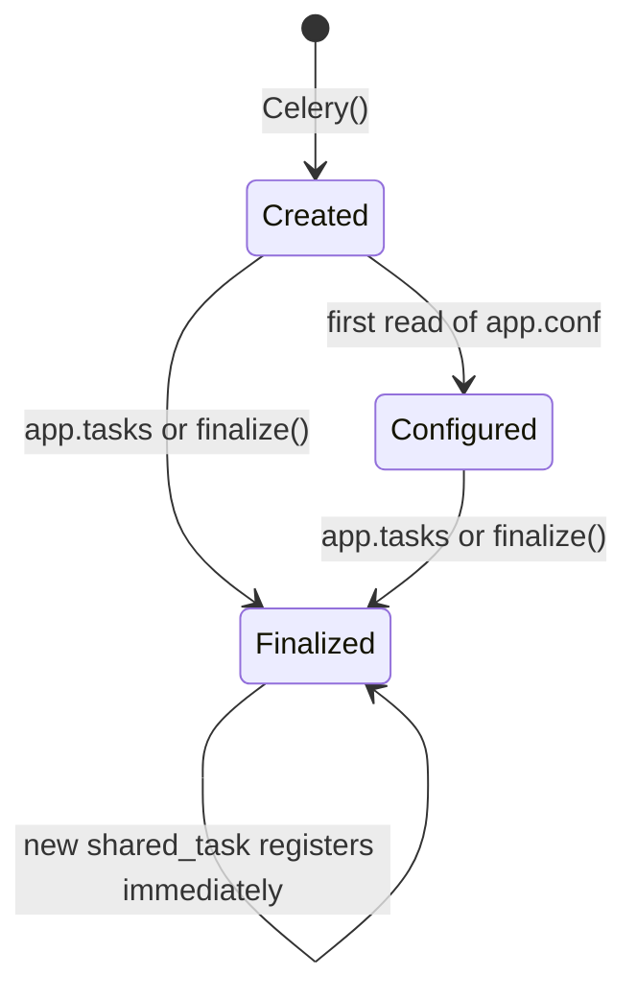

## Overview

Every Celery program starts with a `Celery` instance, the app. It owns the task registry, the configuration, the broker connection and producer pools, and the subsystems that talk to the broker and the result store. Clients, workers, beat and the command line all receive an app and reach everything else through it, which is why several apps can live in one process with different brokers.

Sources: [celery/app/base.py:252-345](repo://celery/app/base.py#L252-L345)

The app is lazy on purpose. Creating it reads no configuration and opens no connection, and decorating functions creates no task classes. Configuration is read on the first access to a setting, and tasks are created when the app is finalized. This page follows those two transitions and the thread-local state that lets code find "the current app" without passing it around. How settings are loaded is on [[Configuration and Loaders]]; what a task class contains is on [[Defining Tasks]].

Sources: [celery/app/base.py:208-250](repo://celery/app/base.py#L208-L250), [celery/app/base.py:657-677](repo://celery/app/base.py#L657-L677)

## Construction

`Celery.__init__` stores class names, not instances, for its collaborators: `amqp_cls` (`celery.app.amqp:AMQP`), `events_cls`, `log_cls`, `control_cls`, `task_cls` and `registry_cls`, plus a loader chosen from the `CELERY_LOADER` environment variable or `celery.loaders.app:AppLoader`. Keyword arguments such as `broker`, `backend` and `include` are not applied directly: `__autoset` writes them into `_preconf` under their setting names (`broker_url`, `result_backend`, `include`) and remembers that they were set automatically.

Sources: [celery/app/base.py:343-399](repo://celery/app/base.py#L343-L399), [celery/app/base.py:436-450](repo://celery/app/base.py#L436-L450)

The constructor then wraps `_preconf` in a `Settings` object whose first layer is a `PendingConfiguration`, instantiates the fix-ups (the Django fix-up is built in), makes the app current for the thread when `set_as_current` is true, creates the four app signals and registers the app in a weak set of live apps.

Sources: [celery/app/base.py:400-434](repo://celery/app/base.py#L400-L434)

| Signal | Sent when |
| --- | --- |
| `on_configure` | Configuration is about to be loaded |
| `on_after_configure` | Settings are loaded; the handler receives `source`, the final settings |
| `on_after_finalize` | Pending task decorators are evaluated and all tasks are bound |
| `on_after_fork` | A child process starts after fork; pools and producers are reset |

Sources: [celery/app/base.py:323-341](repo://celery/app/base.py#L323-L341), [celery/app/base.py:418-427](repo://celery/app/base.py#L418-L427)

## Lazy configuration

`PendingConfiguration` is a dict that accepts writes (`app.conf.update(...)`, `app.conf.x = y`, `setdefault`) into the pre-configuration without loading anything. The first read of a key evaluates its `data` property, which calls `_finalize_pending_conf`. That is why `app.conf.update()` before `config_from_object()` still works: both land in the same pending layer.

Sources: [celery/app/base.py:208-250](repo://celery/app/base.py#L208-L250)

`_load_config` sends `on_configure`, imports `config_source` through the loader, and merges loader configuration with `_preconf` in `detect_settings`, which also decides whether the settings use new lowercase names or old uppercase ones. It swaps the result into the existing `Settings` object in place, so code that kept a reference to `app.conf` sees the loaded values. It then applies pending `add_defaults` callables and pending periodic tasks, and sends `on_after_configure`.

Sources: [celery/app/base.py:1230-1280](repo://celery/app/base.py#L1230-L1280)

## Finalization and the task registry

### Pending decorators and finalize()

`@app.task` normally returns a `PromiseProxy` around `app._task_from_fun` and appends it to `app._pending`. Nothing is created until either the proxy is used or the app is finalized. When `shared=True` (the default) the decorator also registers a constructor with `connect_on_app_finalize`, so every app finalized later gets its own copy of the task.

Sources: [celery/app/base.py:546-585](repo://celery/app/base.py#L546-L585)

`finalize()` runs under `_finalize_mutex`. It marks the app finalized, calls every function registered with `connect_on_app_finalize` (this is how built-in and shared tasks arrive), evaluates the pending proxies in order, binds every task in the registry to the app, and sends `on_after_finalize`. Reading `app.tasks` calls `finalize(auto=True)`; an app created with `autofinalize=False` raises `RuntimeError` instead, which catches code that touches tasks before the app is ready.

Sources: [celery/app/base.py:657-677](repo://celery/app/base.py#L657-L677), [celery/app/base.py:1601-1609](repo://celery/app/base.py#L1601-L1609), [celery/_state.py:43-52](repo://celery/_state.py#L43-L52)

Sources: [celery/app/base.py:657-677](repo://celery/app/base.py#L657-L677), [celery/app/base.py:1564-1570](repo://celery/app/base.py#L1564-L1570)

### Creating and registering task classes

`_task_from_fun` builds the task class with `type()`, using the app's base `Task` class, the function as `run` (a `staticmethod` unless `bind=True`), and a `__header__` signature checker. It stores the single instance in `app._tasks`, binds it and adds autoretry behaviour. A name already in the registry returns the existing task, so importing a module twice does not create two tasks.

Sources: [celery/app/base.py:590-633](repo://celery/app/base.py#L590-L633)

The registry is a `dict` subclass, `TaskRegistry`, whose `__missing__` raises `NotRegistered`. `register` instantiates task classes and refuses ones without a `name`; `unregister` accepts a name or a task.

Sources: [celery/app/registry.py:12-58](repo://celery/app/registry.py#L12-L58)

### Built-in tasks

`celery/app/builtins.py` registers the tasks every app has through `connect_on_app_finalize`: `celery.backend_cleanup` (deletes expired results, scheduled daily by beat when the backend needs it), `celery.accumulate` (used by `Task.replace` with groups), `celery.chord_unlock`, `celery.map`, `celery.starmap`, `celery.chunks`, `celery.group`, `celery.chain` and `celery.chord`. The canvas ones are described on [[Chains, Groups and Chords at Runtime]].

Sources: [celery/app/builtins.py:12-35](repo://celery/app/builtins.py#L12-L35), [celery/app/builtins.py:37-134](repo://celery/app/builtins.py#L37-L134), [celery/app/builtins.py:134-186](repo://celery/app/builtins.py#L134-L186)

### Shared tasks

`shared_task` is for libraries that do not know which app they will run under. It registers a finalizer that adds the task to every future app, adds it at once to every finalized live app, and returns a plain `Proxy` that looks the task up in `current_app.tasks` on each access. `add.app` is therefore whichever app is current where the proxy is used.

Sources: [celery/app/__init__.py:24-76](repo://celery/app/__init__.py#L24-L76)

## Current app and current task

`celery._state` keeps the process-wide state. `_tls.current_app` is thread-local and set by `set_current()`; `default_app` is global and set by `set_default()`. When neither exists, `get_current_app` creates a fallback app named `default` with the default loader. `current_app` and `current_task` are `Proxy` objects over these getters.

Sources: [celery/_state.py:64-141](repo://celery/_state.py#L64-L141)

The task stack is a `LocalStack`. The tracer pushes a task before running it and pops it after, so `current_task` is the innermost running task. `get_current_worker_task` walks the stack from the top and skips tasks whose request says `called_directly`, returning the task the worker actually received. `send_task` uses it to fill `root_id` and `parent_id` for tasks sent from inside a task.

Sources: [celery/_state.py:73-130](repo://celery/_state.py#L73-L130), [celery/app/base.py:1502-1514](repo://celery/app/base.py#L1502-L1514)

Setting `CELERY_TRACE_APP` replaces `app_or_default` with a version that prints a stack trace whenever code falls back to the current or default app; `C_STRICT_APP` makes `get_current_app` raise. Both help find library code that forgets to pass an app.

Sources: [celery/_state.py:107-118](repo://celery/_state.py#L107-L118), [celery/_state.py:163-197](repo://celery/_state.py#L163-L197)

## Proxies

`celery.local.Proxy`, adapted from Werkzeug, forwards attribute access, item access, operators and calls to the object its callable returns, calling it on every access. `PromiseProxy` calls it once, caches the result in `__thing`, drops its arguments, and runs any callbacks queued with `__then__` before evaluation. Task decorators rely on `PromiseProxy`; `current_app` and `shared_task` rely on the re-evaluating `Proxy`.

Sources: [celery/local.py:52-118](repo://celery/local.py#L52-L118), [celery/local.py:282-351](repo://celery/local.py#L282-L351)

## Subsystems created on demand

Most attributes of the app are `cached_property` values built on first use from the stored class names.

Sources: [celery/app/base.py:1534-1600](repo://celery/app/base.py#L1534-L1600)

| Attribute | Built from | Used for |
| --- | --- | --- |
| `amqp` | `amqp_cls` | Queues, router, message creation and publishing ([[Calling Tasks and the Message Protocol]]) |
| `backend` | `result_backend` URL via `backends.by_url` | Storing and reading results ([[Result Backends]]) |
| `control` | `control_cls` | Broadcast commands ([[Remote Control and Inspection]]) |
| `events` | `events_cls` | Event dispatcher and receiver ([[Events and Monitoring]]) |
| `loader` | `loader_cls` | Configuration import and autodiscovery ([[Configuration and Loaders]]) |
| `log` | `log_cls` | Logging set-up for workers and beat |
| `Task`, `AsyncResult`, `GroupResult`, `Worker`, `WorkController`, `Beat` | `subclass_with_self` | Classes bound to this app |

Sources: [celery/app/base.py:1431-1486](repo://celery/app/base.py#L1431-L1486), [celery/app/base.py:1534-1600](repo://celery/app/base.py#L1534-L1600)

`subclass_with_self` creates a subclass whose `app` attribute (or `_app` for `Task`) is this app, so `app.AsyncResult(task_id)` needs no app argument. Unless `keep_reduce` is set, it also gives the class a `__reduce__` that rebuilds it from the current app when unpickled.

Sources: [celery/app/base.py:1335-1377](repo://celery/app/base.py#L1335-L1377)

The backend is cached differently. If the backend class declares `thread_safe`, one instance is shared in `_backend_cache`; otherwise each thread gets its own in `_local.backend`, because clients such as a database session are not safe to share.

Sources: [celery/app/base.py:1539-1562](repo://celery/app/base.py#L1539-L1562), [celery/app/base.py:1224-1228](repo://celery/app/base.py#L1224-L1228)

## Connections and producers

`connection_for_write` and `connection_for_read` build a `kombu.Connection` from `broker_write_url` or `broker_read_url`, which fall back to `broker_url`; this lets a deployment publish to one broker and consume from another. User, password, SSL, heartbeat, failover strategy and transport options come from the matching `broker_*` settings unless passed in.

Sources: [celery/app/base.py:1043-1128](repo://celery/app/base.py#L1043-L1128)

`app.pool` is a kombu connection pool limited by `broker_pool_limit`, and `producer_pool` comes from `app.amqp`. `connection_or_acquire` and `producer_or_acquire` return a `FallbackContext`: it yields the connection or producer the caller passed, or acquires one from the pool and releases it on exit. When the pool is exhausted for `broker_pool_acquire_timeout` seconds, the acquire raises `OperationalError` naming the two settings to raise.

Sources: [celery/app/base.py:1131-1191](repo://celery/app/base.py#L1131-L1191), [celery/app/base.py:1488-1500](repo://celery/app/base.py#L1488-L1500)

Connections must not cross a fork. The first use of `app.pool` registers `_after_fork_cleanup_app`, which clears the connection pool and the producer pool in the child and sends `on_after_fork`.

Sources: [celery/app/base.py:118-125](repo://celery/app/base.py#L118-L125), [celery/app/base.py:460-464](repo://celery/app/base.py#L460-L464), [celery/app/base.py:1282-1288](repo://celery/app/base.py#L1282-L1288)

## Pickling and closing

Apps are pickled when they cross process boundaries. `__reduce__` sends the constructor keywords from `__reduce_keys__` (main module, configuration changes only, collaborator class names, fix-ups, config source, task class, namespace) rather than the whole object, so the default settings never travel. A subclass that overrides `__reduce_args__` keeps the old positional format.

Sources: [celery/app/base.py:1391-1429](repo://celery/app/base.py#L1391-L1429)

`close()` drops the connection pool and removes the app from the live-app set; using the app as a context manager calls it on exit, which matters for apps created dynamically in tests or scripts. `app.start(argv)` runs the `celery` command with this app as the default `-A` value, described on [[Command Line Interface]].

Sources: [celery/app/base.py:466-497](repo://celery/app/base.py#L466-L497), [celery/app/base.py:1382-1386](repo://celery/app/base.py#L1382-L1386)
