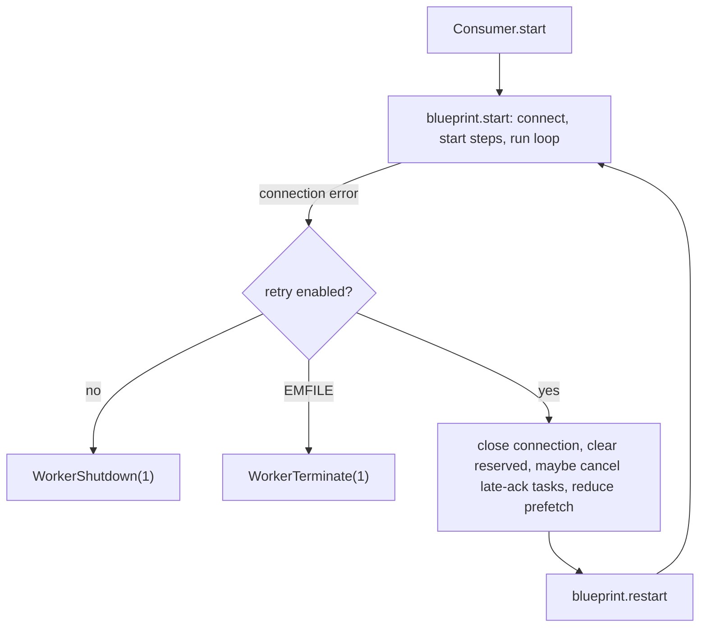

## Overview

The consumer is the part of the worker that talks to the broker. It owns the broker connection, consumes task messages, reserves as many of them as the prefetch count allows, applies rate limits and ETAs, and passes ready requests to the worker, which hands them to the pool. It also hosts the services that share the connection: monitoring events, worker-to-worker sync, heartbeats and remote control. Like the worker, it is a bootstep blueprint ([[Worker Architecture and Bootsteps]]), started by the worker's last step and run until shutdown.

Sources: [celery/worker/consumer/consumer.py:145-256](repo://celery/worker/consumer/consumer.py#L145-L256)

This page covers the consumer blueprint, connection recovery, the event loop, prefetch control and the hand-off for rate-limited and delayed tasks. What happens to a single message once its strategy is called is on [[Task Requests and Strategies]].

Sources: [celery/worker/consumer/consumer.py:723-786](repo://celery/worker/consumer/consumer.py#L723-L786)

## The consumer blueprint

### Steps and start order

`Consumer.Blueprint` lists ten default steps plus any in `app.steps['consumer']`. Each step's `requires` produces this start order, with `Evloop` marked `last`.

Sources: [celery/worker/consumer/consumer.py:170-189](repo://celery/worker/consumer/consumer.py#L170-L189)

| Step | Requires | Included when | Does |
| --- | --- | --- | --- |
| `Connection` | | Always | Opens `c.connection` with `c.connect()` and logs `Connected to ...` |
| `Events` | Connection | Task events, gossip or heartbeat on | Creates `c.event_dispatcher` on a write connection ([[Events and Monitoring]]) |
| `Mingle` | Events | Not `--without-mingle`; amqp, redis or gcpubsub transport | Syncs clock and revoked ids with other workers at start |
| `Gossip` | Mingle | Not `--without-gossip`; amqp or redis | Consumes other workers' events, tracks who is alive, runs elections |
| `Heart` | Events | Not `--without-heartbeat` | Sends `worker-heartbeat` events on the timer |
| `Tasks` | Mingle | Always | Sets QoS and starts the task consumer |
| `Control` | Tasks | `worker_enable_remote_control` and fanout exchanges supported | Starts the pidbox for broadcast commands ([[Remote Control and Inspection]]) |
| `DelayedDelivery` | Tasks | Quorum queues detected | Binds queues for native delayed delivery ([[Routing and Queues]]) |
| `Agent` | Connection | `worker_agent` set | Starts a `cell` actor agent |
| `Evloop` | all (last) | Always | Runs `c.loop(...)` until shutdown |

Sources: [celery/worker/consumer/connection.py:1-45](repo://celery/worker/consumer/connection.py#L1-L45), [celery/worker/consumer/events.py:1-71](repo://celery/worker/consumer/events.py#L1-L71), [celery/worker/consumer/mingle.py:14-31](repo://celery/worker/consumer/mingle.py#L14-L31), [celery/worker/consumer/heart.py:1-36](repo://celery/worker/consumer/heart.py#L1-L36), [celery/worker/consumer/control.py:1-33](repo://celery/worker/consumer/control.py#L1-L33), [celery/worker/consumer/agent.py:1-21](repo://celery/worker/consumer/agent.py#L1-L21), [celery/worker/consumer/consumer.py:857-872](repo://celery/worker/consumer/consumer.py#L857-L872)

### Mingle and gossip

At start, `Mingle` broadcasts an `inspect.hello` with this worker's revoked ids and waits one second for replies. It adjusts the Lamport clock to each neighbour's clock and merges their revoked ids, so a task revoked while this worker was down is still refused. With no replies it logs `mingle: all alone`.

Sources: [celery/worker/consumer/mingle.py:33-76](repo://celery/worker/consumer/mingle.py#L33-L76)

`Gossip` consumes the worker events of the cluster into an events `State`, calls registered handlers on `node_join`, `node_leave` and `node_lost`, and implements a simple leader election: `worker-elect` requests are ordered by Lamport clock, and once every alive worker has acknowledged, the winner runs the elected action (calling a task signature). Starting many workers at once with mingle and gossip adds broadcast traffic, which is why both can be turned off.

Sources: [celery/worker/consumer/gossip.py:22-140](repo://celery/worker/consumer/gossip.py#L22-L140)

## Starting the task consumer

`Tasks.start` runs every time the consumer (re)connects. It calls `update_strategies`, which creates one strategy per registered task with `task.start_strategy(app, consumer)` and builds each task's tracer with `build_tracer`. It then sets the initial prefetch count with `basic_qos`, creates the kombu consumer through `app.amqp.TaskConsumer` over the queues selected for this worker, and wraps prefetch updates in a `QoS` object capped by `worker_eta_task_limit`.

Sources: [celery/worker/consumer/tasks.py:29-83](repo://celery/worker/consumer/tasks.py#L29-L83), [celery/worker/consumer/consumer.py:716-721](repo://celery/worker/consumer/consumer.py#L716-L721)

Whether the prefetch count applies to the channel (`apply_global=True`) depends on the broker. RabbitMQ 3.3 and later redefine `basic.qos` so the global flag is needed; quorum queues do not support global QoS at all, so when they are detected the prefetch count is fixed per consumer and a log line says it is now static.

Sources: [celery/worker/consumer/tasks.py:103-124](repo://celery/worker/consumer/tasks.py#L103-L124)

With `worker_disable_prefetch` on a Redis broker, `Tasks.start` patches the channel's `can_consume` to refuse new messages while the number of reserved requests is at the pool size (or the autoscaler maximum). The worker then takes a message only when it can run it, at the cost of throughput. On other brokers the setting is ignored with a warning.

Sources: [celery/worker/consumer/tasks.py:62-83](repo://celery/worker/consumer/tasks.py#L62-L83)

## Receiving a message

`create_task_handler` returns `on_task_received`, installed as the kombu consumer's `on_message`. For protocol 2 it reads the task name from `message.headers['task']` without decoding the body; for protocol 1 it decodes the body and reads `task` from it. It looks up the strategy for that name and calls it with the message, the decoded payload (protocol 1 only), promises that ack or reject the message, and the `on_task_message` callbacks (used by the autoscaler).

Sources: [celery/worker/consumer/consumer.py:723-786](repo://celery/worker/consumer/consumer.py#L723-L786)

Messages that cannot become requests are handled here, and none are left unacknowledged.

Sources: [celery/worker/consumer/consumer.py:731-786](repo://celery/worker/consumer/consumer.py#L731-L786)

| Case | Handler | Outcome |
| --- | --- | --- |
| Headers missing or body not a task | `on_unknown_message` | Rejected, `task_rejected` signal |
| Task name not registered | `on_unknown_task` | Rejected, result marked `FAILURE` with `NotRegistered`, `task-failed` event, `task_unknown` signal |
| `InvalidTaskError` or a content type not in `accept_content` | `on_invalid_task` | Rejected, `task_rejected` signal |
| Body cannot be decoded | `on_decode_error` | Acknowledged, so it does not loop, and logged as critical |

Sources: [celery/worker/consumer/consumer.py:516-530](repo://celery/worker/consumer/consumer.py#L516-L530), [celery/worker/consumer/consumer.py:665-714](repo://celery/worker/consumer/consumer.py#L665-L714)

The ack and reject promises go through `call_soon_ack`. With the event loop it schedules the call on the hub; without it, it acks at once instead of waiting for the next loop iteration, because a late ack with a prefetch of one would otherwise hold back the next delivery.

Sources: [celery/worker/consumer/consumer.py:257-294](repo://celery/worker/consumer/consumer.py#L257-L294)

## Prefetch and QoS

The prefetch count is how many unacknowledged messages the broker delivers to the worker. It starts at concurrency times `worker_prefetch_multiplier` (4 by default) and changes at run time through `qos.increment_eventually` and `decrement_eventually`; the loop applies a pending change only when no messages are waiting, which groups updates and lets control commands go first.

Sources: [celery/worker/components.py:226-231](repo://celery/worker/components.py#L226-L231), [celery/worker/loops.py:84-95](repo://celery/worker/loops.py#L84-L95)

ETA tasks are why the count moves. A task held for later still occupies a prefetch slot, so the strategy raises the count by one when it schedules an ETA task and `apply_eta_task` lowers it when the task becomes due; otherwise a worker full of future tasks could not receive work it can run now. `worker_eta_task_limit` caps the count to bound the memory used. When the autoscaler resizes the pool, `_update_prefetch_count` recomputes the count from the new number of processes.

Sources: [celery/worker/consumer/consumer.py:305-327](repo://celery/worker/consumer/consumer.py#L305-L327), [celery/worker/consumer/consumer.py:659-663](repo://celery/worker/consumer/consumer.py#L659-L663)

## Rate limits

Each registered task with a `rate_limit` gets a `TokenBucket` with capacity 1 in `task_buckets`; tasks without one get `None`. When the strategy finds a bucket, it calls `_limit_task`, which adds the request to the bucket and drains it: while tokens are available, requests are reserved and sent to the pool; when they run out, the remaining requests stay in order and a timer entry calls the drain again after `bucket.expected_time`. ETA tasks pass through `_limit_post_eta`, which also releases their prefetch slot. `worker_disable_rate_limits` skips buckets entirely, and the `rate_limit` control command replaces a task's bucket at run time.

Sources: [celery/worker/consumer/consumer.py:296-364](repo://celery/worker/consumer/consumer.py#L296-L364)

## The event loops

### Choosing the loop

`Evloop.start` runs `c.loop(*c.loop_args())`, which is `asynloop` when the worker has a hub and `synloop` otherwise.

Sources: [celery/worker/consumer/consumer.py:243-244](repo://celery/worker/consumer/consumer.py#L243-L244), [celery/worker/consumer/consumer.py:511-514](repo://celery/worker/consumer/consumer.py#L511-L514)

### asynloop

`asynloop` creates the message handler, schedules AMQP heartbeat checks on the hub timer at `broker_heartbeat / broker_heartbeat_checkrate`, registers the worker's components and the consumer's steps with the hub (the prefork pool adds its pipes here), starts consuming and calls `on_ready`. On first start it fails with `WorkerLostError` if pool processes did not come up. Each iteration checks the shutdown flags, raises a recorded heartbeat error, applies pending QoS changes and advances the hub's generator one step. On a loop error it resets the hub and clears its timers, so callbacks registered for the dead connection do not fire after reconnecting, and re-raises.

Sources: [celery/worker/loops.py:28-130](repo://celery/worker/loops.py#L28-L130)

### synloop

`synloop` serves transports without asynchronous I/O and the eventlet and gevent pools. Each cycle runs deferred operations from `call_soon`, then blocks in `connection.drain_events(timeout=2.0)`; heartbeats are checked only for green pools. It resets the hub on error as well.

Sources: [celery/worker/loops.py:133-183](repo://celery/worker/loops.py#L133-L183)

## Connection loss and recovery

`Consumer.start` loops while the blueprint is not stopping. Each pass calls `blueprint.start`, which blocks in the event loop. A connection error (and a channel error when `broker_channel_error_retry` is on) ends the pass: if retrying is disabled by `broker_connection_retry_on_startup` (first connection) or `broker_connection_retry` (later), the worker shuts down; `EMFILE` terminates it; otherwise the consumer cleans up and restarts the blueprint. More than five restarts in one second log `Frequent restarts detected` and sleep for a second.

Sources: [celery/worker/consumer/consumer.py:366-413](repo://celery/worker/consumer/consumer.py#L366-L413)

Sources: [celery/worker/consumer/consumer.py:366-413](repo://celery/worker/consumer/consumer.py#L366-L413), [celery/worker/consumer/consumer.py:419-491](repo://celery/worker/consumer/consumer.py#L419-L491)

Cleanup after a lost connection does several things. Delivery tags are tied to the old channel, so unacknowledged work cannot be acknowledged any more: `on_close` clears the semaphore, the rate-limit buckets and every reserved request that has not started. With `worker_cancel_long_running_tasks_on_connection_loss`, running late-ack tasks that were not acknowledged are cancelled, since the broker will redeliver them anyway. With `worker_enable_prefetch_count_reduction`, the prefetch count drops to account for tasks still running and climbs back by one multiplier step per acknowledgement, so the worker does not over-fetch while it is still busy; this is skipped under per-consumer QoS, where the restoration cannot reach the broker.

Sources: [celery/worker/consumer/consumer.py:419-491](repo://celery/worker/consumer/consumer.py#L419-L491), [celery/worker/consumer/consumer.py:532-547](repo://celery/worker/consumer/consumer.py#L532-L547), [celery/worker/consumer/consumer.py:788-815](repo://celery/worker/consumer/consumer.py#L788-L815)

`ensure_connected` retries the connection itself up to `broker_connection_max_retries` times (100 by default), logging each attempt with the next delay and checking for a shutdown request between attempts. A connection with failover alternatives logs a failover instead of a delay.

Sources: [celery/worker/consumer/consumer.py:549-622](repo://celery/worker/consumer/consumer.py#L549-L622)
