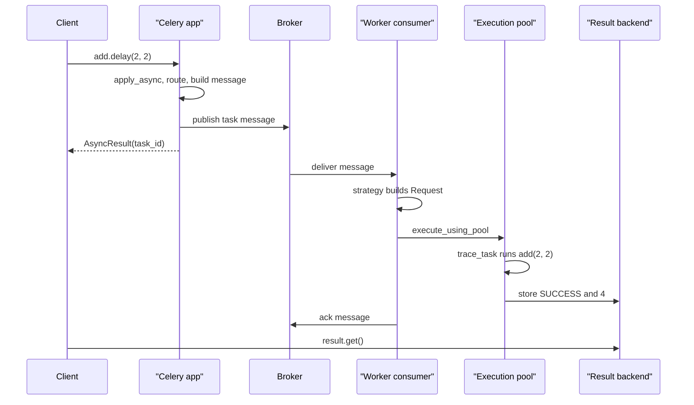

## Overview

Celery is a distributed task queue for Python. A client turns a function call into a message, a broker (RabbitMQ, Redis, SQS and the other transports of the `kombu` library) holds that message in a queue, and worker processes take messages off the queue and run the function. Work spreads over threads, processes and machines, and the client keeps a handle to fetch the return value later. Because the unit of exchange is a documented message rather than a Python object, clients in other languages can publish tasks too.

Sources: [README.rst:91-112](repo://README.rst#L91-L112)

The package exposes its public API lazily from `celery/__init__.py`: `Celery`, `Task`, `shared_task`, `current_app`, `current_task` and the canvas primitives `chain`, `chord`, `chunks`, `group` and `signature`. Importing `celery` does not import the worker, the backends or the pools; each is loaded the first time it is used.

Sources: [celery/__init__.py:1-60](repo://celery/__init__.py#L1-L60)

## Parts of Celery

| Area | What it does | Page |
| --- | --- | --- |
| Application | The `Celery` object: registry of tasks, configuration, connection pools, lazily built subsystems | [[The Celery Application]] |
| Configuration | Defaults, settings objects, loaders and task autodiscovery | [[Configuration and Loaders]] |
| Tasks | The `Task` class, the `@app.task` decorator, retries and handler hooks | [[Defining Tasks]] |
| Calling | `delay`, `apply_async`, `send_task` and the task message protocol | [[Calling Tasks and the Message Protocol]] |
| Routing | Choosing exchange, routing key and queue for each task | [[Routing and Queues]] |
| Worker | The bootsteps that assemble a worker and how it starts and stops | [[Worker Architecture and Bootsteps]], [[Worker Startup and Shutdown]] |
| Consumer | Receiving messages, prefetch, rate limits and the event loop | [[Consumer and Event Loop]] |
| Requests | Turning one message into a `Request`, acknowledgement and revocation | [[Task Requests and Strategies]] |
| Tracing | Running the task function and recording its outcome | [[Task Tracing and Execution]] |
| Pools | prefork, threads, solo, eventlet and gevent concurrency | [[Execution Pools]] |
| Control | Broadcast commands and inspection of live workers | [[Remote Control and Inspection]] |
| Canvas | Signatures, chains, groups, chords and stamping | [[Signatures and Canvas Primitives]], [[Chains, Groups and Chords at Runtime]], [[Canvas Stamping]] |
| Results | `AsyncResult` and the result backends that store outcomes | [[Task Results and AsyncResult]], [[Result Backends]] |
| Beat | Sending tasks on a schedule | [[Periodic Tasks with Beat]], [[Schedules: Intervals, Crontab and Solar]] |
| Monitoring | Task and worker events, and in-process signals | [[Events and Monitoring]], [[Signals]] |
| Operations | The `celery` command, `celery multi`, security, testing and Django | [[Command Line Interface]], [[Running Workers in Production]], [[Message Signing and Serialization Security]], [[Testing Celery Applications]], [[Django Integration]] |

Sources: [celery/app/base.py:252-345](repo://celery/app/base.py#L252-L345), [celery/worker/worker.py:63-87](repo://celery/worker/worker.py#L63-L87)

## The life of a task

Sources: [celery/app/task.py:660-708](repo://celery/app/task.py#L660-L708), [celery/app/base.py:1010-1041](repo://celery/app/base.py#L1010-L1041), [celery/worker/request.py:341-372](repo://celery/worker/request.py#L341-L372)

1. `add.delay(2, 2)` calls `Task.apply_async`, which checks the arguments against the function signature and merges the task's execution options; [[Defining Tasks]] covers those options.
2. `Celery.send_task` asks the router for a destination ([[Routing and Queues]]) and has `AMQP.as_task_v2` build the headers, properties and body of the message ([[Calling Tasks and the Message Protocol]]).
3. The message is published through a pooled producer, and the caller gets an `AsyncResult` holding only the task id ([[Task Results and AsyncResult]]).
4. In the worker, the consumer's event loop receives the message and dispatches it by task name to a strategy ([[Consumer and Event Loop]]).
5. The strategy builds a `Request`, checks revocation and ETA, and passes it to the pool ([[Task Requests and Strategies]]).
6. The pool runs `trace_task` in a child process, thread or green thread ([[Execution Pools]]); the tracer calls the function, handles retries and failures, and runs callbacks ([[Task Tracing and Execution]]).
7. The tracer stores the state and return value in the result backend ([[Result Backends]]), and the request acknowledges the message.

Sources: [celery/app/base.py:950-1041](repo://celery/app/base.py#L950-L1041), [celery/app/amqp.py:326-418](repo://celery/app/amqp.py#L326-L418), [celery/worker/worker.py:223-232](repo://celery/worker/worker.py#L223-L232)

## Design decisions

### Lazy application and task proxies

Nothing about an app is fixed when it is created. `@app.task` returns a `PromiseProxy` and queues it on `app._pending` unless the app is already finalized; `finalize()` evaluates the pending proxies, binds every task, and sends `on_after_finalize`. This lets modules declare tasks at import time before configuration is loaded, and lets `shared_task` attach the same function to every app that is finalized later. [[The Celery Application]] follows the whole process.

Sources: [celery/app/base.py:515-585](repo://celery/app/base.py#L515-L585), [celery/app/base.py:657-677](repo://celery/app/base.py#L657-L677)

### Workers built from bootsteps

The worker is not one class with a fixed start-up sequence. `WorkController.Blueprint` lists components (Hub, Pool, Beat, Timer, StateDB, Consumer, autoscaler) as bootsteps that declare their dependencies, and the blueprint orders and starts them. Users add steps through `app.steps['worker']` without subclassing the worker. [[Worker Architecture and Bootsteps]] explains the model.

Sources: [celery/worker/worker.py:76-140](repo://celery/worker/worker.py#L76-L140)

### A language-neutral message protocol

Protocol version 2 puts everything a worker needs to route, schedule and track a task into message headers (`task`, `id`, `eta`, `expires`, `root_id`, `parent_id`, `timelimit`) and keeps the body as `(args, kwargs, embed)`. A worker can then reject, delay or revoke a task without deserializing its arguments, and non-Python clients can produce valid messages.

Sources: [celery/app/amqp.py:366-418](repo://celery/app/amqp.py#L366-L418)

### Acknowledge early by default

By default a worker acknowledges a message when the pool accepts it, so a task that crashes its process is not delivered again: delivery is at most once. Setting `acks_late` moves the acknowledgement after the task finishes, which redelivers tasks interrupted by a lost worker and suits idempotent tasks. The choice is made per task in `Request.on_accepted` and the success and failure handlers ([[Task Requests and Strategies]]).

Sources: [celery/worker/request.py:515-527](repo://celery/worker/request.py#L515-L527), [celery/worker/request.py:380-387](repo://celery/worker/request.py#L380-L387)

### Pluggable pools and backends

Pools and result backends are named by alias and resolved with `symbol_by_name`, so a worker switches between `prefork`, `threads`, `eventlet`, `gevent` and `solo` with one option, and a result backend is picked from the scheme of `result_backend` (`redis://`, `db+postgresql://`, `s3://`). An environment variable or an entry point adds third-party implementations without changing Celery.

Sources: [celery/concurrency/__init__.py:11-48](repo://celery/concurrency/__init__.py#L11-L48), [celery/app/backends.py:15-69](repo://celery/app/backends.py#L15-L69)
