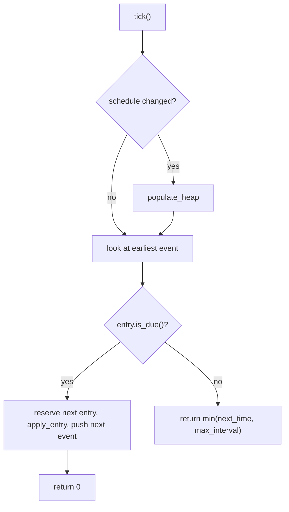

## Overview

Beat is Celery's scheduler process. It keeps a table of entries (a task name, its arguments and options, and a schedule), wakes up when the next entry is due, and sends that task like any client would. Workers run the tasks; beat never executes them. Exactly one beat should run per schedule, because two would send every task twice. This page follows how entries are declared, how the scheduler decides what is due, how the schedule is persisted, and how beat runs as a command or inside a worker. The schedule types themselves (`schedule`, `crontab`, `solar`) are on [[Schedules: Intervals, Crontab and Solar]].

Sources: [celery/beat.py:219-252](repo://celery/beat.py#L219-L252), [celery/beat.py:612-680](repo://celery/beat.py#L612-L680)

## Declaring entries

### The beat_schedule setting

`beat_schedule` maps an entry name to a dict with `task` (the task name), `schedule` (a number of seconds, a `timedelta`, or a schedule object), and optionally `args`, `kwargs`, `options` (passed to `apply_async`) and `relative`. Because beat sends by name, the task does not need to be importable in the beat process.

Sources: [celery/beat.py:82-121](repo://celery/beat.py#L82-L121), [celery/beat.py:399-410](repo://celery/beat.py#L399-L410)

```python
from celery.schedules import crontab

app.conf.beat_schedule = {
    'refresh-feeds-every-5-min': {
        'task': 'feeds.tasks.refresh_all',
        'schedule': 300.0,
    },
    'nightly-report': {
        'task': 'reports.tasks.nightly',
        'schedule': crontab(hour=2, minute=30),
        'args': ('daily',),
        'options': {'queue': 'reports', 'expires': 3600},
    },
}
```

Sources: [celery/beat.py:82-121](repo://celery/beat.py#L82-L121)

### add_periodic_task

`app.add_periodic_task(schedule, sig, args=(), kwargs=(), name=None, **opts)` builds the same entry from a signature: the key is `name` or the signature's repr, and the signature's options are merged with `opts`. When the app is not configured yet, the entry waits in `_pending_periodic_tasks` and is added when configuration loads, which is why it is usually called from an `on_after_configure` handler. Adding a second unnamed entry with the same signature replaces the first and logs a warning; pass `name` to keep both.

Sources: [celery/app/base.py:1295-1333](repo://celery/app/base.py#L1295-L1333), [celery/app/base.py:1270-1274](repo://celery/app/base.py#L1270-L1274)

```python
@app.on_after_configure.connect
def setup_periodic_tasks(sender, **kwargs):
    sender.add_periodic_task(10.0, say.s('hello'), name='add every 10')
```

Sources: [examples/periodic-tasks/myapp.py:50-53](repo://examples/periodic-tasks/myapp.py#L50-L53)

### Arguments evaluated at send time

Arguments are normally fixed when the schedule is loaded. Wrapping a callable in `BeatLazyFunc` defers it: beat calls it each time the entry is sent, so an entry can pass the current time or a fresh value.

Sources: [celery/beat.py:50-80](repo://celery/beat.py#L50-L80), [celery/beat.py:201-216](repo://celery/beat.py#L201-L216)

### Default entries

`install_default_entries` adds `celery.backend_cleanup` at 4 a.m. daily when results expire and the result backend does not expire them itself, unless the schedule already defines it ([[Result Backends]]).

Sources: [celery/beat.py:268-277](repo://celery/beat.py#L268-L277)

## Schedule entries

`ScheduleEntry` holds the name, task, schedule (normalized by `maybe_schedule`), args, kwargs, options, `last_run_at` (defaulting to now) and `total_run_count`. `is_due()` delegates to the schedule with the last run time. After an entry is sent, `next(entry)` returns a new entry with `last_run_at` set to now and the count incremented. Two entries are equal when their editable fields (task, schedule, args, kwargs, options) match, which is how beat notices a changed schedule.

Sources: [celery/beat.py:82-198](repo://celery/beat.py#L82-L198)

## The scheduler loop

### Ticking

`Scheduler.tick()` is one iteration. It keeps a min-heap of `(time, priority, entry)` events, rebuilt by `populate_heap` whenever the schedule differs from the copy it last built from. Each tick looks at the earliest event:

Sources: [celery/beat.py:349-385](repo://celery/beat.py#L349-L385)

1. If its entry is due, it pops the event, replaces the entry with its next instance (`reserve`), sends the task with `apply_entry`, pushes the next event with the delay the schedule returned, and returns 0 so the loop ticks again at once.
2. If not, it returns the time until it is due, minus 10 ms of drift correction, capped at `max_interval`.
3. An empty schedule returns `max_interval`.

Sources: [celery/beat.py:349-385](repo://celery/beat.py#L349-L385), [celery/beat.py:318-336](repo://celery/beat.py#L318-L336)



Sources: [celery/beat.py:349-385](repo://celery/beat.py#L349-L385)

`max_interval` comes from `beat_max_loop_interval` or defaults to 300 seconds, so beat wakes at least every five minutes and picks up schedule changes even when nothing is due. The embedded thread version uses 1 second.

Sources: [celery/beat.py:43-43](repo://celery/beat.py#L43-L43), [celery/beat.py:244-257](repo://celery/beat.py#L244-L257), [celery/beat.py:727-737](repo://celery/beat.py#L727-L737)

### Sending

`apply_async(entry)` evaluates lazy arguments and calls `task.apply_async` with the entry's options when the task is registered in beat's app, or `app.send_task` by name otherwise, over one producer whose connection is retried with `broker_connection_max_retries`. Any error is wrapped in `SchedulingError`, which `apply_entry` logs as `Message Error` without stopping beat, so one broken entry does not stop the others.

Sources: [celery/beat.py:279-292](repo://celery/beat.py#L279-L292), [celery/beat.py:403-425](repo://celery/beat.py#L403-L425), [celery/beat.py:478-497](repo://celery/beat.py#L478-L497)

After each send the scheduler counts tasks since the last sync and calls `sync()` when `sync_every` seconds (180) have passed or `beat_sync_every` tasks have been sent. The base `Scheduler` keeps everything in memory and its `sync` does nothing.

Sources: [celery/beat.py:395-447](repo://celery/beat.py#L395-L447)

`setup_schedule` merges `beat_schedule` into the current schedule with `merge_inplace`: entries no longer configured are removed, existing ones keep their run history but take the new task, schedule, args and options, and new ones are added.

Sources: [celery/beat.py:428-466](repo://celery/beat.py#L428-L466)

## The persistent scheduler

`PersistentScheduler`, the default `beat_scheduler`, stores the entries in a `shelve` file named by `beat_schedule_filename` (`celerybeat-schedule`, with a suffix chosen by the dbm module), so `last_run_at` survives restarts and a restarted beat does not resend tasks that already ran in the current period.

Sources: [celery/beat.py:505-520](repo://celery/beat.py#L505-L520), [celery/app/defaults.py:73-82](repo://celery/app/defaults.py#L73-L82)

On start it opens the file, and deletes and recreates it if it is corrupt or unreadable. It clears the stored entries when the stored `tz` or `utc_enabled` differs from the current configuration, because run times saved under another timezone would be wrong, and when the file predates the fields it now requires. It then merges `beat_schedule`, installs default entries, records version, timezone and UTC flag, and syncs. `sync` flushes the shelf; `close` syncs and closes it.

Sources: [celery/beat.py:526-610](repo://celery/beat.py#L526-L610)

Other schedulers plug in through `beat_scheduler` or `-S`, as a dotted class path or a name registered under the `celery.beat_schedulers` entry point; a database-backed scheduler such as django-celery-beat replaces the shelve file with tables that can be edited at run time.

Sources: [celery/beat.py:663-673](repo://celery/beat.py#L663-L673)

## Running beat

### The service

`beat.Service` owns a scheduler and the loop. `start()` sends `beat_init` (and `beat_embedded_init` inside a worker), then repeatedly calls `tick()` and sleeps for the returned interval, syncing when due. `KeyboardInterrupt` or `SystemExit` ends the loop, and `sync()` closes the scheduler, saving the schedule. `stop()` sets the shutdown flag and can wait for the loop to finish.

Sources: [celery/beat.py:612-680](repo://celery/beat.py#L612-L680)

### The celery beat command

`celery beat` accepts `-s/--schedule`, `-S/--scheduler`, `--max-interval`, `-l/--loglevel` (`WARNING` by default), `--detach` and the daemon options, plus `key=value` configuration after `--`. It builds `app.Beat`, which runs the loader's worker initialization (importing task modules), finalizes the app, creates the pidfile lock, prints a banner with the broker, scheduler, schedule file and maximum interval, sets up logging and a default socket timeout of 30 seconds, and installs handlers so `SIGTERM` and `SIGINT` save the schedule before exiting.

Sources: [celery/bin/beat.py:1-72](repo://celery/bin/beat.py#L1-L72), [celery/apps/beat.py:40-100](repo://celery/apps/beat.py#L40-L100), [celery/apps/beat.py:101-160](repo://celery/apps/beat.py#L101-L160)

```bash
celery -A proj beat -l INFO
celery -A proj beat -s /var/run/celery/beat-schedule --detach --pidfile=/var/run/celery/beat.pid
```

Sources: [celery/bin/beat.py:9-38](repo://celery/bin/beat.py#L9-L38)

### Embedded beat

`celery worker -B` adds the worker's `Beat` bootstep, which creates an `EmbeddedService`: a child process (`_Process`) when multiprocessing is available, otherwise a daemon thread (`_Threaded`). The child resets signal handlers, closes inherited file descriptors except the standard streams and log files, makes the app current, and starts the service. Embedded beat is refused with eventlet and gevent pools. It is convenient for development, but in production one dedicated beat process avoids running a scheduler in every worker started with `-B`.

Sources: [celery/beat.py:682-737](repo://celery/beat.py#L682-L737), [celery/worker/components.py:181-205](repo://celery/worker/components.py#L181-L205)
