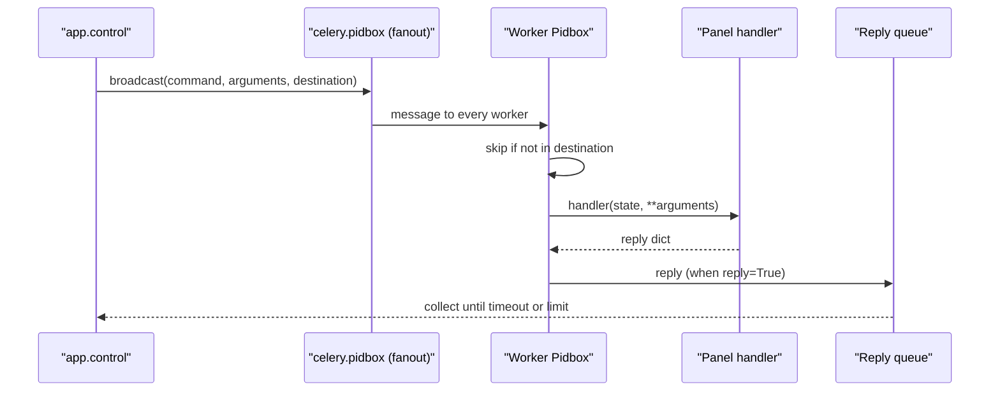

## Overview

Running workers can be inspected and commanded over the broker. A client publishes a command to a fanout exchange; every worker (or the ones named as destination) runs the matching handler and, when asked, sends a reply to the client's reply queue. Clients use `app.control` for commands that change a worker (revoke a task, change a rate limit, add a queue, shut down) and `app.control.inspect()` for read-only queries (active tasks, reserved tasks, statistics). The `celery control`, `celery inspect` and `celery status` commands wrap the same API. The monitoring event stream, which is one-way and continuous, is on [[Events and Monitoring]].

Sources: [celery/app/control.py:426-460](repo://celery/app/control.py#L426-L460), [celery/worker/control.py:1-77](repo://celery/worker/control.py#L1-L77)

## The broadcast path



Sources: [celery/app/control.py:755-790](repo://celery/app/control.py#L755-L790), [celery/worker/pidbox.py:17-44](repo://celery/worker/pidbox.py#L17-L44)

`Control.__init__` creates a kombu `Mailbox` on `control_exchange` (named `celery` by default) of type `fanout`, using the app's accepted content and task serializer and the app's producer pool. The queue options come from the `control_queue_*` settings: per-worker queues are exclusive and non-durable by default, messages live 300 seconds and idle queues expire after 10. Durable and exclusive together is refused, because RabbitMQ deletes exclusive queues. The producer pool is dropped after fork so a child does not reuse the parent's connections.

Sources: [celery/app/control.py:426-456](repo://celery/app/control.py#L426-L456), [celery/app/defaults.py:151-157](repo://celery/app/defaults.py#L151-L157)

`broadcast(command, arguments, destination, reply, timeout, limit, callback, pattern, matcher)` acquires a connection and calls the mailbox's `_broadcast`. With `reply=True` it waits up to `timeout` seconds (1 by default) or until `limit` replies arrive, calling `callback` for each one as it arrives, and returns a list of `{node: reply}` dicts. A `pattern` with a `matcher` selects workers by node-name pattern instead of an explicit list.

Sources: [celery/app/control.py:755-790](repo://celery/app/control.py#L755-L790)

## Control commands from the client

`Control` has a method per common command, each a thin wrapper around `broadcast`.

Sources: [celery/app/control.py:488-560](repo://celery/app/control.py#L488-L560)

| Method | Worker effect |
| --- | --- |
| `revoke(task_id, terminate=False, signal='TERM')` | Adds ids to the revoked set; optionally kills running jobs |
| `terminate(task_id, signal)` | `revoke` with `terminate=True` |
| `revoke_by_stamped_headers(headers, terminate)` | Revokes by stamp values, then revokes the matched ids |
| `rate_limit(task_name, '10/m')` | Sets the task's rate limit and rebuilds token buckets |
| `time_limit(task_name, soft, hard)` | Changes the task's time limits |
| `add_consumer(queue, ...)`, `cancel_consumer(queue)` | Starts or stops consuming from a queue |
| `pool_grow(n)`, `pool_shrink(n)`, `autoscale(max, min)` | Resizes the pool |
| `pool_restart(modules, reload)` | Re-imports modules and restarts the pool, if `worker_pool_restarts` is on |
| `enable_events()`, `disable_events()` | Turns task events on or off |
| `heartbeat()` | Sends an immediate worker heartbeat event |
| `ping()` | Replies `pong` |
| `shutdown()` | Warm shutdown |
| `purge()` | Not a broadcast: deletes waiting messages from the task queues |

Sources: [celery/app/control.py:462-560](repo://celery/app/control.py#L462-L560), [celery/app/control.py:560-660](repo://celery/app/control.py#L560-L660), [celery/app/control.py:660-753](repo://celery/app/control.py#L660-L753)

`revoke_by_stamped_headers` makes two round trips: the workers mark the stamps as revoked and report the ids of matching tasks they know, and the client then sends a normal `revoke` for those ids so workers that only see the id later also refuse them.

Sources: [celery/app/control.py:512-546](repo://celery/app/control.py#L512-L546)

## Inspect queries

`app.control.inspect(destination=None, timeout=1.0, ...)` returns an `Inspect` bound to the app. Each method calls `_request`, which broadcasts with `reply=True` and flattens the list of replies into one dict keyed by node name. When the destination is a single node name, only that node's reply is returned. `flatten_reply` warns when two replies come from the same node name, because duplicate names break control and inspection.

Sources: [celery/app/control.py:38-117](repo://celery/app/control.py#L38-L117)

| Method | Returns per worker |
| --- | --- |
| `active(safe=None)` | Requests running now |
| `reserved()` | Requests received but not started, excluding ETA tasks |
| `scheduled()` | ETA tasks waiting on the timer, with their ETA and priority |
| `revoked()` | Revoked ids in memory |
| `registered(*attrs)` | Registered task names, with optional attributes such as `rate_limit` |
| `stats()` | Pool info, prefetch count, broker, totals, rusage, uptime |
| `active_queues()` | Queues being consumed |
| `query_task(*ids)` | State (`active`, `reserved`, `ready`) and info of given ids |
| `conf(with_defaults)` | The worker's settings, with secrets masked |
| `ping()`, `clock()`, `report()` | Liveness, Lamport clock, bug report text |
| `memsample()`, `memdump()`, `objgraph()` | Memory diagnostics |

Sources: [celery/app/control.py:119-238](repo://celery/app/control.py#L119-L238), [celery/app/control.py:241-360](repo://celery/app/control.py#L241-L360), [celery/app/control.py:361-424](repo://celery/app/control.py#L361-L424)

```python
i = app.control.inspect(timeout=2.0)
for node, tasks in (i.active() or {}).items():
    for task in tasks:
        print(node, task['name'], task['id'], task['time_start'])
```

Sources: [celery/app/control.py:138-151](repo://celery/app/control.py#L138-L151), [celery/worker/request.py:742-754](repo://celery/worker/request.py#L742-L754)

## The worker side

### Pidbox

The consumer's `Control` bootstep, included when `worker_enable_remote_control` is on and the transport supports fanout exchanges, creates a `Pidbox` (or `gPidbox` for eventlet and gevent). The pidbox is a kombu mailbox `Node` named after the worker, with `Panel.data` as its handlers and a state object holding the app, the hostname, the consumer, and a set factory (`tset`). On start it opens a channel on the consumer's connection and listens; each message forwards the Lamport clock and is dispatched by the node, which checks the destination, calls the handler and sends the reply. An unknown command logs `No such control command`, and any other error resets the channel.

Sources: [celery/worker/consumer/control.py:17-33](repo://celery/worker/consumer/control.py#L17-L33), [celery/worker/pidbox.py:17-73](repo://celery/worker/pidbox.py#L17-L73)

`gPidbox` runs the mailbox in a green thread with its own connection and a one-second drain loop, because the green pools use the synchronous loop and would otherwise not read control messages while tasks run.

Sources: [celery/worker/pidbox.py:76-126](repo://celery/worker/pidbox.py#L76-L126)

### The command registry

`Panel` is a global registry of handlers. `@control_command(...)` and `@inspect_command(...)` register a function under its name (and an optional `alias`) with metadata: the type, whether it is visible, a default timeout, help text, a signature string, typed positional `args`, and a `variadic` argument name. The CLI uses this metadata to parse arguments and list commands. Handlers receive the state object and return a value, by convention `{'ok': ...}` or `{'error': ...}`.

Sources: [celery/worker/control.py:24-76](repo://celery/worker/control.py#L24-L76)

Custom commands are added the same way, in a module the worker imports.

Sources: [celery/worker/control.py:69-76](repo://celery/worker/control.py#L69-L76)

```python
from celery.worker.control import control_command


@control_command(args=[('n', int)], signature='[N=1]')
def increase_prefetch_count(state, n=1):
    state.consumer.qos.increment_eventually(n)
    return {'ok': 'prefetch count incremented'}
```

Sources: [celery/worker/control.py:40-76](repo://celery/worker/control.py#L40-L76)

### What the main handlers do

`revoke` adds the ids to `worker_state.revoked`, marks each as `REVOKED` in the result backend (logging a warning if that fails), and with `terminate` finds the matching requests and calls `request.terminate(pool, signal)`. A revoke reaches only workers that are running; revoked ids are kept in memory, merged into new workers by Mingle, and saved with `--statedb` ([[Worker Startup and Shutdown]]).

Sources: [celery/worker/control.py:134-243](repo://celery/worker/control.py#L134-L243)

`rate_limit` validates the rate string, sets it on the task, and calls `consumer.reset_rate_limits()`; an empty rate disables the limit. `pool_restart` calls `controller.reload` and needs `worker_pool_restarts`; `autoscale` needs `--autoscale`; `shutdown` raises `WorkerShutdown(0)` inside the worker. `add_consumer` and `cancel_consumer` call the consumer's queue methods described on [[Routing and Queues]].

Sources: [celery/worker/control.py:255-293](repo://celery/worker/control.py#L255-L293), [celery/worker/control.py:569-629](repo://celery/worker/control.py#L569-L629)

`active`, `reserved` and `scheduled` read the worker state tables and the timer: `reserved` subtracts active requests from reserved ones, and `scheduled` walks the timer queue for entries whose first argument is a `Request`. `stats` returns `WorkController.stats()`. `hello` is the hidden command Mingle uses to exchange clocks and revoked ids.

Sources: [celery/worker/control.py:381-455](repo://celery/worker/control.py#L381-L455)

## Command-line interface

`celery inspect COMMAND [args]` and `celery control COMMAND [args]` check that the command exists and is of the right type, convert positional arguments with the registered `args` types (collecting the rest into the `variadic` argument), and broadcast with `-t/--timeout` and `-d/--destination`. Replies print as they arrive, or once as JSON with `--json`. No reply within the timeout exits with `EX_UNAVAILABLE` and `No nodes replied within time constraint`. `celery status` pings all workers and lists those that answered.

Sources: [celery/bin/control.py:20-46](repo://celery/bin/control.py#L20-L46), [celery/bin/control.py:85-178](repo://celery/bin/control.py#L85-L178), [celery/bin/control.py:179-262](repo://celery/bin/control.py#L179-L262)

```bash
celery -A proj inspect active
celery -A proj inspect registered rate_limit
celery -A proj control rate_limit tasks.add 10/m
celery -A proj control -d w1@host revoke 2f8e...
celery -A proj status
```

Sources: [celery/bin/control.py:150-262](repo://celery/bin/control.py#L150-L262)
