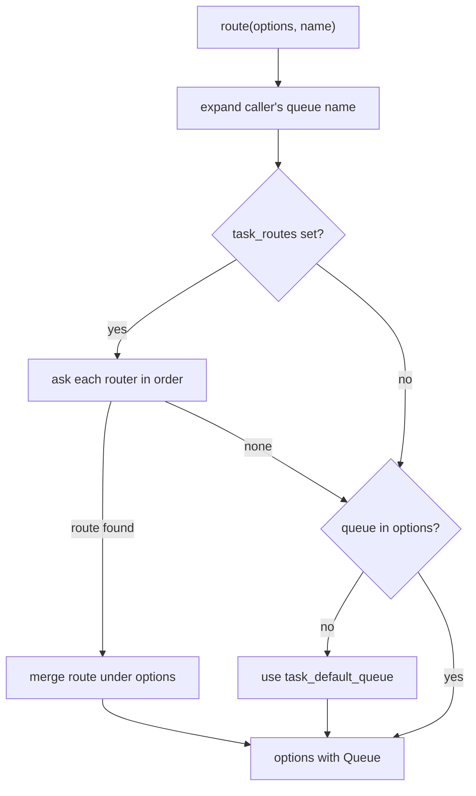

## Overview

Routing decides where a task message goes: which exchange, which routing key, and therefore which queue and which workers. On the sending side `Celery.send_task` asks the app's `Router` for the destination; on the worker side the same queue table decides what the worker consumes. Both sides read `app.amqp.queues`, so a client and a worker sharing configuration agree on queue names, exchanges and arguments. This page covers the router, the queue table, how workers choose queues, and native delayed delivery on RabbitMQ quorum queues. Building the message itself is on [[Calling Tasks and the Message Protocol]].

Sources: [celery/app/base.py:934-935](repo://celery/app/base.py#L934-L935), [celery/app/amqp.py:273-312](repo://celery/app/amqp.py#L273-L312)

## The router

`app.amqp.router` is a `Router` built from the prepared `task_routes` setting, the queue table and `task_create_missing_queues`. When `task_routes` changes at run time, a configuration listener re-prepares the routes and builds a new router.

Sources: [celery/app/amqp.py:308-315](repo://celery/app/amqp.py#L308-L315), [celery/app/amqp.py:620-662](repo://celery/app/amqp.py#L620-L662)

`Router.route(options, name, args, kwargs, task_type)` runs in three steps.

Sources: [celery/app/routes.py:66-76](repo://celery/app/routes.py#L66-L76)

1. `expand_destination(options)` turns a `queue` given by the caller into its `kombu.Queue` from the table.
2. If routes are configured, `lookup_route` asks each router in order and stops at the first that returns a route; the route is expanded the same way and merged under the caller's options with `lpmerge`, so explicit options win but `None` values do not override.
3. If no `queue` is set yet, the `task_default_queue` (`celery` by default) is used.

Sources: [celery/app/routes.py:56-111](repo://celery/app/routes.py#L56-L111)



Sources: [celery/app/routes.py:66-104](repo://celery/app/routes.py#L66-L104)

A queue name not in the table raises `QueueNotFound` from `expand_destination`, unless missing queues are created automatically, which is the default.

Sources: [celery/app/routes.py:78-96](repo://celery/app/routes.py#L78-L96), [celery/app/amqp.py:99-102](repo://celery/app/amqp.py#L99-L102)

## Writing task_routes

`prepare` accepts a single route or a list, and expands each entry: a dict or a list of pairs becomes a `MapRoute`, a string is a dotted path to a router imported lazily on first use, and anything else is used as a callable.

Sources: [celery/app/routes.py:114-136](repo://celery/app/routes.py#L114-L136)

`MapRoute` matches exact task names first, then patterns in insertion order. Keys containing `*` are glob patterns translated with `fnmatch`; compiled `re.Pattern` keys are used as they are. A value may be a dict of options or a bare queue name.

Sources: [celery/app/routes.py:26-53](repo://celery/app/routes.py#L26-L53)

```python
import re

app.conf.task_routes = {
    'feeds.tasks.import_feed': {'queue': 'feeds'},
    'media.*': 'media',
    re.compile(r'(video|image)\.tasks\..*'): {'queue': 'media', 'priority': 5},
}
```

Sources: [celery/app/routes.py:29-53](repo://celery/app/routes.py#L29-L53)

A router function receives `(name, args, kwargs, options, task=task_type)` and returns a route or `None` to pass. Because it sees the arguments, it can route by content, for example sending large jobs to a dedicated queue. Classes with a pre-4.0 `route_for_task` method are still called that way.

Sources: [celery/app/routes.py:106-119](repo://celery/app/routes.py#L106-L119)

```python
def route_task(name, args, kwargs, options, task=None, **kw):
    if name.startswith('reports.') and kwargs.get('size') == 'large':
        return {'queue': 'reports-large'}
    return None

app.conf.task_routes = (route_task,)
```

Sources: [celery/app/routes.py:98-111](repo://celery/app/routes.py#L98-L111)

## The queue table

`app.amqp.queues` is a `Queues` dict of name to `kombu.Queue`, built from `task_queues`. When `task_queues` is empty, it holds one queue named `task_default_queue` on the default exchange (named after the queue, type `direct`) with routing key `task_default_routing_key`; with `task_default_queue_type='quorum'` that queue is declared with `x-queue-type: quorum`.

Sources: [celery/app/amqp.py:273-306](repo://celery/app/amqp.py#L273-L306), [celery/app/utils.py:114-127](repo://celery/app/utils.py#L114-L127)

Adding a queue fills in what it lacks: the default exchange when it has none, the default routing key, and `x-max-priority` from `task_queue_max_priority` when set. Queues may also be given as dicts in the old format, where `binding_key` is accepted as the routing key and the queue name is the fallback.

Sources: [celery/app/amqp.py:104-146](repo://celery/app/amqp.py#L104-L146)

`__missing__` creates unknown queues when `create_missing` is true: `new_missing` makes a queue with an exchange and routing key of the same name. `task_create_missing_queue_type` sets `classic` or `quorum` (anything else raises `ValueError`), and `task_create_missing_queue_exchange_type` sets the exchange type. Disabling `task_create_missing_queues` turns typos in queue names into errors.

Sources: [celery/app/amqp.py:99-102](repo://celery/app/amqp.py#L99-L102), [celery/app/amqp.py:201-217](repo://celery/app/amqp.py#L201-L217)

```python
from kombu import Exchange, Queue

app.conf.task_queues = (
    Queue('default', routing_key='task.#'),
    Queue('feeds', Exchange('feeds', type='direct'), routing_key='feeds'),
    Queue('critical', queue_arguments={'x-queue-type': 'quorum'}),
)
app.conf.task_default_queue = 'default'
```

Sources: [celery/app/amqp.py:63-84](repo://celery/app/amqp.py#L63-L84)

When the message is published, the sender turns a direct-exchange destination without an explicit exchange into a publish to the anonymous exchange with the queue name as routing key; [[Calling Tasks and the Message Protocol]] covers that final step.

Sources: [celery/app/amqp.py:517-547](repo://celery/app/amqp.py#L517-L547)

## Choosing what a worker consumes

`Queues` separates queues the app knows about (for routing) from queues a worker consumes. By default it consumes every queue in the table at start. `celery worker -Q a,b` calls `select`, which narrows consumption to those queues (creating them if allowed), and `-X c` calls `deselect` to drop queues from whichever set is active. An unknown name in either option raises `ImproperlyConfigured`.

Sources: [celery/app/amqp.py:159-199](repo://celery/app/amqp.py#L159-L199), [celery/app/amqp.py:218-222](repo://celery/app/amqp.py#L218-L222), [celery/worker/worker.py:167-181](repo://celery/worker/worker.py#L167-L181)

With `worker_direct`, each worker also consumes a queue named after its node name, bound to the `C.dq2` exchange, so a client can address one worker by routing to `w1@host.dq2`. At run time, the `add_consumer` and `cancel_consumer` control commands call `add_task_queue` and `cancel_task_queue` on the consumer, which use `select_add` and `deselect` and start or stop the kombu consumer for that queue ([[Remote Control and Inspection]]).

Sources: [celery/utils/nodenames.py:38-53](repo://celery/utils/nodenames.py#L38-L53), [celery/worker/consumer/consumer.py:632-657](repo://celery/worker/consumer/consumer.py#L632-L657)

`app.amqp.TaskConsumer` builds the kombu `Consumer` the worker uses, over the queues in `consume_from` and with `accept_content` as the list of content types it will decode.

Sources: [celery/app/amqp.py:317-324](repo://celery/app/amqp.py#L317-L324)

## Native delayed delivery on quorum queues

### Why and when it is used

A task with an ETA is normally held in worker memory until it is due, which needs the broker to let a worker keep many unacknowledged messages. RabbitMQ quorum queues do not support the global QoS this relies on, so Celery uses kombu's native delayed delivery instead: the broker holds the message in a set of delay queues and moves it to the target queue when it is due.

Sources: [celery/worker/consumer/delayed_delivery.py:1-64](repo://celery/worker/consumer/delayed_delivery.py#L1-L64)

`detect_quorum_queues` turns the feature on. It returns true only for the `amqp` transport and only when a queue in the table has `x-queue-type: quorum`, along with the first such queue's name.

Sources: [celery/utils/quorum_queues.py:4-20](repo://celery/utils/quorum_queues.py#L4-L20)

### Sending side

In `send_task`, when a task has an `eta` or `countdown` and quorum queues are detected, the ETA is converted to whole seconds of countdown. If it is positive, `calculate_routing_key` encodes the delay into the routing key, and the message is sent to the `celery_delayed_27` topic exchange in place of its queue. This needs the destination's exchange to be a topic or fanout exchange: for a direct exchange Celery logs a warning and sends the message normally, and the worker may then hold the ETA task in memory.

Sources: [celery/app/base.py:937-970](repo://celery/app/base.py#L937-L970)

### Worker side

The `DelayedDelivery` consumer bootstep, included only when `detect_quorum_queues` is true, validates `broker_native_delayed_delivery_queue_type` (`quorum` by default, or `classic`) and the broker URLs, which may be a list or a `;`-separated string. For each URL it declares the delay exchanges and queues and binds every non-broadcast application queue to the delivery exchange, retrying up to 3 times on connection errors. A failure for one URL is logged and the others are still tried; failing for all of them logs a critical error and leaves the feature off.

Sources: [celery/worker/consumer/delayed_delivery.py:66-150](repo://celery/worker/consumer/delayed_delivery.py#L66-L150), [celery/worker/consumer/delayed_delivery.py:152-199](repo://celery/worker/consumer/delayed_delivery.py#L152-L199), [celery/worker/consumer/delayed_delivery.py:216-279](repo://celery/worker/consumer/delayed_delivery.py#L216-L279)

The step requires the `Tasks` step, so queues are known before binding. [[Consumer and Event Loop]] describes the consumer blueprint it belongs to.

Sources: [celery/worker/consumer/delayed_delivery.py:39-53](repo://celery/worker/consumer/delayed_delivery.py#L39-L53)
