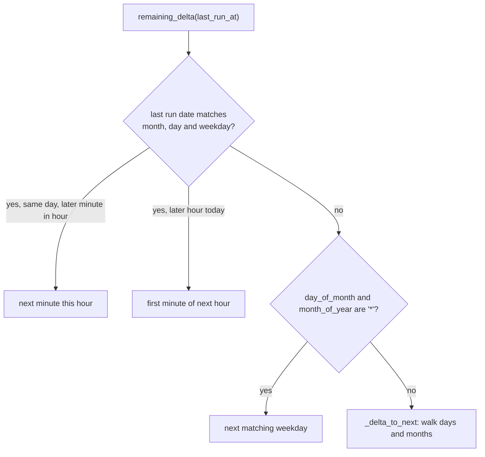

## Overview

A schedule answers one question for beat: given when an entry last ran, is it due now, and if not, how long until it should be checked again? `celery.schedules` provides three answers: `schedule` for fixed intervals, `crontab` for calendar rules in cron syntax, and `solar` for sunrise, sunset and similar events at a location. Each is attached to a beat entry's `schedule` field and called by the scheduler on every tick ([[Periodic Tasks with Beat]]). Custom schedules implement the same small interface.

Sources: [celery/schedules.py:65-110](repo://celery/schedules.py#L65-L110)

## The schedule interface

### is_due and remaining_estimate

`BaseSchedule` defines two methods. `remaining_estimate(last_run_at)` returns a `timedelta` until the next run. `is_due(last_run_at)` returns a `schedstate(is_due, next)` named tuple: `(True, n)` means "run now and check again in `n` seconds", and `(False, n)` means "not yet, check again in `n` seconds". Beat sleeps for the returned `n` but never longer than its `max_interval`, so a schedule's `next` value sets the precision only within that bound.

Sources: [celery/schedules.py:65-80](repo://celery/schedules.py#L65-L80), [celery/schedules.py:134-170](repo://celery/schedules.py#L134-L170)

### Time and timezones

`now()` uses the schedule's `nowfun` if given, else `app.now()`, which is timezone-aware. `maybe_make_aware` attaches the app's timezone (`timezone` setting, UTC when `enable_utc` is on) to naive datetimes, and `remaining` in `celery.utils.time` computes differences in UTC so daylight-saving changes do not shift interval schedules. Setting the environment variable `C_REMDEBUG` prints every remaining-time calculation, which helps when a schedule fires at unexpected times.

Sources: [celery/schedules.py:65-110](repo://celery/schedules.py#L65-L110), [celery/utils/time.py:214-250](repo://celery/utils/time.py#L214-L250)

### Normalization

`maybe_schedule(value, relative, app)` turns what users write into schedule objects: numbers become seconds, `timedelta`s become `schedule` instances, and schedule objects get the app attached. Beat calls it for every entry, which is why `'schedule': 30.0` works in `beat_schedule`.

Sources: [celery/schedules.py:703-714](repo://celery/schedules.py#L703-L714), [celery/beat.py:101-113](repo://celery/beat.py#L101-L113)

## Interval schedules

`schedule(run_every, relative=False)` runs every `run_every` (seconds or a `timedelta`). `is_due` computes the time remaining from `last_run_at`: when nothing remains it answers `(True, run_every)`, otherwise `(False, remaining)`. Because the next run is counted from the last run rather than from a fixed clock, a slow beat or a late tick shifts all later runs.

Sources: [celery/schedules.py:111-192](repo://celery/schedules.py#L111-L192)

With `relative=True`, the end time is rounded to the resolution of the interval (to the minute for intervals of minutes, to the hour for hours), so `schedule(timedelta(hours=1), relative=True)` runs on the hour rather than one hour after beat started.

Sources: [celery/utils/time.py:214-237](repo://celery/utils/time.py#L214-L237)

## Crontab schedules

### Fields

`crontab(minute='*', hour='*', day_of_week='*', day_of_month='*', month_of_year='*')` takes the five cron fields. Each field accepts an integer, a set or iterable of integers, or a string pattern, and is expanded once at construction into a set of values: minutes 0–59, hours 0–23, days of the week 0–6 with Sunday as 0, days of the month 1–31, and months 1–12. A string is parsed by `crontab_parser`; other types are converted directly, and anything else raises `TypeError`.

Sources: [celery/schedules.py:323-415](repo://celery/schedules.py#L323-L415), [celery/schedules.py:433-479](repo://celery/schedules.py#L433-L479)

| Pattern | Meaning |
| --- | --- |
| `*` | Every value |
| `5` | A single value |
| `1,15,30` | A list |
| `9-17` | A range; a range whose end is lower wraps around (`22-2` for hours) |
| `*/15` | Every 15th value from the minimum |
| `8-18/2` | Every 2nd value in the range |
| `mon-fri`, `jan` | Day and month names, matched on their first three letters |

Sources: [celery/schedules.py:196-235](repo://celery/schedules.py#L196-L235), [celery/schedules.py:236-321](repo://celery/schedules.py#L236-L321), [celery/utils/time.py:263-275](repo://celery/utils/time.py#L263-L275)

`crontab_parser(max_, min_)` splits the string on commas, matches each part against range-with-step, range, star-with-step and star patterns, and expands numbers or names. Negative numbers, empty parts, empty steps and values outside the field's range raise `ParseException` or `ValueError` when the crontab is created, not when it runs.

Sources: [celery/schedules.py:236-321](repo://celery/schedules.py#L236-L321)

`crontab.from_string('30 2 * * mon-fri')` accepts the five fields in cron order (minute, hour, day of month, month, day of week); note that the keyword order of the constructor differs.

Sources: [celery/schedules.py:416-431](repo://celery/schedules.py#L416-L431)

```python
from celery.schedules import crontab

crontab()                                   # every minute
crontab(minute=0, hour='*/3')               # every three hours, on the hour
crontab(minute=30, hour=2, day_of_week='mon-fri')
crontab(0, 0, day_of_month='1', month_of_year='*/3')   # first day of each quarter
crontab.from_string('*/15 9-17 * * 1-5')
```

Sources: [celery/schedules.py:401-431](repo://celery/schedules.py#L401-L431)

A day must match all three day fields at once: with `day_of_week=1` and `day_of_month='1-7'`, the entry runs on the first Monday of the month only. And `day_of_week='*/2'` means days whose number is divisible by two, not every other day.

Sources: [celery/schedules.py:345-389](repo://celery/schedules.py#L345-L389)

### Finding the next run

`remaining_delta` computes the next matching time from `last_run_at` with a fast-forward helper (`ffwd`): the next matching minute in the same hour if there is one, else the first minute of the next matching hour today, else the first matching day. When both day-of-month and month are `*`, the next day is found by weekday; otherwise `_delta_to_next` walks forward through days and months, handling short months and year roll-over. `is_due` reports due when the remaining time is zero or negative and then returns the time until the following match.

Sources: [celery/schedules.py:572-639](repo://celery/schedules.py#L572-L639), [celery/schedules.py:480-555](repo://celery/schedules.py#L480-L555)



Sources: [celery/schedules.py:572-628](repo://celery/schedules.py#L572-L628)

### Missed runs and the starting deadline

When beat was down across one or more matching times, the stored `last_run_at` is old and the crontab is overdue, so by default the entry runs once as soon as beat starts. `beat_cron_starting_deadline` (seconds) limits this: `is_due` steps forward through the missed matches, and if the latest one is older than the deadline, the entry is not run and the next match is used instead.

Sources: [celery/schedules.py:641-688](repo://celery/schedules.py#L641-L688), [celery/app/defaults.py:73-82](repo://celery/app/defaults.py#L73-L82)

## Solar schedules

`solar(event, lat, lon)` runs at a solar event at a location, computed with the `ephem` package (installed with the `celery[solar]` extra). The event, latitude (−90 to 90) and longitude (−180 to 180) are validated at construction.

Sources: [celery/schedules.py:717-818](repo://celery/schedules.py#L717-L818)

| Event | Sun position | Method |
| --- | --- | --- |
| `dawn_astronomical`, `dawn_nautical`, `dawn_civil` | Centre 18°, 12°, 6° below the horizon, rising | `next_rising` |
| `sunrise` | Upper edge at the horizon (−0:34 for refraction), rising | `next_rising` |
| `solar_noon` | Highest point | `next_transit` |
| `sunset` | Upper edge at the horizon, setting | `next_setting` |
| `dusk_civil`, `dusk_nautical`, `dusk_astronomical` | Centre 6°, 12°, 18° below the horizon, setting | `next_setting` |

Sources: [celery/schedules.py:745-790](repo://celery/schedules.py#L745-L790)

`remaining_estimate` asks the observer for the next event after `last_run_at` in UTC. Near the poles the sun may not rise or set on a given day; ephem's `CircumpolarError` is caught and the schedule asks to be checked again later instead of failing.

Sources: [celery/schedules.py:828-861](repo://celery/schedules.py#L828-L861)

```python
from celery.schedules import solar

app.conf.beat_schedule = {
    'lights-on-at-sunset': {
        'task': 'home.tasks.lights_on',
        'schedule': solar('sunset', 59.33, 18.06),
    },
}
```

Sources: [celery/schedules.py:792-818](repo://celery/schedules.py#L792-L818)

## Writing a custom schedule

A custom schedule subclasses `BaseSchedule`, implements `remaining_estimate` and `is_due`, and defines `__eq__` and `__reduce__`. Equality matters because beat rebuilds its heap when an entry's schedule changes; pickling matters because the persistent scheduler stores entries in a shelve file.

Sources: [celery/schedules.py:65-110](repo://celery/schedules.py#L65-L110), [celery/schedules.py:172-182](repo://celery/schedules.py#L172-L182), [celery/beat.py:186-198](repo://celery/beat.py#L186-L198)

```python
from datetime import timedelta

from celery.schedules import BaseSchedule, schedstate


class every_weekday_hour(BaseSchedule):
    def remaining_estimate(self, last_run_at):
        nxt = last_run_at.replace(minute=0, second=0, microsecond=0) + timedelta(hours=1)
        while nxt.weekday() >= 5:
            nxt += timedelta(hours=1)
        return nxt - self.now()

    def is_due(self, last_run_at):
        rem = max(self.remaining_estimate(self.maybe_make_aware(last_run_at)).total_seconds(), 0)
        return schedstate(rem == 0, rem or 3600)

    def __eq__(self, other):
        return isinstance(other, every_weekday_hour)

    def __reduce__(self):
        return self.__class__, ()
```

Sources: [celery/schedules.py:65-110](repo://celery/schedules.py#L65-L110)
