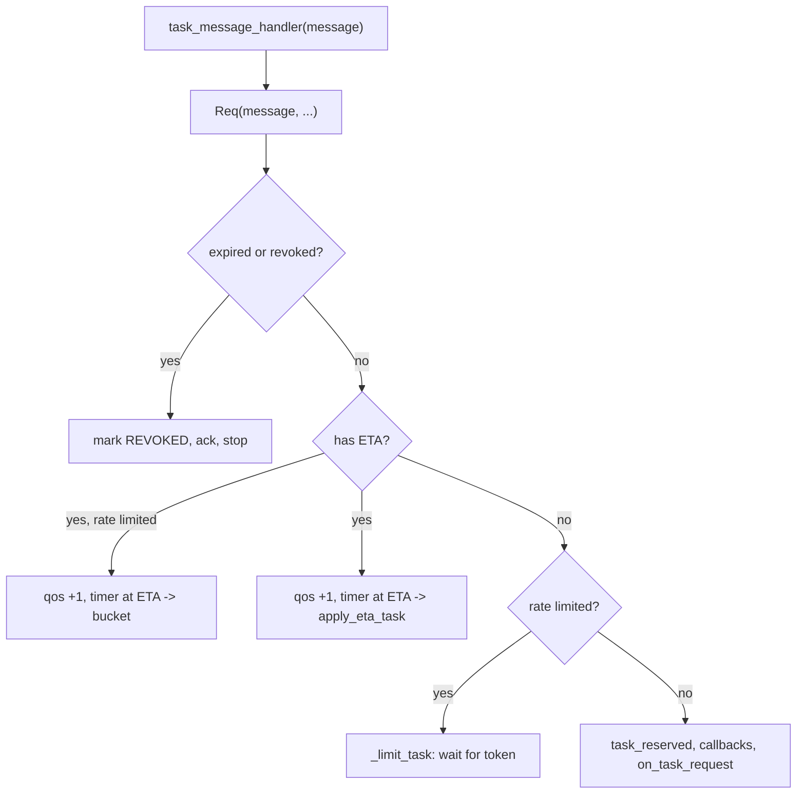

## Overview

Between the broker message and the running task sits the `Request`, the worker's object for one task delivery. The consumer calls the task's strategy for every message ([[Consumer and Event Loop]]); the strategy builds a `Request`, discards it if it is revoked or expired, and either schedules it for later, queues it behind a rate limit, or hands it to the worker for the pool at once. From then on the `Request` receives the pool's callbacks (accepted, succeeded, failed, timed out), decides when the message is acknowledged or rejected, records state in the worker's global tables, and sends monitoring events. The function itself runs inside the tracer, covered on [[Task Tracing and Execution]].

Sources: [celery/worker/strategy.py:99-209](repo://celery/worker/strategy.py#L99-L209), [celery/worker/request.py:67-80](repo://celery/worker/request.py#L67-L80)

## The default strategy

### Setting up per task

`celery.worker.strategy.default` is a factory called once per task when the consumer starts (`Task.Strategy` names it; a task can name another). It captures in local variables everything the per-message handler needs: the event dispatcher, the timer, rate-limit buckets, the consumer's `on_task_request`, the revoked set, and a `Request` subclass made for this task by `create_request_cls`. The returned `task_message_handler` is called for every message, so this up-front binding keeps the hot path free of attribute lookups.

Sources: [celery/worker/strategy.py:99-130](repo://celery/worker/strategy.py#L99-L130)

`create_request_cls` bakes the task's default time limits, `acks_late` flag, the pool's `apply_async` and the trace function into an optimized subclass with its own `execute_using_pool` and `on_success`.

Sources: [celery/worker/request.py:818-874](repo://celery/worker/request.py#L818-L874)

### Handling a message

For a protocol 2 message, the body is left encoded: the request carries the raw bytes, content type and encoding, and only the pool process deserializes the arguments. Protocol 1 bodies and hybrid messages are converted to the protocol 2 shape by `proto1_to_proto2` and `hybrid_to_proto2`, which raise `InvalidTaskError` when `args` or `kwargs` are missing or of the wrong type.

Sources: [celery/worker/strategy.py:25-97](repo://celery/worker/strategy.py#L25-L97), [celery/worker/strategy.py:132-147](repo://celery/worker/strategy.py#L132-L147)

The handler then logs `Task <name>[<id>] received`, returns early if the request has expired or its id is in the revoked set (in which case `revoked()` has already recorded the revocation and acknowledged the message), sends the `task_received` signal and a `task-received` event, and dispatches:

Sources: [celery/worker/strategy.py:148-180](repo://celery/worker/strategy.py#L148-L180)

Sources: [celery/worker/strategy.py:182-209](repo://celery/worker/strategy.py#L182-L209)

An ETA is converted to a local timestamp; an ETA that cannot be converted rejects the message without requeueing. ETA tasks raise the prefetch count by one and are put on the timer with priority 6. A task with neither an ETA nor a rate limit is recorded with `task_reserved`, the `on_task_message` callbacks run, and the consumer's `on_task_request` (the worker's `process_task`) sends it to the pool. The bucket and timer paths, and why prefetch changes, are described on [[Consumer and Event Loop]].

Sources: [celery/worker/strategy.py:182-209](repo://celery/worker/strategy.py#L182-L209), [celery/worker/consumer/consumer.py:659-663](repo://celery/worker/consumer/consumer.py#L659-L663)

## The Request object

`Request.__init__` copies the message headers into `request_dict` and reads the task id, the name (replaced by `shadow` when set), root and parent ids, time limits and argument reprs. It resolves the task from the registry, decides `ignore_result` from the header or the task, parses `eta` and `expires` as ISO 8601 into timezone-aware datetimes (raising `InvalidTaskError` when malformed), and adds the delivery info (exchange, routing key, priority, redelivered flag), `reply_to`, `correlation_id` and the worker hostname. The class uses `__slots__` (except on PyPy) because one is created per message.

Sources: [celery/worker/request.py:67-100](repo://celery/worker/request.py#L67-L100), [celery/worker/request.py:100-195](repo://celery/worker/request.py#L100-L195)

`request._context` builds the `Context` that `task.request` exposes during execution and that the backend receives when storing outcomes, by merging `request_dict` with the embedded `callbacks`, `errbacks`, `chain` and `chord`. `store_errors` is true unless results are ignored and `store_errors_even_if_ignored` is off.

Sources: [celery/worker/request.py:302-305](repo://celery/worker/request.py#L302-L305), [celery/worker/request.py:774-816](repo://celery/worker/request.py#L774-L816)

## Executing in the pool

`execute_using_pool(pool)` checks revocation once more, raising `TaskRevokedError` if it was revoked while waiting, then calls `pool.apply_async` with the trace function (`fast_trace_task` when worker optimizations are installed, otherwise `trace_task_ret`), the task name, id, request dict, raw body, content type and encoding, and four callbacks. The per-call time limits from the message override the task defaults. The returned result handle is kept as a weak reference so the request can terminate the job later.

Sources: [celery/worker/request.py:341-372](repo://celery/worker/request.py#L341-L372)

| Callback | Request method | Called when |
| --- | --- | --- |
| `accept_callback` | `on_accepted(pid, time_accepted)` | A pool process or thread starts the job |
| `callback` | `on_success((failed, retval, runtime))` | The trace function returned |
| `error_callback` | `on_failure(exc_info)` | The job raised in the pool, or the process died |
| `timeout_callback` | `on_timeout(soft, timeout)` | A soft or hard time limit fired |

Sources: [celery/worker/request.py:357-368](repo://celery/worker/request.py#L357-L368)

`execute()` is the in-process alternative used by tests and the solo path: it skips revoked requests, acknowledges early unless `acks_late`, calls `trace_task` directly, and acknowledges or rejects based on the outcome.

Sources: [celery/worker/request.py:374-405](repo://celery/worker/request.py#L374-L405)

## Acknowledgement rules

`acknowledge()` and `reject(requeue)` call the ack and reject promises from the consumer at most once per request; `reject` also sends `task-rejected`. When they are called depends on `acks_late` and the outcome.

Sources: [celery/worker/request.py:730-740](repo://celery/worker/request.py#L730-L740)

| Outcome | Default (early ack) | `acks_late=True` |
| --- | --- | --- |
| Accepted by the pool | Ack now | Nothing yet |
| Success | Already acked | Ack |
| `Retry` raised | Already acked | Ack (the retry is a new message) |
| `Ignore` raised | Already acked | Ack |
| `Reject(requeue)` raised | Already acked | Reject, requeue as given |
| Exception | Already acked | Ack if `acks_on_failure`, else reject without requeue |
| Hard time limit | Already acked | Ack if `acks_on_timeout`, else reject and requeue |
| Worker process lost | Already acked | Reject and requeue if `reject_on_worker_lost`, else as an exception |
| Revoked or expired before running | Ack | Ack |

Sources: [celery/worker/request.py:515-527](repo://celery/worker/request.py#L515-L527), [celery/worker/request.py:596-620](repo://celery/worker/request.py#L596-L620), [celery/worker/request.py:622-728](repo://celery/worker/request.py#L622-L728)

Early acknowledgement means a task whose process crashes is not run again; late acknowledgement means it is redelivered, so the task must be safe to run twice. `reject_on_worker_lost` makes a crash requeue the message, which can loop if the task crashes every time. [[Defining Tasks]] lists where each flag comes from.

Sources: [celery/app/task.py:315-372](repo://celery/app/task.py#L315-L372)

## Outcome handlers

### Accepted

`on_accepted` stores the pool process id and the start time (converted from the pool's monotonic clock), records the request as active with `task_accepted`, acknowledges early-ack tasks, and sends `task-started`. If a terminate was requested before the job started, it runs now.

Sources: [celery/worker/request.py:515-527](repo://celery/worker/request.py#L515-L527)

### Success and retry

`on_success` receives `(failed, retval, runtime)`. When the tracer reports a failure it delegates to `on_failure` with `return_ok=True` (the tracer has already stored the failure), re-raising `SystemExit` and `KeyboardInterrupt`. Otherwise it records the task as ready and successful, acknowledges late-ack tasks, and sends `task-succeeded` with the result repr and runtime. `on_retry` acknowledges late-ack tasks and sends `task-retried`.

Sources: [celery/worker/request.py:596-620](repo://celery/worker/request.py#L596-L620)

### Failure

`on_failure` sorts the exception. `Terminated` (the job was killed by `terminate`) records a revocation unless already cancelled or revoked. `MemoryError` is re-raised. `Reject` stores a failure when not requeued and rejects the message; `Ignore` acknowledges; `Retry` goes to `on_retry`. Any other exception applies the late-ack rules above, then, unless the message was requeued, marks the task `FAILURE` in the backend (for a lost worker, or when the tracer did not already store it) and sends `task_failure`, then `task-failed`. During a cold shutdown the failure event is suppressed, since cancelled tasks are not real failures.

Sources: [celery/worker/request.py:622-728](repo://celery/worker/request.py#L622-L728)

### Time limits

`on_timeout` with `soft=True` only logs a warning; the task itself receives `SoftTimeLimitExceeded` and may clean up. A hard limit means the pool killed the process: the request is marked ready, and unless the worker is terminating, it stores `TimeLimitExceeded` as the failure, calls the task's `on_failure` and `after_return`, and sends `task_failure` and `task-failed` itself, since the tracer never got to run. Late-ack tasks are then acknowledged or requeued according to `acks_on_timeout`.

Sources: [celery/worker/request.py:529-594](repo://celery/worker/request.py#L529-L594)

## Revocation, termination and cancellation

`revoked()` is checked when the message arrives and again before the pool runs it. A request is revoked when it has expired (`maybe_expire` adds its id to the revoked set), when its id is in `state.revoked`, or when one of its stamped headers matches a value in `state.revoked_stamps` (see [[Canvas Stamping]]). A revoked request logs `Discarding revoked task`, is marked `REVOKED` in the backend (with reason `expired` or `revoked`), sends `task-revoked` and the `task_revoked` signal, and is acknowledged.

Sources: [celery/worker/request.py:408-414](repo://celery/worker/request.py#L408-L414), [celery/worker/request.py:457-509](repo://celery/worker/request.py#L457-L509)

`terminate(pool, signal)` kills a running job: if the job has started, the pool sends the signal (`SIGTERM` by default) to its process and the request is recorded as revoked with `terminated=True`; if not, the signal is stored and applied in `on_accepted`. `cancel(pool)` is used during shutdown and connection loss: it kills the job, sends `task-cancelled`, and, when `emit_retry` is true, marks the task `RETRY` and calls `on_retry`, because the message will be delivered again.

Sources: [celery/worker/request.py:416-455](repo://celery/worker/request.py#L416-L455)

## Worker state tables

`celery/worker/state.py` keeps the module-level tables that inspection commands read.

Sources: [celery/worker/state.py:26-75](repo://celery/worker/state.py#L26-L75)

| Function | Called | Effect |
| --- | --- | --- |
| `task_reserved(request)` | When the strategy or bucket releases a request | Adds it to `requests` and `reserved_requests` |
| `task_accepted(request)` | In `on_accepted` | Adds it to `active_requests`, counts it in `total_count` |
| `task_ready(request, successful)` | On any final outcome | Removes it from all three; adds the id to `successful_requests` on success |

Sources: [celery/worker/state.py:96-125](repo://celery/worker/state.py#L96-L125)

`reserved_requests` and `active_requests` are weak sets, so a request dropped elsewhere does not leak. `revoked` is a `LimitedSet` with a size cap and expiry; it is filled by the `revoke` control command, merged from other workers by Mingle, and saved by `--statedb` ([[Worker Startup and Shutdown]]). `inspect active`, `inspect reserved` and `inspect scheduled` read these tables ([[Remote Control and Inspection]]).

Sources: [celery/worker/state.py:51-75](repo://celery/worker/state.py#L51-L75)
