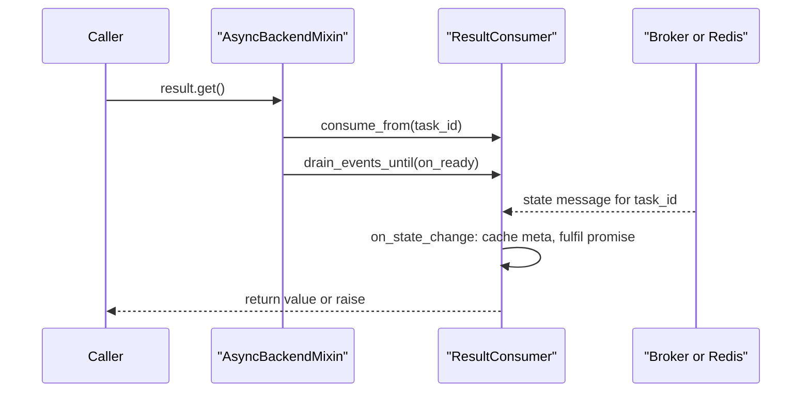

## Overview

Sending a task returns an `AsyncResult`: an object holding only the task id and a reference to the app's result backend. Everything else (state, return value, traceback, children) is read from the backend when asked, and cached once the task has reached a final state. `ResultSet` and `GroupResult` do the same for many tasks, and `EagerResult` wraps a task that already ran in-process. This page covers what the caller can do with these objects and how waiting works for polling and for push-based backends. How results are written and stored is on [[Result Backends]], and where the states come from is on [[Task Tracing and Execution]].

Sources: [celery/result.py:62-102](repo://celery/result.py#L62-L102)

## AsyncResult

### Reading state

`AsyncResult(id, backend=None, app=None, parent=None)` requires an id and defaults the backend to `app.backend`. Its properties read the task's metadata through `_get_task_meta`, which asks the backend and caches the answer only when the state is in `READY_STATES` (`SUCCESS`, `FAILURE`, `REVOKED`), so polling a pending task always gets fresh data while a finished one is read once.

Sources: [celery/result.py:89-102](repo://celery/result.py#L89-L102), [celery/result.py:461-486](repo://celery/result.py#L461-L486)

| Attribute or method | Returns |
| --- | --- |
| `state` / `status` | The task state; `PENDING` for an unknown id |
| `result` / `info` | Return value, the exception instance, or the `meta` of a custom state |
| `traceback` | Formatted traceback of a failure |
| `ready()`, `successful()`, `failed()` | State checks |
| `exists()` | Whether the backend has any record, telling "pending" from "unknown or expired" |
| `name`, `args`, `kwargs`, `worker`, `retries`, `queue`, `date_done` | Extended metadata, present when `result_extended` is on |
| `children` | Results of tasks sent by this task (with `trail` on) |
| `parent` | The previous result in a chain |

Sources: [celery/result.py:351-383](repo://celery/result.py#L351-L383), [celery/result.py:457-576](repo://celery/result.py#L457-L576)

`PENDING` is not stored by anyone: it is what the backend reports when it has nothing for an id. A task that was never sent, one whose result expired, and one waiting in a queue all look the same, which is why `exists()` was added. Turning on `task_track_started` makes running tasks visible as `STARTED`.

Sources: [celery/result.py:351-367](repo://celery/result.py#L351-L367), [celery/states.py:102-106](repo://celery/states.py#L102-L106)

### Waiting with get()

`get(timeout=None, propagate=True, interval=0.5, follow_parents=True, ...)` returns `None` at once for results created with `ignore_result`. Otherwise it checks that waiting is allowed, re-raises the first failure among parent results when `follow_parents` is set (so a failed chain step surfaces at its end), and returns from the cache when the task already finished. If not, it registers the result as pending with the backend and calls `backend.wait_for_pending`.

Sources: [celery/result.py:191-270](repo://celery/result.py#L191-L270)

When the task failed or was revoked (`PROPAGATE_STATES`), `get` re-raises the stored exception, rebuilt as an instance of the original class when possible; with `task_remote_tracebacks` and `tblib` installed, the worker's traceback is attached. With `propagate=False` the exception is returned instead. `timeout` raises `celery.exceptions.TimeoutError`; the task keeps running.

Sources: [celery/result.py:388-401](repo://celery/result.py#L388-L401)

Every result object holds backend resources until it is read: call `get()` or `forget()` on each result you create, or configure `result_expires`, especially with RPC and Redis, where a pending result keeps a subscription open.

Sources: [celery/result.py:199-205](repo://celery/result.py#L199-L205)

### Never wait inside a task

A task that blocks on another task's result can deadlock the worker: with every pool slot waiting, nothing is left to run the subtasks. `assert_will_not_block()` raises `RuntimeError("Never call result.get() within a task!")` when the current pool says joins would block, which the worker records at start-up from the pool's `task_join_will_block` ([[Execution Pools]]). `allow_join_result()` is a context manager that lifts the guard for code that knows it is safe, as the chord machinery does; `denied_join_result()` sets it, as eager calls do. `disable_sync_subtasks=False` on `get` skips the check for one call. Prefer callbacks, chains or chords to waiting.

Sources: [celery/result.py:32-60](repo://celery/result.py#L32-L60), [celery/worker/components.py:172-172](repo://celery/worker/components.py#L172-L172)

### Other operations

`revoke(terminate=False, signal=None, wait=False, timeout=None)` broadcasts a revoke for this id ([[Remote Control and Inspection]]); `revoke_by_stamped_headers` does the same by stamp. `forget()` deletes the stored result of this task and its parents and drops the cache. `then(callback)` registers a promise callback for when the result is ready, which push-based backends fulfil from their consumer.

Sources: [celery/result.py:115-189](repo://celery/result.py#L115-L189)

`collect()` walks the tree of results this task produced, yielding `(result, value)` pairs as each becomes ready; it follows `children`, so tasks must keep the default `trail=True`. `iterdeps()` raises `IncompleteStream` when it reaches a node that is not ready, unless `intermediate=True`. `as_tuple()` and `result_from_tuple()` convert a result tree, including parents and group members, to nested tuples and back, which is how results travel inside messages and backends.

Sources: [celery/result.py:282-349](repo://celery/result.py#L282-L349), [celery/result.py:1112-1131](repo://celery/result.py#L1112-L1131)

## Groups of results

### ResultSet

`ResultSet(results)` is an ordered collection with `add`, `remove`, `discard`, `update` and `clear`, and aggregate checks: `successful()` and `failed()` across all members, `waiting()`, `ready()`, and `completed_count()`. A `barrier` promise (`on_ready`) fires when every member is ready.

Sources: [celery/result.py:579-676](repo://celery/result.py#L579-L676), [celery/result.py:676-718](repo://celery/result.py#L676-L718)

`get()` uses `join_native` when the backend supports it (RPC, Redis and others marked `supports_native_join`) and `join` otherwise. `join` waits for each result in order with a shared timeout, so it polls one task at a time; `join_native` asks the backend for all ids together through `iter_native`. Both return values in the order of the set, or call `callback(task_id, value)` per result instead.

Sources: [celery/result.py:726-826](repo://celery/result.py#L726-L826), [celery/result.py:827-882](repo://celery/result.py#L827-L882)

### GroupResult

`GroupResult(id, results, parent)` adds the group id. `save()` stores it in the backend and `GroupResult.restore(id)` reads it back, so another process can check a group by id alone; `delete()` removes it. Calling a group returns a `GroupResult` whose `children` are the member results ([[Chains, Groups and Chords at Runtime]]).

Sources: [celery/result.py:929-1022](repo://celery/result.py#L929-L1022)

```python
res = group(add.s(i, i) for i in range(10))()
res.save()
same = app.GroupResult.restore(res.id)
print(same.completed_count(), 'of', len(same))
print(same.get(timeout=10))
```

Sources: [celery/result.py:958-1022](repo://celery/result.py#L958-L1022)

## EagerResult

`Task.apply()` and eager mode return an `EagerResult` built from the value, state and traceback the local tracer produced. It is always `ready()`, never touches a backend, `forget()` does nothing and `revoke()` only changes its local state. `get()` re-raises a failure when `propagate` is true.

Sources: [celery/result.py:1025-1110](repo://celery/result.py#L1025-L1110)

## How waiting works

### Polling backends

Backends without a push channel (database, cache, MongoDB, S3 and most others) mix in `SyncBackendMixin`. `wait_for` reads the task's metadata, returns when the state is ready, and otherwise sleeps `interval` seconds (0.5 by default) and tries again until `timeout`. `iter_native` for a set calls `get_many`, which fetches many ids per round where the backend supports it.

Sources: [celery/backends/base.py:879-956](repo://celery/backends/base.py#L879-L956)

### Push-based backends

RPC and Redis mix in `AsyncBackendMixin` and have a result consumer. `add_pending_result` registers the result and tells the consumer to listen for that id (RPC consumes its reply queue; Redis subscribes to the task's key channel). A result that arrived before it was registered is taken from a buffer of pending messages. `wait_for_pending` then drains events until the result's `on_ready` promise is fulfilled: the consumer's `on_state_change` matches each ready message to its pending result, fills the cache, and fulfils it. No polling happens, so `interval` has no effect.

Sources: [celery/backends/asynchronous.py:225-314](repo://celery/backends/asynchronous.py#L225-L314), [celery/backends/asynchronous.py:397-449](repo://celery/backends/asynchronous.py#L397-L449)



Sources: [celery/backends/asynchronous.py:67-112](repo://celery/backends/asynchronous.py#L67-L112), [celery/backends/asynchronous.py:397-449](repo://celery/backends/asynchronous.py#L397-L449)

The drainer depends on the environment. The default `Drainer` blocks in the calling thread; with eventlet or gevent, a green-thread drainer runs in the background and waiting greenlets block on an event, so many results can be awaited concurrently. A connection error during draining is logged and retried after one interval.

Sources: [celery/backends/asynchronous.py:67-113](repo://celery/backends/asynchronous.py#L67-L113), [celery/backends/asynchronous.py:115-222](repo://celery/backends/asynchronous.py#L115-L222)

### The RPC backend

With `rpc://`, the worker publishes each state change as a message to the caller's `reply_to` queue, with the task id as correlation id. The caller's queue is named after its app's `oid` and declared when the task is sent. Results are therefore delivered only to the process that sent the task and are not persistent: another process cannot read them, and they are lost if the caller restarts. When polled without a consumer, `get_task_meta` reads the queue, keeps only the newest message per task, and buffers messages for other tasks. RPC does not support chords.

Sources: [celery/backends/rpc.py:147-251](repo://celery/backends/rpc.py#L147-L251), [celery/backends/rpc.py:254-322](repo://celery/backends/rpc.py#L254-L322)
