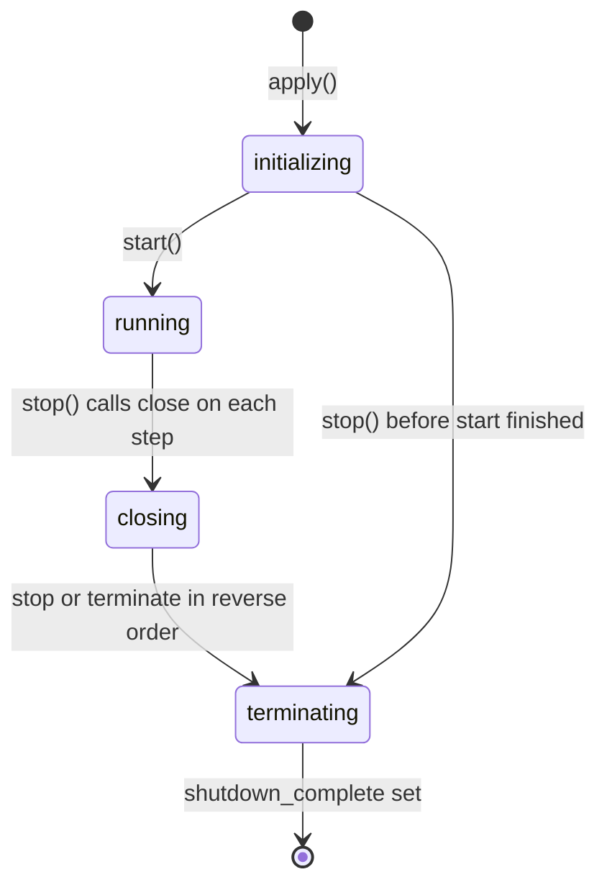
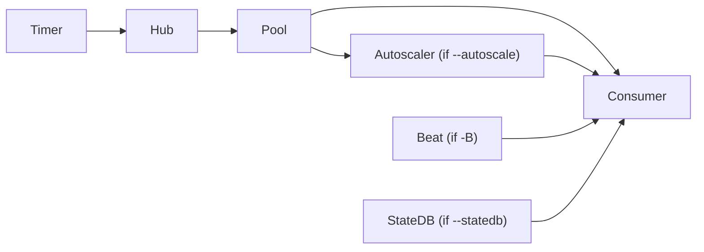

## Overview

A Celery worker is a `WorkController` assembled from bootsteps. Each bootstep is a small class that creates one component (the timer, the event loop, the execution pool, the consumer), declares which steps it needs first, and knows how to start and stop its component. A `Blueprint` collects the steps, sorts them by dependency, and drives their life cycle. The design lets features such as the autoscaler or embedded beat switch themselves on or off, and lets users add their own components without subclassing the worker.

Sources: [celery/bootsteps.py:74-117](repo://celery/bootsteps.py#L74-L117), [celery/worker/worker.py:63-87](repo://celery/worker/worker.py#L63-L87)

The worker has two blueprints: the worker blueprint described here, and the consumer blueprint started by its last step, described on [[Consumer and Event Loop]]. How the `celery worker` command creates the controller and handles signals is on [[Worker Startup and Shutdown]].

Sources: [celery/worker/components.py:221-246](repo://celery/worker/components.py#L221-L246), [celery/worker/consumer/consumer.py:170-189](repo://celery/worker/consumer/consumer.py#L170-L189)

## The bootstep model

### Steps

`Step` is the base class. Its metaclass `StepType` gives every step a `name` equal to its qualified name (`celery.worker.components.Pool`), which is what other steps put in `requires`. A step's `__init__(parent, **kwargs)` runs when the blueprint is applied and can set attributes on the parent. `include_if(parent)` decides whether the step takes part (by default it returns `enabled`), and `create(parent)` builds the component.

Sources: [celery/bootsteps.py:266-353](repo://celery/bootsteps.py#L266-L353)

`StartStopStep` adds a life cycle. `include` stores what `create` returned in `self.obj` and appends the step to `parent.steps`, so only these steps are started and stopped. Its `start`, `stop` and `terminate` call the same methods on `obj` when there is one. `ConsumerStep` is a `StartStopStep` for the consumer blueprint that requires the `Connection` step, opens a channel, and starts the kombu consumers returned by `get_consumers(channel)`, cancelling them and closing their channels on stop.

Sources: [celery/bootsteps.py:355-415](repo://celery/bootsteps.py#L355-L415)

| Attribute | Purpose |
| --- | --- |
| `requires` | Steps (names or classes) that must come first; they must be in the same blueprint |
| `last` | Start after every other step; only the worker's `Consumer` sets it |
| `conditional`, `enabled` | Mark a step as optional and give the default for `include_if` |
| `label` | Short name for logs and graphs |

Sources: [celery/bootsteps.py:288-318](repo://celery/bootsteps.py#L288-L318)

### Blueprints

`Blueprint.apply(parent, **kwargs)` builds the boot order. `claim_steps` loads the default steps plus those passed in, `_firstpass` resolves each `requires` and pulls in required steps that were not listed, and `_finalize_steps` builds a `DependencyGraph` in which the step marked `last` depends on every other step, then sorts it topologically. Each step is instantiated with the parent and keyword arguments in that order, and `include` is called on each. An unknown name in `requires` raises `KeyError('unknown bootstep: ...')`.

Sources: [celery/bootsteps.py:186-256](repo://celery/bootsteps.py#L186-L256)

`start(parent)` sets the state to `RUN`, calls `on_start`, and starts each step in `parent.steps` in order, counting how many started. `stop(parent)` does nothing when already closing; when start-up did not finish, it marks the blueprint terminated without stopping anything. Otherwise it calls `close` on each step in order, then `stop` (or `terminate`) in reverse order with errors logged rather than raised, then `on_stopped`, and finally sets `shutdown_complete`.

Sources: [celery/bootsteps.py:109-184](repo://celery/bootsteps.py#L109-L184)



Sources: [celery/bootsteps.py:88-95](repo://celery/bootsteps.py#L88-L95), [celery/bootsteps.py:155-176](repo://celery/bootsteps.py#L155-L176)

`send_all(parent, method)` calls a method on every step that has it; the worker uses it to give each step the event loop through `register_with_event_loop`. `info(parent)` merges each step's `info()`, which `celery inspect stats` reports.

Sources: [celery/bootsteps.py:119-153](repo://celery/bootsteps.py#L119-L153), [celery/worker/worker.py:214-218](repo://celery/worker/worker.py#L214-L218)

## The worker blueprint

### Components and their order

`WorkController.Blueprint` lists seven default steps, and `setup_instance` adds the app's `app.steps['worker']`. After sorting by `requires`, they start in this order:

Sources: [celery/worker/worker.py:76-87](repo://celery/worker/worker.py#L76-L87), [celery/worker/worker.py:132-139](repo://celery/worker/worker.py#L132-L139)



Sources: [celery/worker/components.py:32-99](repo://celery/worker/components.py#L32-L99), [celery/worker/components.py:101-179](repo://celery/worker/components.py#L101-L179), [celery/worker/components.py:181-246](repo://celery/worker/components.py#L181-L246), [celery/worker/autoscale.py:31-58](repo://celery/worker/autoscale.py#L31-L58)

| Step | Included when | Creates |
| --- | --- | --- |
| `Timer` | Always | `w.timer`: a kombu timer driven by the event loop, or the pool's own `Timer` class with a thread when there is no event loop |
| `Hub` | `w.use_eventloop` | `w.hub`, the kombu event loop; replaces thread locks used by the clock and billiard with dummy locks, since everything runs in one thread |
| `Pool` | Always | `w.pool`, the execution pool, sized by `--concurrency` or the autoscale minimum |
| `Autoscaler` | `--autoscale` is set | `w.autoscaler`, which grows and shrinks the pool |
| `Beat` | `-B` is given | An embedded beat service; refused for eventlet and gevent pools |
| `StateDB` | `worker_state_db` is set | `w._persistence`, saved at exit |
| `Consumer` | Always, last | `w.consumer`, which runs the consumer blueprint |

Sources: [celery/worker/components.py:32-99](repo://celery/worker/components.py#L32-L99), [celery/worker/components.py:101-179](repo://celery/worker/components.py#L101-L179), [celery/worker/components.py:181-246](repo://celery/worker/components.py#L181-L246)

### How the pool is built

The `Pool` step parses `--autoscale max,min` into `max_concurrency` and `min_concurrency`. When the worker runs an event loop (and is not on Windows), the pool is not threaded: the step creates a `LaxBoundedSemaphore` sized to the concurrency, and when the pool class uses it and `worker_pool_putlocks` is on, `w.process_task` acquires a slot before handing a request to the pool. The pool is instantiated with the app and hostname as initializer arguments, `max_tasks_per_child`, `max_memory_per_child`, the default time limits, `worker_lost_wait`, `pool_restarts`, and the `-O` scheduling strategy. The pool's `task_join_will_block` is recorded globally, which makes `AsyncResult.get()` inside a task raise rather than deadlock. [[Execution Pools]] covers the pool classes.

Sources: [celery/worker/components.py:101-178](repo://celery/worker/components.py#L101-L178)

### How the consumer is built

The `Consumer` step computes the initial prefetch count as `max_concurrency` (or `concurrency`) times `worker_prefetch_multiplier`, and instantiates `worker_consumer` (by default `celery.worker.consumer:Consumer`) with `w.process_task` as the callback for each request, the pool, timer and hub, and the worker's options. Because it is marked `last`, its `start` call blocks in the consumer's event loop for the life of the worker.

Sources: [celery/worker/components.py:221-246](repo://celery/worker/components.py#L221-L246)

## WorkController

`WorkController.__init__` resolves the node name, calls `loader.init_worker()` (which imports task modules), and runs `setup_defaults`, where each option falls back to its setting through `app.either` (for example `concurrency` to `worker_concurrency` and `pool` to `worker_pool`). `setup_instance` then selects queues, imports `--include` modules and adds every registered task's module to `include` so child processes started with `execv` import them too, defaults concurrency to the CPU count, decides whether to use the event loop, sends `worker_init`, resolves the pool class, and applies the blueprint.

Sources: [celery/worker/worker.py:90-140](repo://celery/worker/worker.py#L90-L140), [celery/worker/worker.py:183-193](repo://celery/worker/worker.py#L183-L193), [celery/worker/worker.py:351-410](repo://celery/worker/worker.py#L351-L410)

The event loop is used when the environment is not monkey-patched (`detect_environment() == 'default'`), the broker transport supports asynchronous I/O (pyamqp and Redis do), and the platform is not Windows. With eventlet or gevent, or a polling transport such as SQS, the worker falls back to the synchronous loop.

Sources: [celery/worker/worker.py:239-242](repo://celery/worker/worker.py#L239-L242)

`start()` starts the blueprint and turns failures into shutdowns: `WorkerTerminate` triggers a cold shutdown, any other exception is logged as an unrecoverable error and exits with `EX_FAILURE`, and `SystemExit` or `KeyboardInterrupt` stop the worker with the matching exit code. `on_start` creates the pidfile lock, `on_close` calls `loader.shutdown_worker()`, and `on_stopped` stops the timer, shuts the consumer down and releases the pidfile. The warm, cold and soft shutdown paths are on [[Worker Startup and Shutdown]].

Sources: [celery/worker/worker.py:141-165](repo://celery/worker/worker.py#L141-L165), [celery/worker/worker.py:201-212](repo://celery/worker/worker.py#L201-L212), [celery/worker/worker.py:244-267](repo://celery/worker/worker.py#L244-L267)

## Handing requests to the pool

The consumer calls `w.process_task(request)` for every task ready to run. `_process_task` calls `request.execute_using_pool(self.pool)`, which submits the trace function to the pool with callbacks for acceptance, success, failure and timeout ([[Task Requests and Strategies]]). A request revoked at the last moment raises `TaskRevokedError`, and the semaphore slot it took is released. With put-locks, `_process_task_sem` wraps this in `semaphore.acquire`, so the request waits in the semaphore's queue until a pool slot frees up instead of piling up inside the pool.

Sources: [celery/worker/worker.py:220-231](repo://celery/worker/worker.py#L220-L231), [celery/worker/request.py:341-372](repo://celery/worker/request.py#L341-L372)

`reload()` (the `pool_restart` control command) imports or reloads task modules, rebuilds the consumer's strategies and rate limits, and restarts the pool when it supports it. `stats()` combines the worker's info (total tasks, pid, clock, uptime), both blueprints' step info and `rusage`.

Sources: [celery/worker/worker.py:269-334](repo://celery/worker/worker.py#L269-L334)

## Adding your own bootsteps

`app.steps` is a dict of sets keyed by blueprint, `'worker'` and `'consumer'`. Adding a step class there makes the next worker include it; `requires` places it in the order, and its `__init__` receives the worker or consumer plus all command-line options, so a step can read custom options added through `app.user_options`.

Sources: [celery/app/base.py:268-275](repo://celery/app/base.py#L268-L275), [celery/app/base.py:367-368](repo://celery/app/base.py#L367-L368), [celery/worker/worker.py:132-139](repo://celery/worker/worker.py#L132-L139)

```python
from celery import bootsteps


class DeadlineMonitor(bootsteps.StartStopStep):
    requires = {'celery.worker.components:Pool'}

    def __init__(self, worker, **kwargs):
        self.interval = 30.0
        self.tref = None

    def start(self, worker):
        self.tref = worker.timer.call_repeatedly(
            self.interval, self.check, (worker,), priority=10,
        )

    def stop(self, worker):
        if self.tref:
            self.tref.cancel()

    def check(self, worker):
        ...


app.steps['worker'].add(DeadlineMonitor)
```

Sources: [celery/bootsteps.py:355-383](repo://celery/bootsteps.py#L355-L383)

A consumer step that subclasses `ConsumerStep` and returns kombu consumers from `get_consumers` is the supported way to consume extra queues with custom handlers in the worker process. `celery graph bootsteps` draws the resulting dependency graph with `StepFormatter`.

Sources: [celery/bootsteps.py:386-415](repo://celery/bootsteps.py#L386-L415), [celery/bootsteps.py:39-72](repo://celery/bootsteps.py#L39-L72)
