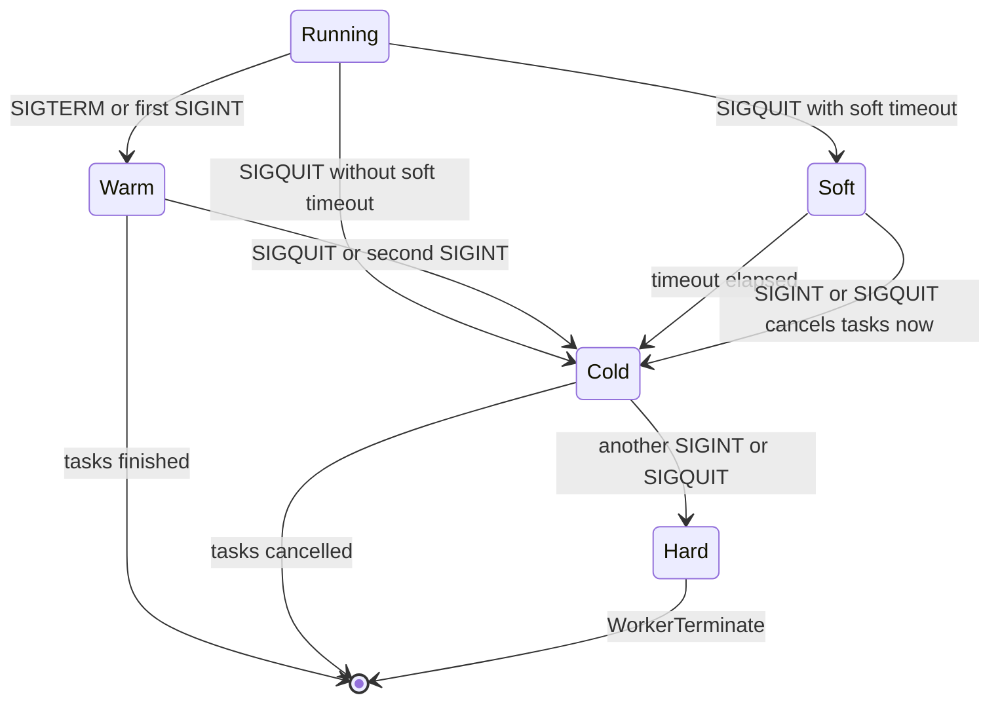

## Overview

`celery worker` is a click command that turns options into keyword arguments for `app.Worker`, the program-level subclass of `WorkController` in `celery/apps/worker.py`. That subclass adds what a long-running process needs on top of the bootsteps described on [[Worker Architecture and Bootsteps]]: logging, the start-up banner, privilege checks, and signal handlers that translate `SIGTERM`, `SIGINT`, `SIGQUIT` and `SIGHUP` into warm, cold and soft shutdowns or a restart. This page follows a worker from the command line to its exit. The click framework shared by all commands is on [[Command Line Interface]], and running many workers with `celery multi` is on [[Running Workers in Production]].

Sources: [celery/bin/worker.py:307-371](repo://celery/bin/worker.py#L307-L371), [celery/apps/worker.py:91-92](repo://celery/apps/worker.py#L91-L92)

## From the command to the process

### Option parsing

The `worker` command's options are grouped (worker, pool, queue, embedded beat, daemonization). Several use custom click types: `--pool` validates the name against the available pools and resolves it to a class early, because eventlet and gevent must monkey-patch before other imports, and keeps `worker_pool` from the configuration when the command-line value is just the default `prefork`. `--hostname` expands `%h`, `%n` and `%d` into a node name, and `--autoscale` accepts `max,min` in either order.

Sources: [celery/bin/worker.py:35-101](repo://celery/bin/worker.py#L35-L101), [celery/bin/worker.py:136-206](repo://celery/bin/worker.py#L136-L206)

Arguments after `--` become configuration in the `worker` namespace through `config_from_cmdline`; a value that cannot be parsed is reported as a usage error. [[Configuration and Loaders]] describes the syntax.

Sources: [celery/bin/worker.py:324-335](repo://celery/bin/worker.py#L324-L335)

### Detaching

With `--detach`, the command removes `--detach`, `-D`, `--uid` and `--gid` from its own argument list and calls `detach`, which re-executes `python -m celery ...` inside `platforms.detached`. `detached` drops privileges, then `DaemonContext` double-forks with `setsid`, changes to the work directory, applies the umask, checks that the log file is writable and that the pidfile is not held by a running process, closes open file descriptors except `/dev/urandom` (which `shelve` needs for beat), and points standard streams at `/dev/null`. If the `execv` fails, the error is logged to the log file, since there is no terminal any more.

Sources: [celery/bin/worker.py:108-133](repo://celery/bin/worker.py#L108-L133), [celery/bin/worker.py:336-356](repo://celery/bin/worker.py#L336-L356), [celery/platforms.py:310-374](repo://celery/platforms.py#L310-L374), [celery/platforms.py:376-431](repo://celery/platforms.py#L376-L431)

Without `--detach`, the command drops privileges to `--uid`/`--gid` if given, formats `%n`-style placeholders in `--pidfile` and `--statedb` with the node name, creates `app.Worker(...)`, calls `start()`, and exits with `worker.exitcode`.

Sources: [celery/bin/worker.py:358-371](repo://celery/bin/worker.py#L358-L371)

## Start-up sequence

`app.Worker` hooks into `WorkController` at each stage of construction and start, in this order.

Sources: [celery/worker/worker.py:90-99](repo://celery/worker/worker.py#L90-L99)

1. `on_before_init` installs the tracer optimizations, sends `celeryd_init` (receivers can change configuration per node name), and runs `check_privileges`.
2. `on_after_init` reads `worker_redirect_stdouts` and its level, the `--purge` flag and colour settings.
3. `on_init_blueprint` sets up logging through `app.log.setup` and finalizes the app.
4. The blueprint is applied and started; `on_start` creates the pidfile lock, sends `celeryd_after_setup`, purges queues if asked, prints the banner, sets the process title, installs signal handlers, redirects `stdout`/`stderr` to the logger, and warns about old setting names.
5. When the consumer is connected and consuming, `on_consumer_ready` sends `worker_ready` and logs `<hostname> ready.`

Sources: [celery/apps/worker.py:94-182](repo://celery/apps/worker.py#L94-L182), [celery/worker/worker.py:150-152](repo://celery/worker/worker.py#L150-L152)

`check_privileges` refuses to run as root, or with a `sudo` or `wheel` group, when `accept_content` includes `pickle`, because a crafted pickle message would then run code as root. Without pickle it only warns; `C_FORCE_ROOT` turns the refusal into a warning.

Sources: [celery/platforms.py:788-845](repo://celery/platforms.py#L788-L845)

The banner shows the app, node name, broker and result backend URLs (with passwords masked by kombu), concurrency with the pool name or the autoscale range, whether task events are on, and the queues being consumed. At `INFO` level and below it also lists the registered tasks, adding the built-in `celery.*` tasks at `DEBUG`.

Sources: [celery/apps/worker.py:168-252](repo://celery/apps/worker.py#L168-L252)

The pidfile lock exits with `EX_CANTCREAT` when another live process holds it, and removes a stale pidfile left by a dead one. It is released at exit.

Sources: [celery/platforms.py:244-272](repo://celery/platforms.py#L244-L272)

## Signals and shutdown modes

### Handlers

Handlers run only in the main process, set a flag, and return. `_shutdown_handler` runs an optional callback, prints `worker: Warm shutdown (MainProcess)` or the cold equivalent, sends the `worker_shutting_down` signal, and sets `state.should_stop` (warm) or `state.should_terminate` (cold) to the exit code. The event loop calls `state.maybe_shutdown()` on every iteration, which raises `WorkerShutdown` or `WorkerTerminate`; both derive from `SystemExit`, so they pass through the loop's error handling and reach `WorkController.start`, which stops or terminates the worker.

Sources: [celery/apps/worker.py:288-316](repo://celery/apps/worker.py#L288-L316), [celery/worker/state.py:88-93](repo://celery/worker/state.py#L88-L93), [celery/worker/loops.py:84-87](repo://celery/worker/loops.py#L84-L87), [celery/exceptions.py:271-280](repo://celery/exceptions.py#L271-L280)

| Signal | Effect |
| --- | --- |
| `SIGTERM` | Warm shutdown; cold shutdown instead when billiard's `REMAP_SIGTERM` is `SIGQUIT` |
| `SIGINT` (Ctrl+C) | Warm shutdown, and the next `SIGINT` becomes cold |
| `SIGQUIT` | Cold shutdown, with soft shutdown first if configured |
| `SIGHUP` | Restart with the same arguments, only when not attached to a terminal; unsupported on macOS |
| `SIGUSR1` | Log the stack of every thread |
| `SIGUSR2` | Open a remote debugger, when `CELERY_RDBSIG` is set |

Sources: [celery/apps/worker.py:254-274](repo://celery/apps/worker.py#L254-L274), [celery/apps/worker.py:432-523](repo://celery/apps/worker.py#L432-L523)

### Warm shutdown

`WorkController.stop()` closes the consumer so no new messages arrive, then stops the blueprint: each step is closed, then stopped in reverse order. The pool step waits for running tasks to finish and the consumer step acknowledges or requeues what is left. `worker_shutdown` is sent last.

Sources: [celery/worker/worker.py:244-267](repo://celery/worker/worker.py#L244-L267), [celery/bootsteps.py:155-176](repo://celery/bootsteps.py#L155-L176)

### Cold shutdown

`on_cold_shutdown` runs before the cold flag is set. It re-binds `SIGINT` and `SIGQUIT` to `during_soft_shutdown`, waits for the soft shutdown timeout if one applies, cancels the task consumer so requeued messages are not delivered straight back to this worker, cancels active requests, sets `should_terminate`, and stops the pool so tasks that already succeeded can still run `on_success`. `cancel_active_requests` cancels every running task that is acknowledged early, and every late-ack task that has not been acknowledged and has not already succeeded; late-ack tasks are not marked `RETRY` because the broker will redeliver them.

Sources: [celery/apps/worker.py:369-426](repo://celery/apps/worker.py#L369-L426), [celery/worker/consumer/consumer.py:823-855](repo://celery/worker/consumer/consumer.py#L823-L855)

A second `SIGINT` or `SIGQUIT` during that wait calls `during_soft_shutdown`, which cancels the remaining requests at once and makes the next signal call `on_hard_shutdown`. That handler raises `WorkerTerminate(EX_FAILURE)` to exit by force, for a worker that is stuck.

Sources: [celery/apps/worker.py:319-366](repo://celery/apps/worker.py#L319-L366)

### Soft shutdown

Soft shutdown is a time-limited warm phase in front of a cold shutdown. With `worker_soft_shutdown_timeout` above zero and at least one active request (or `worker_enable_soft_shutdown_on_idle` set), `wait_for_soft_shutdown` logs `Initiating Soft Shutdown` and sleeps for that many seconds before the cold shutdown cancels what is still running. Short tasks finish, and long ones are returned to the queue for another worker.

Sources: [celery/worker/worker.py:412-435](repo://celery/worker/worker.py#L412-L435)



Sources: [celery/apps/worker.py:338-426](repo://celery/apps/worker.py#L338-L426), [celery/apps/worker.py:453-460](repo://celery/apps/worker.py#L453-L460)

### Restart

The `SIGHUP` handler registers `_reload_current_worker` with `atexit` and sets `should_stop`, so the worker performs a warm shutdown and then `execv`s itself with the original arguments after closing all file descriptors but the standard streams. It is installed only when stdout is not a terminal, so closing a terminal window does not restart a foreground worker into the background.

Sources: [celery/apps/worker.py:469-487](repo://celery/apps/worker.py#L469-L487), [celery/apps/worker.py:259-269](repo://celery/apps/worker.py#L259-L269)

## State kept between restarts

`celery/worker/state.py` holds the process-wide worker state: `requests` by id, the weak sets `reserved_requests` and `active_requests`, `total_count` per task name, `successful_requests`, and `revoked`, a `LimitedSet` of revoked ids capped at 50,000 entries that expire after three hours once the cap is reached (tunable with `CELERY_WORKER_REVOKES_MAX` and `CELERY_WORKER_REVOKE_EXPIRES`). The functions `task_reserved`, `task_accepted` and `task_ready` update it as requests move through the worker, as described on [[Task Requests and Strategies]].

Sources: [celery/worker/state.py:26-125](repo://celery/worker/state.py#L26-L125)

Revocations are held in memory, so a restart would forget them. `--statedb` (`worker_state_db`) adds the `StateDB` bootstep, which creates a `Persistent` store: a `shelve` file holding the revoked set, pickled and zlib-compressed, and the Lamport clock value. At start it merges saved revocations (reading the older formats too) and purges expired ones; at exit it writes them back.

Sources: [celery/worker/state.py:192-288](repo://celery/worker/state.py#L192-L288), [celery/worker/components.py:208-218](repo://celery/worker/components.py#L208-L218)

```bash
celery -A proj worker -l INFO --statedb=/var/run/celery/%n.state
```

Sources: [celery/bin/worker.py:154-160](repo://celery/bin/worker.py#L154-L160), [celery/bin/worker.py:358-366](repo://celery/bin/worker.py#L358-L366)
