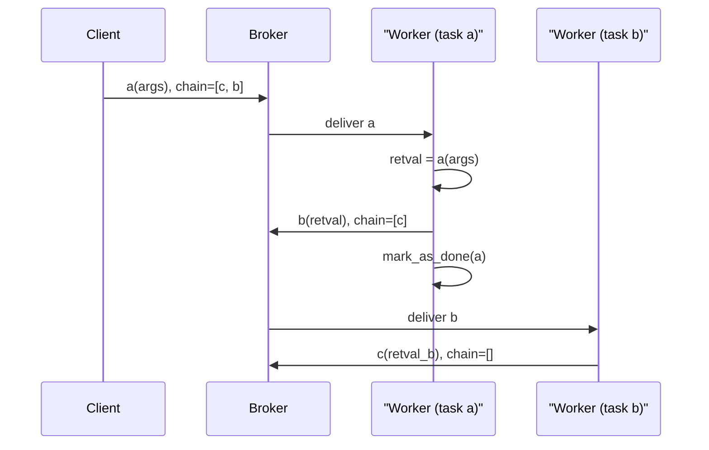
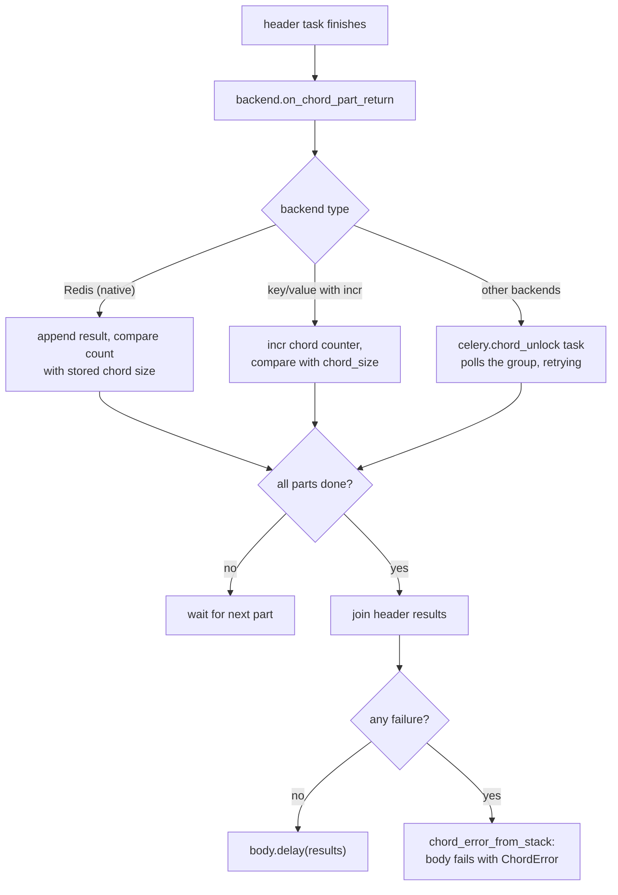

## Overview

The canvas describes a task call as data so it can be passed around, combined and sent later. A `Signature` holds a task name, arguments and execution options; `chain`, `group`, `chord`, `chunks`, `xmap` and `xstarmap` are signatures that contain other signatures. Each is a `dict` subclass, so a whole workflow serializes into a message, and the worker continues it after each step from what the message carries. This page explains how each primitive is frozen (given ids before sending), applied, and continued on the worker; [[Result Backends]] covers how the backend counts chord parts, and [[Task Results]] covers the result objects the primitives return.

Sources: [celery/canvas.py:233-345](repo://celery/canvas.py#L233-L345)

| Primitive | Built with | Runs | Returns |
| --- | --- | --- | --- |
| `Signature` | `task.s()`, `task.si()`, `signature(name, ...)` | One task | `AsyncResult` |
| `chain` | `chain(a, b, c)` or `a \| b \| c` | Tasks in order, each receiving the previous result | Result of the last task, with `.parent` links |
| `group` | `group(a, b, c)` | Tasks in parallel | `GroupResult` |
| `chord` | `chord(header_group, body)` or `group \| sig` | Header in parallel, then the body with the list of header results | Result of the body |
| `chunks` | `task.chunks(it, n)` | `it` split into groups of `n` calls | `GroupResult` |
| `xmap` / `xstarmap` | `task.map(it)` / `task.starmap(it)` | One task applying `task` to each item | `AsyncResult` of a list |

Sources: [celery/canvas.py:1322-1384](repo://celery/canvas.py#L1322-L1384), [celery/canvas.py:1385-1474](repo://celery/canvas.py#L1385-L1474), [celery/canvas.py:1580-1608](repo://celery/canvas.py#L1580-L1608), [celery/canvas.py:2064-2092](repo://celery/canvas.py#L2064-L2092)

## Signatures

### Structure

A signature is the dict `{task, args, kwargs, options, subtask_type, immutable}`. Passing a task object instead of a name stores the name and caches the task type. `type` resolves the task from the app's registry on first use, and `_apply_async` falls back to `app.send_task(name)` when the task is not registered locally, so a client can build signatures for tasks it does not have.

Sources: [celery/canvas.py:323-345](repo://celery/canvas.py#L323-L345), [celery/canvas.py:838-876](repo://celery/canvas.py#L838-L876)

### Partial arguments

`apply_async(args, kwargs, **options)`, `delay(*args, **kwargs)`, `apply()` and `clone()` all merge through `_merge`. New positional arguments are prepended to the stored ones, keyword arguments are merged over the stored ones, and options are merged with two exceptions: `group_id` and any stamped header already set are never overwritten, because changing them would detach the task from the group or stamp it belongs to. An immutable signature (`task.si()` or `immutable=True`) keeps its stored arguments and ignores the new ones, which is how a chain step ignores its parent's result.

Sources: [celery/canvas.py:347-443](repo://celery/canvas.py#L347-L443), [celery/canvas.py:445-471](repo://celery/canvas.py#L445-L471)

### Freezing

`freeze()` assigns ids before anything is sent: it sets `task_id` (keeping an existing one), `root_id`, `parent_id`, `group_id`, `chord`, `group_index` and a `reply_to` defaulting to the app's thread oid, and returns the `AsyncResult` for that id. Every composite primitive freezes its children first, so the result graph exists before the first message is published.

Sources: [celery/canvas.py:473-522](repo://celery/canvas.py#L473-L522)

### Links and the pipe operator

`link(callback)` and `link_error(errback)` append signatures to the `link` and `link_error` options, which `send_task` puts in the message as `callbacks` and `errbacks`. `sig | other` builds a chain: a signature piped to a chain prepends itself, piped to a group or another signature creates a two-step chain, and a one-task group is unrolled to its single task.

Sources: [celery/canvas.py:685-746](repo://celery/canvas.py#L685-L746), [celery/canvas.py:759-786](repo://celery/canvas.py#L759-L786)

Signatures are rebuilt from plain dicts with `Signature.from_dict`, which dispatches on `subtask_type` to the class registered with `@Signature.register_type` (`chain`, `group`, `chord`, `chunks`, `xmap`, `xstarmap`). `signature(d)` and `maybe_signature(d)` are the public entry points the worker uses on callbacks it receives.

Sources: [celery/canvas.py:296-321](repo://celery/canvas.py#L296-L321), [celery/canvas.py:2395-2425](repo://celery/canvas.py#L2395-L2425)

## Chains

### Composing chains

`chain(a, b, c)` reduces its arguments with `|`, so nested chains are flattened and the composition rules below apply. Piping a group onto a chain appends it, unless the chain ends in a chord, in which case it joins the chord body. Piping a signature onto a chain that ends in a group turns that group into a chord whose body is the new signature, because a step after a group must wait for all of it.

Sources: [celery/canvas.py:1371-1383](repo://celery/canvas.py#L1371-L1383), [celery/canvas.py:960-1006](repo://celery/canvas.py#L960-L1006)

### Preparing the steps

`apply_async` on a chain calls `run`, which calls `prepare_steps`. It walks the tasks from last to first, doing the following for each.

Sources: [celery/canvas.py:1036-1060](repo://celery/canvas.py#L1036-L1060), [celery/canvas.py:1120-1140](repo://celery/canvas.py#L1120-L1140)

1. Each task is cloned; the first one receives the chain's arguments.
2. A nested chain is expanded in place, and an empty group in the middle of a chain is dropped.
3. A group followed by another step becomes a chord with that step as its body.
4. Each task is frozen with the chain's `root_id`; the last one gets the requested task id, group and chord.
5. Each result's `parent` is set to the result of the step before it, and `link_error` errbacks are added to every step (and to chord bodies).
6. For a chord step, `app.backend.ensure_chords_allowed()` is called, which fails when results are disabled.

Sources: [celery/canvas.py:1141-1220](repo://celery/canvas.py#L1141-L1220), [celery/canvas.py:1221-1292](repo://celery/canvas.py#L1221-L1292)

`run` then publishes only the first task, with the remaining steps in the `chain` option: a list in reverse order, so the next step is at the end. It returns the result of the last task, whose `parent` chain leads back to the first. Under `task_always_eager` the chain runs inline with `apply`, passing each result to the next task.

Sources: [celery/canvas.py:1036-1094](repo://celery/canvas.py#L1036-L1094), [celery/canvas.py:877-884](repo://celery/canvas.py#L877-L884), [celery/canvas.py:1294-1302](repo://celery/canvas.py#L1294-L1302)

### Continuing on the worker

The chain list travels in the message body next to `callbacks`, `errbacks` and `chord`. When a task succeeds, the tracer's `_dispatch_callbacks_and_chain` first sends each linked callback with the return value prepended to its arguments (several callbacks are sent as a group, and group callbacks separately), then pops the last element of `chain` and sends it with the return value and `chain=chain[:-1]`. Callbacks are sent before the result is stored, so `result.children` is populated when the parent becomes ready.

Sources: [celery/app/trace.py:426-473](repo://celery/app/trace.py#L426-L473), [celery/app/trace.py:610-626](repo://celery/app/trace.py#L610-L626), [celery/app/amqp.py:404-411](repo://celery/app/amqp.py#L404-L411)

Sources: [celery/canvas.py:1048-1094](repo://celery/canvas.py#L1048-L1094), [celery/app/trace.py:465-473](repo://celery/app/trace.py#L465-L473)

When a step fails, `mark_as_failure` walks the rest of the chain and stores the same failure for every step that has a task id, calls `on_chord_part_return` for steps that belong to a chord, and descends into chord bodies, so waiting on the last result of a chain does not hang after an early failure. Then it runs the failed task's errbacks.

Sources: [celery/backends/base.py:188-246](repo://celery/backends/base.py#L188-L246)

## Groups

`group(*tasks)` accepts signatures, a list, or a generator (kept lazily in a `regen`). `apply_async` raises `TypeError` for `link` or `link_error`, because a group has no single end to link to: use a chord, or link the member tasks. It takes the group id from `task_id` (or a new UUID), clones and freezes each task with that `group_id`, its `group_index` and the root id, flattening nested groups, and publishes every task on one producer. The returned `GroupResult` is created with a `barrier` that becomes ready when every member result is.

Sources: [celery/canvas.py:1580-1593](repo://celery/canvas.py#L1580-L1593), [celery/canvas.py:1616-1650](repo://celery/canvas.py#L1616-L1650), [celery/canvas.py:1714-1761](repo://celery/canvas.py#L1714-L1761), [celery/canvas.py:1763-1837](repo://celery/canvas.py#L1763-L1837)

`group | sig` makes a chord. `group.link(sig)` links an immutable clone to the first member only, and `link_error` attaches a clone of the errback to every member. `skew(start, stop, step)` sets increasing countdowns on the members to spread them over time.

Sources: [celery/canvas.py:1598-1614](repo://celery/canvas.py#L1598-L1614), [celery/canvas.py:1691-1712](repo://celery/canvas.py#L1691-L1712)

## Chords

### Header and body

A chord is a group (the header) plus a body that runs once with the list of header results. It is a signature for the built-in `celery.chord` task whose kwargs hold `header` and `body`.

Sources: [celery/canvas.py:2064-2072](repo://celery/canvas.py#L2064-L2072)

### Starting a chord

`chord.apply_async` clones the body with the call's options and runs `run`, which goes through these steps.

Sources: [celery/canvas.py:2153-2177](repo://celery/canvas.py#L2153-L2177)

1. It picks the group id, freezes the body with the requested task id, the group id and the root id.
2. It freezes the header tasks with `chord=body`, so each header message carries the body signature in its `chord` field.
3. With a non-empty header, it calls `app.backend.apply_chord(header_result_args, body, ...)`, then publishes the header as a group. While publishing, `_apply_tasks` counts the expected results with `_descend` (a nested chain counts as its last task, a nested chord as its body) and stores that size with `backend.set_chord_size` before the last task is sent.
4. With an empty header, it sends the body at once with `[]`.

Sources: [celery/canvas.py:2153-2177](repo://celery/canvas.py#L2153-L2177), [celery/canvas.py:2226-2286](repo://celery/canvas.py#L2226-L2286), [celery/canvas.py:2191-2224](repo://celery/canvas.py#L2191-L2224), [celery/canvas.py:1763-1825](repo://celery/canvas.py#L1763-L1825)

### Completing a chord

What happens when each header task finishes depends on the backend. `mark_as_done`, `mark_as_failure` and `mark_as_revoked` call `on_chord_part_return` whenever the request has a `chord`.

Sources: [celery/backends/base.py:179-200](repo://celery/backends/base.py#L179-L200), [celery/backends/base.py:300-307](repo://celery/backends/base.py#L300-L307)

Sources: [celery/backends/base.py:832-866](repo://celery/backends/base.py#L832-L866), [celery/backends/base.py:1183-1258](repo://celery/backends/base.py#L1183-L1258), [celery/app/builtins.py:36-98](repo://celery/app/builtins.py#L36-L98)

- Backends without a native mechanism use the default `apply_chord`, which sends the `celery.chord_unlock` task to the body's queue. That task checks whether the group is ready, retrying itself every `result_chord_retry_interval` seconds until it is, then joins the results and sends the body.
- Key/value backends that implement `incr` save the group result in `apply_chord` and, on each part, increment a counter and compare it with the chord size; the part that reaches the size joins the results, sends the body and deletes the counter and group.
- The Redis backend implements its own `on_chord_part_return` on the chord size stored by `set_chord_size`. [[Result Backends]] describes each one.

Sources: [celery/backends/base.py:838-866](repo://celery/backends/base.py#L838-L866), [celery/backends/base.py:969-978](repo://celery/backends/base.py#L969-L978), [celery/backends/redis.py:570-593](repo://celery/backends/redis.py#L570-L593)

If any header task failed, the join raises; the backend then calls `chord_error_from_stack`, which marks the body as failed with a `ChordError` naming the culprit and runs the body's errbacks. A failure while sending the body is reported the same way. With `task_allow_error_cb_on_chord_header` enabled, `chord.link_error` also attaches the errback to every header task; otherwise only the body (and nested chords) get it, with a pending-deprecation warning.

Sources: [celery/backends/base.py:1225-1252](repo://celery/backends/base.py#L1225-L1252), [celery/backends/base.py:325-350](repo://celery/backends/base.py#L325-L350), [celery/canvas.py:2303-2341](repo://celery/canvas.py#L2303-L2341)

`chord | sig` appends `sig` to the body, and `chord.link(sig)` links it to the body. A task inside a chord can add another header task with `self.add_to_chord(sig)`, as [[Defining Tasks]] explains.

Sources: [celery/canvas.py:2077-2092](repo://celery/canvas.py#L2077-L2092), [celery/canvas.py:2298-2301](repo://celery/canvas.py#L2298-L2301)

## Map, starmap and chunks

`xmap(task, it)` and `xstarmap(task, it)` are immutable signatures for the built-in `celery.map` and `celery.starmap` tasks: a single message whose worker calls `task(x)` or `task(*x)` for every item in turn and returns the list. `chunks(task, it, n)` splits `it` into parts of `n` items and sends a group of `xstarmap` tasks, one per part, so a large list becomes a few messages instead of one per item. All three are routed using the inner task's name.

Sources: [celery/canvas.py:1385-1473](repo://celery/canvas.py#L1385-L1473), [celery/app/builtins.py:101-136](repo://celery/app/builtins.py#L101-L136)

## Stamping

Stamping attaches custom headers to every task in a workflow, for example to tag all tasks started by one request. `sig.stamp(visitor=None, append_stamps=False, **headers)` stores the headers in the signature's options and records their names in `stamped_headers`; the message carries them as `stamps`, and `_merge` never overwrites them. Composite signatures pass the stamps down: a chain to each task, a group to each member, a chord to its header and then its body. Links and errbacks are stamped too.

Sources: [celery/canvas.py:554-634](repo://celery/canvas.py#L554-L634), [celery/canvas.py:636-683](repo://celery/canvas.py#L636-L683), [celery/canvas.py:1107-1118](repo://celery/canvas.py#L1107-L1118), [celery/canvas.py:1668-1689](repo://celery/canvas.py#L1668-L1689), [celery/canvas.py:2127-2151](repo://celery/canvas.py#L2127-L2151)

A `StampingVisitor` subclass computes headers per node: `on_signature` is required, and `on_group_start`/`on_group_end`, `on_chain_start`/`on_chain_end`, `on_chord_header_start`/`on_chord_header_end`, `on_chord_body`, `on_callback` and `on_errback` are optional hooks that return headers to merge. With `append_stamps=True`, a stamp already present is turned into a list of both values instead of being replaced.

Sources: [celery/canvas.py:119-230](repo://celery/canvas.py#L119-L230), [celery/canvas.py:74-116](repo://celery/canvas.py#L74-L116)
