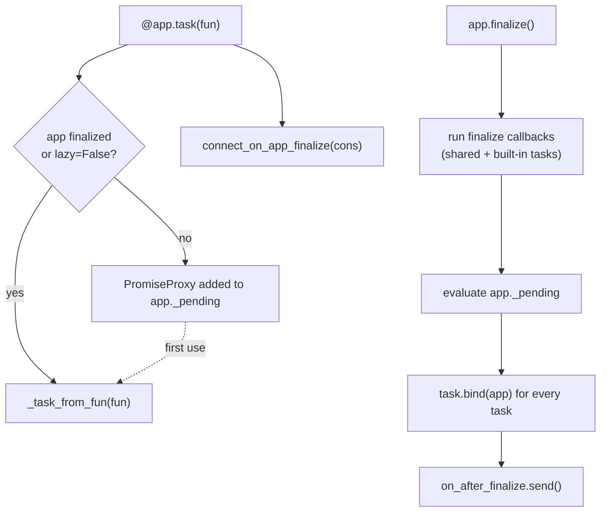

## Overview

Every Celery program, whether it sends tasks, runs a worker or runs beat, is built around one instance of `celery.Celery`. The app owns the configuration, the task registry, the broker connection pool and a set of subsystems (AMQP, result backend, remote control, events, loader, logging). It creates almost nothing up front: the constructor stores names and pending values, and each part is built the first time it is used. This page follows the app from construction to finalization and explains how code without an explicit app finds one. [[Configuration and Loaders]] covers how settings are read, and [[Defining Tasks]] covers the `Task` class the decorator produces.

Sources: [celery/app/base.py:252-341](repo://celery/app/base.py#L252-L341)

## Constructing an app

`Celery.__init__` stores the class to use for each subsystem (`amqp_cls`, `events_cls`, `loader_cls`, `log_cls`, `control_cls`, `task_cls`, `registry_cls`), each given as a `module:Class` string that can be replaced by a constructor argument or a subclass attribute. The loader defaults to the `CELERY_LOADER` environment variable, then the class attribute, then `celery.loaders.app:AppLoader`. It creates a `LamportClock` for ordering events and an empty `TaskRegistry` unless one is passed in.

Sources: [celery/app/base.py:343-385](repo://celery/app/base.py#L343-L385), [celery/app/base.py:436-442](repo://celery/app/base.py#L436-L442)

Arguments that are really settings, `broker`, `backend`, `include` and any extra keyword argument, are not applied directly. `__autoset` writes them into `_preconf` and remembers which keys it set, and `_conf` becomes a `Settings` object wrapping a `PendingConfiguration`. Reading a key from that object for the first time triggers `_finalize_pending_conf`, which loads the full configuration; until then the app has not touched the configuration source at all.

Sources: [celery/app/base.py:395-410](repo://celery/app/base.py#L395-L410), [celery/app/base.py:447-450](repo://celery/app/base.py#L447-L450), [celery/app/base.py:208-249](repo://celery/app/base.py#L208-L249)

The constructor then instantiates the fix-ups (by default only `celery.fixups.django:fixup`, which activates when Django settings are present; see [[Django Integration]]), makes the app current for the thread when `set_as_current` is true, creates the `on_configure`, `on_after_configure`, `on_after_finalize` and `on_after_fork` signals, calls the `on_init` hook and registers the app in the weak set of live apps.

Sources: [celery/app/base.py:412-434](repo://celery/app/base.py#L412-L434), [celery/app/base.py:83-85](repo://celery/app/base.py#L83-L85)

| Constructor argument | Effect |
| --- | --- |
| `main` | Module name used instead of `__main__` in generated task names |
| `broker`, `backend`, `include` | Stored as `broker_url`, `result_backend`, `include` settings |
| `loader`, `amqp`, `events`, `log`, `control`, `tasks` | Replace the class (or registry) for that subsystem |
| `config_source` | Object or module to read configuration from |
| `fixups` | Fix-up plug-ins; `None` uses the built-in set |
| `task_cls` | Base class for tasks created by `@app.task` |
| `autofinalize` | When false, using the registry before `finalize()` raises `RuntimeError` |
| `set_as_current` | Make this the thread's current app |
| `namespace` | Prefix for setting names, for example `CELERY` |
| `strict_typing` | Check call arguments against the task signature |

Sources: [celery/app/base.py:252-290](repo://celery/app/base.py#L252-L290), [celery/app/base.py:343-394](repo://celery/app/base.py#L343-L394)

## Lazy subsystems

Most attributes of the app are `cached_property` objects that build their target on first access, so a process that only sends tasks never creates a remote-control client or an event dispatcher.

Sources: [celery/app/base.py:1534-1611](repo://celery/app/base.py#L1534-L1611)

| Attribute | Built from | Used for |
| --- | --- | --- |
| `app.conf` | `_load_config()` | Settings ([[Configuration and Loaders]]) |
| `app.amqp` | `amqp_cls` | Queues, routing, message creation ([[Sending Tasks and Routing]]) |
| `app.backend` | `backends.by_url(result_backend)` | Result storage ([[Result Backends]]) |
| `app.control` | `control_cls` | Broadcast commands ([[Remote Control and Inspection]]) |
| `app.events` | `events_cls` | Event dispatcher and receiver ([[Events and Monitoring]]) |
| `app.loader` | `loader_cls` | Importing modules, reading config |
| `app.log` | `log_cls` | Logging setup |
| `app.pool` | kombu connection pool | Broker connections for producing |
| `app.Task`, `app.AsyncResult`, `app.GroupResult`, `app.Worker`, `app.WorkController`, `app.Beat` | `subclass_with_self` | Classes bound to this app |

Sources: [celery/app/base.py:1430-1500](repo://celery/app/base.py#L1430-L1500), [celery/app/base.py:1534-1611](repo://celery/app/base.py#L1534-L1611)

The backend is the one exception to plain caching. `_get_backend` resolves the backend class from `result_backend` and instantiates it; the `_backend` setter stores it on the app when the backend declares itself `thread_safe` and otherwise in thread-local storage, so each thread gets its own non-thread-safe backend instance.

Sources: [celery/app/base.py:1224-1228](repo://celery/app/base.py#L1224-L1228), [celery/app/base.py:1539-1563](repo://celery/app/base.py#L1539-L1563)

`subclass_with_self` is how app-bound classes are made: it creates a subclass of, say, `celery.result:AsyncResult` whose `app` attribute is this app, and adds a `__reduce__` that unpickles it by looking the attribute up on the current app. `app.Task` is built the same way from `task_cls`, with the app stored in `_app`.

Sources: [celery/app/base.py:1335-1376](repo://celery/app/base.py#L1335-L1376)

## Broker connections and producers

`connection_for_write()` and `connection_for_read()` build a kombu `Connection` from `broker_write_url` or `broker_read_url`, filling user, password, virtual host, port, transport, SSL, heartbeat, failover strategy and transport options from the configuration. `app.pool` is a kombu connection pool sized by `broker_pool_limit`, created on first use and dropped after fork. `connection_or_acquire()` and `producer_or_acquire()` return a context that uses the connection or producer passed in, or acquires one from the pool; when the pool is exhausted for `broker_pool_acquire_timeout` seconds they raise `OperationalError` naming both settings.

Sources: [celery/app/base.py:1043-1057](repo://celery/app/base.py#L1043-L1057), [celery/app/base.py:1102-1191](repo://celery/app/base.py#L1102-L1191), [celery/app/base.py:1488-1500](repo://celery/app/base.py#L1488-L1500)

After a fork, `_after_fork` clears the connection pool and the AMQP producer pool so a child process never shares broker sockets with its parent, then sends `on_after_fork`.

Sources: [celery/app/base.py:118-124](repo://celery/app/base.py#L118-L124), [celery/app/base.py:1282-1288](repo://celery/app/base.py#L1282-L1288)

## The task decorator and finalization

`@app.task` turns a function into an instance of a generated `Task` subclass. By default (`lazy=True`) and while the app is not finalized, it returns a `PromiseProxy` that will call `_task_from_fun` on first use, and appends the proxy to `app._pending`. With `shared=True`, the default, it also registers a callback with `connect_on_app_finalize` so every app that is finalized later creates the same task. Passing positional arguments other than a single callable raises `TypeError`.

Sources: [celery/app/base.py:515-585](repo://celery/app/base.py#L515-L585)

`_task_from_fun` derives the name with `gen_task_name` (module plus function name, with `app.main` replacing `__main__`), then builds a class with `type()` whose `run` is the function, a `staticmethod` unless `bind=True`. Any other decorator option becomes a class attribute. The instance is stored in the registry, bound to the app, and given auto-retry behaviour; a second decoration under the same name returns the registered task. With `pydantic=True` the function is first wrapped to validate arguments and dump the return value.

Sources: [celery/app/base.py:590-633](repo://celery/app/base.py#L590-L633), [celery/utils/imports.py:122-141](repo://celery/utils/imports.py#L122-L141)

`finalize()` runs once under `_finalize_mutex`. It calls every finalize callback (which creates shared tasks and the built-in tasks), evaluates each pending proxy, binds every registered task to the app and sends `on_after_finalize`. Reading `app.tasks` finalizes the app automatically, or raises `RuntimeError('Contract breach: app not finalized')` when `autofinalize=False`.

Sources: [celery/app/base.py:657-677](repo://celery/app/base.py#L657-L677), [celery/app/base.py:1601-1609](repo://celery/app/base.py#L1601-L1609), [celery/_state.py:43-52](repo://celery/_state.py#L43-L52)

Sources: [celery/app/base.py:554-575](repo://celery/app/base.py#L554-L575), [celery/app/base.py:657-677](repo://celery/app/base.py#L657-L677)

The built-in tasks registered this way are `celery.backend_cleanup`, `celery.accumulate`, `celery.chord_unlock`, `celery.map`, `celery.starmap`, `celery.chunks`, `celery.group`, `celery.chain` and `celery.chord`; [[Canvas: Chains, Groups and Chords]] explains the ones the canvas relies on.

Sources: [celery/app/builtins.py:12-50](repo://celery/app/builtins.py#L12-L50), [celery/app/builtins.py:101-175](repo://celery/app/builtins.py#L101-L175)

## The task registry

`TaskRegistry` is a `dict` from task name to task instance whose missing keys raise `NotRegistered`. `register()` instantiates a class if needed, refuses a task without a `name`, and adds auto-retry behaviour; `unregister()` accepts a name or a task. `register_task` on the app does the same for class-based tasks and binds them.

Sources: [celery/app/registry.py:12-47](repo://celery/app/registry.py#L12-L47), [celery/app/base.py:635-652](repo://celery/app/base.py#L635-L652)

## Shared tasks and the current app

`shared_task` is for libraries that cannot import a specific app. It registers a finalize callback that creates the task in every new app, creates it immediately in every app already finalized, and returns a `Proxy` that looks the task up in `current_app.tasks` on each access.

Sources: [celery/app/__init__.py:24-76](repo://celery/app/__init__.py#L24-L76)

The current app lives in `celery._state`. `_tls.current_app` holds the app last made current in this thread, and `default_app` is the process-wide fallback: when neither is set, `get_current_app` creates a `Celery('default')` app with no fix-ups and the `default` loader. `current_app` and `current_task` are `Proxy` objects around `get_current_app` and `get_current_task`, so they always resolve at the moment they are used. `set_current()` and `set_default()` on an app write those two slots.

Sources: [celery/_state.py:62-104](repo://celery/_state.py#L62-L104), [celery/_state.py:133-137](repo://celery/_state.py#L133-L137), [celery/app/base.py:452-458](repo://celery/app/base.py#L452-L458)

Executing tasks are pushed on a thread-local `LocalStack`. `current_task` is its top; `current_worker_task` walks the stack from the top and returns the first task whose request was not `called_directly`, which skips tasks called inline as plain functions. `send_task` uses `current_worker_task` to set `root_id` and `parent_id` on messages sent from inside a task.

Sources: [celery/_state.py:73-82](repo://celery/_state.py#L73-L82), [celery/_state.py:118-130](repo://celery/_state.py#L118-L130), [celery/app/base.py:1502-1514](repo://celery/app/base.py#L1502-L1514)

`Proxy` forwards attribute access, item access, comparison, arithmetic and calls to the object returned by its callable, so `current_app.conf` evaluates `get_current_app()` each time. `PromiseProxy` evaluates once and caches the object, which is what the lazy task decorator needs.

Sources: [celery/local.py:52-110](repo://celery/local.py#L52-L110), [celery/local.py:282-300](repo://celery/local.py#L282-L300)

## Debugging app leaks

Setting `CELERY_TRACE_APP` switches `app_or_default` to a tracing version that prints a stack trace whenever code falls back to the current or default app, and raises in the main process when no app was given. `C_STRICT_APP` makes `get_current_app` raise outright, and `C_WARN_APP` prints a stack on each call.

Sources: [celery/_state.py:107-116](repo://celery/_state.py#L107-L116), [celery/_state.py:155-197](repo://celery/_state.py#L155-L197)

## Autodiscovering tasks

`autodiscover_tasks(packages, related_name='tasks')` imports `<package>.tasks` for each package. By default it is lazy: it connects to the `import_modules` signal, which fires when the worker imports its default modules; `force=True` imports right away. `packages` may be a callable evaluated at that time, and with no packages the list comes from fix-ups that implement `autodiscover_tasks`, which is how Django apps are found.

Sources: [celery/app/base.py:782-844](repo://celery/app/base.py#L782-L844)

## Pickling and closing

An app is pickled by its constructor keywords (`__reduce_keys__`): `main`, the configuration changes (or the pre-configuration if it has not been configured), the subsystem classes, fix-ups, `config_source`, `task_cls` and `namespace`. Default settings are not sent, only changes. `close()` drops the connection pool and removes the app from the set of live apps; the app also works as a context manager that calls `close()` on exit.

Sources: [celery/app/base.py:1382-1428](repo://celery/app/base.py#L1382-L1428), [celery/app/base.py:466-478](repo://celery/app/base.py#L466-L478)
