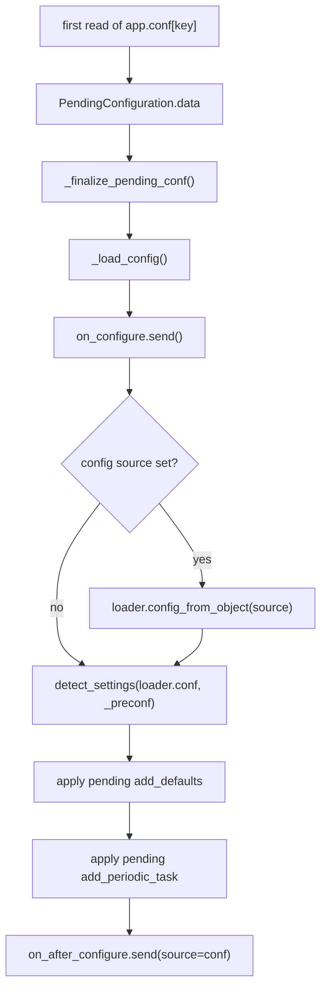

## Overview

An app's settings come from several places: keyword arguments to `Celery(...)`, assignments to `app.conf` before configuration is read, a configuration object or module, lazily added defaults, environment variables, command-line options, and the built-in defaults table. `app.conf` merges them into one `Settings` view the first time any key is read. A loader decides where the configuration module comes from and which modules a worker imports. This page follows that resolution; [[The Celery Application]] explains the app object around it, [[Message Signing]] the `security_*` settings, and [[Django Integration]] how Django settings are read.

Sources: [celery/app/base.py:1230-1280](repo://celery/app/base.py#L1230-L1280), [celery/app/utils.py:69-75](repo://celery/app/utils.py#L69-L75)

## Setting configuration

| Call | What it does |
| --- | --- |
| `Celery(broker=..., backend=..., include=..., **settings)` | Stores the values in the app's pre-configuration (`_preconf`) |
| `app.conf.update(...)` / `app.conf.key = value` | Before configuration is loaded, writes to `_preconf`; afterwards, to the `changes` map |
| `app.config_from_object(obj, silent=False, force=False, namespace=None)` | Records `obj` (an object, module, or dotted name) as the configuration source |
| `app.config_from_envvar(name, silent=False, force=False)` | Reads a module name from the environment variable and calls `config_from_object` |
| `app.add_defaults(d_or_callable)` | Adds a defaults mapping; a callable is called only when configuration is loaded |
| `app.config_from_cmdline(argv, namespace='celery')` | Parses `key=value` arguments into `changes` |

Sources: [celery/app/base.py:679-748](repo://celery/app/base.py#L679-L748), [celery/app/base.py:208-249](repo://celery/app/base.py#L208-L249)

`config_from_object` is lazy by default: it only stores the source and namespace. When `force=True`, or when the app is already configured, it drops the current settings and asks the loader to read the object at once. `config_from_envvar` raises `ImproperlyConfigured` with an example when the variable is unset, unless `silent=True`.

Sources: [celery/app/base.py:703-743](repo://celery/app/base.py#L703-L743), [celery/app/base.py:87-96](repo://celery/app/base.py#L87-L96)

`add_defaults` differs from `conf.update` in that the mapping is not copied and is not sent to child processes when the app is pickled, so the same call must also happen at import time in the child. Before configuration it is queued in `_pending_defaults`; afterwards it is added immediately.

Sources: [celery/app/base.py:679-701](repo://celery/app/base.py#L679-L701)

## How configuration is loaded

Until it is loaded, `app.conf` is a `Settings` view whose changes map is a `PendingConfiguration`. Writes, `update`, `setdefault` and `in` go to the pre-configuration dict without loading anything. The first read of a value evaluates its `data` property, which calls `_finalize_pending_conf` and in turn `_load_config`. An `AttributeError` raised while loading is converted to `ModuleNotFoundError`, because `UserDict` would otherwise swallow it and recurse.

Sources: [celery/app/base.py:208-249](repo://celery/app/base.py#L208-L249), [celery/app/base.py:1230-1245](repo://celery/app/base.py#L1230-L1245)

`_load_config` then runs these steps in order.

Sources: [celery/app/base.py:1247-1250](repo://celery/app/base.py#L1247-L1250)

1. Send the `on_configure` signal.
2. If a configuration source was recorded, call `loader.config_from_object(source)`.
3. Mark the app `configured`, pass the loader's configuration through `prepare_config` (which warns about deprecated settings), and build the `Settings` with `detect_settings`.
4. If something already holds a reference to `app.conf`, swap the new maps into the existing object instead of replacing it.
5. Apply every queued `add_defaults` callable and every queued `add_periodic_task` call.
6. Send `on_after_configure` with the settings as `source`.

Sources: [celery/app/base.py:1247-1280](repo://celery/app/base.py#L1247-L1280), [celery/app/base.py:1193-1195](repo://celery/app/base.py#L1193-L1195)

Sources: [celery/app/base.py:1230-1280](repo://celery/app/base.py#L1230-L1280)

## Precedence

`detect_settings` returns `Settings(preconf, [conf, defaults])`: a chain of maps searched in order. Values given to the constructor or set on `app.conf` before loading come first, then the configuration source, then the defaults table merged with the pre-configuration. `add_defaults` inserts its mapping right after the changes map, so it is searched before the configuration source. Writes after loading go to the first map.

Sources: [celery/app/utils.py:229-288](repo://celery/app/utils.py#L229-L288), [celery/utils/collections.py:202-256](repo://celery/utils/collections.py#L202-L256)

A few settings are properties that consult the environment first. `CELERY_BROKER_URL`, `CELERY_BROKER_READ_URL`, `CELERY_BROKER_WRITE_URL` and `CELERY_RESULT_BACKEND` win over any configured value; `broker_read_url` and `broker_write_url` fall back to `broker_url`, which falls back to the old `broker_host`. `timezone` also accepts Django's `TIME_ZONE`, and `task_default_exchange` and `task_default_routing_key` fall back to `task_default_queue`. The `celery` command sets these variables from its `--broker`, `--result-backend`, `--loader` and `--config` options.

Sources: [celery/app/utils.py:77-125](repo://celery/app/utils.py#L77-L125), [celery/bin/celery.py:122-131](repo://celery/bin/celery.py#L122-L131)

`app.conf.update()` also notifies observers registered with `bind_to`. `app.amqp` registers one that rebuilds the router whenever `task_routes` changes.

Sources: [celery/utils/collections.py:299-304](repo://celery/utils/collections.py#L299-L304), [celery/app/amqp.py:257-263](repo://celery/app/amqp.py#L257-L263), [celery/app/amqp.py:659-663](repo://celery/app/amqp.py#L659-L663)

## Setting names and namespaces

### Option declarations and old names

Every setting is declared once in `NAMESPACES` as an `Option` with a default and a type (`string`, `int`, `float`, `bool`, `dict`, `tuple`, `list` or `any`). Options are grouped by prefix, `broker`, `result`, `task`, `worker`, `beat`, `event`, `redis`, `database`, `security` and others, and `flatten` joins the prefix and key into names such as `worker_prefetch_multiplier`. `DEFAULTS` maps every flattened name to its default.

Sources: [celery/app/defaults.py:42-66](repo://celery/app/defaults.py#L42-L66), [celery/app/defaults.py:391-405](repo://celery/app/defaults.py#L391-L405)

Each option also has old upper-case names from Celery 3, built from the namespace's `__old__` pattern or the option's own `old` set (for example `CELERYD_CONCURRENCY` or `CELERY_TASK_SERIALIZER`). `_TO_NEW_KEY` and `_TO_OLD_KEY` translate between them, and `Settings` looks a key up under both forms.

Sources: [celery/app/defaults.py:23-39](repo://celery/app/defaults.py#L23-L39), [celery/app/defaults.py:382-413](repo://celery/app/defaults.py#L382-L413), [celery/app/utils.py:200-205](repo://celery/app/utils.py#L200-L205)

`detect_settings` decides which format a configuration uses by counting how many of its keys are new names and how many are old names, and picks the majority. If the configuration mixes the two and some minority key has no counterpart in the majority format, it raises `ImproperlyConfigured` listing the renames to make. When the app has a `namespace`, the new format is always used and keys are looked up with the prefix, so `namespace='CELERY'` reads `CELERY_BROKER_URL` for `broker_url`. Old names that are accepted are recorded and `maybe_warn_deprecated_settings` warns about them with Celery 6.0 as the removal version.

Sources: [celery/app/utils.py:219-288](repo://celery/app/utils.py#L219-L288), [celery/app/utils.py:185-197](repo://celery/app/utils.py#L185-L197), [celery/utils/collections.py:367-401](repo://celery/utils/collections.py#L367-L401)

### Frequently changed defaults

| Setting | Default | Meaning |
| --- | --- | --- |
| `broker_url` | `None` | Broker URL; `CELERY_BROKER_URL` overrides it |
| `broker_pool_limit` | `10` | Size of the producer connection pool |
| `broker_connection_retry_on_startup` | `None` | Retry the first broker connection when the worker starts |
| `broker_heartbeat` | `120` | AMQP heartbeat in seconds |
| `result_backend` | `None` | Result backend URL |
| `result_expires` | 1 day | How long stored results are kept |
| `result_extended` | `False` | Store task name, args and other metadata with the result |
| `accept_content` | `('json',)` | Content types a worker accepts |
| `task_serializer` / `result_serializer` | `'json'` | Serializers for messages and results |
| `task_default_queue` | `'celery'` | Queue for tasks without a route |
| `task_acks_late` | `False` | Acknowledge after the task runs instead of before |
| `task_always_eager` | `False` | Run tasks locally instead of sending them |
| `task_protocol` | `2` | Message protocol version |
| `task_time_limit` / `task_soft_time_limit` | `None` | Hard and soft time limits in seconds |
| `worker_concurrency` | `None` | Pool size; the CPU count when unset |
| `worker_pool` | `'prefork'` | Pool implementation |
| `worker_prefetch_multiplier` | `4` | Messages reserved per pool slot |
| `beat_scheduler` | `'celery.beat:PersistentScheduler'` | Scheduler class for beat |
| `enable_utc` / `timezone` | `True` / `None` | Time zone used for ETAs and schedules |

Sources: [celery/app/defaults.py:66-108](repo://celery/app/defaults.py#L66-L108), [celery/app/defaults.py:205-230](repo://celery/app/defaults.py#L205-L230), [celery/app/defaults.py:265-376](repo://celery/app/defaults.py#L265-L376)

### Looking settings up

`app.conf.find_option(name, namespace)` searches the namespaces for an option and returns `(namespace, key, Option)`; `get_by_parts('worker', 'disable_rate_limits')` reads a value by its parts. `without_defaults()` returns only the values that differ from the defaults, and `table()`/`humanize()` render them with keys matching `API`, `TOKEN`, `KEY`, `SECRET`, `PASS`, `SIGNATURE`, `DATABASE` or `BEAT_DBURI` censored. `celery report` and `app.bugreport()` print this view.

Sources: [celery/app/utils.py:37-40](repo://celery/app/utils.py#L37-L40), [celery/app/utils.py:127-183](repo://celery/app/utils.py#L127-L183), [celery/app/defaults.py:427-447](repo://celery/app/defaults.py#L427-L447)

## Command-line settings

`config_from_cmdline` accepts arguments of the form `namespace.key=value` or `namespace_key=value`, case-insensitive; a key starting with `_` or `.` uses the default namespace. The value is converted with the option's declared type, or with an explicit cast prefix such as `(json)`, `(int)` or `(list)`, where `list`, `tuple` and `dict` are parsed as JSON. A conversion error is re-raised with the key name.

Sources: [celery/loaders/base.py:161-206](repo://celery/loaders/base.py#L161-L206), [celery/app/base.py:745-748](repo://celery/app/base.py#L745-L748)

## Loaders

A loader is chosen by `loader_cls`, resolved through `get_loader_cls` with two aliases: `app` (`AppLoader`, the default for any app you create) and `default` (`Loader`, used by the fallback default app). `BaseLoader` holds the shared behaviour listed below.

Sources: [celery/loaders/__init__.py:10-18](repo://celery/loaders/__init__.py#L10-L18), [celery/app/base.py:436-442](repo://celery/app/base.py#L436-L442)

- `config_from_object(obj)` imports a dotted name (as a module, or as `module:attr` / `module.attr`) from the current directory and keeps it as a mapping; `override_backends` in that mapping replaces backend aliases.
- `read_configuration()` imports the module named by `CELERY_CONFIG_MODULE` when it is set; this is how the `--config` option takes effect.
- `default_modules` is the loader's built-in modules plus the `imports` and `include` settings; `import_default_modules()` first sends the `import_modules` signal (which runs lazy `autodiscover_tasks` calls), re-raises any exception a receiver returned, then imports each module.
- `init_worker()` imports the default modules once and calls `on_worker_init`; `on_task_init`, `on_process_cleanup`, `on_worker_shutdown` and `on_worker_process_init` are hooks a custom loader can override.

Sources: [celery/loaders/base.py:33-130](repo://celery/loaders/base.py#L33-L130), [celery/loaders/base.py:208-236](repo://celery/loaders/base.py#L208-L236)

`AppLoader` adds nothing to `BaseLoader`. The `default` loader's `read_configuration` imports `celeryconfig` (or `CELERY_CONFIG_MODULE`) and silently uses an empty configuration when the module is missing, warning only when `C_WNOCONF` is set.

Sources: [celery/loaders/app.py:1-8](repo://celery/loaders/app.py#L1-L8), [celery/loaders/default.py:1-44](repo://celery/loaders/default.py#L1-L44)

`autodiscover_tasks(packages, related_name)` imports `<package>.<related_name>` for each package. A package that cannot be imported is retried one level up, which supports Django `INSTALLED_APPS` entries naming an `AppConfig` class. A missing `tasks` module is skipped, but an import error raised from inside an existing module is re-raised so the real failure is visible.

Sources: [celery/loaders/base.py:239-278](repo://celery/loaders/base.py#L239-L278)
