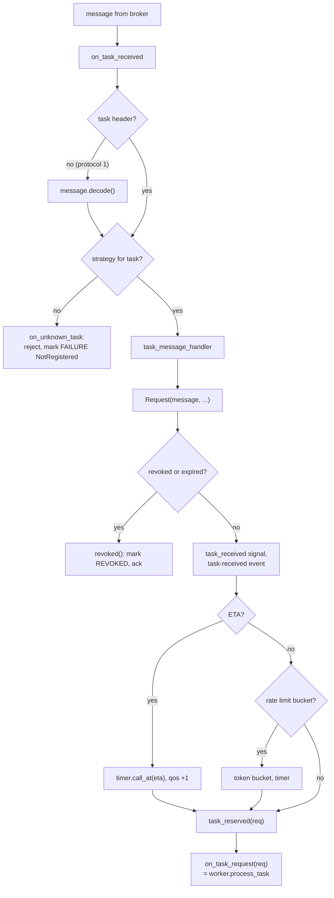

## Overview

The consumer is the part of a worker that talks to the broker. It holds the broker connection, consumes from the task queues, decides how many unacknowledged messages it may hold (prefetch), turns each message into a `Request`, and hands requests to the worker, which sends them to the pool. It is the last step of the worker blueprint ([[Worker Startup and Bootsteps]]) and has a blueprint of its own, whose steps also add events, worker discovery, heartbeats and remote control on the same connection. This page follows a message from the broker into `on_task_request`; [[Task Execution and Tracing]] continues from there.

Sources: [celery/worker/consumer/consumer.py:145-186](repo://celery/worker/consumer/consumer.py#L145-L186), [celery/worker/components.py:224-246](repo://celery/worker/components.py#L224-L246)

## The consumer blueprint

`Consumer.__init__` stores the `on_task_request` callback (the worker's `process_task`), creates a token bucket per task for rate limits, picks the loop (`asynloop` when the worker has a hub, `synloop` otherwise), and applies its blueprint with the default steps plus `app.steps['consumer']`.

Sources: [celery/worker/consumer/consumer.py:191-255](repo://celery/worker/consumer/consumer.py#L191-L255)

| Step | Requires | What it does |
| --- | --- | --- |
| `Connection` | | Opens the broker connection with retries and registers it with the hub |
| `Events` | `Connection` | Creates the event dispatcher (enabled for task events, heartbeats or gossip) |
| `Mingle` | `Events` | At startup, asks other workers for their revoked ids and logical clock |
| `Gossip` | `Mingle` | Listens to other workers' events: node join/leave/lost and leader elections |
| `Heart` | `Events` | Sends `worker-heartbeat` events on a timer |
| `Tasks` | `Mingle` | Sets QoS and starts the task consumer |
| `Control` | `Tasks` | Starts the remote-control mailbox when `worker_enable_remote_control` is on and the transport supports fanout |
| `DelayedDelivery` | `Tasks` | With quorum queues, declares and binds native delayed-delivery exchanges |
| `Agent` | `Connection` | Starts `worker_agent` if configured |
| `Evloop` | (last) | Runs the event loop |

Sources: [celery/worker/consumer/consumer.py:171-186](repo://celery/worker/consumer/consumer.py#L171-L186), [celery/worker/consumer/connection.py:1-45](repo://celery/worker/consumer/connection.py#L1-L45), [celery/worker/consumer/tasks.py:20-28](repo://celery/worker/consumer/tasks.py#L20-L28), [celery/worker/consumer/control.py:1-33](repo://celery/worker/consumer/control.py#L1-L33)

`Evloop` is marked `last`, so the blueprint's `start` ends inside `c.loop(...)` and stays there for as long as the connection is healthy. [[Events and Monitoring]] covers the events and heartbeat, and [[Remote Control and Inspection]] the control mailbox.

Sources: [celery/worker/consumer/consumer.py:857-872](repo://celery/worker/consumer/consumer.py#L857-L872)

## Connecting and reconnecting

`Consumer.start()` runs the blueprint in a loop until it is stopped. When starting raises one of the transport's connection errors (and channel errors, with `broker_channel_error_retry`), the consumer checks whether retrying is allowed: `broker_connection_retry_on_startup` decides for the very first connection when it is set, and `broker_connection_retry` otherwise. If retrying is disabled it raises `WorkerShutdown(1)`; running out of file descriptors (`EMFILE`) raises `WorkerTerminate(1)`. Otherwise it closes the old state with `on_close`, restarts the blueprint's steps and loops. A `restart_state` guard logs `Frequent restarts detected` and sleeps a second when restarts come too quickly.

Sources: [celery/worker/consumer/consumer.py:366-413](repo://celery/worker/consumer/consumer.py#L366-L413)

`ensure_connected` wraps every connection the consumer opens. With retries enabled it calls kombu's `ensure_connection` with up to `broker_connection_max_retries` attempts, logging each failure with the next retry time (or the failover to the next URL), and calls `maybe_shutdown` between attempts so a shutdown signal still works while the broker is down.

Sources: [celery/worker/consumer/consumer.py:568-622](repo://celery/worker/consumer/consumer.py#L568-L622)

Losing an established connection runs `on_connection_error_after_connected`. It closes the dead connection, and with `worker_cancel_long_running_tasks_on_connection_loss` cancels running `acks_late` tasks that have not been acknowledged, since the broker will redeliver them anyway. With `worker_enable_prefetch_count_reduction` (the default) it lowers the starting prefetch count by the number of tasks still running, so the new connection does not fetch a full window on top of them. The count grows back by one multiplier each time a message is acknowledged, until it reaches the maximum. This reduction is skipped for per-consumer QoS (quorum queues), where updates would not reach the running consumer. `on_close` also drops reserved requests that are not running, because their messages will be redelivered.

Sources: [celery/worker/consumer/consumer.py:419-491](repo://celery/worker/consumer/consumer.py#L419-L491), [celery/worker/consumer/consumer.py:532-547](repo://celery/worker/consumer/consumer.py#L532-L547), [celery/worker/consumer/consumer.py:788-815](repo://celery/worker/consumer/consumer.py#L788-L815)

## Prefetch and QoS

The worker passes `initial_prefetch_count` = concurrency × `worker_prefetch_multiplier` (default 4), or max autoscale concurrency × multiplier. The `Tasks` step applies it with `basic_qos` and wraps it in a kombu `QoS` object, capped by `worker_eta_task_limit`, which the rest of the consumer adjusts with `increment_eventually` and `decrement_eventually`. The loops apply pending changes only when they differ from the last value, between reads.

Sources: [celery/worker/components.py:224-230](repo://celery/worker/components.py#L224-L230), [celery/worker/consumer/tasks.py:29-57](repo://celery/worker/consumer/tasks.py#L29-L57), [celery/worker/loops.py:88-93](repo://celery/worker/loops.py#L88-L93)

`qos_global` decides whether prefetch applies per channel or per consumer. It follows the broker's QoS semantics, and is forced off when `worker_detect_quorum_queues` finds a quorum queue, because quorum queues only support per-consumer prefetch; the prefetch count is then static.

Sources: [celery/worker/consumer/tasks.py:103-124](repo://celery/worker/consumer/tasks.py#L103-L124)

`worker_disable_prefetch` (Redis only) patches the channel's `can_consume` so the worker fetches a new message only when fewer requests are reserved than it has pool slots, so idle workers can pick up tasks that a busy worker would otherwise have prefetched. On other brokers the setting is ignored with a warning.

Sources: [celery/worker/consumer/tasks.py:59-83](repo://celery/worker/consumer/tasks.py#L59-L83)

## The event loops

`asynloop` is used with the prefork and solo pools on transports that support asynchronous I/O. It installs `on_task_received` as the kombu consumer's callback, registers the worker and consumer steps with the hub (the pool registers its pipes there), starts consuming, calls `on_ready` (which sends `worker_ready`), and raises `WorkerLostError` if the pool processes did not start. Then it iterates the hub's loop: on each pass it checks the shutdown flags, raises any AMQP heartbeat error, and applies QoS changes. Each `next(loop)` processes ready file descriptors and due timers.

Sources: [celery/worker/loops.py:46-93](repo://celery/worker/loops.py#L46-L93)

`synloop` is the blocking fallback, used for eventlet, gevent and threads and for transports without async support. Each cycle runs pending operations (such as acknowledgements queued with `call_soon`), applies QoS, and calls `connection.drain_events(timeout=2.0)`. Both loops reset the hub and clear its timers when an exception escapes, so callbacks bound to the dead connection do not fire after reconnecting.

Sources: [celery/worker/loops.py:118-183](repo://celery/worker/loops.py#L118-L183), [celery/worker/consumer/consumer.py:257-294](repo://celery/worker/consumer/consumer.py#L257-L294)

AMQP heartbeats are checked by a timer at `broker_heartbeat_checkrate` times per negotiated interval; an error is stored and raised from the loop, which triggers the reconnect path. They are enabled only with a hub or a green pool.

Sources: [celery/worker/loops.py:22-43](repo://celery/worker/loops.py#L22-L43), [celery/worker/consumer/consumer.py:233-238](repo://celery/worker/consumer/consumer.py#L233-L238)

## From message to request

### Flow of one message

Sources: [celery/worker/consumer/consumer.py:723-786](repo://celery/worker/consumer/consumer.py#L723-L786), [celery/worker/strategy.py:132-208](repo://celery/worker/strategy.py#L132-L208)

### Dispatching by task name

`create_task_handler` returns `on_task_received`, called for every task message. With protocol 2 the task name is in `message.headers['task']` and the body is not decoded here; only a protocol-1 message without that header is decoded to find the name. The name selects a strategy from `consumer.strategies`, which `update_strategies` fills when the `Tasks` step starts by calling `task.start_strategy(app, consumer)` for every registered task and building each task's tracer. The handler receives acknowledgement and rejection callbacks wrapped in promises that run through `call_soon_ack`, so acks happen on the event loop thread, and that restore the prefetch count after a reconnect.

Sources: [celery/worker/consumer/consumer.py:716-786](repo://celery/worker/consumer/consumer.py#L716-L786), [celery/worker/consumer/consumer.py:264-286](repo://celery/worker/consumer/consumer.py#L264-L286)

### Messages that cannot be handled

| Problem | Handler | Outcome |
| --- | --- | --- |
| Body has no recognizable format | `on_unknown_message` | Rejected, `task_rejected` signal |
| Task name not registered in this worker | `on_unknown_task` | Rejected; state stored as `FAILURE` with `NotRegistered`; `task-failed` event; `task_unknown` signal |
| Invalid message or disallowed content type | `on_invalid_task` | Rejected, `task_rejected` signal |
| Body cannot be decoded | `on_decode_error` | Logged as critical and acknowledged |

Sources: [celery/worker/consumer/consumer.py:516-530](repo://celery/worker/consumer/consumer.py#L516-L530), [celery/worker/consumer/consumer.py:672-714](repo://celery/worker/consumer/consumer.py#L672-L714)

### The default strategy

`strategy.default(task, app, consumer)` runs once per task type and returns `task_message_handler`. It caches everything the handler needs (event dispatcher, timer, buckets, revoked set) and builds a `Request` subclass specialised for the task with `create_request_cls`. Old protocol-1 and hybrid messages are converted to the protocol-2 layout first.

Sources: [celery/worker/strategy.py:99-130](repo://celery/worker/strategy.py#L99-L130), [celery/worker/strategy.py:25-97](repo://celery/worker/strategy.py#L25-L97)

For each message, the handler runs the steps below.

Sources: [celery/worker/strategy.py:132-135](repo://celery/worker/strategy.py#L132-L135)

1. Builds the request with the message, ack/reject callbacks, headers and body.
2. Logs `Task ... received` at INFO level.
3. Returns early if the request has expired or its id is in the revoked set; `request.revoked()` stores `REVOKED` and acknowledges the message.
4. Sends the `task_received` signal and, when the task and worker send events, a `task-received` event.
5. With an ETA, converts it to a timestamp (rejecting the message without requeue if that fails), raises the prefetch count by one so the held message does not block others, and schedules the request on the timer (through the rate-limit bucket when there is one).
6. Without an ETA but with a rate limit, adds the request to the task's token bucket; the bucket releases requests as tokens become available, rescheduling itself on the timer.
7. Otherwise marks the request reserved, runs any `on_task_message` callbacks, and calls `on_task_request(req)`.

Sources: [celery/worker/strategy.py:132-208](repo://celery/worker/strategy.py#L132-L208), [celery/worker/consumer/consumer.py:329-364](repo://celery/worker/consumer/consumer.py#L329-L364), [celery/worker/consumer/consumer.py:659-663](repo://celery/worker/consumer/consumer.py#L659-L663)

When a delayed request becomes due, `apply_eta_task` reserves it, hands it to the worker and lowers the prefetch count again. Holding ETA tasks in the worker is why a large backlog of far-future tasks can occupy prefetch slots; `worker_eta_task_limit` caps how far the count may grow.

Sources: [celery/worker/consumer/consumer.py:659-663](repo://celery/worker/consumer/consumer.py#L659-L663), [celery/worker/consumer/tasks.py:54-57](repo://celery/worker/consumer/tasks.py#L54-L57)

## Worker discovery: Mingle and Gossip

At startup `Mingle` (on amqp, redis and gcpubsub transports, unless `--without-mingle`) sends a `hello` broadcast with a one-second timeout, carrying this worker's revoked ids. For every reply it adjusts the Lamport clock and merges the other worker's revoked ids, so a task revoked before this worker started is still refused.

Sources: [celery/worker/consumer/mingle.py:1-76](repo://celery/worker/consumer/mingle.py#L1-L76)

`Gossip` (amqp and redis, unless `--without-gossip`) consumes other workers' `worker.*` events into an events `State` and calls registered `node_join`, `node_leave` and `node_lost` handlers; a periodic check reports workers whose heartbeats stopped. It also implements elections: `worker-elect` events are collected and the lowest clock wins, which the `election` remote command uses to run a task on exactly one worker.

Sources: [celery/worker/consumer/gossip.py:36-135](repo://celery/worker/consumer/gossip.py#L36-L135), [celery/worker/consumer/gossip.py:136-206](repo://celery/worker/consumer/gossip.py#L136-L206)

## Native delayed delivery

When a quorum queue is configured on RabbitMQ, the `DelayedDelivery` step validates the configuration, then for each broker URL declares kombu's native delayed-delivery exchanges and queues (of type `broker_native_delayed_delivery_queue_type`, default `quorum`) and binds the worker's queues to them, retrying connection errors three times. This is the receiving side of the countdown routing described in [[Sending Tasks and Routing]].

Sources: [celery/worker/consumer/delayed_delivery.py:30-110](repo://celery/worker/consumer/delayed_delivery.py#L30-L110), [celery/worker/consumer/delayed_delivery.py:112-150](repo://celery/worker/consumer/delayed_delivery.py#L112-L150)

## Queues at runtime

`add_task_queue(queue, ...)` selects an existing queue or declares a new one with a direct exchange of the same name, adds it to the task consumer and starts consuming; `cancel_task_queue(queue)` deselects it and cancels consumption. The `add_consumer` and `cancel_consumer` remote commands call these.

Sources: [celery/worker/consumer/consumer.py:632-657](repo://celery/worker/consumer/consumer.py#L632-L657)

During a cold shutdown, `cancel_active_requests` cancels every running request except `acks_late` tasks that were already acknowledged or already succeeded, so the broker redelivers the rest. `acks_late` cancellations do not emit a retry signal.

Sources: [celery/worker/consumer/consumer.py:823-854](repo://celery/worker/consumer/consumer.py#L823-L854)
