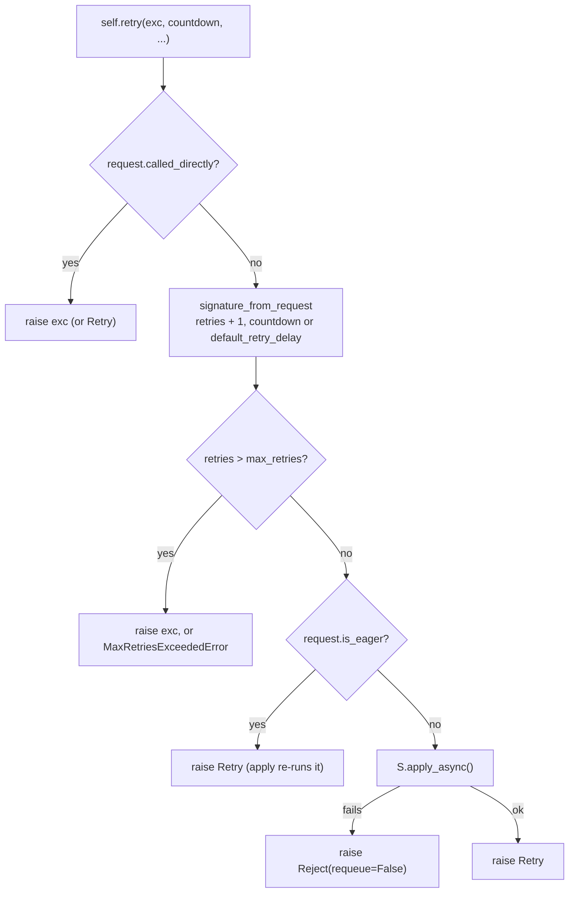

## Overview

A task is an instance of a subclass of `celery.app.task.Task`. `@app.task` generates that subclass from a function (see [[The Celery Application]] for the decorator and the registry); a class-based task subclasses `app.Task` directly and defines `run`. The class carries the task's options as attributes, gives the running body access to its request through `self.request`, and offers the calling API: `delay`, `apply_async`, `apply`, `retry`, `replace` and the signature shortcuts. This page covers those parts; [[Sending Tasks and Routing]] follows a call into a message and [[Task Execution and Tracing]] follows the message back into `run`.

Sources: [celery/app/task.py:206-235](repo://celery/app/task.py#L206-L235), [celery/app/task.py:495-518](repo://celery/app/task.py#L495-L518)

## Task options

Any keyword given to `@app.task(...)` becomes a class attribute of the generated task, so these attributes are also the decorator's options.

Sources: [celery/app/base.py:605-616](repo://celery/app/base.py#L605-L616)

| Attribute | Default | Meaning |
| --- | --- | --- |
| `name` | generated from module and function | Registry key and message `task` header |
| `typing` | `app.strict_typing` | Check call arguments against the function signature |
| `max_retries` | `3` | Retries before `MaxRetriesExceededError`; `None` retries forever |
| `default_retry_delay` | `180` | Seconds before a retry when no countdown is given |
| `rate_limit` | `task_default_rate_limit` | For example `'100/s'`, `'100/m'`, `'100/h'` |
| `ignore_result` | `task_ignore_result` | Do not store state and return value |
| `store_errors_even_if_ignored` | setting | Store failures even when results are ignored |
| `trail` | `True` | Record subtasks in `request.children` |
| `send_events` | `True` | Send task events when the worker has events enabled |
| `serializer` | `task_serializer` | kombu serializer for the message |
| `time_limit` / `soft_time_limit` | settings | Hard and soft limits in seconds |
| `track_started` | `task_track_started` | Store a `STARTED` state when execution begins |
| `acks_late` | `task_acks_late` | Acknowledge after running instead of before |
| `acks_on_failure` / `acks_on_timeout` | `True` | With `acks_late`, still acknowledge on failure / timeout |
| `reject_on_worker_lost` | setting | Requeue instead of acknowledging when the child process dies |
| `throws` | `()` | Expected exceptions: stored as failures but not logged as errors |
| `expires` | `None` | Default expiry for messages of this task |
| `priority` | `task_default_priority` | Default message priority (0 to 9) |
| `backend` | `app.backend` | Result backend for this task |
| `Request`, `Strategy` | worker defaults | Classes the worker uses to handle this task's messages |

Sources: [celery/app/task.py:213-300](repo://celery/app/task.py#L213-L300), [celery/app/task.py:301-391](repo://celery/app/task.py#L301-L391)

Attributes left as `None` are filled from configuration when the class is bound. `Task.bind(app)` stores the app, copies each pair in `from_config` (for example `serializer` from `task_serializer`, `acks_late` from `task_acks_late`) onto the class if the attribute is still `None`, derives `acks_on_failure` and `acks_on_timeout` from the deprecated `acks_on_failure_or_timeout` (or `True`), applies annotations the first time, creates the thread-local `request_stack`, and calls the `on_bound` hook. Reading `task.app` on an unbound class binds it to `current_app`.

Sources: [celery/app/task.py:396-475](repo://celery/app/task.py#L396-L475)

## The request context

While a task runs, `self.request` is a `Context` describing the current call. The worker builds it from the message headers, and `__call__` and `apply` build it for local calls. `request_stack` is a thread-local stack, so a task that calls itself inline gets a fresh context and gets the outer one back afterwards; outside any call, `request` returns an empty default `Context`.

Sources: [celery/app/task.py:75-115](repo://celery/app/task.py#L75-L115), [celery/app/task.py:1234-1254](repo://celery/app/task.py#L1234-L1254)

Its fields include `id`, `args`, `kwargs`, `retries`, `is_eager`, `eta`, `expires`, `group`, `group_index`, `chord`, `chain`, `callbacks`, `errbacks`, `root_id`, `parent_id`, `hostname`, `delivery_info`, `reply_to`, `correlation_id` and `called_directly`. `Context.update` keeps `time_limit` and `soft_time_limit` in step with the protocol's two-element `timelimit` field, and any header that is not a Celery field is collected into `request.headers`. `as_execution_options()` turns the context back into `apply_async` options, dropping RabbitMQ `x-death` headers so a retried message is not treated as a dead-letter cycle.

Sources: [celery/app/task.py:75-115](repo://celery/app/task.py#L75-L115), [celery/app/task.py:121-195](repo://celery/app/task.py#L121-L195), [celery/app/task.py:40-50](repo://celery/app/task.py#L40-L50)

A task gets `self` only when it is bound: `@app.task(bind=True)` stores the function itself as `run`, while the default stores it as a `staticmethod`.

Sources: [celery/app/base.py:604-606](repo://celery/app/base.py#L604-L606)

```python
@app.task(bind=True)
def refresh(self, url):
    try:
        return fetch(url)
    except ConnectionError as exc:
        raise self.retry(exc=exc, countdown=5)
```

Sources: [celery/app/task.py:756-867](repo://celery/app/task.py#L756-L867)

## Calling a task

There are four ways to run a task, and they differ in where the body runs.

Sources: [celery/app/task.py:495-536](repo://celery/app/task.py#L495-L536)

| Call | Runs | Returns |
| --- | --- | --- |
| `task(*args, **kwargs)` | Inline, in the caller | The return value |
| `task.delay(*args, **kwargs)` | On a worker | `AsyncResult` |
| `task.apply_async(args, kwargs, **options)` | On a worker, with options | `AsyncResult` |
| `task.apply(args, kwargs, **options)` | Inline, through the tracer | `EagerResult` |

Sources: [celery/app/task.py:495-536](repo://celery/app/task.py#L495-L536), [celery/app/task.py:869-951](repo://celery/app/task.py#L869-L951)

Calling the task object directly pushes the task on the current-task stack and a request with `called_directly=True`, then calls `run`. Signals, result storage and retries are not involved.

Sources: [celery/app/task.py:495-502](repo://celery/app/task.py#L495-L502)

`apply_async` does the checks that need the task class before handing off to the app, in this order.

Sources: [celery/app/task.py:536-537](repo://celery/app/task.py#L536-L537)

1. Raises `ValueError` if the class's `soft_time_limit` is greater than its `time_limit`.
2. When `typing` is on, calls the generated `__header__` checker with the arguments, so a wrong number of arguments raises `TypeError` in the caller rather than on the worker.
3. Computes the `shadow` name (see `shadow_name`, which a task can override to show a different name in logs and monitors).
4. Merges the class's execution options (`queue`, `routing_key`, `exchange`, `priority`, `expires`, `serializer`, `delivery_mode`, `compression`, `time_limit`, `soft_time_limit`) under the caller's options, and defaults `ignore_result` and `priority` from the class.
5. With `task_always_eager`, round-trips the arguments through the serializer, so non-serializable arguments fail just as they would when sent, and runs the task with `apply`.
6. Otherwise calls `app.send_task(self.name, ..., task_type=self)`.

Sources: [celery/app/task.py:668-708](repo://celery/app/task.py#L668-L708), [celery/app/task.py:31-35](repo://celery/app/task.py#L31-L35)

`apply` builds a request dict with `is_eager=True`, the parent and root ids taken from the task currently on the stack, and the links, then runs the same tracer the worker uses with `eager=True`. Exceptions propagate when `throw` is true, which defaults to `task_eager_propagates`. A `Retry` with a signature re-runs the task eagerly with `retries + 1`.

Sources: [celery/app/task.py:869-951](repo://celery/app/task.py#L869-L951)

## Retrying

### Manual retries

`self.retry(exc=None, countdown=None, eta=None, max_retries=None, throw=True, **options)` sends a new message for the same task id and raises `Retry` to end the current run.

Sources: [celery/app/task.py:756-867](repo://celery/app/task.py#L756-L867)



Sources: [celery/app/task.py:756-867](repo://celery/app/task.py#L756-L867)

`signature_from_request` copies the current request's execution options (id, root and parent, group, chord, chain, links, expiry, time limits, headers, stamps) so the retried message continues the same workflow. It keeps the message's priority, and routes it back to the same queue: when the message came through the default exchange it uses the routing key as the queue name, otherwise it reuses the delivery info. If publishing the retry fails, `retry` raises `Reject(requeue=False)`.

Sources: [celery/app/task.py:731-754](repo://celery/app/task.py#L731-L754), [celery/app/task.py:168-195](repo://celery/app/task.py#L168-L195)

### Automatic retries

`add_autoretry_behaviour` wraps `run` when the task declares `autoretry_for`. The wrapper calls the original `run` and, for an exception in `autoretry_for` that is not in `dont_autoretry_for`, `Ignore` or `Retry`, calls `task.retry(exc=exc, **retry_kwargs)`. With `retry_backoff` set, the countdown is `min(retry_backoff_max, factor * 2 ** retries)`, randomised to between 0 and that value when `retry_jitter` is true (the default); `retry_backoff_max` defaults to 600 seconds. A `max_retries` passed to an explicit `retry` call inside the body is honoured by the wrapper through `override_max_retries`.

Sources: [celery/app/autoretry.py:8-66](repo://celery/app/autoretry.py#L8-L66), [celery/utils/time.py:463-477](repo://celery/utils/time.py#L463-L477)

```python
@app.task(autoretry_for=(IOError,), retry_backoff=True,
          retry_kwargs={'max_retries': 5})
def sync(path):
    ...
```

Sources: [celery/app/autoretry.py:10-31](repo://celery/app/autoretry.py#L10-L31)

### Handler hooks

A task class can override `before_start`, `on_success`, `on_retry`, `on_failure` and `after_return`. The tracer calls them with the task id, arguments and, for errors, the exception and `ExceptionInfo`; [[Task Execution and Tracing]] shows when each runs.

Sources: [celery/app/task.py:1135-1209](repo://celery/app/task.py#L1135-L1209)

## Changing a running workflow

`self.replace(sig)` swaps the rest of the current task for another signature. It moves the task's callbacks and errbacks onto the new signature (pushing chain links down to its last task), turns a group into a chord ending in `celery.accumulate`, freezes the signature with the current task id so existing results still resolve, copies the chord, group and root ids, increments `replaced_task_nesting`, and appends the remainder of the current chain. `on_replace` then sends it and raises `Ignore`, or runs it inline for eager tasks. A signature that is part of a chord, or an empty chain, raises `ImproperlyConfigured`.

Sources: [celery/app/task.py:1029-1095](repo://celery/app/task.py#L1029-L1095), [celery/app/task.py:1211-1227](repo://celery/app/task.py#L1211-L1227)

`self.add_to_chord(sig, lazy=False)` adds a new task to the chord the current task belongs to: it gives the signature the same group and chord, tells the backend to expect one more result, and sends it. It raises `ValueError` outside a chord. `self.update_state(state=..., meta=...)` stores a custom state for the current or another task id, for reporting progress.

Sources: [celery/app/task.py:1097-1133](repo://celery/app/task.py#L1097-L1133)

## Signatures from a task

`task.s(*args, **kwargs)` creates a signature, `task.si(...)` an immutable one that ignores a parent's result, and `task.signature(args, kwargs, options)` the general form. `chunks(it, n)`, `map(it)` and `starmap(it)` build the canvas primitives of the same names. [[Canvas: Chains, Groups and Chords]] explains what to do with them. `task.AsyncResult(task_id)` builds a result bound to the task's backend and name.

Sources: [celery/app/task.py:953-1001](repo://celery/app/task.py#L953-L1001)

## Annotations

The `task_annotations` setting changes task attributes from configuration, without touching the task code. `prepare` accepts a dict, a list of dicts, or dotted names of annotation classes. A dict maps a task name, or `'*'` for every task, to attributes. When a class is bound for the first time, `annotate()` applies the first match by name and the first `'*'` match; a key starting with `@` wraps the method of that name instead of replacing it.

Sources: [celery/app/annotations.py:18-52](repo://celery/app/annotations.py#L18-L52), [celery/app/task.py:477-493](repo://celery/app/task.py#L477-L493)

```python
app.conf.task_annotations = {
    'tasks.add': {'rate_limit': '10/s'},
    '*': {'acks_late': True},
}
```

Sources: [celery/app/annotations.py:18-31](repo://celery/app/annotations.py#L18-L31)

## Pydantic arguments

`@app.task(pydantic=True)` wraps the function before the class is built. For each argument whose annotation is a pydantic `BaseModel` subclass (or an `Optional` of one), the wrapper calls `model_validate` on the incoming value, with `strict` and a context that includes the app and task name. If the return annotation is a model class and the function returns an instance of it, the wrapper returns `model_dump(mode='json')`, so the result is serializable. Without pydantic installed, decorating raises `ImproperlyConfigured`.

Sources: [celery/app/base.py:127-205](repo://celery/app/base.py#L127-L205), [celery/app/base.py:603-604](repo://celery/app/base.py#L603-L604)

## Pickling tasks

A task instance pickles to its name and module. Unpickling imports the module if needed and returns the task from the current app's registry, so a task passed between processes is always the one registered in the receiving process.

Sources: [celery/app/task.py:506-514](repo://celery/app/task.py#L506-L514), [celery/app/registry.py:61-68](repo://celery/app/registry.py#L61-L68)
