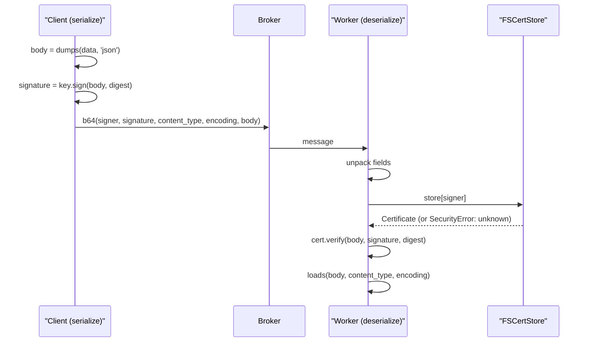

## Overview

Anyone who can publish to a Celery broker can make workers run tasks. Message signing limits that to holders of a trusted private key: every message is signed by the sender, and a worker refuses any message whose signature it cannot verify against a certificate in its certificate store. Celery implements this as a kombu serializer named `auth`, registered by `app.setup_security()`, so signing happens wherever messages are serialized and nothing else in the send or receive path changes. It needs the `cryptography` package; importing `celery.security` without it raises `ImproperlyConfigured`.

Sources: [celery/security/__init__.py:1-70](repo://celery/security/__init__.py#L1-L70), [celery/security/serialization.py:20-58](repo://celery/security/serialization.py#L20-L58)

## Configuration

Signing requires a private key, the certificate that matches it, and a store of certificates to trust when verifying. The example app in the repository shows a complete setup.

Sources: [celery/security/__init__.py:16-34](repo://celery/security/__init__.py#L16-L34)

```python
app.conf.update(
    security_key='ssl/worker.key',
    security_certificate='ssl/worker.pem',
    security_cert_store='ssl/*.pem',
    task_serializer='auth',
    event_serializer='auth',
    accept_content=['auth'],
    result_accept_content=['json']
)
app.setup_security()
```

Sources: [examples/security/mysecureapp.py:30-45](repo://examples/security/mysecureapp.py#L30-L45)

| Setting | Meaning |
| --- | --- |
| `security_key` | Path to the PEM private key used to sign |
| `security_key_password` | Password for an encrypted key (bytes) |
| `security_certificate` | Path to the PEM certificate for that key; identifies the signer |
| `security_cert_store` | Directory or glob of trusted PEM certificates |
| `security_digest` | Hash algorithm for signatures, default `sha256` |
| `task_serializer` | Must be `'auth'` |
| `accept_content` | Must be exactly `['auth']` |

Sources: [celery/app/defaults.py:239-246](repo://celery/app/defaults.py#L239-L246), [celery/app/defaults.py:20-20](repo://celery/app/defaults.py#L20-L20), [celery/security/__init__.py:53-65](repo://celery/security/__init__.py#L53-L65)

Results are not signed by this setting: `result_serializer` and `result_accept_content` stay as configured, which is why the example accepts JSON results. Both clients and workers need the same configuration and must call `setup_security()`, the clients to sign and the workers to verify.

Sources: [examples/security/mysecureapp.py:38-45](repo://examples/security/mysecureapp.py#L38-L45), [celery/app/defaults.py:205-230](repo://celery/app/defaults.py#L205-L230)

## setup_security

`app.setup_security(allowed_serializers=None, key=None, key_password=None, cert=None, store=None, digest='sha256', serializer='json')` calls `celery.security.setup_security`, which goes through these steps.

Sources: [celery/security/__init__.py:44-50](repo://celery/security/__init__.py#L44-L50)

1. Disables kombu's insecure serializers (pickle, yaml, msgpack) except those listed in `allowed_serializers`.
2. Raises `ImproperlyConfigured` unless `task_serializer == 'auth'` and `accept_content == ['auth']`. Signing without refusing unsigned messages would protect nothing.
3. Takes the key, password, certificate, store and digest from the arguments or the `security_*` settings, and raises `ImproperlyConfigured` if the key, certificate or store is missing.
4. Reads the key and certificate files and registers the `auth` serializer with kombu, then makes it kombu's default serializer.

Sources: [celery/app/base.py:750-780](repo://celery/app/base.py#L750-L780), [celery/security/__init__.py:44-74](repo://celery/security/__init__.py#L44-L74)

The registration is global to the process, affecting every app in it. `serializer` names the format the signed body uses inside the envelope (JSON by default).

Sources: [celery/app/base.py:753-760](repo://celery/app/base.py#L753-L760), [celery/security/serialization.py:80-90](repo://celery/security/serialization.py#L80-L90)

## Signing and verifying

`register_auth` builds a `SecureSerializer` from a `PrivateKey`, a `Certificate` and an `FSCertStore`, and registers its `serialize`/`deserialize` pair as `auth` with content type `application/data`.

Sources: [celery/security/serialization.py:80-90](repo://celery/security/serialization.py#L80-L90)



Sources: [celery/security/serialization.py:31-77](repo://celery/security/serialization.py#L31-L77)

`serialize(data)` first serializes the data with the inner serializer, then signs the resulting bytes. Signing the serialized body rather than the data means the receiver can check the signature before decoding anything, so a malicious payload never reaches a decoder. The envelope joins five fields with the separator `\x00\x01`: the base64 signer id, the base64 signature, the content type, the content encoding and the body. The whole envelope is base64-encoded.

Sources: [celery/security/serialization.py:14-46](repo://celery/security/serialization.py#L14-L46), [celery/security/serialization.py:60-66](repo://celery/security/serialization.py#L60-L66)

`deserialize(data)` splits the envelope, looks up the signer's certificate in the store, and verifies the signature over the body. Only then does it decode the body with the embedded content type, forcing the decode because `auth` is the only accepted type. Any failure along the way, such as a malformed envelope, unknown signer or bad signature, is raised as `SecurityError`, so the message is rejected as invalid ([[The Consumer]] covers how invalid messages are handled).

Sources: [celery/security/serialization.py:48-77](repo://celery/security/serialization.py#L48-L77), [celery/security/utils.py:19-28](repo://celery/security/utils.py#L19-L28)

## Keys and certificates

`PrivateKey` loads a PEM key (decrypting it with the password if given) and accepts only RSA keys. It signs with RSA-PSS, using MGF1 with the configured digest and the maximum salt length. `get_digest_algorithm` maps the digest name to the matching `cryptography` hash class, for example `sha256` to `SHA256`.

Sources: [celery/security/key.py:12-35](repo://celery/security/key.py#L12-L35), [celery/security/utils.py:13-16](repo://celery/security/utils.py#L13-L16)

`Certificate` loads a PEM X.509 certificate and also accepts only RSA public keys. A certificate's id is its issuer followed by its serial number; this id travels in each message as the signer and is how the receiver finds the right certificate. `verify()` checks an RSA-PSS signature with the same padding the key uses.

Sources: [celery/security/certificate.py:31-73](repo://celery/security/certificate.py#L31-L73)

`FSCertStore(path)` loads every file matching a directory (all files in it) or glob. It refuses to start if any certificate has expired or two certificates have the same id, raising `SecurityError`. Looking up an unknown id also raises `SecurityError`. To trust a new sender, add its certificate to the store on every worker and restart them.

Sources: [celery/security/certificate.py:76-113](repo://celery/security/certificate.py#L76-L113)

## Generating a key pair

The example's instructions create a self-signed RSA certificate and remove the key's passphrase.

Sources: [examples/security/mysecureapp.py:5-12](repo://examples/security/mysecureapp.py#L5-L12)

```bash
mkdir ssl
openssl req -x509 -newkey rsa:4096 -keyout ssl/worker.key -out ssl/worker.pem -days 365
openssl rsa -in ssl/worker.key -out ssl/worker.key
```

Sources: [examples/security/mysecureapp.py:1-26](repo://examples/security/mysecureapp.py#L1-L26)

With a single shared key, every party that signs can also impersonate the others. For separate identities, give each sender its own key and certificate and put all of their certificates in the workers' store.

Sources: [celery/security/certificate.py:61-63](repo://celery/security/certificate.py#L61-L63), [celery/security/certificate.py:86-97](repo://celery/security/certificate.py#L86-L97)
