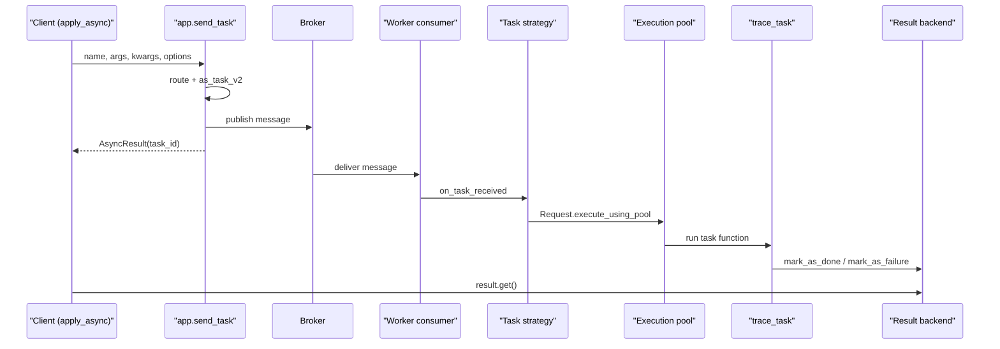

## Overview

Celery is a distributed task queue for Python. A program calls a function decorated as a task; instead of running it in place, Celery serializes the call into a message and publishes it to a broker. One or more worker processes consume those messages, run the function, and optionally store the return value in a result backend where the caller can read it. The package exports the handful of names an application needs, `Celery`, `Task`, `shared_task` and the canvas primitives (`signature`, `chain`, `group`, `chord`, `chunks`), and imports each module only when one of those names is first touched.

Sources: [celery/__init__.py:36-41](repo://celery/__init__.py#L36-L41), [celery/__init__.py:149-180](repo://celery/__init__.py#L149-L180)

Everything starts from an application object, an instance of `Celery`. Its constructor records the broker URL, the result backend and the modules to import, and builds a lazily evaluated configuration; the AMQP layer, the backend, the remote-control client and the event dispatcher are created on first use. Messaging itself is delegated to kombu: the app class exposes kombu's `Connection`, `Producer` and `Consumer` through `app.amqp`, so Celery works with any transport kombu supports (RabbitMQ, Redis, SQS and others).

Sources: [celery/app/base.py:343-434](repo://celery/app/base.py#L343-L434), [celery/app/amqp.py:225-264](repo://celery/app/amqp.py#L225-L264)

## Parts of Celery

| Area | What it does | Page |
| --- | --- | --- |
| Application | The `Celery` object: configuration, task registry, lazy subsystems, current app | [[The Celery Application]] |
| Configuration | Setting names, defaults, `config_from_object`, loaders | [[Configuration and Loaders]] |
| Tasks | The `Task` class, options, retries, the request context | [[Defining Tasks]] |
| Sending | `send_task`, routing, message protocol, producers | [[Sending Tasks and Routing]] |
| Canvas | Signatures, chains, groups, chords | [[Canvas: Chains, Groups and Chords]] |
| Results | `AsyncResult`, `GroupResult`, task states | [[Task Results]] |
| Result backends | Storing states and return values (Redis, RPC, database and more) | [[Result Backends]] |
| Worker | `WorkController`, bootsteps, startup and shutdown | [[Worker Startup and Bootsteps]] |
| Consumer | Receiving messages, prefetch, the event loop, task strategies | [[The Consumer]] |
| Execution | `Request`, tracing, acknowledgement, time limits | [[Task Execution and Tracing]] |
| Pools | prefork, threads, solo, eventlet, gevent | [[Execution Pools]] |
| Beat | Sending periodic tasks on a schedule | [[Periodic Tasks with Beat]] |
| Schedules | `schedule`, `crontab`, `solar` | [[Schedules: Intervals, Crontab and Solar]] |
| Events | Worker and task events, monitors | [[Events and Monitoring]] |
| Remote control | `inspect` and `control` broadcast commands | [[Remote Control and Inspection]] |
| Signals | Hooks around tasks, workers and beat | [[Signals]] |
| CLI | The `celery` command and its subcommands | [[Command-Line Interface]] |
| Daemons | `celery multi`, pidfiles, detaching | [[celery multi and Daemonization]] |
| Security | Signing task messages | [[Message Signing]] |
| Django | The Django fix-up and `DjangoTask` | [[Django Integration]] |
| Testing | pytest fixtures and an embedded test worker | [[Testing with Celery]] |

Sources: [celery/app/base.py:300-308](repo://celery/app/base.py#L300-L308), [celery/worker/worker.py:76-88](repo://celery/worker/worker.py#L76-L88)

## The life of a task

Sources: [celery/app/base.py:1018-1041](repo://celery/app/base.py#L1018-L1041), [celery/worker/consumer/consumer.py:723-783](repo://celery/worker/consumer/consumer.py#L723-L783), [celery/worker/request.py:341-372](repo://celery/worker/request.py#L341-L372), [celery/app/trace.py:568-626](repo://celery/app/trace.py#L568-L626)

1. **Call.** `Task.apply_async` (or `delay`) ends in `Celery.send_task`, which gives the call a UUID, merges the task's execution options and asks the router for a queue: [[Defining Tasks]] and [[Sending Tasks and Routing]].
2. **Build and publish.** `app.amqp.create_task_message` builds a protocol-2 message, and the app publishes it through a pooled producer, then returns an `AsyncResult` for the new id: [[Sending Tasks and Routing]] and [[Task Results]].
3. **Receive.** In the worker, the consumer's `on_task_received` reads the task name from the message headers and looks up that task's strategy: [[The Consumer]].
4. **Reserve.** The default strategy builds a `Request`, drops it if it was revoked or expired, defers it if it has an ETA or a rate limit, and otherwise hands it to the worker: [[The Consumer]].
5. **Execute.** `Request.execute_using_pool` sends the tracer to the pool with time limits and callbacks for acceptance, success, failure and timeout: [[Task Execution and Tracing]] and [[Execution Pools]].
6. **Trace.** In the pool process, `trace_task` sends `task_prerun`, calls the function, dispatches callbacks and chained tasks, records the result with `backend.mark_as_done` or handles the error, then sends `task_postrun`: [[Task Execution and Tracing]] and [[Signals]].
7. **Read.** The caller's `AsyncResult.get()` reads the state and value from the backend: [[Task Results]] and [[Result Backends]].

Sources: [celery/app/base.py:1018-1041](repo://celery/app/base.py#L1018-L1041), [celery/worker/strategy.py:132-208](repo://celery/worker/strategy.py#L132-L208), [celery/worker/worker.py:223-230](repo://celery/worker/worker.py#L223-L230)

Periodic tasks enter the same flow from a different client: the beat service decides when an entry is due and calls `send_task` for it, as [[Periodic Tasks with Beat]] explains.

Sources: [celery/beat.py:393-421](repo://celery/beat.py#L393-L421)

## Design decisions

### Lazy proxies and the current app

Celery avoids importing or creating anything until it is used. The top-level `celery` module is replaced by a module that imports `celery.app`, `celery.canvas` and the rest on first attribute access, which keeps `import celery` cheap. The `@app.task` decorator returns a `PromiseProxy` and queues it in `app._pending` unless the app is already finalized, so modules can declare tasks before the app has read its configuration; `finalize()` later evaluates every pending proxy and binds each registered task to the app.

Sources: [celery/__init__.py:149-180](repo://celery/__init__.py#L149-L180), [celery/app/base.py:554-575](repo://celery/app/base.py#L554-L575), [celery/app/base.py:657-677](repo://celery/app/base.py#L657-L677)

Code that has no app in hand reaches one through `current_app`, a `Proxy` whose target is looked up on every access. `_state` keeps the current app in a thread-local, falls back to a global default app created on demand, and tracks the executing task on a thread-local stack. Libraries can therefore define tasks with `shared_task`, which registers a callback that creates the task in every app that is finalized.

Sources: [celery/_state.py:62-104](repo://celery/_state.py#L62-L104), [celery/local.py:52-110](repo://celery/local.py#L52-L110), [celery/app/__init__.py:24-76](repo://celery/app/__init__.py#L24-L76)

### Bootsteps

Both the worker and its consumer are assembled from bootsteps: small `Step` classes that declare what they `requires`. A `Blueprint` resolves those dependencies into a start order and calls `start`, `stop` and `shutdown` on each step, which lets an application add or replace parts of the worker through `app.steps` without subclassing it. [[Worker Startup and Bootsteps]] covers the graph.

Sources: [celery/bootsteps.py:74-118](repo://celery/bootsteps.py#L74-L118), [celery/bootsteps.py:288-320](repo://celery/bootsteps.py#L288-L320), [celery/worker/consumer/consumer.py:171-186](repo://celery/worker/consumer/consumer.py#L171-L186)

### Message protocol 2

The default `task_protocol` is 2. In this protocol the task name, id, ETA, retries, time limits and parentage travel in message headers, and the body holds only `(args, kwargs, embed)`. The worker can therefore route, revoke, delay or rate-limit a message by reading its headers, and leave deserializing the arguments to the pool process; the consumer only calls `message.decode()` for protocol-1 messages that lack a `task` header.

Sources: [celery/app/defaults.py:295-295](repo://celery/app/defaults.py#L295-L295), [celery/app/amqp.py:371-418](repo://celery/app/amqp.py#L371-L418), [celery/worker/consumer/consumer.py:731-747](repo://celery/worker/consumer/consumer.py#L731-L747)
