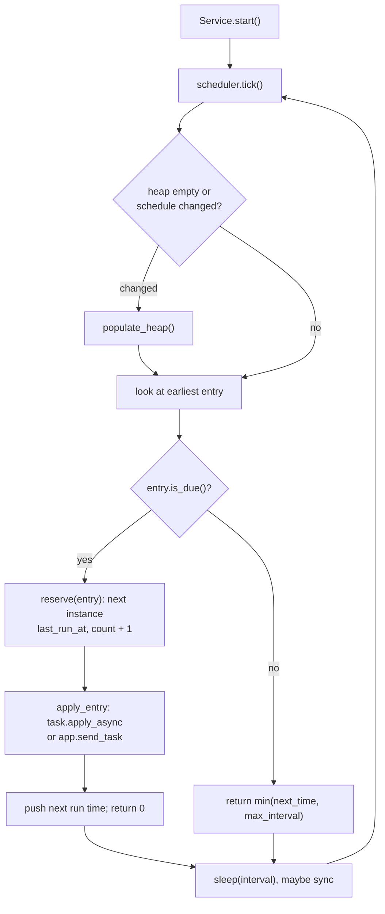

## Overview

Beat is Celery's clock. It is a separate service that reads a schedule of entries, wakes up when the next entry is due, and sends that entry's task to the broker like any other client; workers then run it as usual. Beat does not execute tasks itself, and only one beat should run per schedule, or every due task is sent once per beat process. This page follows `celery beat` from the command line through the service loop and the scheduler, and explains where the schedule comes from and how it is stored. [[Schedules: Intervals, Crontab and Solar]] covers how each entry decides that it is due.

Sources: [celery/beat.py:612-680](repo://celery/beat.py#L612-L680), [celery/beat.py:393-421](repo://celery/beat.py#L393-L421)

## Declaring periodic tasks

### The beat_schedule setting

The schedule is the `beat_schedule` setting: a dict from entry name to a dict with `task` (the task name), `schedule`, and optionally `args`, `kwargs`, `options` (any `apply_async` option) and `relative`. The schedule value may be a `timedelta`, a number of seconds, or a schedule object such as `crontab`.

Sources: [celery/app/defaults.py:73-81](repo://celery/app/defaults.py#L73-L81), [celery/beat.py:117-128](repo://celery/beat.py#L117-L128)

```python
from celery.schedules import crontab

app.conf.beat_schedule = {
    'cleanup-every-morning': {
        'task': 'tasks.cleanup',
        'schedule': crontab(hour=7, minute=30),
        'args': ('reports',),
        'options': {'queue': 'maintenance'},
    },
}
```

Sources: [celery/beat.py:446-472](repo://celery/beat.py#L446-L472)

Arguments that should be computed when the task is sent, rather than when the schedule is defined, can be wrapped in `BeatLazyFunc(func, *args, **kwargs)`; beat calls it each time it applies the entry.

Sources: [celery/beat.py:50-78](repo://celery/beat.py#L50-L78), [celery/beat.py:201-216](repo://celery/beat.py#L201-L216)

### add_periodic_task

`app.add_periodic_task(schedule, sig, args=(), kwargs=(), name=None, **opts)` adds an entry from a signature. It clones the signature with the given arguments, merges the signature's options with `opts`, and stores the entry in `beat_schedule` under `name`, or under the signature's `repr` when no name is given. Two unnamed entries for the same signature therefore collide, and the second replaces the first with a warning. Called before the app is configured, the entry is queued and added when configuration loads. The usual place to call it is an `on_after_configure` handler, as in the example app.

Sources: [celery/app/base.py:1295-1333](repo://celery/app/base.py#L1295-L1333)

```python
@app.on_after_configure.connect
def setup_periodic_tasks(sender, **kwargs):
    # Calls say('hello') every 10 seconds.
    sender.add_periodic_task(10.0, say.s('hello'), name='add every 10')
```

Sources: [examples/periodic-tasks/myapp.py:45-51](repo://examples/periodic-tasks/myapp.py#L45-L51)

### The default cleanup entry

When `result_expires` is set and the result backend does not expire results on its own, the scheduler adds `celery.backend_cleanup` at 4:00 every day with a 12-hour expiry, which deletes old results from backends such as the database ([[Result Backends]]).

Sources: [celery/beat.py:268-277](repo://celery/beat.py#L268-L277)

## Running beat

`celery beat` applies any trailing `key=value` configuration, drops privileges unless detaching, and runs `app.Beat(...)`, in a daemon context with `--detach`. Its options include `-s/--schedule` (the schedule file), `-S/--scheduler` (the scheduler class), `--max-interval` and `-l/--loglevel`.

Sources: [celery/bin/beat.py:13-72](repo://celery/bin/beat.py#L13-L72)

`celery.apps.beat.Beat.run()` prints a start line, calls the loader's `init_worker()` and finalizes the app so task modules are imported, sets the process title, and starts the scheduler. `start_scheduler` creates the pidfile lock, builds a `Service`, prints the banner with the broker, scheduler and maximum interval, sets up logging and an optional default socket timeout, and installs `SIGTERM` and `SIGINT` handlers that save the schedule and exit.

Sources: [celery/apps/beat.py:78-160](repo://celery/apps/beat.py#L78-L160)

A worker can also run beat inside itself with `-B`. The worker's `Beat` bootstep creates an `EmbeddedService`: a child process running the service, or a daemon thread with a one-second maximum interval when multiprocessing is not available or `thread=True` is passed. Eventlet and gevent workers refuse `-B`. [[Worker Startup and Bootsteps]] lists the step.

Sources: [celery/beat.py:682-738](repo://celery/beat.py#L682-L738), [celery/worker/components.py:184-201](repo://celery/worker/components.py#L184-L201)

## The service loop

`Service.start()` sends `beat_init` (and `beat_embedded_init` when embedded), then loops until shut down: it calls `scheduler.tick()`, which returns how long to sleep, sleeps that long, and syncs the schedule if a sync is due. On `KeyboardInterrupt` or `SystemExit` it stops, and on the way out it always closes the scheduler, which saves the schedule. `stop(wait=True)` sets the shutdown flag and waits for that to finish.

Sources: [celery/beat.py:633-664](repo://celery/beat.py#L633-L664)

The scheduler class comes from `beat_scheduler` (default `celery.beat:PersistentScheduler`), or `-S`; names registered under the `celery.beat_schedulers` entry point are accepted as aliases, which is how database-backed schedulers plug in.

Sources: [celery/beat.py:666-680](repo://celery/beat.py#L666-L680), [celery/app/defaults.py:73-81](repo://celery/app/defaults.py#L73-L81)



Sources: [celery/beat.py:310-364](repo://celery/beat.py#L310-L364), [celery/beat.py:633-655](repo://celery/beat.py#L633-L655)

## The scheduler

### Ticks and the heap

`Scheduler.tick()` keeps a heap of `(time, priority, entry)` events ordered by the next time each entry should run. It rebuilds the heap when it has none or when the schedule's entries differ from the copy taken at the last rebuild, so editing the schedule takes effect on the next tick. Each tick looks only at the earliest event. If its entry is due, the tick reserves it, sends it, pushes the entry's next run time and returns 0, so the next tick runs at once and due entries are sent one per tick. If not, it returns the time until that entry is due, capped by `max_interval` (`beat_max_loop_interval`, or 300 seconds). Run times are computed as UTC timestamps and nudged 10 ms early to absorb drift.

Sources: [celery/beat.py:219-251](repo://celery/beat.py#L219-L251), [celery/beat.py:292-379](repo://celery/beat.py#L292-L379), [celery/beat.py:37-43](repo://celery/beat.py#L37-L43)

### Sending an entry

`reserve(entry)` replaces the entry with its next instance, updating `last_run_at` to now and incrementing `total_run_count`, before the task is sent. If sending fails, the entry is still advanced and is not retried in a tight loop. `apply_async` evaluates any lazy arguments and calls the task's own `apply_async` with the entry's options when the task is registered in beat's process, or `app.send_task` by name when it is not, so beat does not need to import task code. Any exception is re-raised as `SchedulingError`, which `apply_entry` logs. Every send counts towards the next sync.

Sources: [celery/beat.py:279-290](repo://celery/beat.py#L279-L290), [celery/beat.py:389-421](repo://celery/beat.py#L389-L421), [celery/beat.py:134-141](repo://celery/beat.py#L134-L141)

The producer uses a connection made with `ensure_connection`, retrying up to `broker_connection_max_retries` and logging each failure, so beat waits for the broker rather than exiting.

Sources: [celery/beat.py:474-499](repo://celery/beat.py#L474-L499)

### Schedule entries

`ScheduleEntry` holds `name`, `task`, `schedule`, `args`, `kwargs`, `options`, `last_run_at` (defaulting to now) and `total_run_count`. Its `schedule` is passed through `maybe_schedule`, so a number or `timedelta` becomes an interval schedule. `is_due()` delegates to the schedule with `last_run_at`. Two entries compare equal when their editable fields, task, schedule, args, kwargs and options, match, and `update()` copies only those fields, preserving run history when the configuration changes.

Sources: [celery/beat.py:82-199](repo://celery/beat.py#L82-L199)

`merge_inplace(beat_schedule)` reconciles the stored schedule with the configured one: entries that are no longer configured are removed, existing ones are updated in place, and new ones are added.

Sources: [celery/beat.py:423-472](repo://celery/beat.py#L423-L472)

## Persisting the schedule

The base `Scheduler` keeps entries in memory. `PersistentScheduler` keeps them in a `shelve` database at `beat_schedule_filename` (`celerybeat-schedule` by default, or `-s`), so `last_run_at` survives restarts and a restarted beat does not resend everything at once or skip runs.

Sources: [celery/beat.py:505-610](repo://celery/beat.py#L505-L610)

Setting up the store opens the shelve file. A file that cannot be opened or read is deleted, with every known suffix (`.db`, `.dat`, `.bak`, `.dir`), and recreated. The store is cleared when its `tz` or `utc_enabled` differ from the current `timezone` and `enable_utc` settings, because stored run times would be interpreted in the wrong zone; files from much older versions without those keys are cleared too. The scheduler then merges `beat_schedule`, adds the default entries, records the version and time zone, and syncs.

Sources: [celery/beat.py:522-590](repo://celery/beat.py#L522-L590)

Syncing writes the shelve to disk. `should_sync()` is true every `sync_every` seconds (3 minutes) or, with `beat_sync_every` set, after that many sent tasks. The service also syncs on exit and in the `SIGTERM`/`SIGINT` handler.

Sources: [celery/beat.py:238-245](repo://celery/beat.py#L238-L245), [celery/beat.py:381-387](repo://celery/beat.py#L381-L387), [celery/beat.py:427-436](repo://celery/beat.py#L427-L436), [celery/beat.py:599-606](repo://celery/beat.py#L599-L606)
