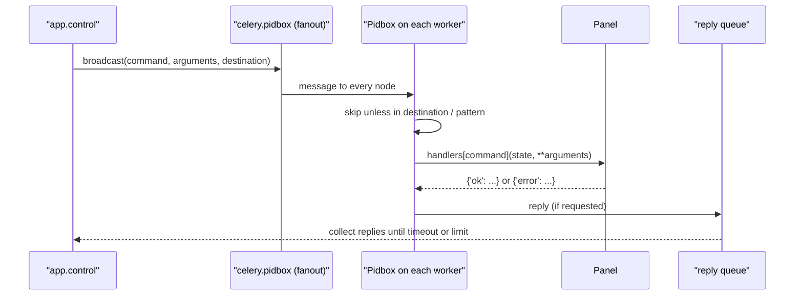

## Overview

Remote control lets any client talk to running workers: ask what they are doing (inspect commands) or change what they do (control commands), such as revoking a task, changing a rate limit, resizing the pool, consuming from another queue or shutting down. It runs over kombu's pidbox mailbox, a fanout exchange every worker listens on, with optional replies sent back on a per-client reply queue. The client side is `app.control` (`celery.app.control.Control` and `Inspect`); the worker side is the `Control` consumer step, the `Pidbox` that receives messages, and the `Panel` registry of commands in `celery.worker.control`. [[Command-Line Interface]] covers `celery inspect` and `celery control`, which wrap this API.

Sources: [celery/app/control.py:426-452](repo://celery/app/control.py#L426-L452), [celery/worker/control.py:39-75](repo://celery/worker/control.py#L39-L75), [celery/worker/pidbox.py:20-49](repo://celery/worker/pidbox.py#L20-L49)



Sources: [celery/app/control.py:755-790](repo://celery/app/control.py#L755-L790), [celery/worker/pidbox.py:25-54](repo://celery/worker/pidbox.py#L25-L54)

## The mailbox

`Control.__init__` creates a kombu `Mailbox` named after `control_exchange` (default `celery`), of type fanout, using the task serializer and accepted content types, publishing through the app's producer pool. Queue settings come from `control_queue_ttl` (300 s), `control_queue_expires` (10 s), `control_queue_exclusive` (true) and `control_queue_durable` (false); asking for a durable exclusive queue raises `ImproperlyConfigured`. After a fork, the mailbox's producer pool is discarded so the child does not reuse the parent's connections.

Sources: [celery/app/control.py:431-456](repo://celery/app/control.py#L431-L456), [celery/app/defaults.py:151-157](repo://celery/app/defaults.py#L151-L157)

`broadcast(command, arguments=None, destination=None, reply=False, timeout=1.0, limit=None, callback=None, pattern=None, matcher=None)` is the single entry point. It acquires a connection and calls the mailbox's `_broadcast`. `destination` is a list of node names (all workers when empty); `pattern` and `matcher` select nodes by pattern instead. With `reply=True` it waits up to `timeout` seconds, or until `limit` replies arrive, calling `callback` for each reply as it comes, and returns the list of replies.

Sources: [celery/app/control.py:755-790](repo://celery/app/control.py#L755-L790)

Worker names must be unique for replies to make sense. `flatten_reply` merges the per-node reply dicts and warns with `DuplicateNodenameWarning` when two replies come from the same name, which happens when workers are started without distinct `-n` names.

Sources: [celery/app/control.py:31-63](repo://celery/app/control.py#L31-L63)

## Inspecting workers

`app.control.inspect(destination=None, timeout=1.0, callback=None, connection=None, limit=None, pattern=None, matcher=None)` returns an `Inspect` object. Each of its methods sends one inspect command with `reply=True` and returns `{hostname: reply}`; with a single string destination it returns that node's reply alone.

Sources: [celery/app/control.py:73-117](repo://celery/app/control.py#L73-L117), [celery/app/control.py:458-460](repo://celery/app/control.py#L458-L460)

| Method | Worker returns |
| --- | --- |
| `ping()` | `{'ok': 'pong'}` (0.2 s default timeout on the worker side) |
| `active(safe=None)` | Info for requests a pool process is running |
| `reserved()` | Requests received but not yet running |
| `scheduled()` | Requests waiting on the timer for their ETA, with priority |
| `revoked()` | Revoked task ids in the worker's set |
| `registered(*taskinfoitems)` | Registered task names, with requested attributes |
| `query_task(*ids)` | `{id: [state, info]}` with state `active`, `reserved` or `ready` |
| `stats()` | `WorkController.stats()`: pid, uptime, totals, pool and broker info, rusage |
| `active_queues()` | Queues the task consumer is consuming from |
| `conf(with_defaults=False)` | Configuration, censored and JSON-safe |
| `clock()` | Logical clock value |
| `report()` | `app.bugreport()` |
| `memsample()`, `memdump()`, `objgraph()` | Memory diagnostics |

Sources: [celery/worker/control.py:79-133](repo://celery/worker/control.py#L79-L133), [celery/worker/control.py:399-490](repo://celery/worker/control.py#L399-L490), [celery/worker/control.py:631-637](repo://celery/worker/control.py#L631-L637)

```python
i = app.control.inspect(['celery@worker1'])
i.active()      # {'celery@worker1': [{'id': ..., 'name': ..., 'args': ..., ...}]}
i.query_task('d9078da5-9915-40a0-bfa1-392c7bde42ed')
```

Sources: [celery/app/control.py:138-151](repo://celery/app/control.py#L138-L151), [celery/app/control.py:342-372](repo://celery/app/control.py#L342-L372)

`active`, `reserved` and `scheduled` return `Request.info()` for each request: id, name, args, kwargs, type, hostname, start time, acknowledged flag, delivery info and worker pid. With `safe=True`, `active` avoids deserializing arguments. `hello` is a hidden inspect command used by Mingle: it merges the caller's revoked ids and returns this worker's revoked ids and clock ([[The Consumer]]).

Sources: [celery/worker/request.py:742-756](repo://celery/worker/request.py#L742-L756), [celery/worker/control.py:381-396](repo://celery/worker/control.py#L381-L396)

## Controlling workers

### Control commands

`Control` has one method per control command; each calls `broadcast`, without waiting for replies unless `reply=True` is passed.

Sources: [celery/app/control.py:488-510](repo://celery/app/control.py#L488-L510), [celery/app/control.py:667-753](repo://celery/app/control.py#L667-L753)

| Method | Effect on each worker |
| --- | --- |
| `revoke(task_id, terminate=False, signal='SIGTERM')` | Adds ids to the revoked set, stores `REVOKED`; with `terminate`, kills the running process |
| `revoke_by_stamped_headers(headers, terminate=False)` | Revokes tasks whose stamps match the given header values |
| `terminate(task_id, signal)` | Revoke with `terminate=True` |
| `rate_limit(task_name, rate_limit)` | Sets the task's `rate_limit` and rebuilds the token buckets |
| `time_limit(task_name, soft, hard)` | Sets the task's soft and hard limits for new requests |
| `enable_events()`, `disable_events()` | Adds or removes the `task` event group |
| `heartbeat()` | Sends a `worker-heartbeat` event now |
| `add_consumer(queue, exchange, exchange_type, routing_key)` | Starts consuming from the queue |
| `cancel_consumer(queue)` | Stops consuming from the queue |
| `pool_grow(n)`, `pool_shrink(n)` | Resizes the pool and adjusts prefetch (refused with autoscale) |
| `autoscale(max, min)` | Changes autoscaler bounds |
| `pool_restart(modules, reload)` | Reloads modules and restarts the pool (needs `worker_pool_restarts`) |
| `shutdown()` | Raises `WorkerShutdown`: a warm shutdown |
| `election(id, topic, action)` | Starts a gossip election |
| `purge()` | Not a broadcast: deletes all messages from the task queues and returns the count |

Sources: [celery/worker/control.py:134-153](repo://celery/worker/control.py#L134-L153), [celery/worker/control.py:245-322](repo://celery/worker/control.py#L245-L322), [celery/worker/control.py:331-379](repo://celery/worker/control.py#L331-L379), [celery/worker/control.py:541-629](repo://celery/worker/control.py#L541-L629), [celery/app/control.py:462-478](repo://celery/app/control.py#L462-L478)

### Revocation

Revoking stores the id in the worker's in-memory `revoked` set and marks the result `REVOKED` in the backend. The set is consulted whenever a request is received and again just before it is sent to the pool, so revoking only prevents tasks that have not started. With `terminate=True`, the worker also finds active requests with those ids and calls `request.terminate(pool, signal)`, which kills the child process (or greenlet) running it. Terminating kills whatever that process is running at that moment, so it is a last resort.

Sources: [celery/worker/control.py:134-153](repo://celery/worker/control.py#L134-L153), [celery/worker/control.py:214-243](repo://celery/worker/control.py#L214-L243), [celery/worker/request.py:416-426](repo://celery/worker/request.py#L416-L426)

The revoked set is per worker and in memory. It survives restarts only with `--statedb`, and workers that start later learn about it through Mingle; both are covered in [[Task Execution and Tracing]] and [[The Consumer]]. `revoke_by_stamped_headers` records header values in `revoked_stamps`, and `Request.revoked()` checks incoming requests against them; with `terminate`, active requests whose stamps match are killed. `AsyncResult.revoke()` and `GroupResult.revoke()` call these methods.

Sources: [celery/worker/control.py:156-211](repo://celery/worker/control.py#L156-L211), [celery/worker/request.py:470-509](repo://celery/worker/request.py#L470-L509), [celery/result.py:145-189](repo://celery/result.py#L145-L189)

## The worker side

### Receiving commands

The consumer's `Control` step is included when `worker_enable_remote_control` is true and the transport supports fanout exchanges. It requires the `Tasks` step and creates a `Pidbox`, or a `gPidbox` for green pools.

Sources: [celery/worker/consumer/control.py:1-33](repo://celery/worker/consumer/control.py#L1-L33)

`Pidbox` creates a mailbox `Node` named after the worker's hostname, with `Panel.data` as handlers and a state object holding the app, hostname and consumer. On start it opens a channel on the consumer's connection and listens. Each message advances the logical clock, then `node.handle_message` checks whether this node is a destination, calls the handler and publishes the reply if one was requested. An unknown command logs `No such control command`; any other exception logs the error and resets the mailbox channel. `gPidbox` instead runs its own connection and drain loop in a green thread from the pool, so control commands keep working while green tasks run.

Sources: [celery/worker/pidbox.py:20-81](repo://celery/worker/pidbox.py#L20-L81), [celery/worker/pidbox.py:83-125](repo://celery/worker/pidbox.py#L83-L125)

### Writing a command

`Panel` is a global registry. `@control_command(...)` and `@inspect_command(...)` register a function under its name (and an optional `alias`), recording its type, visibility, default timeout, help text and the `args`, `signature` and `variadic` metadata the CLI uses to parse arguments. A handler receives the state object first and returns a value, conventionally `ok(value)` or `nok(message)`.

Sources: [celery/worker/control.py:23-75](repo://celery/worker/control.py#L23-L75)

```python
from celery.worker.control import control_command, inspect_command

@inspect_command()
def current_prefetch_count(state):
    return {'prefetch_count': state.consumer.qos.value}

@control_command(args=[('n', int)], signature='[N=1]')
def increase_prefetch_count(state, n=1):
    state.consumer.qos.increment_eventually(n)
    return {'ok': 'prefetch count incremented'}
```

Sources: [celery/worker/control.py:46-75](repo://celery/worker/control.py#L46-L75)

The module defining such commands must be imported by the worker, for example through `imports` or `include`. Clients call them with `app.control.broadcast('increase_prefetch_count', arguments={'n': 2}, reply=True)`, or through `celery control` and `celery inspect`, which read the registered metadata.

Sources: [celery/app/control.py:755-790](repo://celery/app/control.py#L755-L790), [celery/loaders/base.py:223-229](repo://celery/loaders/base.py#L223-L229)
