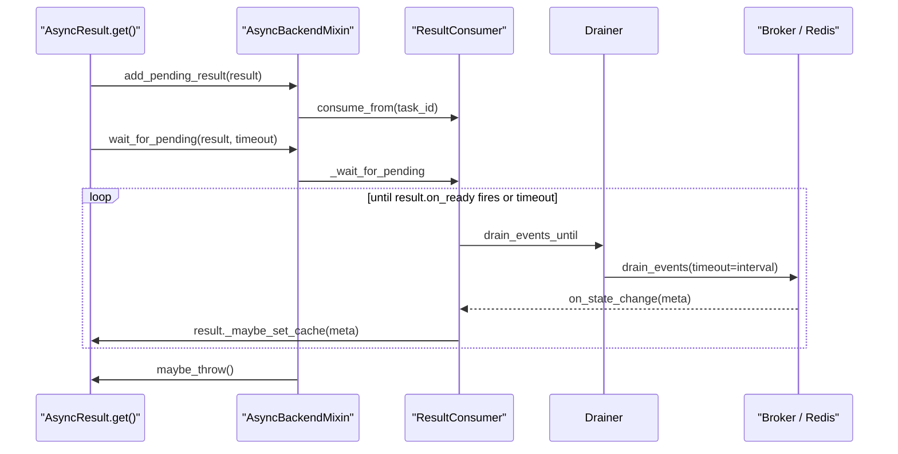

## Overview

Sending a task returns a result object straight away. The object holds only the task id (plus parent links), and asks the app's result backend for the state and return value when you read them. `celery.result` defines the four result classes: `AsyncResult` for one task, `ResultSet` for a list of results, `GroupResult` for a group with an id, and `EagerResult` for a task run locally. This page covers how they read state, wait, propagate errors, and why waiting inside a task is refused. [[Result Backends]] explains where the state is stored, and [[Canvas: Chains, Groups and Chords]] explains which primitive returns which result.

Sources: [celery/result.py:25-28](repo://celery/result.py#L25-L28), [celery/result.py:70-102](repo://celery/result.py#L70-L102)

## Task states

A task's state is a string from `celery.states`. `PENDING` is the state of any id the backend knows nothing about, which includes tasks that do not exist.

Sources: [celery/states.py:126-151](repo://celery/states.py#L126-L151)

| State | Meaning |
| --- | --- |
| `PENDING` | Unknown; waiting or never sent |
| `RECEIVED` | Received by a worker (events only) |
| `STARTED` | Started; stored only with `track_started` |
| `RETRY` | Waiting to be retried |
| `SUCCESS` | Finished; the result is the return value |
| `FAILURE` | Raised; the result is the exception |
| `REVOKED` | Revoked before or during execution |
| `REJECTED` | Rejected (events only) |
| `IGNORED` | Task raised `Ignore`; not stored |

Sources: [celery/states.py:126-151](repo://celery/states.py#L126-L151)

The sets that code checks against are `READY_STATES` (`SUCCESS`, `FAILURE`, `REVOKED`), `UNREADY_STATES`, `EXCEPTION_STATES` (`RETRY`, `FAILURE`, `REVOKED`) and `PROPAGATE_STATES` (`FAILURE`, `REVOKED`), the states whose exception `get()` raises again. `states.state` is a `str` subclass whose comparisons follow `PRECEDENCE`: `SUCCESS` and `FAILURE` rank highest, any custom state such as `'PROGRESS'` ranks above `REVOKED` and the in-progress states, and `PENDING` lowest. Event monitors use it to ignore an older state arriving after a newer one.

Sources: [celery/states.py:61-123](repo://celery/states.py#L61-L123), [celery/states.py:144-147](repo://celery/states.py#L144-L147)

## AsyncResult

`AsyncResult(id, backend=None, app=None, parent=None)` raises `ValueError` for a `None` id and defaults its backend to the app's. Every attribute that needs the task's metadata calls `_get_task_meta()`, which fetches `backend.get_task_meta(id)` and caches the result only once the state is ready, so an unfinished task is fetched again on each read and a finished one never is.

Sources: [celery/result.py:89-102](repo://celery/result.py#L89-L102), [celery/result.py:461-486](repo://celery/result.py#L461-L486)

| Member | Returns |
| --- | --- |
| `state` / `status` | Current state string |
| `result` / `info` | Return value, exception, or the `meta` of a custom state |
| `traceback` | Formatted traceback of a failure |
| `ready()`, `successful()`, `failed()` | State checks against the backend's ready states, `SUCCESS`, `FAILURE` |
| `get(...)` | Waits and returns the value (below) |
| `name`, `args`, `kwargs`, `worker`, `retries`, `queue`, `date_done` | Extended metadata, stored with `result_extended` |
| `children` | Results of tasks this task started (requires the task to `trail`) |
| `parent` | Result of the previous step in a chain |
| `forget()` | Deletes the stored result, and its parents' |
| `revoke(terminate=False, signal=None, wait=False, timeout=None)` | Broadcasts a revoke through `app.control` |
| `then(callback)` | Registers a callback for when the result is ready (async backends) |

Sources: [celery/result.py:136-189](repo://celery/result.py#L136-L189), [celery/result.py:365-397](repo://celery/result.py#L365-L397), [celery/result.py:486-576](repo://celery/result.py#L486-L576)

`AsyncResult` compares equal to another result or to a string with the same id, hashes by id, and pickles as `(id, backend, None, None, parent)`. `as_tuple()` and `result_from_tuple()` convert a result tree, including parents and group members, to nested tuples and back; backends use them to store `children`.

Sources: [celery/result.py:123-134](repo://celery/result.py#L123-L134), [celery/result.py:419-442](repo://celery/result.py#L419-L442), [celery/result.py:1112-1131](repo://celery/result.py#L1112-L1131)

## Waiting with get()

`get(timeout=None, propagate=True, interval=0.5, no_ack=True, follow_parents=True, callback=None, on_message=None, on_interval=None, disable_sync_subtasks=True)` runs these steps.

Sources: [celery/result.py:191-196](repo://celery/result.py#L191-L196)

1. If the result is `ignored` (sent with `ignore_result=True`), return `None` at once.
2. With `disable_sync_subtasks`, call `assert_will_not_block()`, which raises `RuntimeError("Never call result.get() within a task!")` when the process is a pool worker.
3. With `follow_parents` and `propagate`, raise the error of any failed parent first, and keep checking the parents on each interval.
4. If the result is already cached, raise or return from the cache.
5. Otherwise register the result with `backend.add_pending_result` and call `backend.wait_for_pending(...)`, which blocks until the state is ready or `timeout` passes and then calls `maybe_throw`.

Sources: [celery/result.py:245-270](repo://celery/result.py#L245-L270), [celery/result.py:37-40](repo://celery/result.py#L37-L40)

`maybe_throw` raises the stored exception for states in `PROPAGATE_STATES` when `propagate` is true; with `task_remote_tracebacks` and `tblib` installed, the exception carries the worker's traceback. With `propagate=False`, `get()` returns the exception instead of raising it. A `callback` is called with `(task_id, value)`.

Sources: [celery/result.py:385-401](repo://celery/result.py#L385-L401)

`timeout` limits only the caller's wait; on expiry `get()` raises `celery.exceptions.TimeoutError` and the task keeps running. Synchronous backends poll `get_task_meta` every `interval` seconds; asynchronous ones (RPC and Redis) ignore `interval` because results are pushed to them.

Sources: [celery/backends/base.py:900-938](repo://celery/backends/base.py#L900-L938), [celery/result.py:208-218](repo://celery/result.py#L208-L218)

## Why get() is refused inside tasks

`task_join_will_block` is a process-wide flag. When a worker creates its pool it sets the flag to the pool's `task_join_will_block` attribute: true for the base pool and prefork, false for eventlet and gevent. Waiting on another task from inside a prefork child would occupy a process slot that the awaited task may need, so the call is refused rather than risk a deadlock. `allow_join_result()` is a context manager that lifts the check for code that knows it is safe, which the chord machinery uses when it joins header results; `denied_join_result()` sets it, which `apply_async` uses in eager mode.

Sources: [celery/result.py:37-59](repo://celery/result.py#L37-L59), [celery/worker/components.py:160-172](repo://celery/worker/components.py#L160-L172), [celery/concurrency/base.py:70-70](repo://celery/concurrency/base.py#L70-L70), [celery/concurrency/eventlet.py:95-95](repo://celery/concurrency/eventlet.py#L95-L95)

## Result graphs

A chain's result is its last task, whose `parent` points to the step before. `collect(intermediate=False)` walks the result and its `children` breadth-first, yielding `(result, value)` pairs, and raises `IncompleteStream` when it reaches an unfinished node unless `intermediate=True`. `get_leaf()` returns the value of the last node, `iterdeps()` yields `(parent, node)` edges, and `build_graph()`/`graph` turn them into a `DependencyGraph` for drawing.

Sources: [celery/result.py:272-349](repo://celery/result.py#L272-L349), [celery/result.py:403-413](repo://celery/result.py#L403-L413)

## ResultSet and GroupResult

`ResultSet(results)` wraps a list of results. `ready()` and `successful()` require every member, `failed()` and `waiting()` any member, and `completed_count()` counts successes. `add`, `remove`, `discard`, `update` and `clear` edit the list, and `revoke()` revokes all members in one broadcast.

Sources: [celery/result.py:591-643](repo://celery/result.py#L591-L643), [celery/result.py:644-717](repo://celery/result.py#L644-L717)

`get()` uses `join_native` when the backend supports it and `join` otherwise.

Sources: [celery/result.py:726-740](repo://celery/result.py#L726-L740)

- `join` calls `get()` on each result in order, reducing the remaining `timeout` as it goes and raising `TimeoutError('join operation timed out')` when it runs out. It returns the values in the order of the results, or passes each to `callback`.
- `join_native` asks the backend to fetch all results at once (`iter_native`, built on `get_many`) and places each value at its member's index as it arrives, raising the first propagated exception.

Sources: [celery/result.py:742-826](repo://celery/result.py#L742-L826), [celery/result.py:830-881](repo://celery/result.py#L830-L881)

A `GroupResult` is a `ResultSet` with an `id` (the group id) and a `parent`. `save()` stores it in the backend and `GroupResult.restore(id)` loads it again, which is how the chord machinery and other processes find a group's members; `delete()` removes it. Its `children` are its results, and `as_tuple()` includes them. A group's result is built with a `barrier` that fires `on_ready` when every member is ready, for asynchronous backends.

Sources: [celery/result.py:929-1022](repo://celery/result.py#L929-L1022), [celery/result.py:591-612](repo://celery/result.py#L591-L612)

## EagerResult

`Task.apply()` and eager mode return an `EagerResult`, which holds the return value, state and traceback directly. `ready()` is always true, `get()` returns the value or raises the stored exception (wrapping a non-exception in `Exception`), `forget()` does nothing, and `revoke()` only changes the local state to `REVOKED`.

Sources: [celery/result.py:1025-1109](repo://celery/result.py#L1025-L1109)

## Asynchronous result consumers

The RPC and Redis backends do not poll. They include `AsyncBackendMixin`, whose `is_async` is true, and a `ResultConsumer` that receives state messages as they are published. [[Sending Tasks and Routing]] shows that `send_task` already calls `backend.on_task_call`, so the Redis consumer has subscribed to the task's key before the worker can store a result.

Sources: [celery/backends/asynchronous.py:225-314](repo://celery/backends/asynchronous.py#L225-L314)

Sources: [celery/backends/asynchronous.py:260-310](repo://celery/backends/asynchronous.py#L260-L310), [celery/backends/asynchronous.py:393-449](repo://celery/backends/asynchronous.py#L393-L449)

`add_pending_result` starts the drainer, resolves the result immediately if its state message was already buffered, and otherwise records it in the pending map (weakly when requested) and subscribes with `consume_from`. `on_state_change` handles every incoming message: it calls the `on_message` callback for any state, and for a ready state fills the waiting result's cache, firing its `on_ready` promise, or buffers the message when no result is waiting yet. For `join_native`, results are collected through per-call buckets so they are yielded as they arrive.

Sources: [celery/backends/asynchronous.py:228-283](repo://celery/backends/asynchronous.py#L228-L283), [celery/backends/asynchronous.py:427-449](repo://celery/backends/asynchronous.py#L427-L449)

The drainer depends on the environment. The default `Drainer` calls `drain_events` in the waiting thread, one `interval` at a time, raising `socket.timeout` (turned into `TimeoutError`) when the total `timeout` passes and logging and sleeping on recoverable connection errors. Under eventlet and gevent a greenlet drainer runs `drain_events` in its own green thread and waiters block on an event, so many green threads can wait on results at once. `reconnect_on_error` reconnects on the transport's connection errors and raises `RuntimeError` if reconnecting also fails.

Sources: [celery/backends/asynchronous.py:67-113](repo://celery/backends/asynchronous.py#L67-L113), [celery/backends/asynchronous.py:115-223](repo://celery/backends/asynchronous.py#L115-L223), [celery/backends/asynchronous.py:324-370](repo://celery/backends/asynchronous.py#L324-L370)

Because results stay registered until they are ready or forgotten, an `AsyncResult` removes itself from the pending map when garbage-collected, and `forget()` cancels the subscription as well as deleting the stored state.

Sources: [celery/result.py:136-143](repo://celery/result.py#L136-L143), [celery/result.py:444-447](repo://celery/result.py#L444-L447)
