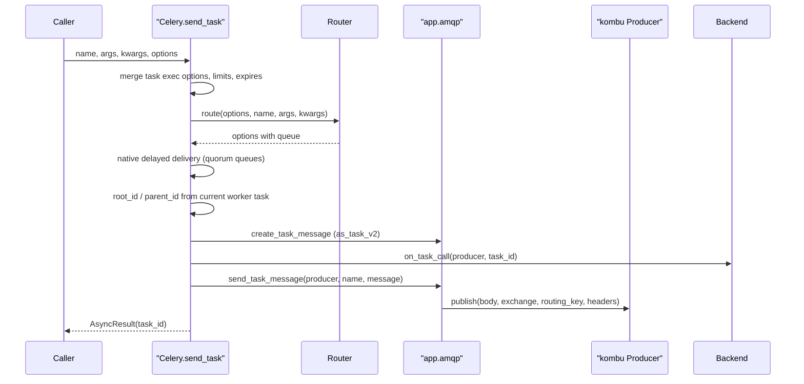

## Overview

Everything that publishes a task, `Task.apply_async`, a canvas primitive, a retry, or beat, ends in `Celery.send_task(name, args, kwargs, **options)`. `send_task` resolves options, asks the router for a destination, builds a message with `app.amqp.create_task_message`, and publishes it through a pooled kombu producer with `app.amqp.send_task_message`. It returns an `AsyncResult` for the new id without waiting for a worker. This page follows those steps; [[Defining Tasks]] covers what `apply_async` checks before calling `send_task`, and [[The Consumer]] picks the message up on the worker side.

Sources: [celery/app/base.py:846-862](repo://celery/app/base.py#L846-L862), [celery/app/base.py:1018-1041](repo://celery/app/base.py#L1018-L1041)

`send_task` can also be called directly with a task name the client does not have registered, which is how one service sends tasks implemented by another. In that case it warns that `task_always_eager` has no effect, since there is no local function to run.

Sources: [celery/app/base.py:863-873](repo://celery/app/base.py#L863-L873)

## The send path



Sources: [celery/app/base.py:863-962](repo://celery/app/base.py#L863-L962), [celery/app/base.py:987-1041](repo://celery/app/base.py#L987-L1041)

## Resolving options

`send_task` generates a UUID unless `task_id` is given. When no `task_type` is passed (a plain `send_task` call), it looks the name up in the registry without finalizing the app and, if found, merges that task's non-`None` execution options under the caller's. `apply_async` passes `task_type` because it has already merged them.

Sources: [celery/app/base.py:863-907](repo://celery/app/base.py#L863-L907)

`time_limit`, `soft_time_limit` and `expires` are then separated from the other options: an explicit argument wins, an explicit `None` clears the task default, and an omitted argument falls back to the merged value. `ignore_result` is popped as well. An `expires` given as a datetime or ISO string is converted to seconds from now; a negative value is clamped to 0 with a warning, and the result is also set as the AMQP `expiration` property.

Sources: [celery/app/base.py:909-925](repo://celery/app/base.py#L909-L925), [celery/app/base.py:962-985](repo://celery/app/base.py#L962-L985)

When called from inside a running task, `send_task` takes `root_id` and `parent_id` from `current_worker_task`, so children carry their workflow's root, and with `task_inherit_parent_priority` it reuses the parent's delivery priority. After publishing it appends the new result to the parent's `request.children` unless `add_to_parent=False`.

Sources: [celery/app/base.py:987-997](repo://celery/app/base.py#L987-L997), [celery/app/base.py:1031-1041](repo://celery/app/base.py#L1031-L1041)

## Routing

`router.route(options, name, args, kwargs, task_type)` decides the queue. It first expands a `queue` option given by name into its `kombu.Queue`. If `task_routes` is set it asks each router in order and merges the first non-`None` answer under the caller's options, so an explicit `queue=` always wins. If no queue was chosen, it uses `task_default_queue`.

Sources: [celery/app/routes.py:56-111](repo://celery/app/routes.py#L56-L111)

`task_routes` can be a dict, a list of dicts and router functions, or dotted names of either; `prepare` turns each dict into a `MapRoute` and each string into a lazily imported router. A `MapRoute` matches the exact task name first, then glob patterns (`'feed.tasks.*'`) and compiled regexes in definition order; a route value can be a queue name or a dict of options. A router function is called as `router(name, args, kwargs, options, task=task)` and returns a route or `None`; old classes with `route_for_task` still work.

Sources: [celery/app/routes.py:26-53](repo://celery/app/routes.py#L26-L53), [celery/app/routes.py:114-136](repo://celery/app/routes.py#L114-L136)

```python
app.conf.task_routes = {
    'feed.tasks.import_feed': {'queue': 'feeds'},
    'web.*': 'web',
}
```

Sources: [celery/app/routes.py:26-53](repo://celery/app/routes.py#L26-L53)

The router is built once and cached on `app.amqp`; updating `task_routes` through `app.conf.update` rebuilds it.

Sources: [celery/app/amqp.py:308-315](repo://celery/app/amqp.py#L308-L315), [celery/app/amqp.py:622-663](repo://celery/app/amqp.py#L622-L663)

## Queues and exchanges

`app.amqp.queues` is a `Queues` mapping built from `task_queues`. When `task_queues` is empty it contains one queue named `task_default_queue` (default `celery`) bound to the default exchange, declared as a quorum queue when `task_default_queue_type` is `quorum`. Every queue without an exchange gets the default exchange (`task_default_exchange`, of type `task_default_exchange_type`, `direct` by default) and the default routing key, and `task_queue_max_priority` adds `x-max-priority` to queues that have none.

Sources: [celery/app/amqp.py:273-306](repo://celery/app/amqp.py#L273-L306), [celery/app/amqp.py:41-146](repo://celery/app/amqp.py#L41-L146), [celery/app/amqp.py:608-648](repo://celery/app/amqp.py#L608-L648)

Looking up an unknown queue name creates it when `task_create_missing_queues` is true (the default): `new_missing` makes a queue with an exchange and routing key of the same name, typed by `task_create_missing_queue_type` and `task_create_missing_queue_exchange_type`. With the setting off, the router raises `QueueNotFound`.

Sources: [celery/app/amqp.py:99-102](repo://celery/app/amqp.py#L99-L102), [celery/app/amqp.py:201-217](repo://celery/app/amqp.py#L201-L217), [celery/app/routes.py:87-96](repo://celery/app/routes.py#L87-L96)

The same mapping tells a worker what to consume. `select(include)` restricts consumption to the queues given with `-Q`, `deselect(exclude)` removes those given with `-X`, and `select_add` adds a queue at runtime; `consume_from` is the resulting set, and `TaskConsumer` creates a kombu consumer for it that accepts only `accept_content`.

Sources: [celery/app/amqp.py:159-223](repo://celery/app/amqp.py#L159-L223), [celery/app/amqp.py:317-324](repo://celery/app/amqp.py#L317-L324)

## Building the message

`create_task_message` is the builder for `task_protocol`: `as_task_v2` by default, `as_task_v1` for the old protocol. `as_task_v2` validates that `args` is a list or tuple and `kwargs` a mapping, converts `countdown` and numeric `expires` into absolute times in the app's time zone, and formats them as ISO strings. It renders `argsrepr` and `kwargsrepr` with `saferepr`, truncated to 1024 characters, for logs and events, and defaults `root_id` to the task id.

Sources: [celery/app/amqp.py:265-267](repo://celery/app/amqp.py#L265-L267), [celery/app/amqp.py:326-368](repo://celery/app/amqp.py#L326-L368), [celery/app/amqp.py:250-255](repo://celery/app/amqp.py#L250-L255)

The message is a `task_message(headers, properties, body, sent_event)` tuple.

Sources: [celery/app/amqp.py:371-418](repo://celery/app/amqp.py#L371-L418)

| Part | Contents |
| --- | --- |
| headers | `lang`, `task`, `id`, `shadow`, `eta`, `expires`, `group`, `group_index`, `retries`, `timelimit` (`[hard, soft]`), `root_id`, `parent_id`, `argsrepr`, `kwargsrepr`, `origin` (sender node name), `ignore_result`, `replaced_task_nesting`, `stamped_headers`, `stamps` |
| properties | `correlation_id` (the task id), `reply_to` (the app's thread oid unless given) |
| body | `(args, kwargs, {'callbacks', 'errbacks', 'chain', 'chord'})` |
| sent_event | Fields for a `task-sent` event, only when `task_send_sent_event` is on |

Sources: [celery/app/amqp.py:371-418](repo://celery/app/amqp.py#L371-L418), [celery/app/base.py:999-1007](repo://celery/app/base.py#L999-L1007)

Putting the routing and control fields in headers lets the worker decide what to do with a message (revoke it, delay it, rate-limit it) without deserializing the arguments; callbacks, chains and chords travel in the body's third element because they are part of the payload a worker runs.

Sources: [celery/worker/strategy.py:132-145](repo://celery/worker/strategy.py#L132-L145)

## Publishing

`send_task_message` is created once per app by `_create_task_sender`, which captures the publish defaults (`task_publish_retry`, `task_publish_retry_policy`, `task_default_delivery_mode`, `task_serializer`, `task_compression`) and the signal receivers. Each call then runs the steps below.

Sources: [celery/app/amqp.py:485-505](repo://celery/app/amqp.py#L485-L505)

1. Merges extra `headers` into the message headers and any other keyword into the AMQP properties.
2. Uses the default queue when neither queue nor exchange was given, and looks a queue name up in `queues`.
3. Takes `delivery_mode` from the queue's exchange, falling back to the default (persistent).
4. For a direct exchange without an explicit exchange and routing key, publishes to the anonymous exchange `''` with the queue name as routing key; otherwise uses the queue's exchange and routing key. The queue is declared on publish unless it is a `Broadcast` queue.
5. Sends `before_task_publish`, calls `producer.publish(...)` with the retry policy, then sends `after_task_publish`.
6. Publishes the `task-sent` event if the message carries one.

Sources: [celery/app/amqp.py:506-560](repo://celery/app/amqp.py#L506-L560), [celery/app/amqp.py:561-606](repo://celery/app/amqp.py#L561-L606)

Before publishing, `send_task` acquires a producer with `producer_or_acquire`, or wraps a given `connection` in a new producer, and calls `backend.on_task_call(producer, task_id)` unless the result is ignored. The RPC backend uses it to declare its reply queue, and the Redis backend to subscribe to the task's result key before the result can arrive. Broker errors are re-raised as kombu library errors.

Sources: [celery/app/base.py:1013-1024](repo://celery/app/base.py#L1013-L1024), [celery/backends/rpc.py:217-223](repo://celery/backends/rpc.py#L217-L223), [celery/backends/redis.py:501-503](repo://celery/backends/redis.py#L501-L503)

The producer pool belongs to `app.amqp`: a kombu producer pool on the write connection, limited to `broker_pool_limit`. When every producer is in use for `broker_pool_acquire_timeout` seconds, `send_task` raises `OperationalError`.

Sources: [celery/app/amqp.py:635-642](repo://celery/app/amqp.py#L635-L642), [celery/app/base.py:1162-1191](repo://celery/app/base.py#L1162-L1191)

## Countdown, ETA and native delayed delivery

A task sent with `countdown` or `eta` normally goes to its queue at once with an `eta` header, and the worker holds it until it is due ([[The Consumer]] covers that). Quorum queues on RabbitMQ do not work well with messages a worker holds unacknowledged for a long time, so `send_task` switches to native delayed delivery when `detect_quorum_queues` finds a queue declared with `x-queue-type: quorum` on an `amqp` transport.

Sources: [celery/app/base.py:927-960](repo://celery/app/base.py#L927-L960), [celery/utils/quorum_queues.py:4-20](repo://celery/utils/quorum_queues.py#L4-L20)

In that mode, for a topic or fanout destination, the ETA is converted to a countdown in seconds, kombu's `calculate_routing_key` encodes the delay into the routing key, and the message is published to the `celery_delayed_27` topic exchange instead of the queue. RabbitMQ holds it there and routes it to the original destination when the delay expires; the worker's `DelayedDelivery` step declares the bindings. A direct exchange cannot be used this way: `send_task` logs a warning and the task is delayed by the worker as usual.

Sources: [celery/app/base.py:927-960](repo://celery/app/base.py#L927-L960)

## Errors when sending

| Situation | Result |
| --- | --- |
| `args` not a list or tuple, `kwargs` not a mapping | `TypeError` from `as_task_v2` |
| Countdown or expires out of range | `ValueError` |
| Queue name unknown and `task_create_missing_queues` off | `QueueNotFound` |
| Producer pool exhausted for `broker_pool_acquire_timeout` | `OperationalError` |
| Broker unreachable after `task_publish_retry_policy` | kombu `OperationalError` |

Sources: [celery/app/amqp.py:335-347](repo://celery/app/amqp.py#L335-L347), [celery/app/amqp.py:480-483](repo://celery/app/amqp.py#L480-L483), [celery/app/routes.py:87-96](repo://celery/app/routes.py#L87-L96), [celery/app/base.py:1162-1174](repo://celery/app/base.py#L1162-L1174)
