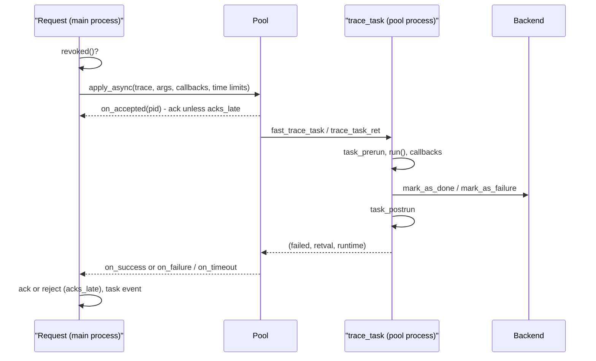

## Overview

Once [[The Consumer]] has turned a message into a `Request` and handed it to the worker, two pieces of code finish the job. In the worker's main process, `celery.worker.request.Request` sends the work to the pool and reacts to what happens: acceptance, success, failure, timeout and revocation, deciding when to acknowledge or reject the message. In the pool process, the tracer built by `celery.app.trace.build_tracer` runs the task function, sends the task signals, stores the result in the backend and dispatches callbacks and chained tasks. `celery.worker.state` keeps the bookkeeping shared by both. This page follows one request through that path; [[Execution Pools]] explains how each pool runs the tracer.

Sources: [celery/worker/request.py:67-176](repo://celery/worker/request.py#L67-L176), [celery/app/trace.py:344-425](repo://celery/app/trace.py#L344-L425)

Sources: [celery/worker/request.py:341-372](repo://celery/worker/request.py#L341-L372), [celery/worker/request.py:515-620](repo://celery/worker/request.py#L515-L620), [celery/app/trace.py:735-789](repo://celery/app/trace.py#L735-L789)

## The Request object

`Request.__init__` reads everything it needs from the message headers without touching the arguments: the id, task name (with `shadow` as the display name), root and parent ids, time limits, `argsrepr`/`kwargsrepr`, `ignore_result`, and the ETA and expiry, which it parses as ISO 8601 and makes time-zone aware. A malformed ETA or expiry raises `InvalidTaskError`. It records the delivery info (exchange, routing key, priority, redelivered flag), the reply-to and correlation id, and holds the raw body and content type so the pool process can deserialize the arguments.

Sources: [celery/worker/request.py:90-176](repo://celery/worker/request.py#L90-L176)

Each task gets its own subclass built by `create_request_cls`, which binds the pool's `apply_async`, the task's default time limits, `acks_late` and the event switch as closure variables, and overrides `execute_using_pool` and `on_success` to use them. The subclass avoids attribute lookups on the hot path for every message.

Sources: [celery/worker/request.py:818-874](repo://celery/worker/request.py#L818-L874)

## Sending the request to the pool

The worker's `process_task` calls `request.execute_using_pool(pool)`. It first checks `revoked()` again, since the request may have waited for an ETA or a rate limit, and raises `TaskRevokedError` if so (the worker then releases the pool slot). It then calls `pool.apply_async` with the values below.

Sources: [celery/worker/request.py:351-358](repo://celery/worker/request.py#L351-L358)

- the trace function, `fast_trace_task` when worker optimizations are installed and `trace_task_ret` otherwise;
- the arguments `(task name, id, request dict, body, content type, content encoding)`;
- callbacks `on_accepted`, `on_success`, `on_failure` and `on_timeout`;
- the soft and hard time limits from the message, falling back to the task's.

Sources: [celery/worker/request.py:341-372](repo://celery/worker/request.py#L341-L372), [celery/worker/worker.py:223-230](repo://celery/worker/worker.py#L223-L230)

`Request.execute()` is the synchronous alternative, without a pool: it acknowledges first unless `acks_late`, runs `trace_task` in the current process, and acknowledges or rejects afterwards.

Sources: [celery/worker/request.py:374-406](repo://celery/worker/request.py#L374-L406)

## Acknowledgement

When a message is acknowledged determines what happens if the worker dies. By default (`acks_late=False`) the request is acknowledged in `on_accepted`, the moment a pool process takes it, so a crash loses the task but never runs it twice. With `acks_late=True` the request is acknowledged only after it finishes, so a crash causes redelivery and the task may run again.

Sources: [celery/worker/request.py:515-527](repo://celery/worker/request.py#L515-L527), [celery/app/task.py:301-325](repo://celery/app/task.py#L301-L325)

| Outcome | `acks_late=False` | `acks_late=True` |
| --- | --- | --- |
| Success | Acked at start | Acked in `on_success` |
| Exception | Acked at start | Acked if `acks_on_failure` (default), else rejected without requeue |
| Hard time limit | Acked at start | Acked if `acks_on_timeout` (default), else rejected with requeue |
| Child process lost | Acked at start | Rejected with requeue if `reject_on_worker_lost`, else as an exception |
| `Retry` raised | Acked at start | Acked |
| `Reject(requeue=...)` raised | Rejected as asked | Rejected as asked |
| `Ignore` raised | Acked | Acked |

Sources: [celery/worker/request.py:596-702](repo://celery/worker/request.py#L596-L702)

`acknowledge()` and `reject()` run at most once per request (`acknowledged` guards them) and go through the promise callbacks the consumer passed in, which perform the operation on the event loop. `reject()` also sends a `task-rejected` event.

Sources: [celery/worker/request.py:730-740](repo://celery/worker/request.py#L730-L740)

## Handling the outcome

### Accepted

`on_accepted(pid, time_accepted)` records the child pid and start time, marks the request active in `worker.state`, acknowledges unless `acks_late`, and sends `task-started`. If the request was terminated while still queued in the pool, the termination is carried out now.

Sources: [celery/worker/request.py:515-527](repo://celery/worker/request.py#L515-L527)

### Success and failure

The tracer's return value comes back to `on_success` as `(failed, retval, runtime)`. A successful run marks the request ready and successful, acknowledges it under `acks_late`, and sends `task-succeeded` with the result and runtime. A failed run is passed to `on_failure`, which branches on the exception as listed below.

Sources: [celery/worker/request.py:596-611](repo://celery/worker/request.py#L596-L611)

- `Terminated` (the process was killed by a revoke): stores `REVOKED` unless already announced.
- `MemoryError`: raised again in the main process.
- `Reject`: without requeue, stores `FAILURE` and sends `task_failure`, since the task will never run again; then rejects as requested.
- `Ignore`: acknowledges.
- `Retry`: `on_retry` acknowledges under `acks_late` and sends `task-retried`.
- Anything else: applies the acknowledgement rules above; stores `FAILURE` and sends `task_failure` only when the pool process could not have done it (worker lost, or an error outside the tracer), and sends `task-failed`.

Sources: [celery/worker/request.py:613-680](repo://celery/worker/request.py#L613-L680), [celery/worker/request.py:681-728](repo://celery/worker/request.py#L681-L728)

### Time limits

Pools that support time limits call `on_timeout(soft, timeout)`. The soft limit raises `SoftTimeLimitExceeded` inside the task, which can catch it, and the main process only logs a warning. The hard limit kills the child. The main process then marks the request ready and stores `FAILURE` with `TimeLimitExceeded`, and because the child could not run them, it calls the task's `on_failure` and `after_return`, sends `task_failure` and `task-failed` itself, and acknowledges or requeues according to `acks_on_timeout`. During a cold shutdown these failure reports are skipped.

Sources: [celery/worker/request.py:529-594](repo://celery/worker/request.py#L529-L594)

### Revocation and cancellation

`revoked()` returns true when the request has expired (adding it to the revoked set), its id is in `worker.state.revoked`, or one of its stamped headers matches a value in `revoked_stamps`. It then logs `Discarding revoked task`, sends `task-revoked`, stores `REVOKED`, acknowledges the message and sends the `task_revoked` signal. `terminate(pool, signal)` kills a running request's process with the signal (default `SIGTERM`) and announces it as revoked; `cancel()` does the same for shutdown and connection loss but records a retry instead, so the broker can redeliver it.

Sources: [celery/worker/request.py:408-509](repo://celery/worker/request.py#L408-L509)

## The tracer

### Building it

`build_tracer(name, task, ...)` is called once per task, when the consumer updates its strategies, and the result is cached on `task.__trace__`. It resolves everything up front: the function to call (`task.run`, or the task itself if it overrides `__call__`), the loader hooks, which handler methods the task overrides, the request stack, and the receivers of `task_prerun`, `task_postrun` and `task_success`, so a signal with no receivers costs nothing.

Sources: [celery/app/trace.py:344-415](repo://celery/app/trace.py#L344-L415), [celery/worker/consumer/consumer.py:716-721](repo://celery/worker/consumer/consumer.py#L716-L721)

In a prefork child, `fast_trace_task` deserializes the body with the accepted content types, merges `args`, `kwargs` and the embedded callbacks/chain/chord into the request dict, and calls the cached tracer. `setup_worker_optimizations`, run at worker start, prepares this: it makes the worker's app current and default, finalizes it, and stores the task registry, accepted content and hostname for the children. Processes started with spawn instead of fork lack that state, and `fast_trace_task` raises a `RuntimeError` suggesting the solo or threads pool. `trace_task_ret` does the same work looking things up on the app each time.

Sources: [celery/app/trace.py:735-789](repo://celery/app/trace.py#L735-L789), [celery/app/trace.py:804-831](repo://celery/app/trace.py#L804-L831)

### Running a task

The traced function, `trace_task(uuid, args, kwargs, request)`, goes through these steps.

Sources: [celery/app/trace.py:475-487](repo://celery/app/trace.py#L475-L487)

1. Raises `InvalidTaskError` if `kwargs` is not a mapping, and builds a `Context` from the request.
2. Decides whether to publish a result: not when results are ignored, and in eager mode only with `store_eager_result`; `track_started` applies only outside eager mode.
3. With `worker_deduplicate_successful_tasks`, `acks_late`, and a persistent backend, skips a redelivered task that already succeeded, re-sending its callbacks only if they were never recorded as children.
4. Pushes the task and request on their stacks, sends `task_prerun`, calls the loader's `on_task_init`, and stores `STARTED` with the pid and hostname when tracking starts.
5. Calls `before_start`, then the task function.
6. On success, sends the linked callbacks and the next chain step with the return value, then calls `backend.mark_as_done`; an encoding error while storing turns into a failure. Then it calls `on_success`, sends `task_success`, and logs `Task ... succeeded in ...s`.
7. Calls `after_return` for every state except `IGNORED`, `RETRY` and `REJECTED`, sends `task_postrun`, pops the stacks, and runs the backend's and loader's process cleanup.

Sources: [celery/app/trace.py:488-570](repo://celery/app/trace.py#L488-L570), [celery/app/trace.py:571-686](repo://celery/app/trace.py#L571-L686)

Callbacks are sent before the result is stored so that `children` is populated when the result becomes visible. [[Canvas: Chains, Groups and Chords]] explains how the chain list is consumed.

Sources: [celery/app/trace.py:610-626](repo://celery/app/trace.py#L610-L626)

### Exceptions in the task body

| Raised | State | Handling |
| --- | --- | --- |
| `Reject` | `REJECTED` | Logged; the main process rejects the message |
| `Ignore` | `IGNORED` | Logged; nothing stored |
| `Retry` | `RETRY` | `mark_as_retry`, `on_retry`, `task_retry` signal; errbacks not called |
| Any other `Exception` | `FAILURE` | `mark_as_failure` (with errbacks and chord/chain propagation), `on_failure`, `task_failure` signal, logged |
| `BaseException` (e.g. `SystemExit`) | | Re-raised |

Sources: [celery/app/trace.py:579-609](repo://celery/app/trace.py#L579-L609), [celery/app/trace.py:179-241](repo://celery/app/trace.py#L179-L241), [celery/app/trace.py:242-312](repo://celery/app/trace.py#L242-L312)

`handle_failure` makes the exception picklable before storing it and passing it back to the main process. Whether an error is stored when results are ignored depends on `store_errors_even_if_ignored`, and the log level comes from a policy: exceptions listed in the task's `throws` are logged at a lower level without a traceback. Tracebacks are cleared after use to avoid keeping frames, and their local variables, alive.

Sources: [celery/app/trace.py:188-204](repo://celery/app/trace.py#L188-L204), [celery/app/trace.py:242-312](repo://celery/app/trace.py#L242-L312), [celery/app/trace.py:137-148](repo://celery/app/trace.py#L137-L148)

An exception raised outside the task body (in a signal handler, the backend, or the tracer itself) is an internal error: the tracer sends `task_internal_error`, reports it as a failure with a `RuntimeWarning`, and in eager mode re-raises it.

Sources: [celery/app/trace.py:670-686](repo://celery/app/trace.py#L670-L686), [celery/app/trace.py:689-733](repo://celery/app/trace.py#L689-L733), [celery/app/trace.py:791-801](repo://celery/app/trace.py#L791-L801)

### Stack protection

Because the worker calls `task.run` directly, a task class that overrides `__call__` and calls `super().__call__` would push a second request on the stack. `_install_stack_protection` patches `Task.__call__` in workers so that the first call inside a worker request goes straight to `run`.

Sources: [celery/app/trace.py:847-873](repo://celery/app/trace.py#L847-L873)

## Worker state

`celery.worker.state` holds module-level structures shared by the consumer, requests and remote control.

Sources: [celery/worker/state.py:1-4](repo://celery/worker/state.py#L1-L4)

| Name | Contents |
| --- | --- |
| `requests` | Reserved requests by id |
| `reserved_requests` | Requests received and not finished (weak set) |
| `active_requests` | Requests a pool process has accepted (weak set) |
| `successful_requests` | Recently succeeded ids (`LimitedSet`, 1000 entries, 3 h) |
| `total_count`, `all_total_count` | Accepted tasks per name and overall |
| `revoked` | Revoked ids (`LimitedSet`, 50,000 entries, 3 h) |
| `revoked_stamps` | Stamp header values flagged for revocation |
| `should_stop`, `should_terminate` | Shutdown flags read by `maybe_shutdown()` |

Sources: [celery/worker/state.py:27-74](repo://celery/worker/state.py#L27-L74)

`task_reserved`, `task_accepted` and `task_ready` move a request through these sets. The limits can be changed with the `CELERY_WORKER_REVOKES_MAX`, `CELERY_WORKER_REVOKE_EXPIRES`, `CELERY_WORKER_SUCCESSFUL_MAX` and `CELERY_WORKER_SUCCESSFUL_EXPIRES` environment variables. With `--statedb`, the `Persistent` class saves the revoked set (compressed) and the logical clock to a `shelve` file at exit and merges them back at start, so revocations survive restarts.

Sources: [celery/worker/state.py:96-127](repo://celery/worker/state.py#L96-L127), [celery/worker/state.py:27-44](repo://celery/worker/state.py#L27-L44), [celery/worker/state.py:192-250](repo://celery/worker/state.py#L192-L250)
