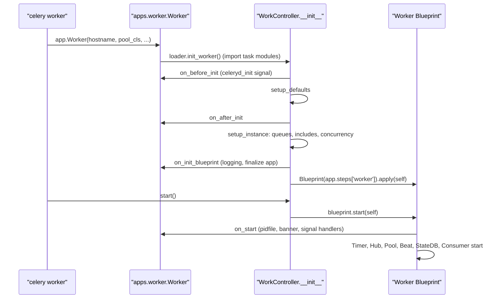

## Overview

A worker is a `WorkController`: an object that owns a pool of execution slots, a timer, optionally an event loop and an embedded beat, and a consumer that reads messages from the broker. It is not written as one long start-up function. Each part is a bootstep, a small class that declares which other steps it requires, and a `Blueprint` sorts the steps into a start order and drives them through start, stop and terminate. The `celery worker` command wraps the controller in `celery.apps.worker.Worker`, which adds logging, the banner and signal handlers. This page follows a worker from the command line to a running blueprint and back down through shutdown; [[The Consumer]] covers the consumer's own blueprint and [[Execution Pools]] the pools.

Sources: [celery/worker/worker.py:76-98](repo://celery/worker/worker.py#L76-L98), [celery/bootsteps.py:74-118](repo://celery/bootsteps.py#L74-L118), [celery/apps/worker.py:91-104](repo://celery/apps/worker.py#L91-L104)

## From the command line to start()

`celery worker` (in `celery/bin/worker.py`) gets the app from the CLI context and applies any trailing `key=value` arguments with `config_from_cmdline(namespace='worker')`. With `--detach` it re-executes itself in the background with `detach` (see [[celery multi and Daemonization]]). Otherwise it drops privileges to `--uid`/`--gid`, creates `app.Worker(...)` with the hostname, pool, log level, log file and node-formatted pidfile and state db, calls `worker.start()`, and exits with `worker.exitcode`.

Sources: [celery/bin/worker.py:307-371](repo://celery/bin/worker.py#L307-L371)



Sources: [celery/worker/worker.py:90-142](repo://celery/worker/worker.py#L90-L142), [celery/apps/worker.py:94-166](repo://celery/apps/worker.py#L94-L166)

## WorkController construction

`WorkController.__init__` resolves the node name, records the start time and calls `app.loader.init_worker()`, which imports the default modules (`imports`, `include` and autodiscovered task modules) and runs the loader's worker hook. It then calls `setup_defaults`, which fills each option from its argument or the matching setting with `app.either`: concurrency, pool class, consumer, timer and autoscaler classes, time limits, `max_tasks_per_child`, `max_memory_per_child`, prefetch multiplier, state db, beat scheduler and others.

Sources: [celery/worker/worker.py:90-98](repo://celery/worker/worker.py#L90-L98), [celery/worker/worker.py:380-428](repo://celery/worker/worker.py#L380-L428), [celery/loaders/base.py:97-111](repo://celery/loaders/base.py#L97-L111)

`setup_instance` does the rest, in the steps listed here.

Sources: [celery/worker/worker.py:100-102](repo://celery/worker/worker.py#L100-L102)

- `setup_queues` selects the `-Q` queues and deselects the `-X` queues, raising `ImproperlyConfigured` for unknown names, and with `worker_direct` adds a queue named after this node.
- `setup_includes` imports `-I` modules and records every task module in the `include` setting, so a re-executed worker imports the same modules.
- Concurrency defaults to the CPU count (2 if it cannot be determined).
- The event loop is used when the environment is not green (eventlet or gevent), the broker transport supports asynchronous I/O, and the platform is not Windows.
- It sends `worker_init`, resolves the pool class, and builds the blueprint from the default steps plus `app.steps['worker']`, then calls `blueprint.apply(self)`.

Sources: [celery/worker/worker.py:100-201](repo://celery/worker/worker.py#L100-L201), [celery/worker/worker.py:238-241](repo://celery/worker/worker.py#L238-L241)

## Bootsteps

### Steps

A step class gets a `name` from its module and class name (through the `StepType` metaclass). Its `requires` lists steps, as classes or dotted names, that must start before it, and `include_if(parent)` decides whether it is used (by default its `enabled` attribute). When included, `create(parent)` builds whatever the step manages. A plain `Step` only runs code at creation. A `StartStopStep` keeps the object `create` returned and calls its `start`, `stop` and `terminate` (falling back to `stop`), and appends itself to `parent.steps`, the list the blueprint walks.

Sources: [celery/bootsteps.py:266-384](repo://celery/bootsteps.py#L266-L384)

`ConsumerStep` is a `StartStopStep` for the consumer's blueprint that requires the connection step. It creates kombu consumers from `get_consumers(channel)` on start and cancels them and closes their channels on stop. Applications use it to consume their own queues inside a worker.

Sources: [celery/bootsteps.py:386-415](repo://celery/bootsteps.py#L386-L415)

### The blueprint

`Blueprint.apply(parent)` loads every step class in `default_steps` plus the extra steps, follows `requires` to pull in dependencies that were not listed, and builds a `DependencyGraph`. The step marked `last = True` (the consumer) gets an edge from every other step, so it always starts after them. `topsort()` gives the boot order; an unknown dependency raises `KeyError('unknown bootstep: ...')`. Each step is then instantiated in that order and its `include` decides whether it joins `parent.steps`.

Sources: [celery/bootsteps.py:186-256](repo://celery/bootsteps.py#L186-L256)

`start(parent)` sets the state to `RUN`, calls `on_start`, and starts each step in `parent.steps`, counting how many started. `send_all(parent, method)` calls a method on every step, in reverse order by default, optionally logging instead of raising errors. `stop(parent, terminate=False)` returns at once if the blueprint is already closing; if it never finished starting, it marks itself terminated without stopping anything. Otherwise it calls `on_close`, sends `close` to the steps in order, sends `stop` or `terminate` in reverse order, calls `on_stopped`, and sets `shutdown_complete`.

Sources: [celery/bootsteps.py:109-184](repo://celery/bootsteps.py#L109-L184)

### Adding steps

`app.steps['worker']` and `app.steps['consumer']` are sets of extra step classes. Adding one inserts it into the dependency graph of that blueprint without subclassing the worker.

Sources: [celery/worker/worker.py:132-140](repo://celery/worker/worker.py#L132-L140)

```python
from celery import bootsteps

class InfoStep(bootsteps.StartStopStep):
    requires = {'celery.worker.components:Pool'}

    def start(self, worker):
        print('pool ready:', worker.pool)

app.steps['worker'].add(InfoStep)
```

Sources: [celery/app/base.py:290-294](repo://celery/app/base.py#L290-L294), [celery/worker/worker.py:132-140](repo://celery/worker/worker.py#L132-L140), [celery/worker/consumer/consumer.py:250-254](repo://celery/worker/consumer/consumer.py#L250-L254)

## Worker components

The worker blueprint's default steps are defined in `celery/worker/components.py`, plus the autoscaler.

Sources: [celery/worker/worker.py:76-88](repo://celery/worker/worker.py#L76-L88)

| Step | Requires | What it does |
| --- | --- | --- |
| `Timer` | | With the event loop, a kombu `Timer` driven by the hub; otherwise the pool's timer class running in a thread |
| `Hub` | `Timer` | Only with the event loop: gets or creates the kombu event loop and replaces thread locks with dummy locks, since everything runs in one thread |
| `Pool` | `Hub` | Creates the execution pool with the concurrency, time limits, `max_tasks_per_child`, `max_memory_per_child` and restart options, and sets the `task_join_will_block` flag |
| `Beat` | | With `-B`: an embedded beat service; refused for eventlet and gevent pools |
| `StateDB` | | With `--statedb`: loads and, at exit, saves revoked ids and the clock |
| `Autoscaler` | `Pool` | With `--autoscale`: grows and shrinks the pool |
| `Consumer` | (last) | Creates the consumer with prefetch count = concurrency (or max autoscale) × prefetch multiplier |

Sources: [celery/worker/components.py:23-140](repo://celery/worker/components.py#L23-L140), [celery/worker/components.py:141-246](repo://celery/worker/components.py#L141-L246)

The `Pool` step decides how tasks reach the pool. With the event loop, it creates a `LaxBoundedSemaphore` of the pool size; when `pool_putlocks` is on and the pool uses semaphores, `process_task` acquires a slot before sending the request to the pool and the pool releases it when the task finishes. Without the event loop the pool itself blocks on puts. `--autoscale max,min` sets `max_concurrency` and `min_concurrency`, and the pool starts with the minimum.

Sources: [celery/worker/components.py:100-172](repo://celery/worker/components.py#L100-L172), [celery/worker/worker.py:220-230](repo://celery/worker/worker.py#L220-L230)

The `Consumer` step passes `process_task` as the consumer's `on_task_request` callback; this is the hand-off from [[The Consumer]] to [[Task Execution and Tracing]].

Sources: [celery/worker/components.py:224-246](repo://celery/worker/components.py#L224-L246)

## The worker program

`celery.apps.worker.Worker` subclasses `WorkController` and fills its hooks as listed below.

Sources: [celery/apps/worker.py:91-93](repo://celery/apps/worker.py#L91-L93)

- `on_before_init` installs the tracer optimizations, sends `celeryd_init` (which can configure workers by node name), and refuses to run as root with pickle content unless allowed.
- `on_after_init` sets up stdout redirection and colours.
- `on_init_blueprint` configures logging and finalizes the app.
- `on_start` creates the pidfile lock, sends `celeryd_after_setup`, purges queues with `--purge`, prints the banner with the configuration and task list, sets the process title, installs signal handlers and warns about old setting names.
- `on_consumer_ready` sends `worker_ready` and logs that the node is ready.

Sources: [celery/apps/worker.py:94-182](repo://celery/apps/worker.py#L94-L182), [celery/worker/worker.py:155-171](repo://celery/worker/worker.py#L155-L171)

## Shutdown

### Signals

The worker program maps POSIX signals to shutdown modes. Handlers do not stop the worker themselves: they set `state.should_stop` (warm) or `state.should_terminate` (cold), and the event loop calls `state.maybe_shutdown()` on each iteration, which raises `WorkerShutdown` or `WorkerTerminate`. Both are `SystemExit` subclasses, so they unwind into `WorkController.start`.

Sources: [celery/apps/worker.py:288-316](repo://celery/apps/worker.py#L288-L316), [celery/worker/state.py:88-93](repo://celery/worker/state.py#L88-L93), [celery/worker/loops.py:84-86](repo://celery/worker/loops.py#L84-L86), [celery/exceptions.py:271-280](repo://celery/exceptions.py#L271-L280)

| Signal | Effect |
| --- | --- |
| `SIGTERM` | Warm shutdown: stop consuming, wait for running tasks (cold if billiard's `REMAP_SIGTERM` is `SIGQUIT`) |
| `SIGINT` (Ctrl+C) | Warm shutdown; a second Ctrl+C switches to cold |
| `SIGQUIT` | Cold shutdown: optional soft wait, then cancel running tasks |
| `SIGHUP` | Restart by re-executing the same command (only when detached from a terminal; not on macOS) |
| `SIGUSR1` | Log the stack of every thread |
| `CELERY_RDBSIG` signal | Open a remote debugger |

Sources: [celery/apps/worker.py:254-274](repo://celery/apps/worker.py#L254-L274), [celery/apps/worker.py:431-523](repo://celery/apps/worker.py#L431-L523)

### Warm, cold and soft

`WorkController.start()` runs the blueprint and maps the outcome to a shutdown: `WorkerTerminate` calls `terminate()`, any other exception logs a critical error and stops with a failure code, and `SystemExit`/`KeyboardInterrupt` call `stop()`. `stop()` (warm) closes the consumer and stops the blueprint with `terminate=False`, so the pool finishes the tasks it has; `terminate()` (cold) stops it with `terminate=True`. Both apply a socket timeout while stopping so a dead broker cannot hang shutdown, and `stop()` sends `worker_shutdown`. Stopping runs `on_stopped`, which stops the timer, shuts the consumer down and releases the pidfile.

Sources: [celery/worker/worker.py:203-213](repo://celery/worker/worker.py#L203-L213), [celery/worker/worker.py:243-271](repo://celery/worker/worker.py#L243-L271), [celery/worker/worker.py:160-171](repo://celery/worker/worker.py#L160-L171)

A cold shutdown triggered by `SIGQUIT` first runs `on_cold_shutdown`. If `worker_soft_shutdown_timeout` is positive and tasks are running (or always, with `worker_enable_soft_shutdown_on_idle`), the worker sleeps for that long to let them finish. It then cancels the task consumer so requeued messages are not redelivered to it, cancels all unacknowledged requests so the broker redelivers them, and stops the pool. During that wait another `SIGINT` or `SIGQUIT` cancels the requests at once, and a further one raises `WorkerTerminate` for a hard exit.

Sources: [celery/apps/worker.py:319-427](repo://celery/apps/worker.py#L319-L427), [celery/worker/worker.py:429-435](repo://celery/worker/worker.py#L429-L435)

## Reloading and stats

`reload(modules, reload=False)` imports task modules that are not yet loaded (or reloads them when asked), rebuilds the consumer's strategies and rate limits, and restarts the pool if it supports that; the `pool_restart` remote command calls it. `stats()` combines `info()` (total tasks, pid, logical clock, uptime), the info of each worker and consumer step, and `rusage`; the `inspect stats` command returns it, as [[Remote Control and Inspection]] shows.

Sources: [celery/worker/worker.py:273-358](repo://celery/worker/worker.py#L273-L358)
