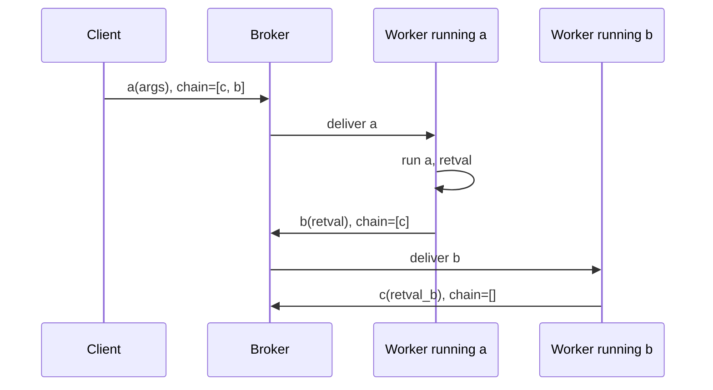

## Overview

The canvas turns single task calls into workflows. A *signature* describes one call (task name, arguments, options) as a plain dictionary that can be serialized into a message, and the primitives built on it compose signatures: `chain` runs tasks one after another, passing each result on; `group` runs tasks in parallel; `chord` runs a group and then a callback with all the results; `chunks`, `xmap` and `xstarmap` split an iterable over tasks. All of it lives in `celery/canvas.py`.

Sources: [celery/canvas.py:233-296](repo://celery/canvas.py#L233-L296)

None of these primitives needs a coordinator process. A workflow is carried forward by the messages themselves: each task message holds the callbacks, the remaining chain and the chord it belongs to, and the worker that finishes a task sends what comes next. This page follows how each primitive is encoded and executed. The result objects they return are on [[Task Results and States]], and how the worker dispatches callbacks is on [[Task Execution and Tracing]].

Sources: [celery/app/amqp.py:398-405](repo://celery/app/amqp.py#L398-L405), [celery/app/trace.py:426-473](repo://celery/app/trace.py#L426-L473)

## Signatures

### The signature dictionary

`Signature` is a `dict` subclass with the keys `task`, `args`, `kwargs`, `options`, `subtask_type` and `immutable`, so any serializer that handles dictionaries can carry it. `add.s(2, 2)` and `add.signature((2, 2), countdown=10)` create one; `signature(d)` turns a dictionary back into the right class through the `subtask_type` registered with `Signature.register_type`. The task class is looked up lazily from the app's registry, and when the name is not registered, `apply_async` falls back to `app.send_task`, so a signature can name a task this process does not have.

Sources: [celery/canvas.py:296-345](repo://celery/canvas.py#L296-L345), [celery/canvas.py:838-875](repo://celery/canvas.py#L838-L875), [celery/canvas.py:2395-2410](repo://celery/canvas.py#L2395-L2410)

### Partial application

Calling `sig.apply_async(args, kwargs, **options)` merges the new values into the stored ones: new positional arguments are *prepended*, keyword arguments and options are merged with the new values winning. This is how a callback receives its parent's return value as the first argument. An *immutable* signature (`add.si(2, 2)` or `sig.set(immutable=True)`) ignores new arguments and only merges options. Two options, `group_id` and any stamped header, can never be overridden once set, because changing them would detach the task from its group.

Sources: [celery/canvas.py:370-443](repo://celery/canvas.py#L370-L443), [celery/canvas.py:294-294](repo://celery/canvas.py#L294-L294)

`clone()` copies a signature with deep-copied options, and `set(**options)` updates options in place and returns the signature, so calls can be chained: `add.s(2, 2).set(countdown=10)`.

Sources: [celery/canvas.py:445-471](repo://celery/canvas.py#L445-L471), [celery/canvas.py:539-552](repo://celery/canvas.py#L539-L552)

### Freezing

`freeze()` gives a signature its final identity without sending it: it sets `task_id` (keeping an existing one), `root_id`, `parent_id`, `group_id`, `group_index`, `chord`, and `reply_to` (the app's per-thread id), and returns the `AsyncResult` the call will produce. Every composite primitive freezes its members before sending anything, so the result tree a caller holds exists before the first task runs.

Sources: [celery/canvas.py:473-522](repo://celery/canvas.py#L473-L522)

### Callbacks and errbacks

`sig.link(callback)` appends to the `link` option and `sig.link_error(errback)` to `link_error`; `on_error` does the same but returns the original signature. These options travel in the message body as `callbacks` and `errbacks`. After a task succeeds, the tracer applies each callback with the return value as its argument; several callbacks are sent together as a group. Errbacks run from the backend's `mark_as_failure`.

Sources: [celery/canvas.py:717-746](repo://celery/canvas.py#L717-L746), [celery/app/trace.py:440-465](repo://celery/app/trace.py#L440-L465), [celery/backends/base.py:250-252](repo://celery/backends/base.py#L250-L252)

## Chains

`a.s() | b.s() | c.s()` and `chain(a.s(), b.s(), c.s())` build the same `_chain` signature, whose `kwargs.tasks` holds the steps; `chain(...)` reduces its arguments with the `|` operator. The operator flattens nested chains, and `group | signature` becomes a chord.

Sources: [celery/canvas.py:759-786](repo://celery/canvas.py#L759-L786), [celery/canvas.py:1371-1383](repo://celery/canvas.py#L1371-L1383), [celery/canvas.py:1598-1607](repo://celery/canvas.py#L1598-L1607)

`chain.apply_async` calls `run`, which calls `prepare_steps`. That method walks the steps from last to first, so each step can be frozen knowing the step that follows it:

Sources: [celery/canvas.py:1036-1094](repo://celery/canvas.py#L1036-L1094)

1. A step that is a dict is turned back into a signature; a nested chain is expanded in place; a one-member group is unrolled to its task, and an empty group is skipped.
2. Steps are cloned, and the chain's partial arguments go to the first step only.
3. A group followed by another step is turned into a chord with that step as its body, so the following step receives the list of results.
4. The last step is frozen with the chain's own task id, group and chord, and the others with fresh ids. Each result's `parent` points to the previous step's result, which lets `get()` re-raise a parent's failure.
5. `link_error` is added to every step, and to a chord's body.

Sources: [celery/canvas.py:1170-1289](repo://celery/canvas.py#L1170-L1289)

`run` then sends only the first step, with the remaining steps in the message's `chain` option, listed in reverse order. When that task finishes, the tracer pops the last entry of `chain`, which is the next step, and sends it with the rest of the list and the return value as its argument. The returned `AsyncResult` is the last step's, so `chain(...).get()` waits for the whole chain.

Sources: [celery/canvas.py:1076-1092](repo://celery/canvas.py#L1076-L1092), [celery/canvas.py:877-932](repo://celery/canvas.py#L877-L932), [celery/app/trace.py:466-472](repo://celery/app/trace.py#L466-L472)

Sources: [celery/canvas.py:1076-1092](repo://celery/canvas.py#L1076-L1092), [celery/app/trace.py:466-472](repo://celery/app/trace.py#L466-L472)

When a step fails, `mark_as_failure` stores the same failure on every remaining step of the chain, including a chord body in a later step, so callers waiting on the chain's last result see the error instead of waiting forever.

Sources: [celery/backends/base.py:188-252](repo://celery/backends/base.py#L188-L252)

## Groups

`group(sig1, sig2, …)` sends its members in parallel. `apply_async` takes the group id from the `task_id` option or a new UUID, freezes every member with that group id and its index, and sends them all through one producer. It returns a `GroupResult` whose ready state comes from a barrier promise that each member result resolves. A group cannot take `link` or `link_error`: use a chord, or link the members.

Sources: [celery/canvas.py:1616-1650](repo://celery/canvas.py#L1616-L1650), [celery/canvas.py:1763-1825](repo://celery/canvas.py#L1763-L1825)

While sending, `_apply_tasks` counts how many results the members will produce (descending into nested groups, chains and chords with `_chord._descend`). When the group is a chord header, it calls `backend.set_chord_size(group_id, size)` before sending the last member, so the counter knows when the header is complete.

Sources: [celery/canvas.py:1789-1825](repo://celery/canvas.py#L1789-L1825), [celery/canvas.py:2191-2219](repo://celery/canvas.py#L2191-L2219)

## Chords

`chord(header)(body)` or `group(...) | body` runs the body once with the list of header results. `chord.run`:

Sources: [celery/canvas.py:2064-2092](repo://celery/canvas.py#L2064-L2092)

1. Takes the group id from the header's `task_id` or a new UUID, and freezes the body with its own id and that group id.
2. Freezes the header members with the group id and `chord=body`, so every header message carries the body.
3. Calls `backend.apply_chord(header_result_args, body)`, which prepares the join, then sends the header group.
4. With an empty header, sends the body at once with `[]`.
5. Returns the body's result, whose `parent` is the header's `GroupResult`.

Sources: [celery/canvas.py:2153-2177](repo://celery/canvas.py#L2153-L2177), [celery/canvas.py:2226-2286](repo://celery/canvas.py#L2226-L2286)

How the body is triggered depends on the backend ([[Result Backends]]):

Sources: [celery/canvas.py:2270-2278](repo://celery/canvas.py#L2270-L2278)

| Backend kind | `apply_chord` | Joining |
| --- | --- | --- |
| Redis | Saves the header only if it contains nested groups | Each member's `on_chord_part_return` adds its result to a sorted set and compares the count with the chord size; the last member sends the body |
| Key-value with `incr` (cache, DynamoDB, GCS) | Saves the header `GroupResult` | Each member increments a counter; the member that reaches the size joins the header and sends the body |
| Other backends | Sends `celery.chord_unlock` with a countdown | The unlock task retries every `result_chord_retry_interval` until the header is ready, then joins it and sends the body |
| RPC, disabled | `ensure_chords_allowed` raises | Chords are not supported |

Sources: [celery/backends/redis.py:570-583](repo://celery/backends/redis.py#L570-L583), [celery/backends/base.py:838-867](repo://celery/backends/base.py#L838-L867), [celery/backends/base.py:1183-1257](repo://celery/backends/base.py#L1183-L1257), [celery/app/builtins.py:36-99](repo://celery/app/builtins.py#L36-L99)

If a header member failed, the join raises; the error, or a failure to send the body, becomes a `ChordError`, and `chord_error_from_stack` calls the body's errbacks and stores the failure as the body's result. Joins in the worker run under `allow_join_result()` with `result_chord_join_timeout`.

Sources: [celery/backends/base.py:325-358](repo://celery/backends/base.py#L325-L358), [celery/app/builtins.py:72-99](repo://celery/app/builtins.py#L72-L99)

A chord can be piped further: `chord | task` appends the task to the body, so the chain continues after the body finishes.

Sources: [celery/canvas.py:2077-2092](repo://celery/canvas.py#L2077-L2092)

## Map, starmap and chunks

`xmap(task, it)` and `xstarmap(task, it)` send one message to the built-in `celery.map` or `celery.starmap` task, which calls the task in-process for each item, one after another, and returns the list. `chunks(task, it, n)` splits the iterable into parts of `n` items and sends a group of `xstarmap` tasks, one per part, which trades message overhead against parallelism.

Sources: [celery/canvas.py:1385-1472](repo://celery/canvas.py#L1385-L1472), [celery/app/builtins.py:101-131](repo://celery/app/builtins.py#L101-L131)

## Stamping

Stamps are custom headers added to every task of a workflow, for example to tag all tasks started by one request. `sig.stamp(visitor=None, append_stamps=False, **headers)` stamps a signature, its callbacks and errbacks. A `StampingVisitor` subclass decides the headers: `on_signature` is required, and `on_group_start`, `on_chain_start`, `on_chord_header_start`, `on_chord_body`, `on_callback` and `on_errback` let it vary them by position. Stamped header names are listed in `stamped_headers`, are copied into the message headers, and cannot be overridden by later merges.

Sources: [celery/canvas.py:119-230](repo://celery/canvas.py#L119-L230), [celery/canvas.py:614-634](repo://celery/canvas.py#L614-L634), [celery/app/amqp.py:370-390](repo://celery/app/amqp.py#L370-L390)
