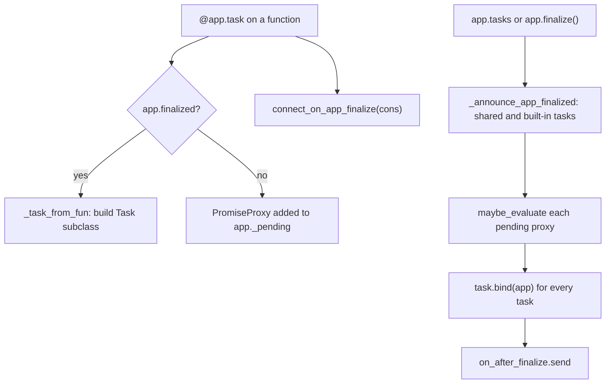

## Overview

Every Celery program starts with a `Celery` instance, the app. It owns the configuration, the task registry, the broker connection pool and the helper objects for messaging (`amqp`), results (`backend`), remote control (`control`), events and logging. Nothing in Celery reaches for module-level globals when an app is at hand: tasks, results and workers carry a reference to their app, so several apps with different brokers can live in one process.

Sources: [celery/app/base.py:252-336](repo://celery/app/base.py#L252-L336)

The app is built to be created at import time and used later. Its constructor reads no configuration and creates no tasks; those happen on first use, through a pending configuration and a queue of task promises that `finalize()` evaluates. This page follows that lifecycle. The setting names and loading methods are on [[Configuration]], and what a task class holds is on [[Defining Tasks]].

Sources: [celery/app/base.py:343-434](repo://celery/app/base.py#L343-L434), [celery/app/base.py:657-677](repo://celery/app/base.py#L657-L677)

## Creating an app

`Celery.__init__` records which classes to use and stores the settings it was given, without loading anything:

Sources: [celery/app/base.py:343-360](repo://celery/app/base.py#L343-L360)

- `amqp`, `events`, `log`, `control`, `loader`, `task_cls` and the registry class may each be passed as an import string or class; the defaults are class attributes such as `amqp_cls = 'celery.app.amqp:AMQP'`. The loader comes from the `CELERY_LOADER` environment variable, then `loader_cls`, then `celery.loaders.app:AppLoader`.
- `broker`, `backend`, `include` and any other keyword argument go into `_preconf` through `__autoset`, which also remembers the key in `_preconf_set_by_auto`.
- `_conf` becomes a `Settings` object wrapping a `PendingConfiguration` whose callback is `_finalize_pending_conf`.
- Fixups (by default the Django fixup) are instantiated with the app, and the app becomes the current app unless `set_as_current=False`.
- Four signals are created per app: `on_configure`, `on_after_configure`, `on_after_finalize` and `on_after_fork`.

Sources: [celery/app/base.py:343-434](repo://celery/app/base.py#L343-L434), [celery/app/base.py:436-450](repo://celery/app/base.py#L436-L450)

The helper objects are `cached_property` attributes, created on first access from the class names stored above: `app.amqp`, `app.control`, `app.events`, `app.loader` and `app.log`. `app.backend` is different: a backend that declares `thread_safe` is cached on the app, any other one is stored in a `threading.local`, so each thread gets its own instance.

Sources: [celery/app/base.py:1534-1595](repo://celery/app/base.py#L1534-L1595)

## Current and default app

`celery._state` tracks which app code means when it does not name one. `_tls.current_app` is a thread-local set by `app.set_current()` (the constructor calls it), and `default_app` is a process-wide fallback set by `set_default()`. When neither exists, `_get_current_app` creates a fallback app named `default` with the `default` loader, which reads `celeryconfig.py`.

Sources: [celery/_state.py:66-104](repo://celery/_state.py#L66-L104), [celery/loaders/default.py:15-44](repo://celery/loaders/default.py#L15-L44)

`current_app` and `current_task` are `Proxy` objects around `get_current_app` and `get_current_task`. A `Proxy` calls its function on every attribute access, so it always resolves to the app or task current at that moment. `get_current_worker_task` walks the task stack from the top and skips tasks whose request says `called_directly`, so a task called inline from another task does not hide the task the worker is running.

Sources: [celery/_state.py:121-142](repo://celery/_state.py#L121-L142), [celery/local.py:52-110](repo://celery/local.py#L52-L110)

Setting `CELERY_TRACE_APP` swaps `app_or_default` for a version that prints a stack trace whenever code falls back to the current or default app, which helps find code that forgets to pass its app.

Sources: [celery/_state.py:163-197](repo://celery/_state.py#L163-L197)

## Lazy configuration

`PendingConfiguration` is a dictionary wrapper whose `data` property calls the app's `_finalize_pending_conf` the first time any key is read. Writes before that point go straight into `_preconf`, so `app.conf.update(...)` right after construction costs nothing.

Sources: [celery/app/base.py:208-250](repo://celery/app/base.py#L208-L250)

`_load_config` does the real work once:

Sources: [celery/app/base.py:1247-1250](repo://celery/app/base.py#L1247-L1250)

1. Send `on_configure`.
2. If a `config_source` was given, pass it to `loader.config_from_object`.
3. Merge the loader's configuration with `_preconf` through `detect_settings`, ignoring keys that were set automatically from constructor arguments when deciding whether the user writes old uppercase or new lowercase names.
4. Swap the result into the existing `Settings` object in place, so references to `app.conf` taken earlier see the loaded values.
5. Apply defaults queued by `add_defaults` and periodic tasks queued by `add_periodic_task`.
6. Send `on_after_configure`.

Sources: [celery/app/base.py:1230-1280](repo://celery/app/base.py#L1230-L1280)

## Finalization and the task registry

The `@app.task` decorator does not create a task class when the app is not finalized. It wraps `_task_from_fun` in a `PromiseProxy`, appends the proxy to `app._pending` and returns the proxy. A `PromiseProxy` evaluates its function once, on first attribute access, and keeps the result. The decorator also registers a constructor with `connect_on_app_finalize` unless `shared=False`, so every app finalized later gets its own copy of the task.

Sources: [celery/app/base.py:554-578](repo://celery/app/base.py#L554-L578), [celery/local.py:282-358](repo://celery/local.py#L282-L358)

`finalize()` runs once under `_finalize_mutex`. It sets `finalized`, calls every callback registered with `connect_on_app_finalize` (shared tasks and the built-in tasks), evaluates every pending proxy, binds every task in the registry to the app and sends `on_after_finalize`. Reading `app.tasks` calls `finalize(auto=True)`; an app built with `autofinalize=False` raises `RuntimeError` instead, which catches code that uses the registry before setup is done.

Sources: [celery/app/base.py:657-677](repo://celery/app/base.py#L657-L677), [celery/app/base.py:1601-1609](repo://celery/app/base.py#L1601-L1609), [celery/_state.py:39-49](repo://celery/_state.py#L39-L49)

Sources: [celery/app/base.py:554-578](repo://celery/app/base.py#L554-L578), [celery/app/base.py:657-677](repo://celery/app/base.py#L657-L677)

`shared_task` is the decorator for libraries that do not know which app will use them. It registers a constructor for future apps, adds the task to every app already finalized, and returns a plain `Proxy` that looks the task up by name in the current app's registry on every access.

Sources: [celery/app/__init__.py:24-76](repo://celery/app/__init__.py#L24-L76)

## Loaders and task discovery

A loader reads configuration and imports task modules. `BaseLoader.import_default_modules` sends the `import_modules` signal, re-raises any exception a receiver returned, and imports every module in `default_modules`: the loader's built-in modules, then the `imports` setting, then `include`. The worker calls `init_worker` once, which imports these modules and then runs `on_worker_init`.

Sources: [celery/loaders/base.py:97-111](repo://celery/loaders/base.py#L97-L111), [celery/loaders/base.py:223-229](repo://celery/loaders/base.py#L223-L229)

`app.autodiscover_tasks(packages, related_name='tasks')` is lazy by default: it connects a promise to the `import_modules` signal, so the search runs when the worker imports its default modules. With `force=True` it runs at once. For each package, `find_related_module` imports the package and then `package.tasks`, returning nothing when only the `tasks` submodule is missing and re-raising an import error raised inside it. With no packages, the app asks each fixup for its list; the Django fixup answers with the installed apps ([[Django Integration]]).

Sources: [celery/app/base.py:782-844](repo://celery/app/base.py#L782-L844), [celery/loaders/base.py:218-278](repo://celery/loaders/base.py#L218-L278)

Loader names resolve through `LOADER_ALIASES`: `app` is `AppLoader`, the loader of every explicit app, and `default` is the `celeryconfig` loader of the fallback app.

Sources: [celery/loaders/__init__.py:1-18](repo://celery/loaders/__init__.py#L1-L18), [celery/loaders/app.py:1-8](repo://celery/loaders/app.py#L1-L8)

## Broker connections and producers

`app.connection_for_write()` and `connection_for_read()` return lazy `kombu.Connection` objects built from the `broker_write_url`/`broker_read_url` settings and the other `broker_*` settings; `app.connection()` is the older name for the write variant. `_connection` fills each argument from configuration when the caller leaves it out and merges `broker_transport_options` with the caller's transport options.

Sources: [celery/app/base.py:1043-1129](repo://celery/app/base.py#L1043-L1129)

`app.pool` is a kombu connection pool sized by `broker_pool_limit`, and `app.producer_pool` is the producer pool kept by `app.amqp`. `connection_or_acquire` and `producer_or_acquire` return a `FallbackContext`: inside a `with` block they use the connection or producer the caller passed, or take one from the pool and give it back afterwards. When the pool stays exhausted past `broker_pool_acquire_timeout`, the error names both settings to raise.

Sources: [celery/app/base.py:1131-1191](repo://celery/app/base.py#L1131-L1191), [celery/app/base.py:1488-1501](repo://celery/app/base.py#L1488-L1501), [celery/app/base.py:1611-1613](repo://celery/app/base.py#L1611-L1613)

## App-bound classes and pickling

`subclass_with_self` creates a subclass of an app-compatible class with the app stored as a class attribute, which is how `app.Task`, `app.AsyncResult`, `app.GroupResult`, `app.Worker` and `app.WorkController` exist. Unless `keep_reduce` is set, the subclass pickles as "get attribute `reverse` from the current app and call it", so a result object unpickled in another process binds to that process's app.

Sources: [celery/app/base.py:1335-1376](repo://celery/app/base.py#L1335-L1376), [celery/app/base.py:1430-1486](repo://celery/app/base.py#L1430-L1486)

The app itself pickles as its class plus `__reduce_keys__`: the main name, the configuration changes (or `_preconf` before configuration), the class names of its helpers, fixups, config source and namespace. Default settings are never sent, and a child process rebuilds an equal app from these keys.

Sources: [celery/app/base.py:1391-1428](repo://celery/app/base.py#L1391-L1428)

## After fork

The first time `app.pool` is built, `_ensure_after_fork` registers `_after_fork_cleanup_app` with kombu's `register_after_fork`. In a forked child it drops the connection pool and the producer pool, since sockets inherited from the parent cannot be shared, and sends `on_after_fork`. `close()`, also called on leaving a `with Celery(...)` block, drops the pool and removes the app from the set of active apps.

Sources: [celery/app/base.py:118-124](repo://celery/app/base.py#L118-L124), [celery/app/base.py:460-478](repo://celery/app/base.py#L460-L478), [celery/app/base.py:1282-1288](repo://celery/app/base.py#L1282-L1288)
