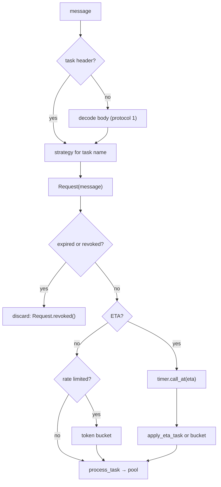

## Overview

The consumer is the part of the worker that talks to the broker. It owns the connection, consumes task messages from the selected queues, turns each message into a `Request`, holds back requests that have an ETA or exceed a rate limit, and hands the rest to the worker's `process_task`, which sends them to the pool. It also runs the worker's other broker services (events, heartbeats, remote control) and restarts all of them when the connection is lost. The `Consumer` object is created by the worker's last bootstep ([[Worker Startup and Bootsteps]]) and is itself a blueprint of steps.

Sources: [celery/worker/consumer/consumer.py:145-255](repo://celery/worker/consumer/consumer.py#L145-L255), [celery/worker/components.py:222-246](repo://celery/worker/components.py#L222-L246)

What happens to a `Request` once it reaches the pool is on [[Task Execution and Tracing]]; broker-side ETA handling for quorum queues is on [[Native Delayed Delivery and Quorum Queues]].

Sources: [celery/worker/strategy.py:99-132](repo://celery/worker/strategy.py#L99-L132)

## The consumer blueprint

| Step | Requires | Role |
| --- | --- | --- |
| `Connection` | — | Opens `c.connection` with `connect()` and closes it on shutdown |
| `Events` | Connection | Creates the event dispatcher; flushes events buffered while disconnected |
| `Mingle` | Events | At start, asks other workers (`hello`) for their logical clock and revoked task ids |
| `Gossip` | Mingle | Consumes other workers' events to track the cluster and run elections |
| `Heart` | Events | Sends a `worker-heartbeat` event every few seconds |
| `Control` | Tasks | The remote-control mailbox ([[Remote Control and Inspection]]) |
| `Tasks` | Mingle | Sets prefetch and starts the task consumer |
| `DelayedDelivery` | Tasks | Declares broker-side delay queues for quorum queues |
| `Evloop` | last | Runs the event loop |
| `Agent` | Connection | Starts the `worker_agent` actor, if configured |

Sources: [celery/worker/consumer/consumer.py:171-189](repo://celery/worker/consumer/consumer.py#L171-L189), [celery/worker/consumer/connection.py:14-45](repo://celery/worker/consumer/connection.py#L14-L45), [celery/worker/consumer/events.py:12-71](repo://celery/worker/consumer/events.py#L12-L71), [celery/worker/consumer/heart.py:9-36](repo://celery/worker/consumer/heart.py#L9-L36), [celery/worker/consumer/agent.py:9-21](repo://celery/worker/consumer/agent.py#L9-L21), [celery/worker/consumer/control.py:18-33](repo://celery/worker/consumer/control.py#L18-L33), [celery/worker/consumer/delayed_delivery.py:45-60](repo://celery/worker/consumer/delayed_delivery.py#L45-L60)

`Mingle` and `Gossip` only run on transports that can broadcast: AMQP, Redis, and for Mingle also Google Pub/Sub. They can be switched off with `--without-mingle` and `--without-gossip`. Mingle merges the revoked ids it receives into the worker's own set, so a task revoked while the worker was down is still skipped ([[Remote Control and Inspection]]).

Sources: [celery/worker/consumer/mingle.py:22-76](repo://celery/worker/consumer/mingle.py#L22-L76), [celery/worker/consumer/gossip.py:23-79](repo://celery/worker/consumer/gossip.py#L23-L79)

## Connection and restarts

`Consumer.start` runs the blueprint in a loop. When a recoverable error escapes it (a connection error, plus channel errors with `broker_channel_error_retry`), it decides whether to retry: on the first connection the setting is `broker_connection_retry_on_startup` when set, otherwise `broker_connection_retry`. With retries disabled, the worker shuts down with exit code 1. Running out of file descriptors (`EMFILE`) terminates the worker. Otherwise the consumer cleans up, closes all steps and restarts the blueprint; more than five restarts within a second log "Frequent restarts detected" and pause for a second.

Sources: [celery/worker/consumer/consumer.py:366-413](repo://celery/worker/consumer/consumer.py#L366-L413)

`ensure_connected` wraps every connection the consumer opens. With retries enabled, it calls kombu's `ensure_connection` with `broker_connection_max_retries` (100 by default), logging each failed attempt with the time to the next one; between attempts it checks whether a shutdown was requested.

Sources: [celery/worker/consumer/consumer.py:568-622](repo://celery/worker/consumer/consumer.py#L568-L622)

After a connection is lost mid-run, `on_connection_error_after_connected` closes the broken connection before reconnecting. With `worker_cancel_long_running_tasks_on_connection_loss`, it cancels running `acks_late` tasks that are not yet acknowledged, because their messages will be redelivered by the broker anyway. It then lowers the prefetch count by the number of tasks still running, so the new connection does not fetch more than the pool can take, and restores it step by step as those tasks are acknowledged. With per-consumer QoS (quorum queues) the reduction is skipped, because the broker would not apply the later increases.

Sources: [celery/worker/consumer/consumer.py:419-491](repo://celery/worker/consumer/consumer.py#L419-L491), [celery/worker/consumer/consumer.py:788-815](repo://celery/worker/consumer/consumer.py#L788-L815)

## Prefetch and QoS

The `Tasks` step builds the task strategies, sets `basic_qos` with the initial prefetch count (`concurrency × worker_prefetch_multiplier`), and creates the task consumer for the selected queues with the app's `accept_content`. Prefetch changes go through a kombu `QoS` object capped by `worker_eta_task_limit`. Global QoS is used when the broker's semantics require it, and switched off when quorum queues are detected, since they only support per-consumer prefetch.

Sources: [celery/worker/consumer/tasks.py:29-57](repo://celery/worker/consumer/tasks.py#L29-L57), [celery/worker/consumer/tasks.py:103-124](repo://celery/worker/consumer/tasks.py#L103-L124)

With `worker_disable_prefetch` on a Redis broker, the step patches the channel's `can_consume` so the worker reserves a message only when fewer requests are reserved than the pool (or the autoscaler's maximum) has slots. On other brokers the setting is ignored with a warning.

Sources: [celery/worker/consumer/tasks.py:59-83](repo://celery/worker/consumer/tasks.py#L59-L83)

## The event loop

`Evloop` is the last step and calls `c.loop(...)`, which is `asynloop` when the worker has a hub and `synloop` otherwise (eventlet, gevent, or transports without asynchronous I/O).

Sources: [celery/worker/consumer/consumer.py:857-872](repo://celery/worker/consumer/consumer.py#L857-L872), [celery/worker/consumer/consumer.py:240-241](repo://celery/worker/consumer/consumer.py#L240-L241)

`asynloop` installs the message handler on the task consumer, registers the worker's and the consumer's steps with the hub, starts consuming and calls `on_ready`, which fires the `worker_ready` callback. The first time, it raises `WorkerLostError` if pool processes failed to start. Each iteration checks for a requested shutdown, re-raises a broker heartbeat failure, applies pending QoS changes only when there is nothing left to read (so remote-control commands are not starved by task messages), and steps the hub. On an error it resets the hub and clears its timers, so callbacks tied to the dead connection do not fire after reconnecting.

Sources: [celery/worker/loops.py:44-139](repo://celery/worker/loops.py#L44-L139)

`synloop` does the same work by blocking in `connection.drain_events(timeout=2.0)` and running callbacks queued with `call_soon` between iterations. Acknowledgements bypass that queue through `call_soon_ack` and are written to the broker immediately, so with `acks_late` and a prefetch of one the next message is not delayed.

Sources: [celery/worker/loops.py:142-183](repo://celery/worker/loops.py#L142-L183), [celery/worker/consumer/consumer.py:257-294](repo://celery/worker/consumer/consumer.py#L257-L294)

## From message to request

### Dispatching by task name

`create_task_handler` returns `on_task_received`, the callback for every task message:

Sources: [celery/worker/consumer/consumer.py:723-786](repo://celery/worker/consumer/consumer.py#L723-L786)

1. Read the task name from the `task` header (protocol 2), or decode the body and read `task` from it (protocol 1). A message with neither is logged as unknown and rejected.
2. Look up the strategy for that name. An unregistered name logs an error, rejects the message, stores `NotRegistered` as the task's failure, sends `task-failed` and the `task_unknown` signal.
3. Call the strategy with the message and ack/reject callbacks. `InvalidTaskError` or `ContentDisallowed` reject the message and send `task_rejected`; a decode error is logged and the message acknowledged, so it cannot loop forever.

Sources: [celery/worker/consumer/consumer.py:516-530](repo://celery/worker/consumer/consumer.py#L516-L530), [celery/worker/consumer/consumer.py:672-714](repo://celery/worker/consumer/consumer.py#L672-L714)

Strategies are built per task by `update_strategies`, which also compiles each task's tracer: `task.start_strategy` instantiates the task's `Strategy`, `celery.worker.strategy:default` unless overridden.

Sources: [celery/worker/consumer/consumer.py:716-721](repo://celery/worker/consumer/consumer.py#L716-L721), [celery/app/task.py:520-521](repo://celery/app/task.py#L520-L521)

### The default strategy

`strategy.default` precomputes everything per task (the `Request` class created by `create_request_cls`, the rate-limit bucket getter, the revoked set, whether events are on) and returns `task_message_handler`. For each message it:

Sources: [celery/worker/strategy.py:99-131](repo://celery/worker/strategy.py#L99-L131)

1. Normalizes the payload to protocol 2: protocol 2 messages keep their undecoded body, so arguments are deserialized only in the pool; protocol 1 and hybrid messages are converted by `proto1_to_proto2` and `hybrid_to_proto2`.
2. Builds the `Request`, logs "Received task", and drops it at once if it is expired or its id is in the revoked set.
3. Sends the `task_received` signal and a `task-received` event.
4. With an ETA, converts it to a timestamp, increments the prefetch count so the held message does not block new ones, and schedules the request on the timer: `apply_eta_task` reserves and processes it at that time. An ETA that cannot be converted rejects the message.
5. With a rate limit, puts the request in the task's token bucket.
6. Otherwise marks the request reserved and calls `on_task_request`, which is the worker's `process_task`.

Sources: [celery/worker/strategy.py:99-209](repo://celery/worker/strategy.py#L99-L209), [celery/worker/strategy.py:25-97](repo://celery/worker/strategy.py#L25-L97), [celery/worker/consumer/consumer.py:659-663](repo://celery/worker/consumer/consumer.py#L659-L663)

Sources: [celery/worker/strategy.py:132-208](repo://celery/worker/strategy.py#L132-L208), [celery/worker/request.py:470-509](repo://celery/worker/request.py#L470-L509)

## Rate limits

Each task with a `rate_limit` gets a `TokenBucket` of capacity 1 filling at that rate; tasks without one get `None`. A rate-limited request is appended to its bucket, and `_schedule_bucket_request` moves requests to the pool while tokens are available. When the bucket is empty, it puts the request back at the head and asks the timer to try again after the bucket's expected wait, so requests keep their order. `--without-rate-limits` (`worker_disable_rate_limits`) skips buckets entirely, and `reset_rate_limits` rebuilds them when a `rate_limit` control command changes a task's limit.

Sources: [celery/worker/consumer/consumer.py:296-364](repo://celery/worker/consumer/consumer.py#L296-L364)

## Shutdown of active requests

During a cold shutdown, `cancel_active_requests` cancels every running request that is not `acks_late`, and every `acks_late` request not yet acknowledged unless it already succeeded. Requests of `acks_late` tasks are cancelled without a `RETRY` signal, since the broker redelivers their messages.

Sources: [celery/worker/consumer/consumer.py:823-854](repo://celery/worker/consumer/consumer.py#L823-L854)
