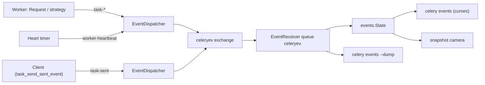

## Overview

Events are Celery's monitoring stream. Workers publish small JSON messages whenever something happens to a task (received, started, succeeded, failed, retried, revoked) and periodically about themselves (online, heartbeat, offline); clients can add a `task-sent` event. Monitors subscribe to the event exchange, feed the messages into an in-memory `State`, and show or record the cluster from it. Events are separate from results: they are fire-and-forget, not stored by the broker for long, and only sent when enabled. This page covers the dispatcher that publishes events, the receiver that consumes them, the `State` model, and the tools built on them. Querying workers on demand is on [[Remote Control and Inspection]].

Sources: [celery/events/event.py:11-63](repo://celery/events/event.py#L11-L63), [celery/events/dispatcher.py:14-80](repo://celery/events/dispatcher.py#L14-L80)



Sources: [celery/events/receiver.py:23-79](repo://celery/events/receiver.py#L23-L79), [celery/bin/events.py:14-98](repo://celery/bin/events.py#L14-L98)

## Event messages

An event is a dictionary with a `type` field and a `timestamp` (added when missing). The part of the type before the first dash is its *group*: `task-succeeded` belongs to `task`, `worker-heartbeat` to `worker`. The dispatcher also adds `hostname`, `utcoffset`, `pid` and the sender's logical `clock`.

Sources: [celery/events/event.py:18-43](repo://celery/events/event.py#L18-L43), [celery/events/dispatcher.py:115-136](repo://celery/events/dispatcher.py#L115-L136)

Events go to the topic exchange named by `event_exchange` (`celeryev`), routed by the type with dashes turned into dots, such as `task.succeeded`. On Redis and Google Pub/Sub the exchange is a fanout exchange instead. The SQL transport cannot carry events, and the dispatcher disables itself there.

Sources: [celery/events/event.py:46-63](repo://celery/events/event.py#L46-L63), [celery/events/dispatcher.py:72-80](repo://celery/events/dispatcher.py#L72-L80)

| Event | Sent by | Key fields |
| --- | --- | --- |
| `task-sent` | Client, with `task_send_sent_event` | name, args, kwargs, eta, expires, queue, exchange |
| `task-received` | Worker strategy on receipt | name, args, kwargs, root_id, parent_id, retries, eta, expires |
| `task-started` | Request, when the pool accepts it | — |
| `task-succeeded` | Request | result, runtime |
| `task-failed` | Request | exception, traceback |
| `task-retried` | Request | exception, traceback |
| `task-revoked` | Request | terminated, signum, expired |
| `task-rejected` | Request | requeue |
| `worker-online`, `worker-heartbeat`, `worker-offline` | Heart | freq, active, processed, loadavg, software info |

Sources: [celery/app/amqp.py:404-418](repo://celery/app/amqp.py#L404-L418), [celery/worker/strategy.py:166-176](repo://celery/worker/strategy.py#L166-L176), [celery/worker/request.py:457-469](repo://celery/worker/request.py#L457-L469), [celery/worker/request.py:515-527](repo://celery/worker/request.py#L515-L527), [celery/worker/request.py:596-624](repo://celery/worker/request.py#L596-L624), [celery/worker/request.py:736-740](repo://celery/worker/request.py#L736-L740), [celery/worker/heartbeat.py:39-61](repo://celery/worker/heartbeat.py#L39-L61)

## Publishing: EventDispatcher

### Sending and buffering

`app.events.Dispatcher(connection, hostname=None, enabled=True, groups=None, buffer_while_offline=True)` wraps a kombu producer on the event exchange, using `event_serializer` (JSON). `send(type, **fields)` drops the event when the dispatcher is disabled or when `groups` is set and does not include the event's group. Otherwise it publishes it; if publishing fails and `buffer_while_offline` is on, the event is kept in an outbound buffer that `flush()` sends later.

Sources: [celery/events/dispatcher.py:44-80](repo://celery/events/dispatcher.py#L44-L80), [celery/events/dispatcher.py:138-162](repo://celery/events/dispatcher.py#L138-L162), [celery/events/dispatcher.py:164-213](repo://celery/events/dispatcher.py#L164-L213)

The dispatcher can also buffer whole groups: events of a group in `buffer_group` collect in a list and are sent together as one message routed `<group>.multi` when the list reaches `buffer_limit` (24), or when the worker's event loop flushes them. Receivers accept either one event or a list.

Sources: [celery/events/dispatcher.py:182-213](repo://celery/events/dispatcher.py#L182-L213), [celery/events/receiver.py:140-145](repo://celery/events/receiver.py#L140-L145)

### In the worker

The consumer's `Events` step creates the worker's dispatcher on the consumer's write connection. Without `-E` (`worker_send_task_events`), its groups are limited to `worker`, so only heartbeats go out; with it, all groups are sent. With the event loop, task events are buffered and sent in batches. When the connection is restarted, the step copies the old dispatcher's buffer into the new one, flushes it, and points reserved requests at the new dispatcher.

Sources: [celery/worker/consumer/events.py:12-71](repo://celery/worker/consumer/events.py#L12-L71)

The `enable_events` and `disable_events` control commands add or remove the `task` group at run time, which is how `celery events` turns on task events in a worker started without `-E`.

Sources: [celery/worker/control.py:344-367](repo://celery/worker/control.py#L344-L367)

### Heartbeats

The `Heart` step sends `worker-online` when it starts, `worker-heartbeat` every two seconds by default (`--heartbeat-interval`), and `worker-offline` when it stops. Each carries the interval as `freq`, the number of active tasks, the total processed, the load average and the software version. The heartbeat starts and stops with the dispatcher, and `--without-heartbeat` disables it.

Sources: [celery/worker/heartbeat.py:15-61](repo://celery/worker/heartbeat.py#L15-L61), [celery/worker/consumer/heart.py:9-36](repo://celery/worker/consumer/heart.py#L9-L36)

## Consuming: EventReceiver

`app.events.Receiver(connection, handlers={...}, routing_key='#')` declares its own queue, `celeryev.<uuid>` (prefix `event_queue_prefix`), bound to the event exchange. The queue is auto-deleted, with a message TTL of `event_queue_ttl` (5 s) and an expiry of `event_queue_expires` (60 s), so a monitor that stops does not leave events piling up. It cannot be both exclusive and durable.

Sources: [celery/events/receiver.py:23-79](repo://celery/events/receiver.py#L23-L79), [celery/app/defaults.py:179-189](repo://celery/app/defaults.py#L179-L189)

`capture(limit=None, timeout=None, wakeup=True)` consumes until stopped. With `wakeup`, it first broadcasts the `heartbeat` control command, so every worker announces itself at once instead of after its next interval. Each event is passed to `handlers[type]`, or to the `'*'` handler. Before that, `event_from_message` adjusts the receiver's logical clock from the event's clock, gives `task-sent` events (whose clients do not keep a synchronized clock) a clock just below the receiver's, converts the timestamp with the sender's `utcoffset`, and records `local_received`.

Sources: [celery/events/receiver.py:80-145](repo://celery/events/receiver.py#L80-L145)

```python
def on_event(event):
    print(event['type'], event.get('uuid'))

with app.connection() as conn:
    recv = app.events.Receiver(conn, handlers={'*': on_event})
    recv.capture(limit=None, timeout=None, wakeup=True)
```

Sources: [celery/events/receiver.py:80-106](repo://celery/events/receiver.py#L80-L106)

## The State model

### Caches and indexes

`app.events.State()` turns the stream into a model of the cluster: `state.workers` and `state.tasks` are LRU caches of `Worker` and `Task` objects (5,000 workers and 10,000 tasks by default), with indexes by task type and by worker. Passing `state.event` as a receiver's handler keeps it up to date.

Sources: [celery/events/state.py:398-440](repo://celery/events/state.py#L398-L440), [celery/events/state.py:501-512](repo://celery/events/state.py#L501-L512)

### Workers

A `Worker` keeps the last few heartbeat arrival times. It is `alive` while the latest heartbeat is younger than its `freq` times the expire window of 200%, so a worker that sends every two seconds is considered offline after four seconds of silence. A heartbeat whose timestamp differs from its arrival time by more than 16 seconds logs a warning that clocks may be out of sync. A `worker-offline` event clears the heartbeats and calls `on_node_leave`.

Sources: [celery/events/state.py:44-58](repo://celery/events/state.py#L44-L58), [celery/events/state.py:107-124](repo://celery/events/state.py#L107-L124), [celery/events/state.py:183-236](repo://celery/events/state.py#L183-L236)

### Tasks

A `Task` records a timestamp per event (`received`, `started`, `succeeded`, …) and its current state. Because events from different processes can arrive out of order, an event whose state comes *before* the current one in the precedence order (see [[Task Results and States]]) does not move the task back: only the fields named in `merge_rules` are taken from it, such as the name and arguments of a late `task-received`. Retries are the exception and always update the state. Unknown event subjects become custom states.

Sources: [celery/events/state.py:66-76](repo://celery/events/state.py#L66-L76), [celery/events/state.py:243-332](repo://celery/events/state.py#L243-L332)

The state also keeps a heap of task events ordered by logical clock, used by `tasks_by_time()`, and links parent, root and child tasks by id when those tasks are known.

Sources: [celery/events/state.py:540-635](repo://celery/events/state.py#L540-L635), [celery/events/state.py:656-675](repo://celery/events/state.py#L656-L675)

## Monitoring tools

`celery events` has three modes:

Sources: [celery/bin/events.py:44-98](repo://celery/bin/events.py#L44-L98)

- With no option, it runs `evtop`, a curses monitor listing recent tasks and workers, which requires the `curses` module.
- `--dump` prints every event as it arrives.
- `--camera=module.Class` with `--frequency` (default 1 s) and `--maxrate` runs `evcam`, which records snapshots of the state. A camera subclasses `Polaroid` and implements `on_shutter(state)`; it is called every `freq` seconds, at most `maxrate` times per period, while the state is locked with `freeze_while`. `--detach` runs the camera in the background.

Sources: [celery/events/cursesmon.py:512-534](repo://celery/events/cursesmon.py#L512-L534), [celery/events/dumper.py:79-103](repo://celery/events/dumper.py#L79-L103), [celery/events/snapshot.py:24-111](repo://celery/events/snapshot.py#L24-L111), [celery/events/state.py:442-449](repo://celery/events/state.py#L442-L449)

The same events feed the worker's `Gossip` step: each worker runs a receiver with a `State` of its own to track which other workers are alive and to coordinate elections ([[The Consumer and Message Handling]]).

Sources: [celery/worker/consumer/gossip.py:23-79](repo://celery/worker/consumer/gossip.py#L23-L79)
