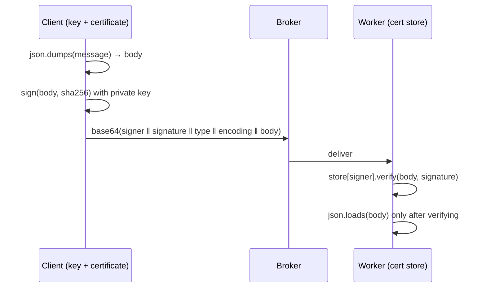

## Overview

A worker runs whatever a message tells it to run, so anyone who can publish to the broker can run tasks. Celery's `auth` serializer narrows that to holders of a private key: the client signs every message with its key, and the worker accepts only messages whose signature verifies against a certificate in a trusted store. The serializer is registered with kombu like any other, so signing happens below the task protocol and nothing else in Celery changes. This page explains how to enable it, how messages are signed and verified, and how keys and certificates are loaded. General serializer settings are on [[Configuration]].

Sources: [celery/security/__init__.py:1-74](repo://celery/security/__init__.py#L1-L74), [celery/security/serialization.py:20-90](repo://celery/security/serialization.py#L20-L90)

## Enabling signed messages

Signing needs three settings, a matching serializer configuration, and a call to `app.setup_security()`:

Sources: [celery/app/base.py:750-781](repo://celery/app/base.py#L750-L781)

```python
app.conf.update(
    security_key='ssl/worker.key',
    security_certificate='ssl/worker.pem',
    security_cert_store='ssl/*.pem',
    task_serializer='auth',
    event_serializer='auth',
    accept_content=['auth'],
    result_accept_content=['json']
)
app.setup_security()
```

Sources: [examples/security/mysecureapp.py:35-44](repo://examples/security/mysecureapp.py#L35-L44)

| Setting | Meaning |
| --- | --- |
| `security_key` | Path to the PEM private key used to sign |
| `security_key_password` | Password for an encrypted key |
| `security_certificate` | Path to the PEM certificate matching the key |
| `security_cert_store` | Directory or glob of trusted certificates used to verify |
| `security_digest` | Hash algorithm, `sha256` by default |

Sources: [celery/app/defaults.py:239-247](repo://celery/app/defaults.py#L239-L247), [celery/app/defaults.py:20-20](repo://celery/app/defaults.py#L20-L20)

`setup_security(allowed_serializers=None, key=None, key_password=None, cert=None, store=None, digest=..., serializer='json')` performs these steps:

Sources: [celery/security/__init__.py:44-46](repo://celery/security/__init__.py#L44-L46)

1. Disable kombu's insecure serializers (such as pickle) except those listed in `allowed_serializers`.
2. Require `task_serializer == 'auth'` and `accept_content == ['auth']`, raising `ImproperlyConfigured` otherwise, because signing is pointless if unsigned messages are still accepted.
3. Take the key, password, certificate, store and digest from the arguments or the settings, and raise `ImproperlyConfigured` when the key, certificate or store is missing.
4. Read the key and certificate files and register the `auth` serializer, then make it kombu's default serializer.

Sources: [celery/security/__init__.py:44-74](repo://celery/security/__init__.py#L44-L74)

Importing `celery.security` raises `ImproperlyConfigured` when the `cryptography` package is missing. The operation is global: the serializer registry is shared by every app in the process.

Sources: [celery/security/__init__.py:38-41](repo://celery/security/__init__.py#L38-L41), [celery/app/base.py:753-757](repo://celery/app/base.py#L753-L757)

## Signing and verifying

`SecureSerializer.serialize(data)` first encodes the data with the inner serializer (`json` by default), then signs the encoded bytes with the private key. Signing the encoded body rather than the data means the receiver can check the signature before decoding anything, so a forged message never reaches a decoder. The result packs five fields separated by `\x00\x01`, base64-encoded as a whole: the signer's id (base64), the signature (base64), the inner content type, the inner content encoding, and the body.

Sources: [celery/security/serialization.py:14-66](repo://celery/security/serialization.py#L14-L66)

`deserialize(data)` unpacks the fields, looks up the signer's certificate in the store, verifies the signature over the body, and only then decodes the body with the inner content type. Any cryptography error, an unknown signer or a bad signature is re-raised as `SecurityError`, so the body is never decoded. With message protocol 2 the worker decodes task bodies in the pool process, just before running the task ([[Task Execution and Tracing]]), so that is where verification happens.

Sources: [celery/security/serialization.py:48-77](repo://celery/security/serialization.py#L48-L77), [celery/security/utils.py:19-28](repo://celery/security/utils.py#L19-L28), [celery/app/trace.py:757-789](repo://celery/app/trace.py#L757-L789)

The serializer is registered as `auth` with content type `application/data`.

Sources: [celery/security/serialization.py:80-90](repo://celery/security/serialization.py#L80-L90)



Sources: [celery/security/serialization.py:31-77](repo://celery/security/serialization.py#L31-L77)

## Keys and certificates

Only RSA keys and certificates are supported. `PrivateKey` loads a PEM key (with an optional password) and signs with RSA-PSS padding using MGF1 and the maximum salt length. `Certificate` loads a PEM X.509 certificate; its id, which travels in every message as the signer, is the issuer's name followed by the serial number. `Certificate.verify` checks a signature with the same PSS parameters.

Sources: [celery/security/key.py:12-35](repo://celery/security/key.py#L12-L35), [celery/security/certificate.py:31-73](repo://celery/security/certificate.py#L31-L73)

`FSCertStore(path)` loads every certificate matching the path: a directory means every file in it, otherwise the path is a glob. It refuses an expired certificate and a duplicate id with `SecurityError`, so a worker with an expired certificate in its store fails at setup rather than silently trusting it. The digest name is turned into a `cryptography` hash class by name, so any algorithm the library provides, such as `sha512`, can be used.

Sources: [celery/security/certificate.py:76-113](repo://celery/security/certificate.py#L76-L113), [celery/security/utils.py:13-16](repo://celery/security/utils.py#L13-L16)

## What signing covers

Signing protects what goes through the `auth` serializer: task messages, and events when `event_serializer` is `auth` too. Results are stored with `result_serializer`; the example keeps them as JSON and lists that in `result_accept_content`. Separately, the worker refuses to start as root when `pickle` is accepted ([[Running Multiple Workers and Daemonization]]), and the result backend refuses to rebuild stored "exceptions" that are not exception classes ([[Task Results and States]]).

Sources: [examples/security/mysecureapp.py:35-43](repo://examples/security/mysecureapp.py#L35-L43), [celery/platforms.py:788-845](repo://celery/platforms.py#L788-L845), [celery/backends/base.py:495-511](repo://celery/backends/base.py#L495-L511)
