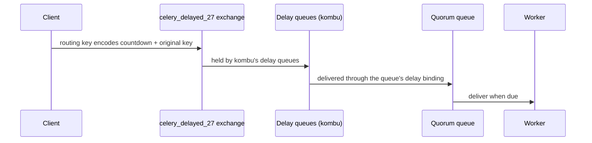

## Overview

Normally a task sent with `countdown` or `eta` is delivered to a worker at once, and the worker holds it in memory until it is due, raising its prefetch count so the held message does not block others ([[The Consumer and Message Handling]]). That depends on changing the prefetch count at run time, which RabbitMQ quorum queues do not support: they only accept a fixed, per-consumer prefetch. When quorum queues are in use, Celery therefore lets the broker do the waiting. Delayed messages are published to a chain of delay exchanges and queues provided by kombu's native delayed delivery, and reach the real queue only when they are due. This page explains how quorum queues are detected, how the sending side reroutes delayed tasks, and what the worker sets up.

Sources: [celery/worker/strategy.py:180-198](repo://celery/worker/strategy.py#L180-L198), [celery/worker/consumer/tasks.py:103-124](repo://celery/worker/consumer/tasks.py#L103-L124), [celery/worker/consumer/delayed_delivery.py:1-51](repo://celery/worker/consumer/delayed_delivery.py#L1-L51)

## Using quorum queues

A queue is a quorum queue when its declaration has the argument `x-queue-type: quorum`. There are three ways to get one:

Sources: [celery/utils/quorum_queues.py:4-20](repo://celery/utils/quorum_queues.py#L4-L20)

- `task_default_queue_type = 'quorum'` declares the default queue with that argument.
- `task_create_missing_queue_type = 'quorum'` does the same for queues created on demand; any value other than `classic` or `quorum` raises `ValueError`.
- A `kombu.Queue` in `task_queues` can set `queue_arguments={'x-queue-type': 'quorum'}` itself.

Sources: [celery/app/amqp.py:286-295](repo://celery/app/amqp.py#L286-L295), [celery/app/amqp.py:201-216](repo://celery/app/amqp.py#L201-L216)

The example in `examples/quorum-queues` sets the default queue type and turns on publisher confirms, which quorum queues require:

Sources: [examples/quorum-queues/myapp.py:35-40](repo://examples/quorum-queues/myapp.py#L35-L40)

```python
app = Celery("myapp", broker="amqp://guest@localhost//")

# Use custom queue (Optional) or set the default queue type to "quorum"
# app.conf.task_queues = (my_quorum_queue,)  # uncomment to use custom queue
app.conf.task_default_queue_type = "quorum"  # comment to use classic queue

# Required by Quorum Queues: https://www.rabbitmq.com/docs/quorum-queues#use-cases
app.conf.broker_transport_options = {"confirm_publish": True}
```

Sources: [examples/quorum-queues/myapp.py:33-40](repo://examples/quorum-queues/myapp.py#L33-L40)

`detect_quorum_queues(app, driver_type)` returns `(True, queue_name)` for the first declared queue with the quorum argument, and only on the `amqp` transport; on any other broker it returns `(False, "")`, so the behaviour on this page applies to RabbitMQ only.

Sources: [celery/utils/quorum_queues.py:4-20](repo://celery/utils/quorum_queues.py#L4-L20)

## Sending a delayed task

In `send_task`, after routing, a call with `eta` or `countdown` on a broker with quorum queues is rewritten:

Sources: [celery/app/base.py:928-936](repo://celery/app/base.py#L928-L936)

1. The exchange type is read from the routed queue, or from the routing options.
2. For a topic or fanout exchange, an `eta` is turned into a countdown in seconds. When the countdown is positive, the routing key becomes `calculate_routing_key(int(countdown), routing_key)`, the exchange becomes the topic exchange `celery_delayed_27`, and the `queue` option is dropped so the message goes through the delay exchange.
3. For a direct exchange, nothing is rewritten and a warning explains that native delayed delivery needs a topic or fanout exchange, and that the task may otherwise block a worker process until its ETA.

Sources: [celery/app/base.py:933-966](repo://celery/app/base.py#L933-L966)

`calculate_routing_key` comes from kombu's `native_delayed_delivery` transport module, which also provides the delay exchanges and queues the worker declares; the routing key it returns combines the countdown with the original routing key. The message itself is built as usual and still carries its `eta` header.

Sources: [celery/app/base.py:18-25](repo://celery/app/base.py#L18-L25), [celery/app/base.py:1012-1021](repo://celery/app/base.py#L1012-L1021)

> [!WARNING]
> The default exchange type, `task_default_exchange_type`, is `direct`. With quorum queues and the default routing, delayed tasks are not rerouted: declare queues on a topic exchange to use native delayed delivery.

Sources: [celery/app/defaults.py:284-286](repo://celery/app/defaults.py#L284-L286), [celery/app/base.py:959-966](repo://celery/app/base.py#L959-L966)

## Worker setup: the DelayedDelivery step

`DelayedDelivery` is a consumer bootstep that requires the `Tasks` step and is included only when quorum queues are detected on the write connection. On start it:

Sources: [celery/worker/consumer/delayed_delivery.py:39-64](repo://celery/worker/consumer/delayed_delivery.py#L39-L64)

1. Validates the configuration: `broker_url` must not be empty and must be a string or a list of strings, and `broker_native_delayed_delivery_queue_type` must be `classic` or `quorum` (default `quorum`). An invalid value is logged as critical and stops the step.
2. Splits `broker_url` on `;` (a failover list) and, for each URL, opens a write connection, declares the delay exchanges and queues with kombu's `declare_native_delayed_delivery_exchanges_and_queues`, then binds every application queue to them with `bind_queue_to_native_delayed_delivery_exchange`. Broadcast queues are skipped.
3. Retries each URL up to three times, one second apart, on `ConnectionRefusedError` and `OSError`. Bind failures of other kinds are collected and raised together as an `ExceptionGroup`.
4. Logs a warning for each URL that fails, and a critical message when every URL failed, in which case native delayed delivery is not available but the worker keeps running.

Sources: [celery/worker/consumer/delayed_delivery.py:66-150](repo://celery/worker/consumer/delayed_delivery.py#L66-L150), [celery/worker/consumer/delayed_delivery.py:152-214](repo://celery/worker/consumer/delayed_delivery.py#L152-L214), [celery/worker/consumer/delayed_delivery.py:216-279](repo://celery/worker/consumer/delayed_delivery.py#L216-L279), [celery/app/defaults.py:98-98](repo://celery/app/defaults.py#L98-L98)



Sources: [celery/app/base.py:943-955](repo://celery/app/base.py#L943-L955), [celery/worker/consumer/delayed_delivery.py:124-150](repo://celery/worker/consumer/delayed_delivery.py#L124-L150)

## How the worker behaves with quorum queues

With `worker_detect_quorum_queues` on (the default), the `Tasks` step switches off global QoS when it finds a quorum queue and logs that the prefetch count is now static. The prefetch count is set once from `concurrency × worker_prefetch_multiplier` and later increases for held ETA tasks do not reach the broker.

Sources: [celery/worker/consumer/tasks.py:103-124](repo://celery/worker/consumer/tasks.py#L103-L124), [celery/app/defaults.py:373-373](repo://celery/app/defaults.py#L373-L373)

After a lost connection, the consumer normally lowers the prefetch count by the number of running tasks and raises it again as they finish. With per-consumer QoS it skips that reduction and restores the full prefetch count, because the later increases would never reach the running consumer and the worker would stay at the reduced count.

Sources: [celery/worker/consumer/consumer.py:451-468](repo://celery/worker/consumer/consumer.py#L451-L468)
