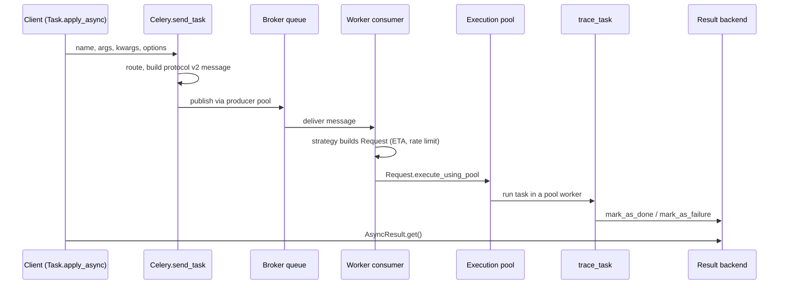

## Overview

Celery is a distributed task queue for Python. A client turns a function call into a message and puts it on a broker queue; worker processes watch the queues, run the function and, when asked, store its return value in a result backend. Several workers and brokers can run at once, which is how a Celery system scales out and stays available. Because the work travels as messages, the protocol is not tied to Python: the README lists clients for Node.js, PHP, Go and Rust.

Sources: [README.rst:91-109](repo://README.rst#L91-L109)

The package exposes a small public surface (`Celery`, `Task`, `shared_task`, the canvas primitives `chain`, `group`, `chord`, `signature`, and the `current_app`/`current_task` proxies). `celery/__init__.py` rebuilds itself as a lazy module with `local.recreate_module`, so `import celery` imports none of these until an attribute is first used.

Sources: [celery/__init__.py:36-41](repo://celery/__init__.py#L36-L41), [celery/__init__.py:150-180](repo://celery/__init__.py#L150-L180)

## The parts of Celery

| Area | What it does | Page |
| --- | --- | --- |
| Application | The `Celery` object: configuration, task registry, broker connections, lazy finalization | [[The Celery Application]] |
| Settings | Setting names, defaults and the ways configuration is loaded | [[Configuration]] |
| Tasks | The `Task` class, the `@app.task` decorator, retries and handlers | [[Defining Tasks]] |
| Messaging | `apply_async`, routing to queues and building the task message | [[Sending Tasks and Routing]] |
| Results | `AsyncResult`, task states and the backend base classes | [[Task Results and States]] |
| Backends | The shipped result stores (Redis, RPC, SQL, MongoDB, S3, …) | [[Result Backends]] |
| Canvas | Signatures, chains, groups and chords | [[Canvas: Signatures and Workflows]] |
| Worker | `WorkController` and the bootsteps that start it | [[Worker Startup and Bootsteps]] |
| Consumer | Receiving messages, ETA and rate limits, prefetch | [[The Consumer and Message Handling]] |
| Execution | `Request` and the tracer that runs a task and records its outcome | [[Task Execution and Tracing]] |
| Pools | prefork, threads, solo, eventlet and gevent concurrency | [[Execution Pools]] |
| Delayed delivery | Broker-side countdowns for quorum queues | [[Native Delayed Delivery and Quorum Queues]] |
| Remote control | Broadcast commands such as `revoke`, `ping` and `inspect` | [[Remote Control and Inspection]] |
| Beat | The periodic task scheduler | [[Periodic Tasks with Beat]] |
| Schedules | `schedule`, `crontab` and `solar` | [[Schedules: Intervals, Crontab and Solar]] |
| Events | Task and worker events, and the monitors that read them | [[Events and Monitoring]] |
| Signals | Hooks into the task, worker and app lifecycle | [[Signals]] |
| Logging | Logger setup for workers and tasks | [[Logging]] |
| CLI | The `celery` command and its subcommands | [[Command Line Interface]] |
| Multi | `celery multi` and process daemonization | [[Running Multiple Workers and Daemonization]] |
| Security | Signed task messages | [[Message Signing and Security]] |
| Django | The Django fixup and `DjangoTask` | [[Django Integration]] |
| Testing | The pytest plugin and embedded test workers | [[Testing Celery Applications]] |
| Contrib | Abortable tasks, remote debugger, message migration, Sphinx | [[Contrib Extensions]] |

Sources: [celery/app/base.py:252-336](repo://celery/app/base.py#L252-L336), [celery/worker/worker.py:63-85](repo://celery/worker/worker.py#L63-L85)

## The life of a task

One call to `add.delay(2, 2)` crosses the client, the broker, the worker's consumer, an execution pool and the result backend.

Sources: [celery/app/task.py:523-534](repo://celery/app/task.py#L523-L534)

Sources: [celery/app/task.py:675-708](repo://celery/app/task.py#L675-L708), [celery/app/base.py:1012-1042](repo://celery/app/base.py#L1012-L1042), [celery/worker/strategy.py:132-208](repo://celery/worker/strategy.py#L132-L208), [celery/worker/request.py:341-372](repo://celery/worker/request.py#L341-L372), [celery/app/trace.py:566-665](repo://celery/app/trace.py#L566-L665)

1. `Task.apply_async` checks the arguments against the function's signature, merges the task's default options and hands off to `Celery.send_task`; with `task_always_eager` it runs the task in-process instead ([[Defining Tasks]]).
2. `send_task` routes the call to a queue, builds the message with `amqp.create_task_message` and publishes it through a pooled producer, then returns an `AsyncResult` for the new task id ([[Sending Tasks and Routing]]).
3. In the worker, the consumer reads the `task` header, picks the strategy registered for that task name, and the strategy wraps the message in a `Request`, holding it back for an ETA or a rate-limit bucket ([[The Consumer and Message Handling]]).
4. `Request.execute_using_pool` passes the tracer and the raw message body to the pool's `apply_async`, with the task's time limits and the success, failure and timeout callbacks ([[Task Execution and Tracing]], [[Execution Pools]]).
5. The tracer runs the function, sends `task_prerun`/`task_success`/`task_postrun` signals, dispatches linked callbacks and the rest of a chain, and stores the outcome with `mark_as_done` or the failure handler ([[Task Execution and Tracing]], [[Canvas: Signatures and Workflows]]).
6. The caller reads the state and value back from the backend through `AsyncResult` ([[Task Results and States]]).

Sources: [celery/app/task.py:657-708](repo://celery/app/task.py#L657-L708), [celery/worker/consumer/consumer.py:731-784](repo://celery/worker/consumer/consumer.py#L731-L784), [celery/app/trace.py:566-665](repo://celery/app/trace.py#L566-L665)

## Design decisions

### Lazy apps and proxies

Creating a `Celery` object does almost nothing: the constructor stores keyword settings in `_preconf`, wraps them in a `PendingConfiguration` that loads the real configuration only when a key is first read, and registers fixups. Task decorators on an unfinalized app return a `PromiseProxy` queued in `_pending`; `finalize()` evaluates the queue, binds every task and sends `on_after_finalize`. This lets modules declare tasks at import time before the configuration exists, and lets `shared_task` attach the same function to every app through `connect_on_app_finalize`. [[The Celery Application]] follows this in detail.

Sources: [celery/app/base.py:387-405](repo://celery/app/base.py#L387-L405), [celery/app/base.py:554-578](repo://celery/app/base.py#L554-L578), [celery/app/base.py:657-677](repo://celery/app/base.py#L657-L677), [celery/_state.py:39-49](repo://celery/_state.py#L39-L49)

### Pluggable parts named by string

The app names its collaborators as import strings (`amqp_cls = 'celery.app.amqp:AMQP'`, `control_cls`, `log_cls`, `task_cls`) and instantiates them on first access, so a subclass or constructor argument can swap any of them. Result backends and pools work the same way: `BACKEND_ALIASES` maps a URL scheme such as `redis` or `s3` to a class path, and `concurrency.ALIASES` maps `prefork`, `threads`, `gevent` and the others to `TaskPool` classes, with `CELERY_CUSTOM_WORKER_POOL` adding an out-of-tree pool.

Sources: [celery/app/base.py:299-307](repo://celery/app/base.py#L299-L307), [celery/app/base.py:1534-1595](repo://celery/app/base.py#L1534-L1595), [celery/app/backends.py:15-69](repo://celery/app/backends.py#L15-L69), [celery/concurrency/__init__.py:11-48](repo://celery/concurrency/__init__.py#L11-L48)

### Bootsteps compose the worker

The worker is not one class with a fixed start sequence. `WorkController.Blueprint` lists steps (Hub, Pool, Beat, Timer, StateDB, Consumer, Autoscaler), each declaring the steps it `requires`; `Blueprint.apply` loads them, builds a dependency graph and starts them in topological order. Users add their own steps through `app.steps`. [[Worker Startup and Bootsteps]] covers the model.

Sources: [celery/worker/worker.py:76-87](repo://celery/worker/worker.py#L76-L87), [celery/bootsteps.py:186-252](repo://celery/bootsteps.py#L186-L252)

### Kombu carries every message

Celery does not speak to brokers directly. Connections are `kombu.Connection` objects built from the `broker_*` settings, producers come from kombu's pools, and the logical clock is kombu's `LamportClock`. Any transport kombu supports can therefore serve as a Celery broker.

Sources: [celery/app/base.py:18-25](repo://celery/app/base.py#L18-L25), [celery/app/base.py:1102-1129](repo://celery/app/base.py#L1102-L1129)

### Message protocol 2 puts metadata in headers

`as_task_v2` puts the task name, id, ETA, expiry, retries, time limits, root and parent ids and stamps in the message headers, and leaves only `(args, kwargs, embed)` in the body. The worker can therefore route, schedule, revoke and rate-limit a message from its headers without deserializing the arguments; the consumer reads `message.headers['task']` first and decodes the body only for old protocol 1 messages.

Sources: [celery/app/amqp.py:370-418](repo://celery/app/amqp.py#L370-L418), [celery/worker/consumer/consumer.py:731-749](repo://celery/worker/consumer/consumer.py#L731-L749)
