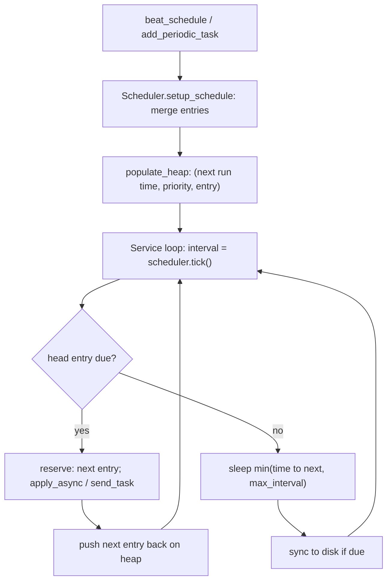

## Overview

Celery beat is the clock of a Celery system. It is a separate process (or a thread or child process inside one worker) that holds a schedule of entries, wakes up when the next entry is due, and sends that task to the broker like any client would. Workers then run the task as usual; beat never executes tasks itself. Because beat only publishes messages, exactly one beat must run per schedule, or every task is sent once per beat. This page follows how entries are declared, how the scheduler loop picks the next due task, how the default scheduler persists its state, and how the `beat` command and the embedded `-B` mode run the service. How each schedule computes "is it due?" is on [[Schedules: Intervals, Crontab and Solar]].

Sources: [celery/beat.py:219-266](repo://celery/beat.py#L219-L266), [celery/beat.py:612-680](repo://celery/beat.py#L612-L680)



Sources: [celery/beat.py:310-364](repo://celery/beat.py#L310-L364), [celery/beat.py:633-655](repo://celery/beat.py#L633-L655)

## Declaring periodic tasks

Entries come from the `beat_schedule` setting, a dictionary of entry name to `task`, `schedule`, and optional `args`, `kwargs` and `options` (any `apply_async` option). A schedule can be a number of seconds, a `timedelta`, or a schedule object such as `crontab`.

Sources: [celery/beat.py:82-129](repo://celery/beat.py#L82-L129), [celery/app/defaults.py:73-81](repo://celery/app/defaults.py#L73-L81)

`app.add_periodic_task(schedule, sig, args=(), kwargs=(), name=None, **opts)` adds an entry from a signature. The key is `name`, or the signature's `repr` when no name is given, so adding the same unnamed signature twice replaces the first entry, with a warning. If the app is not configured yet, the entry is queued and added when configuration loads, which is why the usual place to call it is an `on_after_configure` handler:

Sources: [celery/app/base.py:1295-1333](repo://celery/app/base.py#L1295-L1333), [celery/app/base.py:1273-1277](repo://celery/app/base.py#L1273-L1277)

```python
@app.on_after_configure.connect
def setup_periodic_tasks(sender, **kwargs):
    # Calls say('hello') every 10 seconds.
    sender.add_periodic_task(10.0, say.s('hello'), name='add every 10')
```

Sources: [examples/periodic-tasks/myapp.py:50-53](repo://examples/periodic-tasks/myapp.py#L50-L53)

Arguments can be computed at send time: an argument wrapped in `BeatLazyFunc(func, *args)` is replaced by `func(*args)` each time the entry is sent, for example to pass the current time.

Sources: [celery/beat.py:50-80](repo://celery/beat.py#L50-L80), [celery/beat.py:201-216](repo://celery/beat.py#L201-L216)

## Schedule entries

A `ScheduleEntry` holds the name, task name, schedule, arguments, options, `last_run_at` and `total_run_count`. `is_due()` delegates to `schedule.is_due(last_run_at)`, which returns `(is_due, next_time_to_run)` in seconds. After an entry is sent, `next(entry)` returns a copy with `last_run_at` set to now and the run count increased. Entries compare equal when their editable fields match (task, schedule, args, kwargs, options), which is how the scheduler notices a changed schedule.

Sources: [celery/beat.py:117-198](repo://celery/beat.py#L117-L198)

## The scheduler loop

`Scheduler.tick()` sends at most one due task per call and returns how long to sleep:

Sources: [celery/beat.py:326-333](repo://celery/beat.py#L326-L333)

1. When the heap does not exist, or the schedule changed since it was built, `populate_heap` builds a min-heap of `(next run timestamp, priority, entry)`, with due entries at the current time.
2. With an empty heap, it returns `max_interval`.
3. It checks the entry at the head. When due, it pops it, *reserves* it (stores the next instance in the schedule before sending, so a failure cannot make it fire forever), sends it with `apply_entry`, pushes the next instance with its next run time, and returns 0 so the loop ticks again at once.
4. When not due, it returns the time to the next run, capped at `max_interval`.

Sources: [celery/beat.py:310-364](repo://celery/beat.py#L310-L364), [celery/beat.py:389-391](repo://celery/beat.py#L389-L391)

`max_interval` comes from `beat_max_loop_interval`, defaulting to 300 seconds; it bounds how long beat sleeps, and therefore how quickly it notices schedule changes. Next-run times are shifted 10 ms earlier (`adjust`) to compensate for wake-up latency.

Sources: [celery/beat.py:43-43](repo://celery/beat.py#L43-L43), [celery/beat.py:252-266](repo://celery/beat.py#L252-L266), [celery/beat.py:292-308](repo://celery/beat.py#L292-L308)

`apply_async(entry)` evaluates lazy arguments and calls the task's `apply_async` with the entry's options when the task is registered in beat's process, or `app.send_task` by name otherwise, so beat does not need the task's code. Any error becomes a `SchedulingError`, which `apply_entry` logs; the loop continues. Beat's producer uses its own write connection and retries connecting up to `broker_connection_max_retries`, logging each failure.

Sources: [celery/beat.py:279-290](repo://celery/beat.py#L279-L290), [celery/beat.py:393-421](repo://celery/beat.py#L393-L421), [celery/beat.py:474-499](repo://celery/beat.py#L474-L499)

## Merging the configured schedule

`setup_schedule` installs default entries and merges `beat_schedule` into the scheduler's store with `merge_inplace`: entries no longer configured are removed, existing ones get their editable fields updated (keeping `last_run_at`), and new ones are added. The default entry is `celery.backend_cleanup`, added at 4:00 every day when results expire and the backend does not expire them itself ([[Result Backends]]).

Sources: [celery/beat.py:268-277](repo://celery/beat.py#L268-L277), [celery/beat.py:423-472](repo://celery/beat.py#L423-L472)

## Persistence

The default `beat_scheduler` is `PersistentScheduler`, which keeps entries, including their last run times, in a `shelve` file named by `beat_schedule_filename` (`celerybeat-schedule`, set with `-s`). On start it opens the file, and if the file is corrupt, deletes it with all known suffixes and starts fresh. It also clears the stored schedule when the stored `timezone` or `enable_utc` differ from the current settings, because stored times would be wrong, and records the Celery version, timezone and UTC flag.

Sources: [celery/beat.py:505-610](repo://celery/beat.py#L505-L610), [celery/app/defaults.py:73-81](repo://celery/app/defaults.py#L73-L81)

The schedule is written to disk every `sync_every` seconds (3 minutes), after `beat_sync_every` sent tasks when that is set, and on shutdown. Other schedulers (for example one stored in a database) can be used with `--scheduler` or `beat_scheduler`, by class path or by a name registered under the `celery.beat_schedulers` entry point.

Sources: [celery/beat.py:236-245](repo://celery/beat.py#L236-L245), [celery/beat.py:381-387](repo://celery/beat.py#L381-L387), [celery/beat.py:666-676](repo://celery/beat.py#L666-L676)

## Running beat

### The beat command

`celery beat` parses extra `key=value` configuration, drops privileges or detaches, and runs `app.Beat(...).run()`. The program initializes the loader (importing task modules) and finalizes the app, sets the process title, creates the pidfile lock, prints the banner, sets up logging and starts the `Service`. Its `SIGTERM` and `SIGINT` handlers save the schedule before exiting.

Sources: [celery/bin/beat.py:10-72](repo://celery/bin/beat.py#L10-L72), [celery/apps/beat.py:78-160](repo://celery/apps/beat.py#L78-L160)

`Service.start` sends `beat_init`, then loops: tick, sleep for the returned interval, and sync when due, until `stop()` sets the shutdown event. On exit it closes the scheduler, which syncs it.

Sources: [celery/beat.py:612-664](repo://celery/beat.py#L612-L664)

### Embedded beat

`celery worker -B` adds the worker's `Beat` bootstep, which starts `EmbeddedService`: a child process by default, or a daemon thread (with a one-second `max_interval`, so it can stop quickly) when multiprocessing is unavailable. The child process resets signals, closes inherited file descriptors and sends `beat_embedded_init`. Embedded beat is refused with eventlet and gevent pools ([[Worker Startup and Bootsteps]]).

Sources: [celery/beat.py:682-738](repo://celery/beat.py#L682-L738), [celery/worker/components.py:184-205](repo://celery/worker/components.py#L184-L205)
