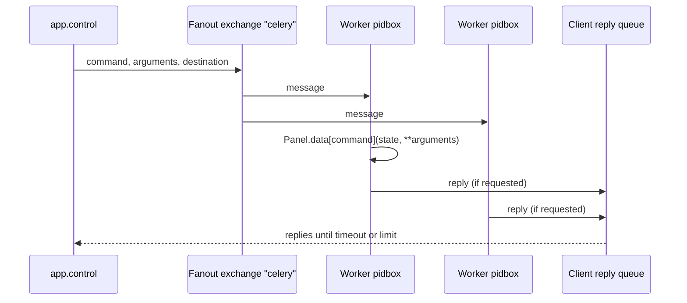

## Overview

Running workers can be inspected and reconfigured without restarting them. A client broadcasts a command such as `revoke`, `rate_limit` or `active` on a fanout exchange; every worker (or only the named ones) runs the matching handler and, when asked, sends a reply back to the client's reply queue. The client side is `app.control` (with `app.control.inspect()` for read-only queries); the worker side is the *pidbox*, a mailbox consumer started by the consumer's `Control` bootstep, and the command registry in `celery/worker/control.py`. This page covers both ends, the built-in commands, and the `celery control`, `celery inspect` and `celery status` commands. Monitoring through events is on [[Events and Monitoring]].

Sources: [celery/app/control.py:426-452](repo://celery/app/control.py#L426-L452), [celery/worker/consumer/control.py:18-33](repo://celery/worker/consumer/control.py#L18-L33), [celery/worker/control.py:39-75](repo://celery/worker/control.py#L39-L75)



Sources: [celery/app/control.py:755-790](repo://celery/app/control.py#L755-L790), [celery/worker/pidbox.py:25-53](repo://celery/worker/pidbox.py#L25-L53)

## The client: Control and Inspect

`Control` builds a kombu `Mailbox` on the exchange named by `control_exchange` (`celery`) of type `fanout`, using `accept_content`, the task serializer and the app's producer pool. The queue settings come from `control_queue_ttl`, `control_queue_expires`, `control_queue_exclusive` and `control_queue_durable`; asking for a queue that is both durable and exclusive raises `ImproperlyConfigured`, since an exclusive queue is deleted with its connection.

Sources: [celery/app/control.py:426-452](repo://celery/app/control.py#L426-L452), [celery/app/defaults.py:151-157](repo://celery/app/defaults.py#L151-L157)

Every command goes through `broadcast(command, arguments, destination=None, reply=False, timeout=1.0, limit=None, callback=None, pattern=None, matcher=None)`. `destination` is a list of node names; when empty, all workers receive the command. With `reply=True`, the call waits up to `timeout` seconds, or until `limit` replies arrived, and returns a list of `{node: reply}` mappings, calling `callback` for each reply as it arrives.

Sources: [celery/app/control.py:755-790](repo://celery/app/control.py#L755-L790)

`Control` wraps the common commands as methods: `revoke`, `revoke_by_stamped_headers`, `terminate`, `ping`, `rate_limit`, `time_limit`, `add_consumer`, `cancel_consumer`, `enable_events`, `disable_events`, `pool_grow`, `pool_shrink`, `autoscale`, `pool_restart`, `heartbeat`, `shutdown` and `election`. `purge()` is not a broadcast: it deletes all waiting messages from the worker's queues directly through a task consumer and returns how many were removed.

Sources: [celery/app/control.py:462-478](repo://celery/app/control.py#L462-L478), [celery/app/control.py:488-511](repo://celery/app/control.py#L488-L511), [celery/app/control.py:560-599](repo://celery/app/control.py#L560-L599), [celery/app/control.py:685-753](repo://celery/app/control.py#L685-L753)

`app.control.inspect(destination=None, timeout=1.0, pattern=None, ...)` returns an `Inspect` object whose methods send read-only commands with `reply=True` and merge the replies into a single `{node: result}` dictionary. With a single destination it returns only that node's result.

Sources: [celery/app/control.py:73-117](repo://celery/app/control.py#L73-L117), [celery/app/control.py:457-460](repo://celery/app/control.py#L457-L460)

```python
i = app.control.inspect()
i.active()       # tasks being executed, per node
i.reserved()     # tasks received but not yet running
i.scheduled()    # tasks waiting for their ETA
i.stats()        # pool, broker, prefetch, rusage and counters
app.control.rate_limit('tasks.add', '10/m')
app.control.revoke(task_id, terminate=True, signal='SIGKILL')
```

Sources: [celery/app/control.py:138-181](repo://celery/app/control.py#L138-L181), [celery/app/control.py:488-511](repo://celery/app/control.py#L488-L511), [celery/app/control.py:578-599](repo://celery/app/control.py#L578-L599)

## The worker: pidbox and the Panel

The consumer's `Control` step is included when `worker_enable_remote_control` is on (the default) and the transport supports fanout exchanges. It creates a `Pidbox`, or a `gPidbox` for green pools, and requires the `Tasks` step.

Sources: [celery/worker/consumer/control.py:18-33](repo://celery/worker/consumer/control.py#L18-L33)

`Pidbox` creates a mailbox `Node` named after the worker's hostname, with the `Panel` registry as its handlers and a state object holding the app, hostname and consumer. On start it opens a channel and listens; each message advances the logical clock and is dispatched by the node. An unknown command is logged as "No such control command"; a handler that raises is logged and the pidbox consumer is reset. The green variant runs the same loop in a greenlet on its own connection, so a busy green pool does not delay commands.

Sources: [celery/worker/pidbox.py:20-81](repo://celery/worker/pidbox.py#L20-L81), [celery/worker/pidbox.py:83-126](repo://celery/worker/pidbox.py#L83-L126)

The `Panel` is a global registry. The `@control_command` and `@inspect_command` decorators register a function by name, with optional alias, argument types, a signature for help text, a variadic argument and a default timeout. `celery control --list` and `celery inspect --list` read this metadata. A project can register its own commands with the same decorators; they receive the state object as the first argument.

Sources: [celery/worker/control.py:39-75](repo://celery/worker/control.py#L39-L75)

## Built-in commands

### Control commands

| Command | Effect |
| --- | --- |
| `revoke` | Adds ids to the revoked set, stores `REVOKED` in the backend; with `terminate`, signals the processes running them |
| `revoke_by_stamped_headers` | Revokes every task carrying the given stamp values |
| `terminate` | `revoke` with `terminate=True` and the given signal |
| `rate_limit` | Sets `Task.rate_limit` and rebuilds the consumer's token buckets |
| `time_limit` | Sets a task's soft and hard time limits |
| `add_consumer`, `cancel_consumer` | Starts or stops consuming from a queue, declaring it if needed |
| `pool_grow`, `pool_shrink`, `autoscale`, `pool_restart` | Resizes or restarts the pool |
| `enable_events`, `disable_events`, `heartbeat` | Toggle task events, or send a heartbeat now |
| `shutdown` | Raises `WorkerShutdown`, starting a warm shutdown |
| `election` | Takes part in a gossip election |

Sources: [celery/worker/control.py:134-160](repo://celery/worker/control.py#L134-L160), [celery/worker/control.py:214-322](repo://celery/worker/control.py#L214-L322), [celery/worker/control.py:331-378](repo://celery/worker/control.py#L331-L378), [celery/worker/control.py:541-628](repo://celery/worker/control.py#L541-L628)

### Inspect commands

| Command | Returns |
| --- | --- |
| `ping` | `pong` (0.2 s default timeout) |
| `stats` | Worker, pool, broker and consumer statistics, rusage, total counts |
| `active`, `reserved`, `scheduled` | Requests running, received, or waiting for an ETA |
| `revoked` | Revoked task ids |
| `registered` | Task names, optionally with attributes such as `rate_limit` |
| `query_task` | The state of specific task ids on this worker |
| `active_queues` | Queues the task consumer is consuming from |
| `conf`, `report`, `clock` | Configuration (censored), bug report, logical clock |
| `hello` | Mingle sync data: revoked ids and the clock (hidden from listings) |
| `memsample`, `memdump`, `objgraph` | Memory diagnostics |

Sources: [celery/worker/control.py:79-131](repo://celery/worker/control.py#L79-L131), [celery/worker/control.py:381-490](repo://celery/worker/control.py#L381-L490), [celery/worker/control.py:491-538](repo://celery/worker/control.py#L491-L538), [celery/worker/control.py:631-637](repo://celery/worker/control.py#L631-L637)

## Revocation

`revoke` has to reach tasks wherever they are, so `_revoke` does three things. It adds the ids to the worker's in-memory `revoked` set, which `Request.revoked()` checks when a message arrives and again before the request goes to the pool. It stores `REVOKED` in the result backend for each id, so callers stop waiting. With `terminate=True`, it finds active requests with those ids and calls `request.terminate(pool, signal)`, which signals the pool process (default `SIGTERM`).

Sources: [celery/worker/control.py:214-243](repo://celery/worker/control.py#L214-L243), [celery/worker/request.py:341-352](repo://celery/worker/request.py#L341-L352)

The revoked set is a `LimitedSet` capped at 50,000 ids, whose entries expire after three hours once the cap is reached. A worker that starts later learns earlier revocations from its peers: Mingle sends `hello` with its own set and merges the replies, and `hello` purges expired entries before answering. With `--statedb`, the set is also saved to disk ([[Task Execution and Tracing]]).

Sources: [celery/worker/state.py:34-74](repo://celery/worker/state.py#L34-L74), [celery/worker/control.py:381-396](repo://celery/worker/control.py#L381-L396), [celery/worker/consumer/mingle.py:22-76](repo://celery/worker/consumer/mingle.py#L22-L76)

> [!NOTE]
> Revoking by id only affects workers that receive the broadcast. A task already in the pool runs to completion unless `terminate=True` is used.

Sources: [celery/worker/control.py:214-243](repo://celery/worker/control.py#L214-L243)

## Adding and removing queues

`add_consumer(queue, exchange, exchange_type, routing_key)` schedules `Consumer.add_task_queue` on the consumer's loop: the queue is added to the selected queues (declaring it on the given exchange, `direct` by default) and the task consumer starts consuming from it. `cancel_consumer` deselects the queue and cancels consuming. Because the change is made in the worker's memory only, it lasts until the worker restarts.

Sources: [celery/worker/control.py:601-628](repo://celery/worker/control.py#L601-L628), [celery/worker/consumer/consumer.py:632-658](repo://celery/worker/consumer/consumer.py#L632-L658)

## Command-line tools

`celery status` pings all workers and prints how many nodes are online, exiting with `EX_UNAVAILABLE` when none reply. `celery inspect COMMAND` and `celery control COMMAND [args]` check the command name against the `Panel` metadata, convert positional arguments with the declared types, broadcast with `--timeout` (1 second) and `--destination`, and print each reply as it arrives, or all replies as JSON with `--json`.

Sources: [celery/bin/control.py:119-170](repo://celery/bin/control.py#L119-L170), [celery/bin/control.py:171-245](repo://celery/bin/control.py#L171-L245)

```bash
celery -A proj status
celery -A proj inspect active -d worker1@host
celery -A proj control rate_limit tasks.add 10/m
celery -A proj control --list
```

Sources: [celery/bin/control.py:20-117](repo://celery/bin/control.py#L20-L117)
