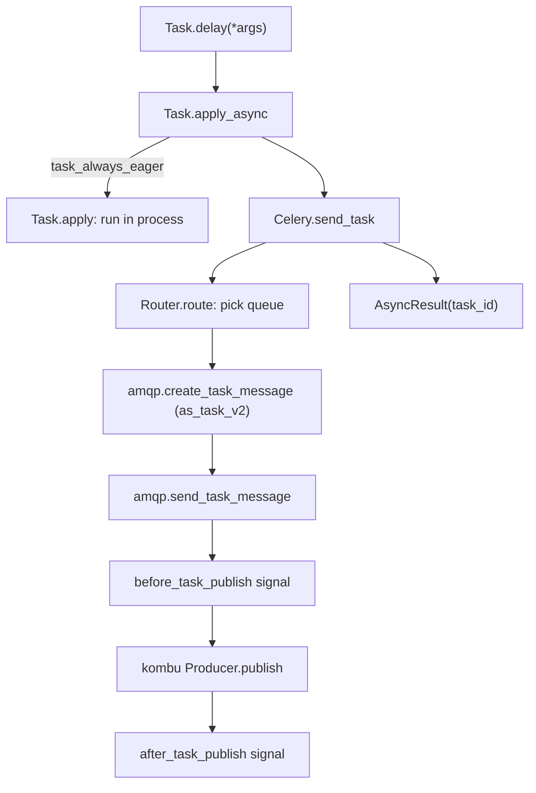

## Overview

Calling a task means publishing a message: `add.delay(2, 2)` resolves options, picks a queue, builds a message in the task protocol and publishes it through a pooled kombu producer, then returns an `AsyncResult` for the new id. No worker is involved until the broker delivers the message. This page follows that path through `Task.apply_async`, `Celery.send_task`, the router and `app.amqp`. How the worker receives the message is on [[The Consumer and Message Handling]]; broker-side countdowns for quorum queues are on [[Native Delayed Delivery and Quorum Queues]].

Sources: [celery/app/task.py:657-708](repo://celery/app/task.py#L657-L708), [celery/app/base.py:1012-1042](repo://celery/app/base.py#L1012-L1042)



Sources: [celery/app/task.py:657-708](repo://celery/app/task.py#L657-L708), [celery/app/base.py:928-1042](repo://celery/app/base.py#L928-L1042), [celery/app/amqp.py:506-605](repo://celery/app/amqp.py#L506-L605)

## Calling a task

`delay(*args, **kwargs)` is `apply_async(args, kwargs)` without execution options. `apply_async` takes the full set: `countdown`, `eta`, `expires`, `queue`, `exchange`, `routing_key`, `priority`, `serializer`, `compression`, `link`, `link_error`, `task_id`, `shadow`, `headers`, `retry`/`retry_policy` and any argument `kombu.Producer.publish` accepts.

Sources: [celery/app/task.py:523-640](repo://celery/app/task.py#L523-L640)

Before sending, `apply_async`:

Sources: [celery/app/task.py:640-641](repo://celery/app/task.py#L640-L641)

1. Rejects a `soft_time_limit` larger than `time_limit`.
2. When `typing` is on, calls the `__header__` checker with the arguments, so a wrong number of arguments raises `TypeError` in the caller rather than in the worker.
3. Computes the shadow name: a display name for logs and monitors returned by the task's `shadow_name(args, kwargs, options)` hook.
4. Merges the task's execution options (`queue`, `routing_key`, `exchange`, `priority`, `expires`, `serializer`, `delivery_mode`, `compression`, `time_limit`, `soft_time_limit`) under the caller's options, and adds `ignore_result` and `priority` from the task.
5. With `task_always_eager`, serializes and deserializes the arguments with the configured serializer, so eager mode fails on arguments the real path could not send, then calls `apply`.
6. Otherwise calls `app.send_task(self.name, …, result_cls=self.AsyncResult, task_type=self)`.

Sources: [celery/app/task.py:640-708](repo://celery/app/task.py#L640-L708), [celery/app/task.py:32-36](repo://celery/app/task.py#L32-L36)

## send_task

`app.send_task(name, …)` can send any task by name, including one whose code this process does not have; [[Canvas: Signatures and Workflows]] and the `celery call` command use it directly. It does the following:

Sources: [celery/app/base.py:846-866](repo://celery/app/base.py#L846-L866)

1. Generates a task id with `uuid()` unless one is given, and warns that `task_always_eager` is ignored here.
2. When called by name, looks the task up in the registry without finalizing the app and merges its non-`None` execution options.
3. Pops `time_limit`, `soft_time_limit` and `expires` from the options, taking the task's value only when the caller left the argument out.
4. Routes the options with the router.
5. For `eta` or `countdown` on a RabbitMQ broker with quorum queues, rewrites the exchange and routing key for native delayed delivery.
6. Converts `expires` to seconds for the message `expiration` property, and clamps a past expiry to 0 with a warning.
7. Inside a worker task, fills `root_id` and `parent_id` from the current task, and with `task_inherit_parent_priority` copies its priority.
8. Builds the message with `amqp.create_task_message`, acquires a producer and publishes it with `amqp.send_task_message`. Unless the result is ignored, the backend's `on_task_call` runs first; the RPC backend uses it to set up its reply queue.
9. Returns an `AsyncResult` and, inside a worker task, adds it to the parent's `children`.

Sources: [celery/app/base.py:866-985](repo://celery/app/base.py#L866-L985), [celery/app/base.py:986-1042](repo://celery/app/base.py#L986-L1042)

## Routing

The router decides which queue, exchange and routing key a message goes to. `app.amqp.router` is a `Router` built from the prepared `task_routes` and the declared queues; it is rebuilt when `task_routes` changes on the configuration.

Sources: [celery/app/amqp.py:308-315](repo://celery/app/amqp.py#L308-L315), [celery/app/amqp.py:620-662](repo://celery/app/amqp.py#L620-L662)

`routes.prepare` accepts `task_routes` as one router or a list of them. A dictionary becomes a `MapRoute`: exact task names are looked up first, then glob patterns such as `'feeds.*'` (and compiled regular expressions) in order. A string is imported lazily as a router function or a pre-4.0 router class. A route value can be a queue name or a dict of options.

Sources: [celery/app/routes.py:26-53](repo://celery/app/routes.py#L26-L53), [celery/app/routes.py:114-136](repo://celery/app/routes.py#L114-L136)

```python
app.conf.task_routes = {
    'feeds.tasks.import_feed': {'queue': 'feeds'},
    'web.*': 'web',
}
```

Sources: [celery/app/routes.py:29-53](repo://celery/app/routes.py#L29-L53)

`Router.route(options, name, args, kwargs, task_type)` first expands a `queue` given by the caller. If routes exist, it asks each router in order with `(name, args, kwargs, options, task=task_type)` and merges the first answer under the caller's options, so explicit `apply_async` options always win. With no route and no queue, it uses `task_default_queue`. A queue name missing from the declared queues raises `QueueNotFound` when missing queues are not created automatically.

Sources: [celery/app/routes.py:56-111](repo://celery/app/routes.py#L56-L111)

## Queue declarations

`app.amqp.queues` is a `Queues` mapping of name to `kombu.Queue`, built from `task_queues`. With no queues configured, it holds one queue named by `task_default_queue` (`celery`), declared as a quorum queue when `task_default_queue_type='quorum'`. Each queue without an exchange gets the default exchange (`task_default_exchange`, falling back to the queue name, of type `task_default_exchange_type`), and `task_queue_max_priority` adds `x-max-priority` to queues that do not set one.

Sources: [celery/app/amqp.py:273-306](repo://celery/app/amqp.py#L273-L306), [celery/app/amqp.py:132-146](repo://celery/app/amqp.py#L132-L146), [celery/app/amqp.py:643-647](repo://celery/app/amqp.py#L643-L647)

Looking up an unknown name calls `__missing__`. With `task_create_missing_queues` (the default), `new_missing` creates a queue with an exchange and routing key of the same name, typed by `task_create_missing_queue_type` (`classic` or `quorum`) and `task_create_missing_queue_exchange_type`. That is why `apply_async(queue='new')` works without declaring `new` first.

Sources: [celery/app/amqp.py:99-102](repo://celery/app/amqp.py#L99-L102), [celery/app/amqp.py:201-216](repo://celery/app/amqp.py#L201-L216)

On the worker side, `select` and `deselect` narrow the queues to consume from (`-Q` and `-X`), and `select_add` adds one at run time; every declared queue stays usable for routing. `detect_quorum_queues` reports whether any declared queue has `x-queue-type: quorum` on an AMQP broker, which switches on the quorum-queue behaviour.

Sources: [celery/app/amqp.py:159-223](repo://celery/app/amqp.py#L159-L223), [celery/utils/quorum_queues.py:4-20](repo://celery/utils/quorum_queues.py#L4-L20)

## The task message

`app.amqp.create_task_message` is the builder for `task_protocol` (2 by default; 1 is the legacy format). `as_task_v2` converts `countdown` to an absolute `eta` and a numeric `expires` to a datetime, both timezone-aware in the app timezone, and serializes them as ISO 8601 strings. It truncates `argsrepr` and `kwargsrepr` to 1024 characters with `saferepr`, and defaults `root_id` to the task id.

Sources: [celery/app/amqp.py:326-367](repo://celery/app/amqp.py#L326-L367)

The message has three parts:

Sources: [celery/app/amqp.py:392-396](repo://celery/app/amqp.py#L392-L396)

| Part | Contents |
| --- | --- |
| headers | `lang`, `task`, `id`, `shadow`, `eta`, `expires`, `group`, `group_index`, `retries`, `timelimit`, `root_id`, `parent_id`, `argsrepr`, `kwargsrepr`, `origin`, `ignore_result`, `replaced_task_nesting`, `stamped_headers`, `stamps` |
| properties | `correlation_id` (the task id), `reply_to` |
| body | `(args, kwargs, {callbacks, errbacks, chain, chord})` |

Sources: [celery/app/amqp.py:369-418](repo://celery/app/amqp.py#L369-L418)

When `task_send_sent_event` is enabled, the message also carries the fields of a `task-sent` event, which `send_task_message` publishes after the task ([[Events and Monitoring]]).

Sources: [celery/app/amqp.py:404-418](repo://celery/app/amqp.py#L404-L418), [celery/app/amqp.py:588-600](repo://celery/app/amqp.py#L588-L600)

## Publishing

`send_task_message(producer, name, message, **options)` turns routing options into a publish call. When neither queue nor exchange is set, it uses the default queue. For a direct exchange without an explicit exchange and routing key, it publishes to the anonymous exchange with the queue name as routing key; otherwise it uses the queue's exchange and routing key. It declares the target queue (unless it is a `Broadcast` queue), takes the delivery mode from the exchange or `task_default_delivery_mode`, and merges the caller's `retry_policy` into `task_publish_retry_policy`.

Sources: [celery/app/amqp.py:506-562](repo://celery/app/amqp.py#L506-L562)

The `before_task_publish` signal fires with the body, exchange, routing key, headers and properties, so a receiver can modify the headers just before `producer.publish`. `after_task_publish` fires after. The serializer defaults to `task_serializer` and compression to `task_compression`. Publishing retries on connection errors according to `task_publish_retry` and the merged policy (3 retries by default).

Sources: [celery/app/amqp.py:564-587](repo://celery/app/amqp.py#L564-L587), [celery/app/defaults.py:296-305](repo://celery/app/defaults.py#L296-L305)

Producers come from `app.amqp.producer_pool`, a kombu producer pool on the write connection with the same limit as the connection pool. A caller can pass `producer=` or `connection=` to reuse one. If no slot frees up within `broker_pool_acquire_timeout`, an `OperationalError` names the pool settings to raise ([[The Celery Application]]).

Sources: [celery/app/amqp.py:635-641](repo://celery/app/amqp.py#L635-L641), [celery/app/base.py:1162-1191](repo://celery/app/base.py#L1162-L1191)
