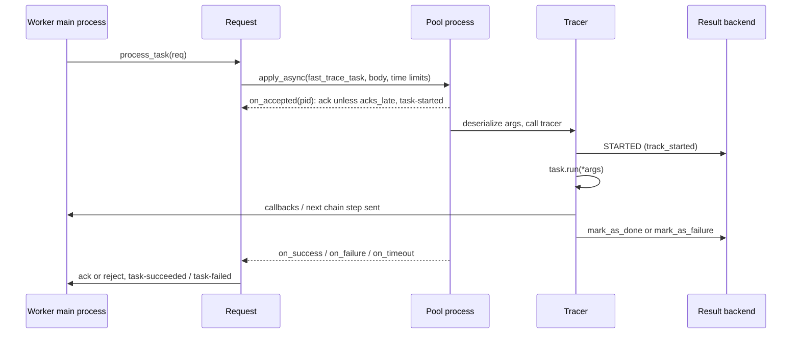

## Overview

Once the consumer accepts a message ([[The Consumer and Message Handling]]), two objects carry it to completion. In the worker's main process, a `Request` wraps the message: it decides when to acknowledge or reject it, enforces revocation and time limits, and turns pool callbacks into events and state changes. Inside the pool, the *tracer* built by `build_tracer` runs the task function and records what happened: it stores the result, sends the task signals, calls the task's handlers, and dispatches callbacks and the next step of a chain. This page follows one request through both. The pools themselves are on [[Execution Pools]].

Sources: [celery/worker/request.py:67-177](repo://celery/worker/request.py#L67-L177), [celery/app/trace.py:344-424](repo://celery/app/trace.py#L344-L424)

Sources: [celery/worker/request.py:818-874](repo://celery/worker/request.py#L818-L874), [celery/worker/request.py:515-527](repo://celery/worker/request.py#L515-L527), [celery/app/trace.py:566-633](repo://celery/app/trace.py#L566-L633)

## The Request object

`Request.__init__` reads everything it needs from the message headers without deserializing the body: id, task name (or the `shadow` name for display), root and parent ids, time limits, argument representations, ETA and expiry (parsed as ISO 8601 and made timezone-aware; a bad value raises `InvalidTaskError`), and `ignore_result`, falling back to the task's setting. It adds the delivery info (exchange, routing key, priority, redelivered flag) and the `reply_to` and `correlation_id` properties to the request dictionary that the task will see as `self.request`.

Sources: [celery/worker/request.py:90-176](repo://celery/worker/request.py#L90-L176)

`create_request_cls` builds a subclass per task when the strategy is created, binding the pool's `apply_async`, the task's default time limits, its `acks_late` flag, whether events are on, and the trace function, so the per-message path does no lookups.

Sources: [celery/worker/request.py:818-874](repo://celery/worker/request.py#L818-L874)

## Sending a request to the pool

The worker's `process_task` calls `req.execute_using_pool(pool)`. It raises `TaskRevokedError` if the request has been revoked in the meantime, then calls `pool.apply_async` with the trace function and its arguments `(task name, id, request dict, body, content type, content encoding)`, four callbacks (`on_accepted`, `on_timeout`, `on_success`, `on_failure`) and the hard and soft time limits from the message, or else from the task.

Sources: [celery/worker/request.py:341-372](repo://celery/worker/request.py#L341-L372), [celery/worker/worker.py:225-233](repo://celery/worker/worker.py#L225-L233)

The body travels to the pool still serialized; `fast_trace_task` (or `trace_task_ret` when worker optimizations are off) deserializes it inside the pool process, checking the content type against `accept_content`, adds the arguments and the embedded `callbacks`, `errbacks`, `chain` and `chord` to the request, and calls the task's cached tracer. It returns `(failed, value, runtime)` to the main process.

Sources: [celery/app/trace.py:735-789](repo://celery/app/trace.py#L735-L789)

`setup_worker_optimizations`, called when the worker starts, finalizes the app, makes it the current and default app, and fills `_localized` with the task registry, the accepted content types and the hostname, which `fast_trace_task` reads. A process that was spawned instead of forked has an empty `_localized` and gets a `RuntimeError` suggesting `--pool=solo` or `--pool=threads`.

Sources: [celery/app/trace.py:804-832](repo://celery/app/trace.py#L804-L832), [celery/app/trace.py:757-773](repo://celery/app/trace.py#L757-L773)

## Acknowledgement

When the pool starts the task, `on_accepted` records the process id and start time, marks the request active, and acknowledges the message unless the task is `acks_late`. A late-acknowledged message stays unacknowledged until the outcome is known, so the broker redelivers it if the worker dies, at the cost of possibly running the task twice.

Sources: [celery/worker/request.py:515-527](repo://celery/worker/request.py#L515-L527)

| Outcome | Default (early ack) | `acks_late` |
| --- | --- | --- |
| Success | already acked | ack |
| Exception | already acked | ack if `acks_on_failure` (default), else reject without requeue |
| Hard time limit | already acked | ack if `acks_on_timeout` (default), else requeue |
| Pool process lost | already acked | requeue with `reject_on_worker_lost`, else follow `acks_on_failure` |
| `Retry` | already acked | ack (the retry is a new message) |
| `Reject(requeue=…)` | reject | reject, requeued if asked |
| `Ignore` | ack | ack |

Sources: [celery/worker/request.py:596-620](repo://celery/worker/request.py#L596-L620), [celery/worker/request.py:622-680](repo://celery/worker/request.py#L622-L680), [celery/worker/request.py:586-594](repo://celery/worker/request.py#L586-L594)

## Inside the tracer

`build_tracer` precomputes per task: the function to call (`task.run`, or the task itself when it overrides `__call__`), the overridden handlers, the signal receivers, and whether to deduplicate. The traced function then runs these steps for each call:

Sources: [celery/app/trace.py:377-414](repo://celery/app/trace.py#L377-L414)

1. Build the request `Context` and decide whether to publish the result: not for ignored results, and in eager mode only with `store_eager_result`.
2. With `worker_deduplicate_successful_tasks` on an `acks_late` task, a redelivered message whose id already has a `SUCCESS` result is skipped; its callbacks and chain are dispatched only if the stored result shows they never were.
3. Push the task and request on their stacks, send `task_prerun`, call the loader's `on_task_init`, and with `track_started` store `STARTED` with the pid and hostname.
4. Call `before_start`, then the task function.
5. On success, dispatch callbacks and the next chain step *before* storing the result, so `result.children` is filled, then `mark_as_done`, `on_success`, `task_success` and the "succeeded" log line.
6. Call `after_return`, send `task_postrun`, pop the stacks, and run the backend's and loader's per-task cleanup.

Sources: [celery/app/trace.py:475-566](repo://celery/app/trace.py#L475-L566), [celery/app/trace.py:567-683](repo://celery/app/trace.py#L567-L683)

Exceptions from the task are sorted by type:

Sources: [celery/app/trace.py:588-611](repo://celery/app/trace.py#L588-L611)

| Raised | State | Handling |
| --- | --- | --- |
| `Reject` | `REJECTED` | Logged; the main process rejects the message |
| `Ignore` | `IGNORED` | Logged; nothing stored |
| `Retry` | `RETRY` | `mark_as_retry`, `on_retry`, `task_retry` signal; errbacks not called |
| any other `Exception` | `FAILURE` | `mark_as_failure` (which also calls errbacks), `on_failure`, `task_failure`, error log |
| an exception while storing the result (`EncodeError`) | `FAILURE` | Handled as a task failure |

Sources: [celery/app/trace.py:179-282](repo://celery/app/trace.py#L179-L282), [celery/app/trace.py:588-633](repo://celery/app/trace.py#L588-L633)

Whether a failure is stored depends on the result settings: with an ignored result only if `store_errors_even_if_ignored`; in eager mode only with `store_eager_result`. An exception thrown by Celery's own code around the task, rather than by the task, is reported through the `task_internal_error` signal and returned as an internal failure.

Sources: [celery/app/trace.py:188-204](repo://celery/app/trace.py#L188-L204), [celery/app/trace.py:675-702](repo://celery/app/trace.py#L675-L702)

## Callbacks and chains

`_dispatch_callbacks_and_chain` sends what comes after a successful task: one callback is applied with the return value as its first argument; several are sent together as one group (and group callbacks separately); the last element of the request's `chain` is applied with the return value and the rest of the chain. All of them carry the finished task as `parent_id` and keep its `root_id`, and with `task_inherit_parent_priority` its priority. [[Canvas: Signatures and Workflows]] explains how chains are encoded this way.

Sources: [celery/app/trace.py:426-473](repo://celery/app/trace.py#L426-L473)

## Time limits

The pool enforces the limits and reports through `on_timeout`. A soft limit only logs a warning in the main process; inside the task it raises `SoftTimeLimitExceeded`, which the task may catch to clean up. A hard limit kills the pool process; `on_timeout` then marks the task finished, stores `TimeLimitExceeded` as its failure, calls `on_failure` and `after_return`, sends `task_failure` and `task-failed`, and acknowledges or requeues an `acks_late` message according to `acks_on_timeout`. During a cold shutdown the failure is not recorded.

Sources: [celery/worker/request.py:529-594](repo://celery/worker/request.py#L529-L594)

## Revoking and terminating

Before execution, `revoked()` checks expiry and the revoked set, by task id or by stamped header. A revoked request is acknowledged, stored as `REVOKED` (if errors are stored), announced with a `task-revoked` event and the `task_revoked` signal, and skipped. `terminate(pool, signal)` sends the signal to the pool process running the task, or remembers it until the task is accepted. `cancel` is the shutdown variant: it stops the task and, for non-`acks_late` tasks, stores a `RETRY` state so the task is not reported as revoked.

Sources: [celery/worker/request.py:408-509](repo://celery/worker/request.py#L408-L509), [celery/worker/consumer/consumer.py:848-854](repo://celery/worker/consumer/consumer.py#L848-L854)

## Worker state

`celery/worker/state.py` keeps the per-process bookkeeping the rest of the worker reads:

Sources: [celery/worker/state.py:17-21](repo://celery/worker/state.py#L17-L21)

| Name | Contents |
| --- | --- |
| `reserved_requests` | Requests received and not finished, including those waiting for an ETA or rate limit |
| `active_requests` | Requests a pool process is running |
| `successful_requests` | Ids of recent successes (up to 1000), used by deduplication and shutdown |
| `total_count` | Accepted tasks per task name, shown by `inspect stats` |
| `revoked` | Revoked ids: up to 50,000, expiring after 3 hours once full |
| `revoked_stamps` | Stamped header values marked as revoked |

Sources: [celery/worker/state.py:34-74](repo://celery/worker/state.py#L34-L74)

`task_reserved`, `task_accepted` and `task_ready` move requests between these sets. With `--statedb`, the `Persistent` class saves the revoked set (compressed) and the logical clock to a `shelve` file at exit and merges them back at start, so revocations survive restarts.

Sources: [celery/worker/state.py:96-134](repo://celery/worker/state.py#L96-L134), [celery/worker/state.py:192-252](repo://celery/worker/state.py#L192-L252)
