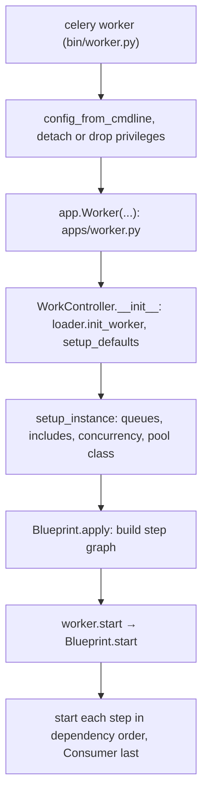

## Overview

`celery worker` builds a `WorkController` out of independent services (a timer, an event loop, an execution pool, an optional embedded beat, a state file and the message consumer) and starts them in dependency order. Each service is a *bootstep*: a small class that creates its part when the worker is built and starts and stops it with the worker. This page follows the path from the command line to a running worker, explains the bootstep model, and describes the three ways a worker shuts down. The consumer's own steps are on [[The Consumer and Message Handling]]; the pools are on [[Execution Pools]].

Sources: [celery/worker/worker.py:63-140](repo://celery/worker/worker.py#L63-L140), [celery/bootsteps.py:74-107](repo://celery/bootsteps.py#L74-L107)

Sources: [celery/bin/worker.py:307-371](repo://celery/bin/worker.py#L307-L371), [celery/worker/worker.py:90-140](repo://celery/worker/worker.py#L90-L140), [celery/worker/worker.py:203-214](repo://celery/worker/worker.py#L203-L214)

## From command line to WorkController

The `worker` click command reads its options, applies extra `key=value` arguments with `app.config_from_cmdline(..., namespace='worker')`, and then either re-executes itself detached in the background (`--detach`) or drops privileges to `--uid`/`--gid`. It creates `app.Worker(hostname=..., pool_cls=..., loglevel=..., **options)`, calls `start()` and exits with the worker's `exitcode`. A `SecurityError` while starting is printed and exits with status 1.

Sources: [celery/bin/worker.py:307-371](repo://celery/bin/worker.py#L307-L371)

`app.Worker` is `celery.apps.worker.Worker`, a `WorkController` subclass that adds what a program needs around the controller: `on_before_init` installs the worker's trace optimizations and sends `celeryd_init` (which can configure workers by name); `on_init_blueprint` sets up logging; and `on_start` sends `celeryd_after_setup`, purges queues with `--purge`, prints the banner, sets the process title and installs signal handlers. When the consumer is ready, `worker_ready` is sent and "`<hostname>` ready." is logged.

Sources: [celery/apps/worker.py:91-182](repo://celery/apps/worker.py#L91-L182)

`WorkController.__init__` calls `app.loader.init_worker()`, which imports the task modules ([[The Celery Application]]), applies defaults from configuration, and then `setup_instance`:

Sources: [celery/worker/worker.py:90-99](repo://celery/worker/worker.py#L90-L99)

1. Select the queues from `-Q` and drop those in `-X`; an unknown name raises `ImproperlyConfigured`. With `worker_direct`, a queue named after the node is added.
2. Import `--include` modules and record every task module in `include`, so a re-executed child imports the same modules.
3. Default the concurrency to the CPU count.
4. Decide whether to use the event loop: only without eventlet or gevent, on a transport that supports asynchronous I/O, and not on Windows.
5. Send `worker_init`, resolve the pool class, and build and apply the blueprint with any user steps from `app.steps['worker']`.

Sources: [celery/worker/worker.py:90-140](repo://celery/worker/worker.py#L90-L140), [celery/worker/worker.py:166-195](repo://celery/worker/worker.py#L166-L195), [celery/worker/worker.py:240-243](repo://celery/worker/worker.py#L240-L243)

## Bootsteps

### Steps and blueprints

A `Step` names its dependencies in `requires`, can opt out with `include_if` (by default its `enabled` flag), and builds its part in `create(parent)`. A `StartStopStep` also keeps the object `create` returned and calls its `start`, `stop` and `terminate`; when included, it appends itself to `parent.steps`, which is the order of starting. `StepType` names each step after its module and class, such as `celery.worker.components.Pool`.

Sources: [celery/bootsteps.py:266-385](repo://celery/bootsteps.py#L266-L385)

A `Blueprint` holds a set of step types. `apply(parent)` loads them, follows `requires` transitively, builds a `DependencyGraph` and sorts it topologically. The step marked `last` (the worker's `Consumer`) is made to depend on every other step, so it always starts after them. Each step is instantiated with the parent, then `include` decides whether it takes part.

Sources: [celery/bootsteps.py:186-252](repo://celery/bootsteps.py#L186-L252)

### Starting and stopping

`Blueprint.start` calls `start` on each included step in order and counts how many started. `stop` closes all steps in order, then calls `stop` (or `terminate`) on each in reverse order, logging errors instead of raising them. A blueprint that never finished starting is marked terminated without stopping anything. `join` waits on `shutdown_complete`, which matters when running green threads.

Sources: [celery/bootsteps.py:109-184](repo://celery/bootsteps.py#L109-L184)

### Adding a step

Users add steps with `app.steps['worker'].add(MyStep)` (or `'consumer'` for the consumer blueprint). The blueprint merges them with its `default_steps`, so a custom step can require a built-in one, for example `requires = {'celery.worker.components:Pool'}`, to start after the pool exists. `ConsumerStep` is a ready-made base for steps that consume from their own queues on the worker's connection.

Sources: [celery/worker/worker.py:131-138](repo://celery/worker/worker.py#L131-L138), [celery/bootsteps.py:98-104](repo://celery/bootsteps.py#L98-L104), [celery/bootsteps.py:389-415](repo://celery/bootsteps.py#L389-L415)

## The worker's steps

| Step | Requires | What it creates |
| --- | --- | --- |
| `Timer` | — | `w.timer`: the event loop's timer, or the pool's timer class running in a thread |
| `Hub` | Timer | The kombu event loop; only with the event loop enabled |
| `Pool` | Hub | The execution pool sized `min_concurrency`, with time limits, `max_tasks_per_child` and `max_memory_per_child` |
| `Beat` | — | An embedded beat service with `-B`; refused with eventlet or gevent |
| `StateDB` | — | Persistent revoked-task state with `--statedb`, saved at exit |
| Autoscaler | Pool | Grows and shrinks the pool with `--autoscale` |
| `Consumer` | all (last) | The consumer, with `prefetch_count = concurrency × prefetch_multiplier` |

Sources: [celery/worker/components.py:29-128](repo://celery/worker/components.py#L29-L128), [celery/worker/components.py:174-246](repo://celery/worker/components.py#L174-L246), [celery/worker/autoscale.py:31-51](repo://celery/worker/autoscale.py#L31-L51)

The `Pool` step decides how tasks reach the pool. With the event loop on a non-Windows host, it uses a `LaxBoundedSemaphore` of the pool size and, when the pool uses semaphores, sends tasks through `_process_task_sem` so the worker never hands the pool more tasks than it has processes. It also sets the flag that forbids `result.get()` inside tasks ([[Task Results and States]]).

Sources: [celery/worker/components.py:126-172](repo://celery/worker/components.py#L126-L172), [celery/worker/worker.py:222-238](repo://celery/worker/worker.py#L222-L238)

The `Consumer` step is the bridge to message handling: it passes `w.process_task` to the consumer as the function to call for each accepted request, along with the pool, timer, hub and prefetch settings. With autoscaling, the prefetch count is computed from the maximum concurrency.

Sources: [celery/worker/components.py:222-246](repo://celery/worker/components.py#L222-L246)

## Shutdown

### Warm shutdown

`SIGTERM` (and the first `Ctrl+C`) start a warm shutdown: the handler sets `state.should_stop`, which the consumer loop turns into `WorkerShutdown`. `WorkController.stop` closes the consumer so no new messages arrive, then stops the blueprint with `terminate=False`: the pool waits for running tasks to finish. `worker_shutting_down` is sent when the signal arrives and `worker_shutdown` at the end.

Sources: [celery/apps/worker.py:288-316](repo://celery/apps/worker.py#L288-L316), [celery/worker/state.py:88-93](repo://celery/worker/state.py#L88-L93), [celery/worker/worker.py:245-273](repo://celery/worker/worker.py#L245-L273)

### Cold shutdown

`SIGQUIT`, or a second `Ctrl+C`, starts a cold shutdown through `on_cold_shutdown`: it waits for the soft-shutdown period if one is configured, cancels the task consumer so requeued messages are not delivered back to this worker, cancels all unacknowledged requests, sets `should_terminate` and stops the pool. Setting the environment variable `REMAP_SIGTERM=SIGQUIT` makes `SIGTERM` start a cold shutdown too.

Sources: [celery/apps/worker.py:369-450](repo://celery/apps/worker.py#L369-L450)

### Soft shutdown and hard exit

With `worker_soft_shutdown_timeout` above zero, the cold shutdown first sleeps that many seconds while tasks are running (or always, with `worker_enable_soft_shutdown_on_idle`), so short tasks can finish before the rest are cancelled. A signal received during that wait cancels the requests at once; one more signal raises `WorkerTerminate` and exits immediately with a failure code.

Sources: [celery/worker/worker.py:412-435](repo://celery/worker/worker.py#L412-L435), [celery/apps/worker.py:319-366](repo://celery/apps/worker.py#L319-L366)

## Other signal handlers

When the worker is detached from a terminal, `SIGHUP` restarts it by re-executing the same command line at exit (macOS only logs a warning). `SIGUSR1` prints the stack trace of every thread, and `SIGUSR2` opens a remote debugger when `CELERY_RDBSIG` is set ([[Contrib Extensions]]).

Sources: [celery/apps/worker.py:254-274](repo://celery/apps/worker.py#L254-L274), [celery/apps/worker.py:469-523](repo://celery/apps/worker.py#L469-L523)
