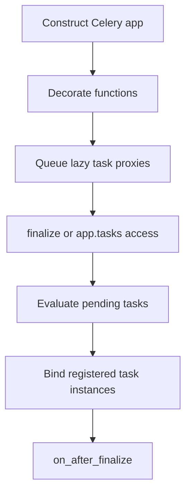

## Overview

A `Celery` application owns configuration, the task registry and factories for messaging, events, control and logging. Construction records broker, backend and include settings, creates pending-work queues and leaves configuration and finalization flags unset. The small module in [[Quickstart]] uses this same lifecycle; larger projects add configuration sources and task discovery before workers need the registry.

Sources: [celery/app/base.py:311-398](repo://celery/app/base.py#L311-L398)

## Configuration sources and precedence

`config_from_object` accepts an object or import string and records it as the configuration source. Reading is lazy unless `force=True` or the app is already configured. A namespace is retained on the application. `config_from_envvar` instead reads an environment variable whose value names the module; an unset variable raises `ImproperlyConfigured` unless silent mode is requested. These APIs choose a source rather than opening a broker connection.

Sources: [celery/app/base.py:703-743](repo://celery/app/base.py#L703-L743)

The loader imports a string source, converts the result to a mapping and accepts `override_backends` from it. Configuration detection combines preconfiguration, source settings and defaults, with preconfiguration as the first settings layer. It also detects incompatible mixtures of old and new setting names and reports renaming suggestions; supplying a namespace selects the new format. This behavior matters when moving an existing settings module into a new app rather than simply copying every historical key.

Sources: [celery/loaders/base.py:119-130](repo://celery/loaders/base.py#L119-L130), [celery/app/utils.py:232-286](repo://celery/app/utils.py#L232-L286)

Several connection settings have explicit environment precedence. `CELERY_BROKER_URL` overrides the configured broker URL, and `CELERY_RESULT_BACKEND` overrides the configured result backend. Read and write URLs each check their own environment variable, then their configured value, then fall back to the general broker URL. The command-line group sets these environment values for its broker and backend options, so inspect the environment when a supplied constructor value appears ineffective.

Sources: [celery/app/utils.py:84-112](repo://celery/app/utils.py#L84-L112), [celery/bin/celery.py:123-131](repo://celery/bin/celery.py#L123-L131)

## Decoration and task identity

`app.task` can return a `PromiseProxy` rather than immediately constructing a task. The decorator queues that proxy and registers a finalization callback for shared tasks. When the task is materialized, `_task_from_fun` derives or accepts its name, chooses a base class, installs the function as `run`, constructs an argument checker, registers the instance and binds it to the app. With `bind=True`, `run` is an instance method; otherwise the function becomes a static method.

Sources: [celery/app/base.py:554-585](repo://celery/app/base.py#L554-L585), [celery/app/base.py:590-633](repo://celery/app/base.py#L590-L633)

The registry is keyed by task name. If that name already exists, `_task_from_fun` returns the existing task instead of replacing it. Names therefore determine which implementation the worker registry exposes. Registration also applies automatic retry behavior. [[Publishing Tasks]] describes how these task objects provide execution defaults to producers, and [[Worker Execution]] explains how automatic retry changes execution after a message is delivered.

Sources: [celery/app/base.py:604-633](repo://celery/app/base.py#L604-L633)

`shared_task` lets library code defer selection of the current application's task instance. It registers a constructor callback for future finalization, creates the task for already-finalized active applications, and returns a proxy that resolves the name through the current app's registry. This is useful when a module should define a task without importing one particular project's application object.

Sources: [celery/app/__init__.py:48-76](repo://celery/app/__init__.py#L48-L76)

## Finalization boundaries

`finalize` holds the app's finalization lock, announces finalization, evaluates all pending decorators and binds registered tasks before sending `on_after_finalize`. The code documents this signal as the earliest point where currently registered tasks form an initialized, stable registry. Accessing `app.tasks` automatically finalizes the app; setting `autofinalize=False` makes an attempted automatic finalization raise a contract error instead.

Sources: [celery/app/base.py:333-338](repo://celery/app/base.py#L333-L338), [celery/app/base.py:657-677](repo://celery/app/base.py#L657-L677), [celery/app/base.py:1598-1614](repo://celery/app/base.py#L1598-L1614)



Sources: [celery/app/base.py:375-385](repo://celery/app/base.py#L375-L385), [celery/app/base.py:554-570](repo://celery/app/base.py#L554-L570), [celery/app/base.py:657-677](repo://celery/app/base.py#L657-L677), [celery/app/base.py:1598-1614](repo://celery/app/base.py#L1598-L1614)

## Loading and discovery

The loader's default module list combines built-ins, `imports` and `include`. Worker initialization imports those modules once, after sending `import_modules`. The loader explicitly re-raises exceptions returned by import signal receivers because logging is not yet fully configured and otherwise these failures would be difficult to diagnose. A missing task can therefore originate in an import failure before the worker's delivery path starts.

Sources: [celery/loaders/base.py:97-111](repo://celery/loaders/base.py#L97-L111), [celery/loaders/base.py:223-229](repo://celery/loaders/base.py#L223-L229)

`autodiscover_tasks` normally connects lazy discovery to that import signal. Given packages, it searches their `tasks` modules, or a different `related_name`; a callable package list is evaluated at discovery time. `force=True` performs the discovery immediately. With no package list, discovery delegates to installed framework fixups. The loader ignores a genuinely absent related module but re-raises a missing dependency imported from inside that module.

Sources: [celery/app/base.py:782-837](repo://celery/app/base.py#L782-L837), [celery/loaders/base.py:251-278](repo://celery/loaders/base.py#L251-L278)

## Django application setup

The Django example sets `DJANGO_SETTINGS_MODULE` before constructing the application, loads settings with the `CELERY` namespace and requests discovery across registered Django apps. Its comment explains why the source is an import string: the worker does not have to serialize the configuration object to child processes. This setup extends the single-module application from [[Quickstart]] while leaving task publication on the usual app interface.

Sources: [examples/django/proj/celery.py:1-17](repo://examples/django/proj/celery.py#L1-L17)

```python
app.config_from_object('django.conf:settings', namespace='CELERY')

# Load task modules from all registered Django apps.
app.autodiscover_tasks()
```

Sources: [examples/django/proj/celery.py:14-17](repo://examples/django/proj/celery.py#L14-L17)

When Django settings are present, the fixup installs import and worker-init signal handlers. Before task modules load it calls Django setup and model checks; worker installation also connects database and cache cleanup to task and process lifecycle signals. Unless the application supplied a custom task class, the fixup selects `DjangoTask` as its task base.

Sources: [celery/fixups/django.py:52-89](repo://celery/fixups/django.py#L52-L89), [celery/fixups/django.py:101-116](repo://celery/fixups/django.py#L101-L116), [celery/fixups/django.py:146-163](repo://celery/fixups/django.py#L146-L163)

`DjangoTask.delay_on_commit` and `apply_async_on_commit` register partial calls with Django's `transaction.on_commit`. They defer submission to that transaction hook and return no immediate result handle. Use the ordinary publishing methods when immediate submission is intended; the on-commit methods specifically exist to trigger tasks at the end of a database transaction.

Sources: [celery/contrib/django/task.py:8-21](repo://celery/contrib/django/task.py#L8-L21)
