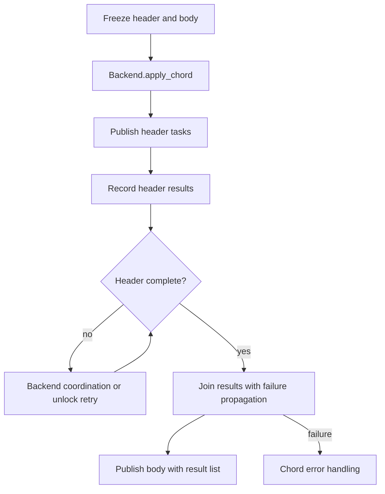

## Overview

Canvas represents task invocations as signatures and combines them into distributed workflows. A signature holds arguments and delivery options in a serializable dictionary structure; chains, groups and chords use these signatures as their parts. Each published part still follows [[Publishing Tasks]], and its continuation runs through the tracer described in [[Worker Execution]]. Canvas supplies composition and synchronization rather than a separate worker execution engine.

Sources: [celery/canvas.py:233-268](repo://celery/canvas.py#L233-L268), [celery/canvas.py:370-401](repo://celery/canvas.py#L370-L401), [celery/app/trace.py:440-473](repo://celery/app/trace.py#L440-L473)

## Signatures and argument propagation

Create a signature through a task's `signature` or `s` helper, then use `set` for delivery options. Calling `apply_async` on the signature resolves its task submission method and merges any partial arguments. New positional arguments are prepended to stored arguments; new keyword values override existing keys. This is how a callback receives the preceding task's result before the arguments already stored on its signature.

Sources: [celery/canvas.py:243-263](repo://celery/canvas.py#L243-L263), [celery/canvas.py:370-443](repo://celery/canvas.py#L370-L443), [celery/app/trace.py:461-473](repo://celery/app/trace.py#L461-L473)

```python
add.s(2, 2).set(countdown=10).set(expires=30).delay()
```

Sources: [celery/canvas.py:258-263](repo://celery/canvas.py#L258-L263)

An immutable signature preserves its stored arguments when partial arguments arrive, while still allowing execution options to merge. Signature immutability is separate from protected options: group identifiers and stamped headers have their own merge restrictions to prevent workflow metadata from changing. `clone` builds a separate signature with merged arguments and a deep copy of options; `freeze` assigns identity and creates its result handle without sending the task.

Sources: [celery/canvas.py:403-443](repo://celery/canvas.py#L403-L443), [celery/canvas.py:445-520](repo://celery/canvas.py#L445-L520), [celery/canvas.py:292-294](repo://celery/canvas.py#L292-L294)

## Chains and sequential continuation

A chain prepares its steps in reverse order, allowing the worker to pop the next task from the message's chain field. Preparation clones steps, splices nested chains and can upgrade a group followed by another task into a chord. The chain's `run` publishes the first prepared task with remaining steps in its options. A multi-step call returns the prepared result for the final step, while a single-step chain returns the actual result from that task's publication.

Sources: [celery/canvas.py:1048-1092](repo://celery/canvas.py#L1048-L1092), [celery/canvas.py:1176-1235](repo://celery/canvas.py#L1176-L1235)

The worker continues a chain only through the successful execution branch: it builds a signature from the next element, passes the return value as a partial argument and includes the remaining chain. A failure goes through error handling instead. For the surrounding acknowledgement and retry rules, use [[Worker Execution]]; the chain itself does not block one worker process while waiting for all subsequent tasks.

Sources: [celery/app/trace.py:467-473](repo://celery/app/trace.py#L467-L473), [celery/app/trace.py:580-627](repo://celery/app/trace.py#L580-L627)

## Groups and aggregate results

`group.apply_async` prepares child tasks under a group ID, publishes them and builds a `GroupResult` with a readiness barrier. It can attach that aggregate result to the currently executing parent task's trail. An empty group returns a frozen result, and eager mode executes the local group path. Completion tracking is separate from creating the group object; [[Task Results]] explains how callers join the resulting children.

Sources: [celery/canvas.py:1616-1650](repo://celery/canvas.py#L1616-L1650)

Passing `link` directly to `group.apply_async` raises a `TypeError` that directs callers to use a chord, and passing `link_error` there directs callers to attach it to individual tasks. A group fans out work and returns aggregate handles. When a task should receive all header results after the group completes, that synchronization belongs to a chord.

Sources: [celery/canvas.py:1616-1635](repo://celery/canvas.py#L1616-L1635), [celery/canvas.py:2226-2248](repo://celery/canvas.py#L2226-L2248)

## Chords and backend synchronization

A chord contains a header group and a body signature. It freezes the body, freezes header tasks with the body as their chord callback, asks the backend to arrange chord completion, and publishes the header. The returned result represents the body and has the header result as its parent. For an empty header, the implementation sends the body immediately with an empty result list rather than waiting for a completion notification that cannot arrive.

Sources: [celery/canvas.py:2247-2294](repo://celery/canvas.py#L2247-L2294)



Sources: [celery/canvas.py:2258-2277](repo://celery/canvas.py#L2258-L2277), [celery/backends/base.py:180-199](repo://celery/backends/base.py#L180-L199), [celery/app/builtins.py:36-98](repo://celery/app/builtins.py#L36-L98)

For backends without native synchronization, the built-in `celery.chord_unlock` task reconstructs a `GroupResult`, checks readiness and retries when the header is unfinished or readiness checking fails. Once ready it chooses native join when supported, otherwise ordinary join, and requests exception propagation. A failed join creates a chord error that identifies a failed dependency when possible. Failure to publish the body also enters backend chord error handling. [[Result Backends]] documents which adapters support this coordination.

Sources: [celery/app/builtins.py:36-98](repo://celery/app/builtins.py#L36-L98)

## Map, starmap and chunks

`xmap` and `xstarmap` represent mapping a task over an iterable, with starmap expanding each item into arguments. The implementation explicitly documents map execution as sequential inside a process, unlike a group. `chunks` partitions an iterable and builds a group of starmap signatures, so each chunk is one mapped unit while the chunks themselves are submitted as group members. This distinction determines where Canvas creates separate messages.

Sources: [celery/canvas.py:1410-1468](repo://celery/canvas.py#L1410-L1468), [celery/app/builtins.py:100-124](repo://celery/app/builtins.py#L100-L124)

## Stamping workflow metadata

Signatures can carry stamped headers through options. `stamp` first stamps links, asks a visitor for headers when present, merges them with supplied headers and sets the resulting options on the signature. This gives workflow code a way to label tasks before publication. The merge rules protect already-stamped option names, and the publisher separates the named stamps into protocol headers. [[Monitoring and Control]] describes the worker control path that can revoke tasks by stamped headers.

Sources: [celery/canvas.py:613-665](repo://celery/canvas.py#L613-L665), [celery/canvas.py:424-443](repo://celery/canvas.py#L424-L443), [celery/app/amqp.py:370-390](repo://celery/app/amqp.py#L370-L390)
