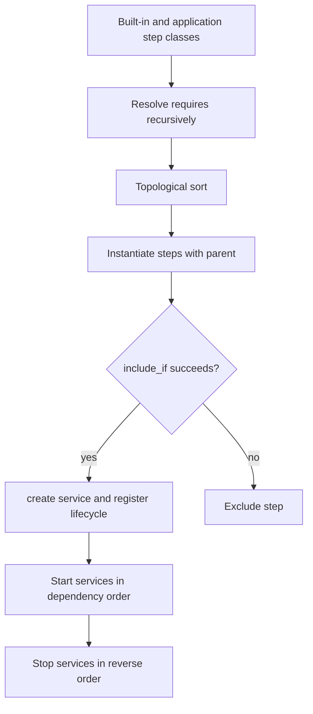

## Overview

Workers assemble services through bootstep blueprints. A `WorkController` initializes its loader, selects a pool implementation and applies a worker blueprint containing built-in and application-supplied steps. This lifecycle is separate from the per-message path in [[Worker Execution]]: bootsteps own services such as pools, timers and consumers, while tasks supply the work those services execute.

Sources: [celery/worker/worker.py:76-139](repo://celery/worker/worker.py#L76-L139)

## Worker and consumer blueprints

The worker blueprint includes the hub, pool, embedded Beat, timer, state database, consumer and autoscaler component. The consumer step is marked last and constructs a consumer with the worker's pool, timer, hub, processing callback and initial prefetch count. That consumer has its own blueprint for the broker connection, synchronization, events, gossip, heartbeat, remote control, task consumption, delayed delivery and event loop.

Sources: [celery/worker/worker.py:76-88](repo://celery/worker/worker.py#L76-L88), [celery/worker/components.py:221-246](repo://celery/worker/components.py#L221-L246), [celery/worker/consumer/consumer.py:171-189](repo://celery/worker/consumer/consumer.py#L171-L189)

Add custom services to the application's worker or consumer step collection according to the parent they need. A worker step receives the controller; a consumer step receives the consumer and can use its broker connection. The `requires` declaration names steps that must start first and must stay within the same blueprint. The `last` flag is reserved for the worker's consumer, so ordinary extensions should express dependencies instead of claiming that special position.

Sources: [celery/worker/worker.py:129-139](repo://celery/worker/worker.py#L129-L139), [docs/userguide/extending.rst:22-45](repo://docs/userguide/extending.rst#L22-L45), [celery/bootsteps.py:288-314](repo://celery/bootsteps.py#L288-L314)

## Dependency ordering and inclusion

`Blueprint.apply` resolves step classes, recursively discovers requirements and topologically sorts a dependency graph. It instantiates each class with the parent and options, then calls `include` in the resulting order. `Step.include_if` can exclude a step; included steps call `create`. A basic `Step` is useful for creating parent attributes, while `StartStopStep` also appends itself to the parent's lifecycle list.

Sources: [celery/bootsteps.py:186-212](repo://celery/bootsteps.py#L186-L212), [celery/bootsteps.py:228-256](repo://celery/bootsteps.py#L228-L256), [celery/bootsteps.py:319-342](repo://celery/bootsteps.py#L319-L342), [celery/bootsteps.py:378-383](repo://celery/bootsteps.py#L378-L383)



Sources: [celery/bootsteps.py:109-141](repo://celery/bootsteps.py#L109-L141), [celery/bootsteps.py:186-249](repo://celery/bootsteps.py#L186-L249), [celery/bootsteps.py:322-383](repo://celery/bootsteps.py#L322-L383)

## Service ownership and shutdown

`StartStopStep` keeps the object returned by `create` and delegates start and stop to it. Termination calls the object's `terminate` when present and otherwise falls back to `stop`. A blueprint starts services in forward order, closes them in forward order and stops or terminates them in reverse order. Shutdown records completion and runs its stopped callback. A partially started blueprint takes a separate early termination branch, so extension initialization should not assume every later service has already started.

Sources: [celery/bootsteps.py:109-176](repo://celery/bootsteps.py#L109-L176), [celery/bootsteps.py:355-383](repo://celery/bootsteps.py#L355-L383)

`send_all` can propagate lifecycle exceptions or log them and continue, depending on the caller. Normal blueprint stop uses the non-propagating form, allowing shutdown to proceed through other steps after an error. [[Monitoring and Control]] describes how process signals request shutdown; a bootstep's responsibility is to release its own resources when that request reaches its lifecycle methods.

Sources: [celery/bootsteps.py:137-171](repo://celery/bootsteps.py#L137-L171), [celery/apps/worker.py:301-316](repo://celery/apps/worker.py#L301-L316)

## Add a message consumer

`ConsumerStep` already requires the consumer connection step. Its `start` opens a channel, calls the extension's `get_consumers(channel)` and starts each returned Kombu consumer. `stop` cancels consumers and closes their distinct channels; `shutdown` closes channels without the cancellation pass. Implementing `get_consumers` therefore lets an extension join the same connection lifecycle without reimplementing channel cleanup.

Sources: [celery/bootsteps.py:386-415](repo://celery/bootsteps.py#L386-L415)

The repository guide's example uses `my_queue` and returns a consumer with a `handle_message` callback. Its callback acknowledges each message after handling it. Register the class on `app.steps['consumer']` once the app exists, as shown in that example. This is an additional message consumer; it does not change the registered task protocol described in [[Publishing Tasks]].

Sources: [docs/userguide/extending.rst:22-45](repo://docs/userguide/extending.rst#L22-L45)

```python
app.steps['consumer'].add(MyConsumerStep)
```

Sources: [docs/userguide/extending.rst:45-45](repo://docs/userguide/extending.rst#L45-L45)

## Pool implementations

| Pool name | Implementation behavior |
| --- | --- |
| `prefork`, `processes` | Multiprocessing pool with child initialization, timeout support and delegated grow/shrink operations |
| `solo` | Inline blocking execution with a concurrency limit of one |
| `threads` | `ThreadPoolExecutor` submission; shutdown cancels pending futures |
| `gevent` | Greenlet pool with a gevent timer and non-signal-safe shutdown |
| `eventlet` | Eventlet `GreenPool`, greenlet timer and pool lifecycle signals |
| `custom` | Class named by `CELERY_CUSTOM_WORKER_POOL`, selected with `--pool custom` |

Sources: [celery/concurrency/__init__.py:11-43](repo://celery/concurrency/__init__.py#L11-L43), [celery/concurrency/prefork.py:95-126](repo://celery/concurrency/prefork.py#L95-L126), [celery/concurrency/solo.py:11-31](repo://celery/concurrency/solo.py#L11-L31), [celery/concurrency/thread.py:30-56](repo://celery/concurrency/thread.py#L30-L56), [celery/concurrency/gevent.py:85-114](repo://celery/concurrency/gevent.py#L85-L114), [celery/concurrency/eventlet.py:88-119](repo://celery/concurrency/eventlet.py#L88-L119)

The worker's pool step passes concurrency, child task and memory limits, time limits, restart settings and event-loop options into the selected class. Actual support depends on that implementation: for example, the thread pool's `on_apply` accepts callback and acceptance callback arguments and ignores remaining options. Selecting an alternative pool therefore requires checking the adapter's behavior rather than assuming every prefork feature transfers unchanged.

Sources: [celery/worker/components.py:138-170](repo://celery/worker/components.py#L138-L170), [celery/concurrency/thread.py:45-56](repo://celery/concurrency/thread.py#L45-L56)

## Implement the pool contract

`BasePool` defines lifecycle hooks and capability flags including `signal_safe`, `is_green`, `uses_semaphore` and `task_join_will_block`. `start` calls `on_start`; `apply_async` normalizes arguments and delegates to `on_apply` with callback-propagation and slot-wait options. Its documentation asks callbacks to return promptly because a slow callback can block the result-handling thread. Custom pools should also provide JSON-friendly information through `_get_info` for worker statistics.

Sources: [celery/concurrency/base.py:47-92](repo://celery/concurrency/base.py#L47-L92), [celery/concurrency/base.py:128-172](repo://celery/concurrency/base.py#L128-L172)

Green-pool setup must happen early enough for concurrency patching. The CLI entry point invokes `maybe_patch_concurrency` before importing its command group, and the worker pool component warns when eventlet or gevent is selected only through the configuration setting. Keep that startup requirement separate from service dependencies: a bootstep cannot retroactively change imports that occurred before concurrency patching.

Sources: [celery/__main__.py:10-15](repo://celery/__main__.py#L10-L15), [celery/worker/components.py:20-35](repo://celery/worker/components.py#L20-L35), [celery/worker/components.py:138-143](repo://celery/worker/components.py#L138-L143)
