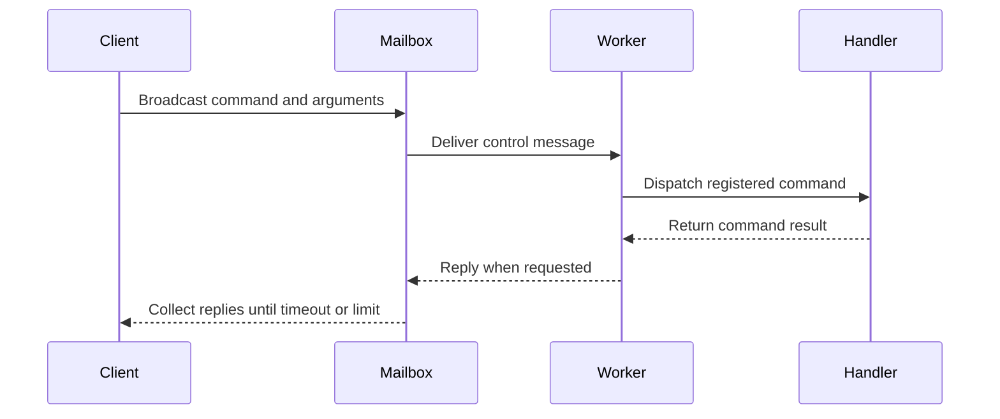

## Overview

Celery exposes request-and-reply inspection, commands that change worker behavior, and a stream of worker and task events. `Inspect` uses the control broadcast mechanism with replies enabled; events use their own dispatcher and receiver. These views complement the stored task state described in [[Task Results]] and the delivery lifecycle in [[Worker Execution]], rather than forming a single shared record of every task.

Sources: [celery/app/control.py:73-117](repo://celery/app/control.py#L73-L117), [celery/events/dispatcher.py:135-162](repo://celery/events/dispatcher.py#L135-L162), [celery/events/receiver.py:80-88](repo://celery/events/receiver.py#L80-L88)

## Control requests and replies

`Control.broadcast` acquires a broker connection, combines command arguments and invokes the mailbox broadcast operation. Callers can select destinations, request replies, limit their number, set a timeout and receive each reply through a callback. `Inspect._request` always requests replies and then flattens them into a worker-name mapping, or extracts one destination's reply. A bounded reply collection describes responses received in that window; it is not an inventory of every worker that might exist.

Sources: [celery/app/control.py:82-117](repo://celery/app/control.py#L82-L117), [celery/app/control.py:755-790](repo://celery/app/control.py#L755-L790)

The worker's `Pidbox` creates a mailbox node with handlers from `control.Panel.data` and state containing the app, hostname and consumer. Incoming messages advance the logical clock and dispatch through the node. Unknown commands are logged; other handler failures are logged and reset the mailbox. The consumer installs remote control only when `worker_enable_remote_control` is enabled and the connection supports fanout exchanges.

Sources: [celery/worker/pidbox.py:25-65](repo://celery/worker/pidbox.py#L25-L65), [celery/worker/consumer/control.py:18-33](repo://celery/worker/consumer/control.py#L18-L33)

Sources: [celery/app/control.py:755-790](repo://celery/app/control.py#L755-L790), [celery/worker/pidbox.py:25-54](repo://celery/worker/pidbox.py#L25-L54), [celery/worker/control.py:405-448](repo://celery/worker/control.py#L405-L448)

## Interpret worker snapshots

| Inspection | What the worker reports |
| --- | --- |
| `stats` | Controller statistics |
| `scheduled` | Requests waiting in the worker's ETA/countdown timer |
| `reserved` | Reserved requests excluding active requests |
| `active` | Requests currently executing |
| `active_queues` | Queues selected by the task consumer |

Sources: [celery/worker/control.py:405-448](repo://celery/worker/control.py#L405-L448), [celery/worker/control.py:632-637](repo://celery/worker/control.py#L632-L637)

The `scheduled` inspection reads the worker timer and filters entries to `Request` objects; it does not read Beat's periodic schedule. Use [[Periodic Tasks and Beat]] to understand recurring entries that have not yet been published. A task can therefore be absent from worker snapshots because Beat has not sent that occurrence yet, even though its periodic definition exists.

Sources: [celery/worker/control.py:412-429](repo://celery/worker/control.py#L412-L429), [celery/beat.py:348-357](repo://celery/beat.py#L348-L357)

## Revoke by identity or stamps

The revoke command adds task IDs to the worker's revoked set and attempts to record revocation in the result backend, logging a warning if that backend update fails. Optional termination searches matching active requests and asks them to terminate through the pool. Revocation state and process termination are thus related but separate actions; the plain revoke command does not automatically request termination.

Sources: [celery/worker/control.py:138-153](repo://celery/worker/control.py#L138-L153), [celery/worker/control.py:214-238](repo://celery/worker/control.py#L214-L238)

Stamped-header revocation records header values in `revoked_stamps`. Without termination it returns after recording them. With termination it scans active requests and terminates a request when one named header has an intersecting stamped value. This connects to the metadata added by [[Canvas Workflows]]: the matching path operates on stamps, not arbitrary task arguments.

Sources: [celery/worker/control.py:160-211](repo://celery/worker/control.py#L160-L211)

## Change rates, pools and queues

The rate-limit handler validates the new rate, updates the registered task type and resets consumer rate-limit buckets. Unknown task names return an error. The time-limit handler changes the task's hard and soft limit attributes, so these commands modify worker-local task behavior. They do not rewrite a configuration module for subsequent worker starts; persistent settings belong in [[Applications and Configuration]].

Sources: [celery/worker/control.py:259-284](repo://celery/worker/control.py#L259-L284), [celery/worker/control.py:295-320](repo://celery/worker/control.py#L295-L320)

Manual pool growth and shrinkage update both the pool and prefetch count, but return an error when autoscaling is active. The autoscale command instead updates the autoscaler's maximum and minimum bounds and errors if autoscaling is unavailable. Queue commands schedule consumer addition or cancellation through `call_soon`, with addition forwarding exchange and routing parameters. [[Extending Workers]] explains the pool and service contracts that these operations call.

Sources: [celery/worker/control.py:545-568](repo://celery/worker/control.py#L545-L568), [celery/worker/control.py:579-637](repo://celery/worker/control.py#L579-L637)

## Event production and capture

The event dispatcher adds hostname, process ID, UTC offset and a logical clock, then publishes using an event-type routing key. It filters disabled event groups and can buffer events while offline; without buffering, publication failures are raised. `enable_events` and `disable_events` change the task event group on the worker's dispatcher. Event availability therefore depends on both dispatcher configuration and the points that emit events.

Sources: [celery/events/dispatcher.py:135-184](repo://celery/events/dispatcher.py#L135-L184), [celery/worker/control.py:341-368](repo://celery/worker/control.py#L341-L368)

The receiver creates a queue using event exchange, TTL, expiry and durability settings. It rejects a queue configured as both exclusive and durable. Incoming events dispatch to an exact event-type handler or the `'*'` fallback, and consumers use automatic acknowledgement. This is the extension point for a monitor that wants to process task transitions or worker activity without issuing repeated inspection commands.

Sources: [celery/events/receiver.py:36-88](repo://celery/events/receiver.py#L36-L88)

`events.State` keeps bounded LRU caches of workers and tasks and serializes updates under a mutex. Task event handling applies state precedence so a late earlier-state event can merge useful fields without simply regressing the task's state; retries receive special treatment. The cache is an in-memory view of received events, with finite capacity, so it should not be confused with the backend retention and cleanup behavior in [[Task Results]].

Sources: [celery/events/state.py:305-338](repo://celery/events/state.py#L305-L338), [celery/events/state.py:407-426](repo://celery/events/state.py#L407-L426), [celery/events/state.py:501-512](repo://celery/events/state.py#L501-L512)

## Worker shutdown signals

The worker installs a warm shutdown handler for `SIGTERM` by default and a cold shutdown handler for `SIGQUIT`; `REMAP_SIGTERM=SIGQUIT` changes the former mapping. The generic shutdown handler sends `worker_shutting_down` and records either `should_stop` or `should_terminate`. Cold shutdown installs further signal handlers, waits for the configured soft-shutdown phase, cancels active requests and stops the pool to allow successful-task acknowledgements before exiting.

Sources: [celery/apps/worker.py:288-318](repo://celery/apps/worker.py#L288-L318), [celery/apps/worker.py:403-447](repo://celery/apps/worker.py#L403-L447)
