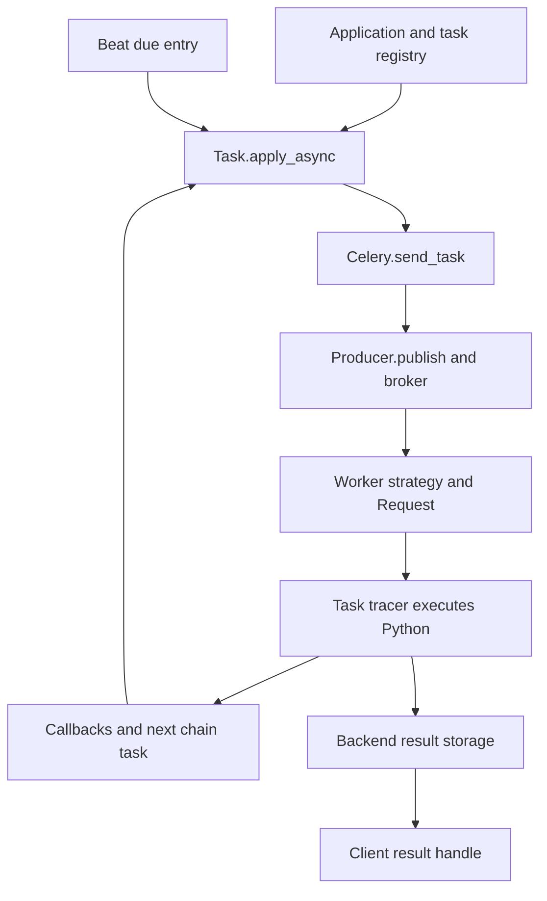

## Overview

Celery turns Python task calls into messages that workers execute. An application owns task names, configuration and broker access; a worker resolves a delivered name to registered code. Calling `delay` or `apply_async` normally publishes work and returns an `AsyncResult`, while execution and result storage happen separately. This documentation describes the implementation in this repository, starting with a runnable example in [[Quickstart]].

Sources: [celery/app/task.py:523-538](repo://celery/app/task.py#L523-L538), [celery/app/task.py:682-708](repo://celery/app/task.py#L682-L708), [celery/app/base.py:1022-1041](repo://celery/app/base.py#L1022-L1041), [celery/app/trace.py:580-627](repo://celery/app/trace.py#L580-L627)

## System map

| Area | What it does | Documentation |
| --- | --- | --- |
| First application | Starts a broker, imports tasks and launches a worker | [[Quickstart]] |
| Application | Configures and finalizes the task registry | [[Applications and Configuration]] |
| Producer | Resolves options and routes, builds messages and publishes | [[Publishing Tasks]] |
| Worker | Schedules requests and traces task execution | [[Worker Execution]] |
| Workflow | Composes signatures into chains, groups and chords | [[Canvas Workflows]] |
| Results | Stores task state and exposes result handles | [[Task Results]] |
| Storage adapters | Resolves backend names and URLs into implementations | [[Result Backends]] |
| Scheduler | Publishes entries when their schedules become due | [[Periodic Tasks and Beat]] |
| Operations | Broadcasts commands and receives worker replies | [[Monitoring and Control]] |
| Worker services | Builds the worker from dependent bootsteps and a pool | [[Extending Workers]] |
| Tests | Starts controlled workers and checks task completion | [[Testing and Contributing]] |

Sources: [docs/getting-started/first-steps-with-celery.rst:127-162](repo://docs/getting-started/first-steps-with-celery.rst#L127-L162), [celery/app/base.py:657-677](repo://celery/app/base.py#L657-L677), [celery/app/amqp.py:506-576](repo://celery/app/amqp.py#L506-L576), [celery/worker/strategy.py:145-208](repo://celery/worker/strategy.py#L145-L208), [celery/canvas.py:2190-2233](repo://celery/canvas.py#L2190-L2233), [celery/backends/base.py:673-714](repo://celery/backends/base.py#L673-L714), [celery/app/backends.py:15-69](repo://celery/app/backends.py#L15-L69), [celery/beat.py:326-364](repo://celery/beat.py#L326-L364), [celery/app/control.py:755-790](repo://celery/app/control.py#L755-L790), [celery/worker/worker.py:76-139](repo://celery/worker/worker.py#L76-L139), [celery/contrib/testing/worker.py:96-136](repo://celery/contrib/testing/worker.py#L96-L136)

## A task from call to result

Sources: [celery/app/task.py:682-708](repo://celery/app/task.py#L682-L708), [celery/app/base.py:1022-1041](repo://celery/app/base.py#L1022-L1041), [celery/app/amqp.py:565-576](repo://celery/app/amqp.py#L565-L576), [celery/worker/strategy.py:145-208](repo://celery/worker/strategy.py#L145-L208), [celery/app/trace.py:580-627](repo://celery/app/trace.py#L580-L627), [celery/beat.py:393-410](repo://celery/beat.py#L393-L410), [celery/backends/base.py:702-714](repo://celery/backends/base.py#L702-L714)

1. [[Applications and Configuration]] explains how decoration constructs task objects, binds them to an app and registers their names before execution.
2. [[Publishing Tasks]] follows `apply_async` into `send_task`, where routing and protocol options become a producer publication.
3. [[Worker Execution]] follows a received message into a request, timer or rate limiter, then task execution and settlement.
4. [[Canvas Workflows]] explains how successful tasks dispatch callbacks and the next chain element using their return value.
5. [[Task Results]] follows the separate state-storage path; [[Result Backends]] describes the adapters selected for it.
6. [[Periodic Tasks and Beat]] adds a scheduler as another producer, publishing through the same task interface when an entry is due.

Sources: [celery/app/base.py:590-633](repo://celery/app/base.py#L590-L633), [celery/app/task.py:702-708](repo://celery/app/task.py#L702-L708), [celery/worker/strategy.py:178-208](repo://celery/worker/strategy.py#L178-L208), [celery/app/trace.py:440-473](repo://celery/app/trace.py#L440-L473), [celery/backends/base.py:673-714](repo://celery/backends/base.py#L673-L714), [celery/app/backends.py:41-69](repo://celery/app/backends.py#L41-L69), [celery/beat.py:393-410](repo://celery/beat.py#L393-L410)

## Design decisions across systems

Task identity is a name rather than a serialized Python function. `send_task` can send an unregistered remote name and deliberately consults the underlying registry without forcing application finalization. For a locally registered task it can inherit execution defaults, but explicit caller values win. This makes producer-side imports and worker-side task registration distinct concerns, developed in [[Applications and Configuration]] and [[Publishing Tasks]].

Sources: [celery/app/base.py:855-909](repo://celery/app/base.py#L855-L909)

Result storage is configurable independently of publication. A backend name that is absent resolves to the disabled backend, and task execution computes whether it should publish a result from eager execution and ignore-result settings. The fact that a submission returns a handle therefore does not establish that a persistent result exists. [[Task Results]] explains observation, while [[Result Backends]] describes the storage choices.

Sources: [celery/app/backends.py:41-56](repo://celery/app/backends.py#L41-L56), [celery/app/trace.py:497-506](repo://celery/app/trace.py#L497-L506), [celery/app/base.py:1025-1034](repo://celery/app/base.py#L1025-L1034)

The worker's hot path specializes behavior ahead of each delivery. A strategy captures task-specific objects, event settings and request construction; the tracer deliberately unrolls calls for performance. When extending execution, distinguish these optimized paths from the explicit service lifecycle described in [[Extending Workers]]. The strategy's own documentation notes that overriding it is difficult because of these optimizations.

Sources: [celery/worker/strategy.py:99-128](repo://celery/worker/strategy.py#L99-L128), [celery/app/trace.py:475-486](repo://celery/app/trace.py#L475-L486), [celery/worker/worker.py:129-139](repo://celery/worker/worker.py#L129-L139)

Ordering matters at two boundaries. Successful execution dispatches callbacks before storing the parent result so that child results are recorded in its trail. Beat advances entry timestamps and run counts before publication so a failed publish does not leave an entry scheduled forever. These are local sequencing decisions with explicit reasons in the code; they do not turn broker publication and result storage into one transaction.

Sources: [celery/app/trace.py:610-627](repo://celery/app/trace.py#L610-L627), [celery/beat.py:389-418](repo://celery/beat.py#L389-L418)

## Running and changing the system

The command-line entry point applies concurrency patching before importing the command group, except for `multi`. The command group resolves the selected application and exposes broker, backend and configuration overrides. Worker services are then assembled through a blueprint. [[Monitoring and Control]] explains how running workers receive commands, and [[Extending Workers]] explains where custom services join startup and shutdown.

Sources: [celery/__main__.py:10-15](repo://celery/__main__.py#L10-L15), [celery/bin/celery.py:123-163](repo://celery/bin/celery.py#L123-L163), [celery/worker/worker.py:129-139](repo://celery/worker/worker.py#L129-L139), [celery/app/control.py:755-790](repo://celery/app/control.py#L755-L790)

For changes that require real delivery, the repository's worker testing helper starts a controlled worker and can submit a ping task before yielding it to a test. [[Testing and Contributing]] describes that lifecycle and the test configuration, so a contributor can choose checks that exercise the boundary their change affects.

Sources: [celery/contrib/testing/worker.py:96-136](repo://celery/contrib/testing/worker.py#L96-L136)
