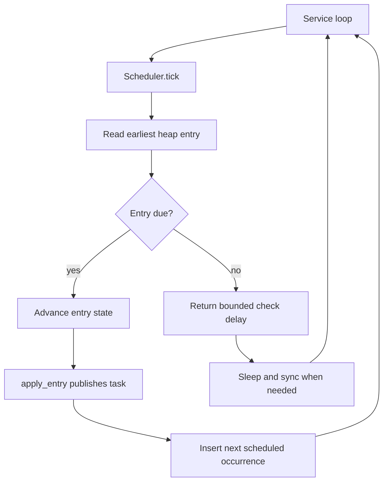

## Overview

Beat publishes task messages when schedule entries become due. Workers execute those messages through the ordinary delivery path, so starting Beat does not replace starting a worker. The repository's periodic-task example runs these as separate services. [[Publishing Tasks]] explains the shared producer interface, and [[Worker Execution]] explains what happens after a scheduled message reaches a worker.

Sources: [examples/periodic-tasks/myapp.py:3-12](repo://examples/periodic-tasks/myapp.py#L3-L12), [celery/beat.py:393-410](repo://celery/beat.py#L393-L410)

## Register a periodic entry

`add_periodic_task` converts a signature into an entry containing schedule, task name, arguments, keyword arguments and delivery options. If configuration is ready it inserts the entry into `beat_schedule`; otherwise it queues the insertion. Keys come from an explicit name or the signature representation. Reusing a key replaces the old entry, so distinct names are needed when the same signature should have multiple schedules.

Sources: [celery/app/base.py:1295-1333](repo://celery/app/base.py#L1295-L1333)

The example registers a ten-second interval from `on_after_configure`, after defining `say`. This uses the configuration lifecycle from [[Applications and Configuration]] and the signature interface from [[Canvas Workflows]]. Delivery options are retained in the entry and passed along when Beat eventually publishes it.

Sources: [examples/periodic-tasks/myapp.py:42-53](repo://examples/periodic-tasks/myapp.py#L42-L53), [celery/app/base.py:1312-1324](repo://celery/app/base.py#L1312-L1324), [celery/beat.py:400-410](repo://celery/beat.py#L400-L410)

```python
@app.on_after_configure.connect
def setup_periodic_tasks(sender, **kwargs):
    # Calls say('hello') every 10 seconds.
    sender.add_periodic_task(10.0, say.s('hello'), name='add every 10')
```

Sources: [examples/periodic-tasks/myapp.py:50-53](repo://examples/periodic-tasks/myapp.py#L50-L53)

`ScheduleEntry` adds scheduling state: `last_run_at` and `total_run_count`. Advancing an entry creates a new instance with the current schedule time and an incremented count. Updating an existing entry changes its editable task, schedule, arguments and options while retaining its accumulated scheduling state. These timestamps describe when Beat scheduled work, not when a worker finished it.

Sources: [celery/beat.py:111-159](repo://celery/beat.py#L111-L159)

## Schedule types and due calculations

The interval schedule converts its duration to a timedelta and computes the remaining time from `last_run_at`. `is_due` returns a pair: whether to send now and how many seconds until the scheduler should check again. When the remaining time reaches zero it returns the interval as the next check delay. The scheduler's maximum loop interval caps sleeping, so a schedule's next-check value is not a promise of exact task start time.

Sources: [celery/schedules.py:125-173](repo://celery/schedules.py#L125-L173), [celery/beat.py:348-364](repo://celery/beat.py#L348-L364)

`crontab` expands minute, hour, weekday, day-of-month and month fields into sets used for calendar matching. Its due calculation also observes `beat_cron_starting_deadline`: when the most recent feasible missed run is too old, it suppresses that catch-up run and calculates the next future check. This differs from a simple elapsed interval because eligibility depends on calendar fields and missed-run policy.

Sources: [celery/schedules.py:403-432](repo://celery/schedules.py#L403-L432), [celery/schedules.py:638-688](repo://celery/schedules.py#L638-L688)

Solar schedules calculate events such as sunrise or sunset for a geographic location. Their calculation converts the last-run time to UTC and asks the ephemeris observer for the next event. If the sun will not rise or set on that date, the implementation schedules another check after the next anti-transit. This is a distinct schedule implementation with its own event calculations, while exposing the same due-check interface to Beat.

Sources: [celery/schedules.py:717-752](repo://celery/schedules.py#L717-L752), [celery/schedules.py:828-875](repo://celery/schedules.py#L828-L875)

## The scheduler tick

The scheduler builds a heap of entries ordered by their next check times. Each tick compares the current schedule with the previous snapshot and rebuilds the heap when necessary. If the earliest entry is due, it removes that entry, reserves its next instance, publishes the current entry and pushes the next event back into the heap. A tick sends at most one due task and returns zero so another due entry can be considered promptly.

Sources: [celery/beat.py:310-364](repo://celery/beat.py#L310-L364)



Sources: [celery/beat.py:326-364](repo://celery/beat.py#L326-L364), [celery/beat.py:633-655](repo://celery/beat.py#L633-L655)

`apply_async` resolves a registered task and calls its `apply_async`; if it is not registered locally, it calls `send_task` by name. Entry arguments are evaluated before publication, and entry options are forwarded. Reserving before sending is deliberate: the source explains that timestamps and counts must advance even when publication fails so an entry does not schedule forever. `apply_entry` logs publication failures, while the scheduler tracks sync activity in a `finally` block.

Sources: [celery/beat.py:279-290](repo://celery/beat.py#L279-L290), [celery/beat.py:389-418](repo://celery/beat.py#L389-L418)

## Persistent state and recovery

`PersistentScheduler` stores entries in a shelve database opened with writeback enabled. Setup opens the store and probes its keys; if the store is corrupt, it removes associated database files and reopens it. It then merges configured entries, installs default entries and stores version, timezone and UTC metadata. A changed timezone or UTC setting clears the saved schedule state to avoid retaining timestamps under incompatible clock settings.

Sources: [celery/beat.py:504-565](repo://celery/beat.py#L504-L565)

Synchronization flushes the store, and closing the scheduler synchronizes before closing it. The service loop repeatedly calls `tick`, sleeps for positive delays and synchronizes when required. Its shutdown path closes the scheduler in a `finally` block. [[Result Backends]] describes the default cleanup entry that Beat installs for expiring results on adapters without automatic expiry.

Sources: [celery/beat.py:598-611](repo://celery/beat.py#L598-L611), [celery/beat.py:633-664](repo://celery/beat.py#L633-L664), [celery/beat.py:268-277](repo://celery/beat.py#L268-L277)

## Run and extend Beat

From the periodic example's directory, the application exposes a direct Beat command through `app.start`. Its command-line wrapper initializes the loader, creates the scheduler service, configures logging and starts the service. A configured PID file is locked before service startup. The following command is the example's scheduler invocation; run its worker invocation separately to execute the published tasks.

Sources: [examples/periodic-tasks/myapp.py:3-12](repo://examples/periodic-tasks/myapp.py#L3-L12), [examples/periodic-tasks/myapp.py:59-60](repo://examples/periodic-tasks/myapp.py#L59-L60), [celery/apps/beat.py:78-118](repo://celery/apps/beat.py#L78-L118)

```bash
python myapp.py beat -l INFO
```

Sources: [examples/periodic-tasks/myapp.py:8-9](repo://examples/periodic-tasks/myapp.py#L8-L9)

The periodic-task guide requires a single scheduler for a given schedule to avoid duplicate publications. It also notes that occurrences can overlap when a task lasts longer than its interval; periodic scheduling does not wait for previous execution to finish. A custom scheduler can be selected by class name or an extension alias from `celery.beat_schedulers`, receiving the app, schedule filename, maximum interval and lazy flag through the service factory.

Sources: [docs/userguide/periodic-tasks.rst:10-28](repo://docs/userguide/periodic-tasks.rst#L10-L28), [docs/userguide/periodic-tasks.rst:157-168](repo://docs/userguide/periodic-tasks.rst#L157-L168), [celery/beat.py:666-675](repo://celery/beat.py#L666-L675)
