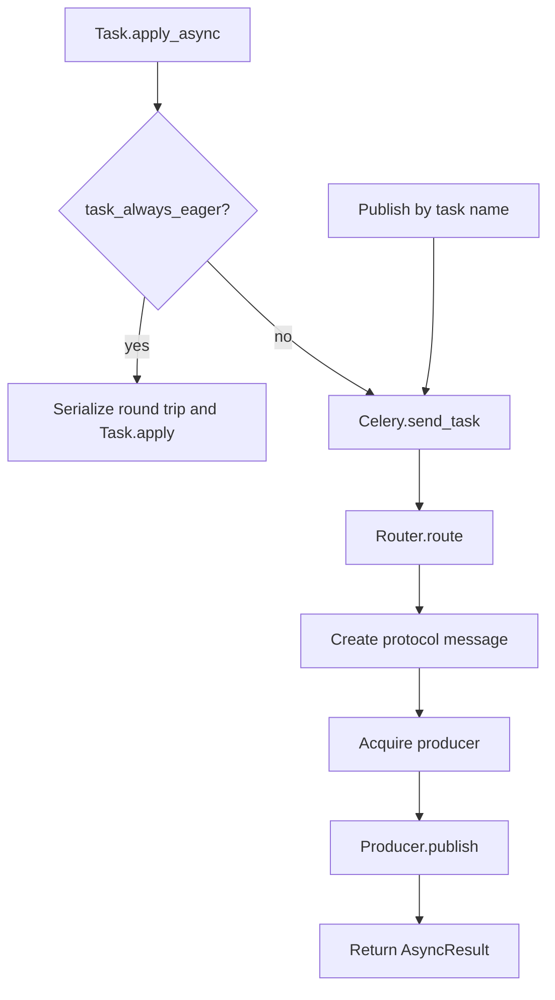

## Overview

Publication transforms a task name, arguments and execution options into a broker message and a result handle. The application and registry described in [[Applications and Configuration]] supply task defaults; `Task.apply_async`, `Celery.send_task`, the router and the AMQP publisher perform the delivery preparation. [[Worker Execution]] starts at the receiving side and owns execution retries and acknowledgement policy.

Sources: [celery/app/task.py:675-708](repo://celery/app/task.py#L675-L708), [celery/app/base.py:897-932](repo://celery/app/base.py#L897-L932), [celery/app/base.py:1022-1041](repo://celery/app/base.py#L1022-L1041), [celery/worker/strategy.py:132-150](repo://celery/worker/strategy.py#L132-L150)

## Choose the submission interface

`delay(*args, **kwargs)` forwards only task arguments to `apply_async`. Use `apply_async(args, kwargs, **options)` when specifying delivery options. Before publication, it rejects a soft time limit greater than the hard limit and, when task typing is enabled, checks arguments using the generated function header. It then merges task execution defaults with caller options and supplies `ignore_result` and priority defaults.

Sources: [celery/app/task.py:523-538](repo://celery/app/task.py#L523-L538), [celery/app/task.py:659-680](repo://celery/app/task.py#L659-L680)

`send_task(name, ...)` supports publication without a task object. It checks the underlying local registry without forcing finalization, allowing remote or unregistered names to be sent. If it finds a registered task and was not already given `task_type`, it merges non-null execution defaults beneath caller options. For `time_limit`, `soft_time_limit` and `expires`, an omitted argument permits the default, while an explicit `None` clears it.

Sources: [celery/app/base.py:846-928](repo://celery/app/base.py#L846-L928)

## Eager execution is a separate branch

With `task_always_eager`, `Task.apply_async` serializes and deserializes the arguments using the selected serializer and calls `Task.apply` locally inside a context that disallows result joins. This exercises serialization but bypasses broker delivery. In contrast, `send_task` warns that eager mode has no effect and proceeds with publication. Tests that submit only by name therefore cannot rely on eager mode to avoid a broker; [[Testing and Contributing]] describes worker-backed test fixtures.

Sources: [celery/app/task.py:682-708](repo://celery/app/task.py#L682-L708), [celery/app/base.py:863-872](repo://celery/app/base.py#L863-L872)

## Routing and queue resolution

`MapRoute` checks exact task names before ordered regular-expression or wildcard patterns. The higher-level router checks configured routers in order and takes the first non-null answer. It expands queue names to queue objects, merges delivery options with the route and falls back to `task_default_queue` when no queue was selected. A queue name that cannot be resolved raises `QueueNotFound`; the AMQP queue collection's creation policy determines whether missing names can be supplied automatically.

Sources: [celery/app/routes.py:26-111](repo://celery/app/routes.py#L26-L111), [celery/app/amqp.py:80-102](repo://celery/app/amqp.py#L80-L102), [celery/app/amqp.py:190-215](repo://celery/app/amqp.py#L190-L215)

Sources: [celery/app/task.py:682-708](repo://celery/app/task.py#L682-L708), [celery/app/base.py:930-932](repo://celery/app/base.py#L930-L932), [celery/app/base.py:1006-1041](repo://celery/app/base.py#L1006-L1041), [celery/app/amqp.py:565-576](repo://celery/app/amqp.py#L565-L576)

## Message contents and timing

Protocol v2 validates that positional arguments are a list or tuple and keyword arguments are a mapping. It converts countdowns to timezone-aware ETAs and serializes ETA and expiry timestamps to ISO strings. Headers carry identity, timing, retry and workflow metadata; the body contains arguments, keyword arguments and embedded callbacks, errbacks, chain and chord information. Argument representations are computed separately for display, so changing a display representation does not replace the actual payload.

Sources: [celery/app/amqp.py:326-414](repo://celery/app/amqp.py#L326-L414)

`send_task` additionally converts expiry to broker expiration seconds, clamping a past expiration to zero with a warning. When a task publishes child work, it fills missing root and parent IDs from the current worker task and can inherit priority. [[Canvas Workflows]] uses this metadata to connect workflow submissions; the publishing layer transports it without executing the workflow's Python functions.

Sources: [celery/app/base.py:968-1015](repo://celery/app/base.py#L968-L1015)

For detected quorum queues, ETA or countdown publication can use native delayed delivery. Positive countdowns on non-direct exchanges change the routing key and select `celery_delayed_27`; a direct exchange produces a warning because native delayed delivery does not support it. This is a transport-dependent branch, so the mere presence of `countdown` does not imply every message follows the same broker route.

Sources: [celery/app/base.py:934-965](repo://celery/app/base.py#L934-L965)

## Publication and failure boundaries

The application acquires a producer, notifies the result backend of the call unless results are ignored, sends the message and constructs the result handle. Producer acquisition uses `broker_pool_acquire_timeout`; exhausting the pool raises an `OperationalError` that identifies the timeout and current pool limit. The failure occurs before that call returns its normal result handle.

Sources: [celery/app/base.py:1022-1041](repo://celery/app/base.py#L1022-L1041), [celery/app/base.py:1162-1189](repo://celery/app/base.py#L1162-L1189)

The AMQP publisher resolves exchange and routing-key defaults, prepares declarations and merges the configured retry policy with per-call overrides. It sends `before_task_publish`, calls Kombu's `producer.publish` with serializer, compression, delivery mode and retry parameters, then sends `after_task_publish`. These retries concern transport publication. They are separate from the task's own `retry` method, which [[Worker Execution]] describes after task code has started running.

Sources: [celery/app/amqp.py:506-579](repo://celery/app/amqp.py#L506-L579)

## Serialization and signed messages

The publisher selects the caller's serializer or the application's default, while the task consumer receives the application's `accept_content` list. These controls apply at different ends of the message path: selecting a serializer for output does not itself change what a worker accepts. The eager branch also round-trips through a serializer, but its accepted type is set locally from that serialization operation.

Sources: [celery/app/amqp.py:317-324](repo://celery/app/amqp.py#L317-L324), [celery/app/amqp.py:565-575](repo://celery/app/amqp.py#L565-L575), [celery/app/task.py:683-698](repo://celery/app/task.py#L683-L698)

`setup_security` requires `task_serializer='auth'`, `accept_content=['auth']`, and configured key, certificate and certificate store. It disables unapproved serializers, registers the authenticated serializer and makes it the default. `SecureSerializer` signs the serialized body and verifies that signature before decoding the contents; its comments explain that this ordering avoids decoding unverified data. These are signing and verification operations, with configuration errors raised before normal use when required inputs are missing.

Sources: [celery/security/__init__.py:44-70](repo://celery/security/__init__.py#L44-L70), [celery/security/serialization.py:31-58](repo://celery/security/serialization.py#L31-L58)
