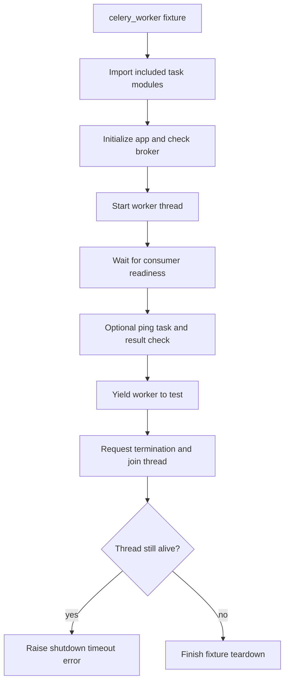

## Overview

The repository separates unit, integration and smoke tests. Pytest defaults to `t/unit/`, while tox defines Python-version and service-specific environments for the wider suites. Celery also supplies reusable pytest fixtures and an embedded worker helper, allowing tests to exercise an isolated application or actual task delivery. [[Quickstart]] provides the manual broker-and-worker walkthrough; this page explains the automated lifecycle.

Sources: [pyproject.toml:1-6](repo://pyproject.toml#L1-L6), [tox.ini:1-7](repo://tox.ini#L1-L7), [celery/contrib/pytest.py:172-210](repo://celery/contrib/pytest.py#L172-L210)

## Prepare the test environment

Install the checkout as described in [[Quickstart]], then install the test and default requirements. The contributor guide gives these dependency commands and the unit-suite invocation below. Tox additionally installs package utilities and version-specific CI requirements, so a direct pytest environment and a tox environment can contain different optional dependencies.

Sources: [CONTRIBUTING.rst:527-527](repo://CONTRIBUTING.rst#L527-L527), [CONTRIBUTING.rst:574-600](repo://CONTRIBUTING.rst#L574-L600), [tox.ini:30-45](repo://tox.ini#L30-L45)

```bash
pip install -U -r requirements/test.txt
pip install -U -r requirements/default.txt
pytest t/unit
```

Sources: [CONTRIBUTING.rst:586-599](repo://CONTRIBUTING.rst#L586-L599)

Pytest uses strict markers, discovers classes named `test_*` and treats unexpected success of an expected-failure test as a failure. A focused run can name one test module; the guide uses the worker test file below. These settings matter when adding tests because an unregistered marker or differently named class can change collection or failure behavior.

Sources: [pyproject.toml:1-6](repo://pyproject.toml#L1-L6), [CONTRIBUTING.rst:616-621](repo://CONTRIBUTING.rst#L616-L621)

```bash
pytest t/unit/worker/test_worker.py
```

Sources: [CONTRIBUTING.rst:616-621](repo://CONTRIBUTING.rst#L616-L621)

## Configure an isolated application

For an application outside this repository, enable the fixtures with `PYTEST_PLUGINS=celery.contrib.pytest` or a `pytest_plugins` declaration in its root conftest. The repository unit suite imports the fixtures directly, so its setup differs from an application that has not enabled the plugin.

Sources: [docs/userguide/testing.rst:118-128](repo://docs/userguide/testing.rst#L118-L128), [t/unit/conftest.py:19-25](repo://t/unit/conftest.py#L19-L25)

The pytest plugin registers a `celery` marker whose keyword arguments override the `celery_config` fixture for a test. `celery_app` creates an application through `_create_app`, passing constructor parameters separately from configuration. `celery_parameters` changes app construction; `celery_worker_parameters` changes the worker controller. Keeping these inputs distinct mirrors the application and worker boundaries described in [[Applications and Configuration]] and [[Extending Workers]].

Sources: [celery/contrib/pytest.py:22-50](repo://celery/contrib/pytest.py#L22-L50), [celery/contrib/pytest.py:137-185](repo://celery/contrib/pytest.py#L137-L185)

`TestApp` merges copied test defaults with overrides and uses a memory broker plus an in-memory cache result backend by default. Supplying explicit broker or backend constructor arguments removes the corresponding default setting first. The helper also chooses test logging unless normal logging is enabled. These local defaults allow tests to share state inside the test process; they do not exercise an external broker or result service.

Sources: [celery/contrib/testing/app.py:1-20](repo://celery/contrib/testing/app.py#L1-L20), [celery/contrib/testing/app.py:47-65](repo://celery/contrib/testing/app.py#L47-L65), [celery/backends/cache.py:23-25](repo://celery/backends/cache.py#L23-L25)

The application context saves and restores current/default app state, finalizers and registered applications, and closes the test app after use. Enabling `use_celery_app_trap` replaces implicit app access with a trap that raises when code accidentally falls back to the current app. This makes missing explicit app dependencies visible instead of allowing a test to pass using unrelated global state.

Sources: [celery/contrib/testing/app.py:23-36](repo://celery/contrib/testing/app.py#L23-L36), [celery/contrib/testing/app.py:68-112](repo://celery/contrib/testing/app.py#L68-L112), [celery/contrib/pytest.py:53-61](repo://celery/contrib/pytest.py#L53-L61)

## Start a worker inside a test

The `celery_worker` fixture imports modules listed by `celery_includes` and enters `start_worker`, using the `solo` pool unless the pool fixture is overridden. The helper defaults to one execution slot, sends test-worker lifecycle signals and optionally publishes `celery.ping`, requiring its result to equal `pong` before yielding. That ping checks task delivery and result retrieval rather than only the existence of a worker object.

Sources: [celery/contrib/pytest.py:127-134](repo://celery/contrib/pytest.py#L127-L134), [celery/contrib/pytest.py:194-210](repo://celery/contrib/pytest.py#L194-L210), [celery/contrib/testing/worker.py:99-136](repo://celery/contrib/testing/worker.py#L99-L136)

The thread helper initializes the application for worker use, checks the broker connection, creates a worker without mingle or gossip, and disables heartbeats by default. It starts a daemon thread and waits for the consumer-ready signal. During teardown it requests termination and joins for `shutdown_timeout`; a thread that remains alive raises a clear error suggesting a larger timeout for long-running tasks. These defaults deliberately omit some distributed worker services, which matters when testing [[Monitoring and Control]].

Sources: [celery/contrib/testing/worker.py:140-192](repo://celery/contrib/testing/worker.py#L140-L192)



Sources: [celery/contrib/pytest.py:194-210](repo://celery/contrib/pytest.py#L194-L210), [celery/contrib/testing/worker.py:119-192](repo://celery/contrib/testing/worker.py#L119-L192)

## Choose the boundary a test exercises

Eager execution uses a serialization round trip and a local call, as detailed in [[Publishing Tasks]]. It skips normal broker delivery, and `send_task` does not honor eager mode at all. Use the worker fixture when a test needs the consumer, request or result-delivery path. Use an appropriate pool override when the behavior depends on multiprocessing or another concurrency adapter; the default solo worker cannot establish prefork-specific behavior.

Sources: [celery/app/task.py:682-708](repo://celery/app/task.py#L682-L708), [celery/app/base.py:869-872](repo://celery/app/base.py#L869-L872), [celery/contrib/pytest.py:127-134](repo://celery/contrib/pytest.py#L127-L134)

Integration configuration reads `TEST_BROKER` and `TEST_BACKEND`, defaulting to RabbitMQ and Redis, and enables extended result metadata. It can merge settings from `integration-tests-config.json` in the repository root and overrides the worker pool to prefork. Tox factors select combinations such as RabbitMQ/RPC, Redis/Redis and RabbitMQ/Redis. The required services must match the selected factor; [[Result Backends]] explains capability differences that can affect workflow tests.

Sources: [t/integration/conftest.py:21-22](repo://t/integration/conftest.py#L21-L22), [t/integration/conftest.py:61-92](repo://t/integration/conftest.py#L61-L92), [tox.ini:61-80](repo://tox.ini#L61-L80)

## Repository checks and review preparation

Tox runs unit tests under coverage, writes XML and terminal reports, and invokes integration and smoke suites explicitly. Smoke tests have rerun settings in the configured command. The environment list includes Python 3.10 through 3.14 and PyPy, so report the actual interpreter and environment used when describing validation rather than implying one local run covered the entire matrix.

Sources: [tox.ini:1-7](repo://tox.ini#L1-L7), [tox.ini:47-52](repo://tox.ini#L47-L52)

The contributor checklist asks for unit or integration coverage for behavior changes, no decrease in unit coverage, pre-commit checks and an API documentation build. Apply those checks to code contributions and record relevant outcomes for review.

Sources: [CONTRIBUTING.rst:830-875](repo://CONTRIBUTING.rst#L830-L875)
