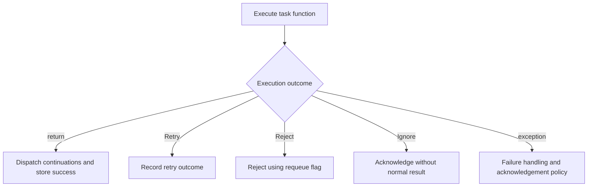

## Overview

The worker turns a broker delivery into a `Request`, schedules it, submits it to a pool and interprets the execution outcome. This page begins after [[Publishing Tasks]] has built the message. It follows task execution and settlement; [[Extending Workers]] covers the services and pool implementations that host this path, and [[Task Results]] covers client-side observation.

Sources: [celery/worker/consumer/consumer.py:731-784](repo://celery/worker/consumer/consumer.py#L731-L784), [celery/worker/strategy.py:145-208](repo://celery/worker/strategy.py#L145-L208), [celery/worker/request.py:341-369](repo://celery/worker/request.py#L341-L369)

## Dispatch by registered task name

The consumer builds one strategy and tracer per registered task. On delivery, it first reads the protocol-v2 task name from headers, falling back to decoding a protocol-v1 body when that header is absent. It looks up the strategy by name and passes acknowledgement and rejection promises to it. Unknown names take a separate error path: the message is rejected, a `NotRegistered` failure is recorded when identity is available, and task failure and unknown-task notifications are emitted.

Sources: [celery/worker/consumer/consumer.py:677-722](repo://celery/worker/consumer/consumer.py#L677-L722), [celery/worker/consumer/consumer.py:731-784](repo://celery/worker/consumer/consumer.py#L731-L784)

The default strategy constructs a request using the task-specific request class, checks revocation or expiry and emits the received signal and optional event. An ETA request goes to the consumer timer; a rate-limited task goes through its token bucket; an immediately runnable request is reserved and passed to `on_task_request`. ETA and rate limiting can apply together, with the timer eventually handing work to the rate limiter.

Sources: [celery/worker/strategy.py:119-208](repo://celery/worker/strategy.py#L119-L208)

## Pool execution and tracing

`Request.execute_using_pool` checks revocation again and invokes the pool's `apply_async` with the selected tracer, message body, content type and encoding. Acceptance, timeout, success and failure callbacks keep the parent request informed of execution. Task-level time limits are used when request limits do not provide a value. Pool-specific capabilities belong to [[Extending Workers]] rather than to the task message itself.

Sources: [celery/worker/request.py:341-369](repo://celery/worker/request.py#L341-L369)

The tracer calls `task.run` directly unless the task supplies a custom `__call__`. It creates the request context, computes result-storage policy, pushes task and request stacks, sends pre-run signals, initializes the loader and optionally stores `STARTED`. Then it invokes the task function. `Reject`, `Ignore`, `Retry` and ordinary exceptions take distinct branches, so these control exceptions must not be treated as interchangeable task failures.

Sources: [celery/app/trace.py:374-406](repo://celery/app/trace.py#L374-L406), [celery/app/trace.py:497-506](repo://celery/app/trace.py#L497-L506), [celery/app/trace.py:563-609](repo://celery/app/trace.py#L563-L609)

On success, callbacks and chain continuation are dispatched before the backend marks the task done, preserving child-result trails. Custom success and after-return hooks follow the appropriate outcome branches. A nested `finally` sends post-run signals, pops request and task stacks, and invokes backend and loader process cleanup for non-eager execution. [[Canvas Workflows]] develops the continuation path without requiring a task to synchronously wait on its successors.

Sources: [celery/app/trace.py:610-672](repo://celery/app/trace.py#L610-L672)

## Acknowledgement decisions

| Outcome | Settlement behavior |
| --- | --- |
| Pool acceptance with early acknowledgement | `on_accepted` acknowledges when `acks_late` is false |
| Successful execution with late acknowledgement | `on_success` acknowledges after marking the request ready |
| Task retry with late acknowledgement | `on_retry` acknowledges the current delivery |
| Hard timeout with late acknowledgement | Acknowledge when `acks_on_timeout` is true; otherwise reject with requeue |
| Worker lost with late acknowledgement and `reject_on_worker_lost` | Reject with requeue |
| Other late-ack failure | Acknowledge if `acks_on_failure`; otherwise reject without requeue |
| Explicit `Reject` | Use the exception's requeue flag |
| Explicit `Ignore` | Acknowledge the current delivery |

Sources: [celery/worker/request.py:515-527](repo://celery/worker/request.py#L515-L527), [celery/worker/request.py:590-620](repo://celery/worker/request.py#L590-L620), [celery/worker/request.py:649-725](repo://celery/worker/request.py#L649-L725)

These branches make late acknowledgement a policy with several outcomes, not a promise that every failure is redelivered. In this checkout an explicit rejection without requeue records terminal failure and sends the failure signal, avoiding a task left indefinitely in `PENDING` or `STARTED`. The acknowledgement and rejection methods guard against settling the same request twice using the request's `acknowledged` flag.

Sources: [celery/worker/request.py:649-725](repo://celery/worker/request.py#L649-L725), [celery/worker/request.py:730-746](repo://celery/worker/request.py#L730-L746)

## Retrying task code

`Task.retry` increments the request retry count and constructs a signature from the current request, preserving its execution context and delivery information. If no ETA or countdown is supplied it uses `default_retry_delay`. Exceeding `max_retries` re-raises the supplied exception or raises `MaxRetriesExceededError`; a directly called task raises instead of publishing another message. The normal worker path publishes the retry signature and raises the `Retry` control exception unless `throw=False`.

Sources: [celery/app/task.py:731-753](repo://celery/app/task.py#L731-L753), [celery/app/task.py:818-867](repo://celery/app/task.py#L818-L867)

Automatic retries wrap `run` only when `autoretry_for` is configured and it has not already been wrapped. `Ignore`, `Retry` and exceptions listed in `dont_autoretry_for` escape the wrapper unchanged. Matching retryable exceptions can receive exponential backoff capped by `retry_backoff_max`, with jitter enabled by default, before the wrapper calls `task.retry`. This mechanism retries selected task-code exceptions, unlike the publication retry policy in [[Publishing Tasks]].

Sources: [celery/app/autoretry.py:8-66](repo://celery/app/autoretry.py#L8-L66)

Sources: [celery/app/trace.py:580-627](repo://celery/app/trace.py#L580-L627), [celery/worker/request.py:613-725](repo://celery/worker/request.py#L613-L725)

## Connection loss and redelivery

After a broker connection fails, the consumer can cancel active, unacknowledged late-ack tasks when `worker_cancel_long_running_tasks_on_connection_loss` is enabled. With prefetch reduction enabled and global QoS in use, it reduces the initial count according to active requests, then restores it through acknowledgement and rejection callbacks. Per-consumer QoS skips reduction because those updates would not reach existing consumers. The maximum count is pool processes multiplied by `prefetch_multiplier`; this bounds broker reservation separately from execution concurrency.

Sources: [celery/worker/consumer/consumer.py:419-491](repo://celery/worker/consumer/consumer.py#L419-L491), [celery/worker/consumer/consumer.py:765-815](repo://celery/worker/consumer/consumer.py#L765-L815)

Successful-task deduplication is conditional on late acknowledgements, the deduplication setting and a persistent backend. For a redelivered request, the tracer checks remembered success or backend `SUCCESS`. It can recover callback or chain dispatch from stored result metadata when children are absent; a dispatch error rejects with requeue. The code explicitly points to broker dead-letter or maximum-delivery policies as the circuit breaker for permanent dispatch failures, rather than claiming unconditional exactly-once execution.

Sources: [celery/app/trace.py:379-382](repo://celery/app/trace.py#L379-L382), [celery/app/trace.py:508-561](repo://celery/app/trace.py#L508-L561)
