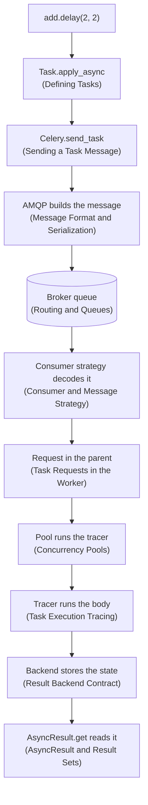

## Overview

Celery is a distributed task queue. A caller turns a function call into a message, a broker delivers the message, and a worker process runs the task and optionally stores its return value in a result backend. The package is organised around one `Celery` application object, which holds the configuration, the task registry and the classes for each moving part.

Sources: [celery/app/base.py:252-287](repo://celery/app/base.py#L252-L287)

The `Celery` class takes the names of its components as class paths and resolves them when first used: the AMQP helper, the events, the control, the registry and the logging classes. A custom component replaces one of these names without changing the callers.

Sources: [celery/app/base.py:311-317](repo://celery/app/base.py#L311-L317)

The top-level `celery` package imports its public names on first attribute access, so importing the package only loads what the code uses. The comment in the source gives that as the reason.

Sources: [celery/__init__.py:156-157](repo://celery/__init__.py#L156-L157)

## The parts

| Area | What it does | Page |
| --- | --- | --- |
| Setup | Builds the app and finalizes its tasks | [[The Celery App]] |
| Setup | Reads settings from objects, files and env | [[Configuration]] |
| Sending | Turns a task name into a `Task` object | [[Defining Tasks]] |
| Sending | Publishes the message for `apply_async` | [[Sending a Task Message]] |
| Sending | Picks the queue and exchange | [[Routing and Queues]] |
| Sending | Builds the protocol 1 and 2 messages | [[Message Format and Serialization]] |
| Executing | Runs the task body and records its state | [[Task Execution Tracing]] |
| Executing | Retries, failures and time limits | [[Retries, Failures and Time Limits]] |
| Worker | Starts the blueprint of steps | [[Worker Startup and Bootsteps]] |
| Worker | Consumes messages and decides how to run them | [[Consumer and Message Strategy]] |
| Worker | Runs tasks in processes, threads or greenlets | [[Concurrency Pools]] |
| Worker | Tracks one received message in the parent | [[Task Requests in the Worker]] |
| Results | Defines what a backend stores | [[Result Backend Contract]] |
| Results | Lists the concrete backends | [[Result Backend Catalogue]] |
| Results | Reads state and return values | [[AsyncResult and Result Sets]] |
| Workflows | Describes one task call as data | [[Signatures]] |
| Workflows | Sequences and fans out calls | [[Chains and Groups]] |
| Workflows | Runs a body after a header group | [[Chords]] |
| Scheduling | Sends tasks on a timetable | [[Beat Scheduler]] |
| Scheduling | Interval, crontab and solar timetables | [[Schedules]] |
| Events | Publishes and reads worker events | [[Events]] |
| Control | Sends commands to running workers | [[Remote Control and Revocation]] |
| Command line | The `celery` command and its options | [[Command Line Entry Point]] |
| Command line | Starts several workers at once | [[Multi Workers]] |
| Extending | Finds custom components by name | [[Registering Custom Components]] |
| Extending | Signals sent at fixed points | [[Signals]] |
| Extending | Django settings and connections | [[Django Integration]] |
| Extending | In-process worker and test fixtures | [[Testing Utilities]] |
| Extending | Abortable tasks and other contrib tools | [[Contrib Utilities]] |
| Security | Signs and verifies messages | [[Message Security]] |

Sources: [celery/app/base.py:252-287](repo://celery/app/base.py#L252-L287), [celery/app/task.py:206-222](repo://celery/app/task.py#L206-L222), [celery/app/amqp.py:225-270](repo://celery/app/amqp.py#L225-L270), [celery/app/trace.py:344-360](repo://celery/app/trace.py#L344-L360), [celery/worker/worker.py:63-89](repo://celery/worker/worker.py#L63-L89), [celery/result.py:70-90](repo://celery/result.py#L70-L90), [celery/canvas.py:233-250](repo://celery/canvas.py#L233-L250), [celery/beat.py:219-240](repo://celery/beat.py#L219-L240), [celery/events/dispatcher.py:19-40](repo://celery/events/dispatcher.py#L19-L40), [celery/app/control.py:426-452](repo://celery/app/control.py#L426-L452), [celery/bin/celery.py:113-130](repo://celery/bin/celery.py#L113-L130), [celery/security/__init__.py:44-72](repo://celery/security/__init__.py#L44-L72)

## Main flow

A call such as `add.delay(2, 2)` goes through the steps below. The worker side runs in a separate process from the caller, and the two sides meet only at the broker and the backend.

Sources: [celery/app/task.py:523-535](repo://celery/app/task.py#L523-L535), [celery/app/task.py:536-545](repo://celery/app/task.py#L536-L545)

Sources: [celery/app/task.py:682-708](repo://celery/app/task.py#L682-L708), [celery/app/base.py:846-860](repo://celery/app/base.py#L846-L860), [celery/app/base.py:1007-1029](repo://celery/app/base.py#L1007-L1029), [celery/app/amqp.py:506-576](repo://celery/app/amqp.py#L506-L576), [celery/worker/strategy.py:99-209](repo://celery/worker/strategy.py#L99-L209), [celery/worker/request.py:832-844](repo://celery/worker/request.py#L832-L844), [celery/worker/worker.py:223-231](repo://celery/worker/worker.py#L223-L231), [celery/backends/base.py:673-690](repo://celery/backends/base.py#L673-L690), [celery/result.py:191-200](repo://celery/result.py#L191-L200)

`Task.apply_async` takes the eager branch when `task_always_eager` is set. In that case it serializes the arguments and deserializes them again before calling `apply` in the same process, so no broker is involved.

Sources: [celery/app/task.py:683-708](repo://celery/app/task.py#L683-L708)

## Design decisions

The sender and the worker share one contract: the message. The sender picks a protocol from the `task_protocol` setting, and the worker reads both protocol 1 and protocol 2 messages and converts them to the same shape before it builds a request.

Sources: [celery/app/amqp.py:266-267](repo://celery/app/amqp.py#L266-L267), [celery/worker/strategy.py:25-99](repo://celery/worker/strategy.py#L25-L99)

The backend is chosen from the URL scheme. `by_url` splits a `scheme://` value, and the scheme names an entry in `BACKEND_ALIASES`, or else a class path is imported.

Sources: [celery/app/backends.py:59-69](repo://celery/app/backends.py#L59-L69), [celery/app/backends.py:15-33](repo://celery/app/backends.py#L15-L33)

The worker keeps the message bookkeeping in the parent process and hands only the tracer to the pool. `Request.execute_using_pool` checks for revocation and then submits the tracer with callbacks that run in the parent, so acknowledgement and state events stay with the consumer.

Sources: [celery/worker/request.py:832-856](repo://celery/worker/request.py#L832-L856)

Configuration is read through one `conf` view on the app, so every part of the code sees the same settings after finalize. The defaults for each setting are declared once in the defaults table.

Sources: [celery/app/base.py:1566-1576](repo://celery/app/base.py#L1566-L1576), [celery/app/defaults.py:42-60](repo://celery/app/defaults.py#L42-L60)

## Reading order

Start with [[Quickstart]] to run one task end to end, then [[The Celery App]] and [[Configuration]] for the object the rest hangs on. [[Sending a Task Message]] and [[Consumer and Message Strategy]] follow the message in each direction, and [[Task Execution Tracing]] covers what runs in the child process.

Sources: [celery/app/base.py:252-287](repo://celery/app/base.py#L252-L287), [celery/worker/strategy.py:99-209](repo://celery/worker/strategy.py#L99-L209)
