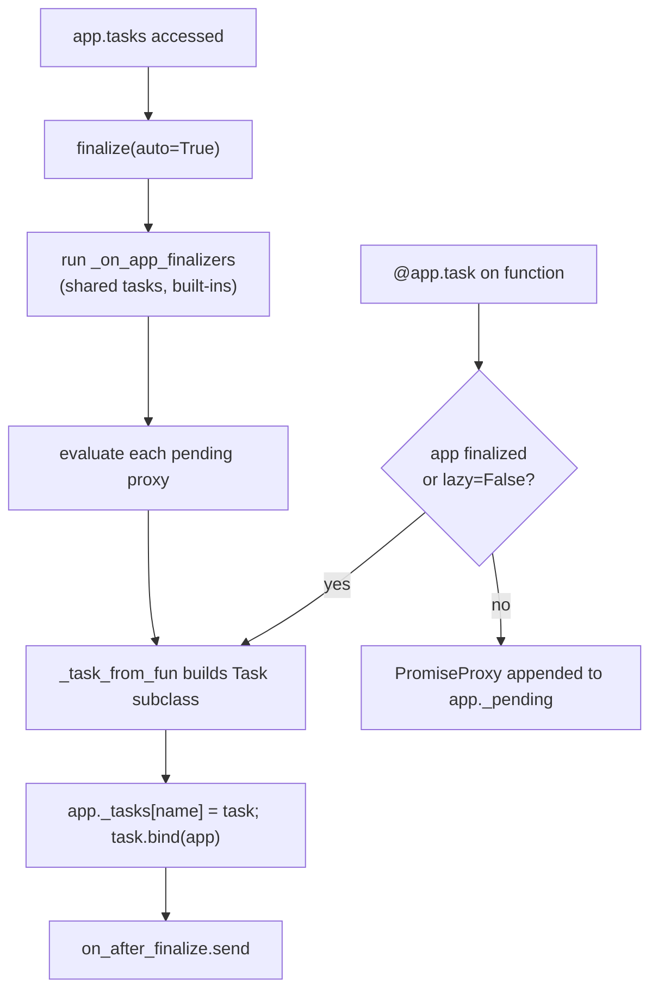

## Overview

Every Celery program starts from a `Celery` instance. The app owns the task registry, the configuration, the broker connection pool and the factories for everything else Celery builds: the AMQP helper, the result backend, the event dispatcher, remote control, logging and the worker and beat applications. Almost all of these are created lazily on first access, so constructing an app is cheap and safe at import time. This page follows how the app is built, how tasks become registered, and how processes find "the current app". Settings and loaders are covered in [[Configuration and Loaders]]; the `Task` class in [[Defining Tasks]].

Sources: [celery/app/base.py:252-342](repo://celery/app/base.py#L252-L342)

## Constructing an app

The constructor records class paths rather than objects. `amqp`, `events`, `log`, `control` and `task_cls` default to strings such as `'celery.app.amqp:AMQP'` and `'celery.app.task:Task'`; the loader defaults to the `CELERY_LOADER` environment variable, then to `celery.loaders.app:AppLoader`. A `TaskRegistry` is created (or the given `tasks` mapping wrapped in one), and a `LamportClock` is attached for event ordering.

Sources: [celery/app/base.py:297-305](repo://celery/app/base.py#L297-L305), [celery/app/base.py:343-389](repo://celery/app/base.py#L343-L389), [celery/app/base.py:436-442](repo://celery/app/base.py#L436-L442)

Connection and backend arguments are not stored as attributes. `broker`, `backend`, `include` and any extra keyword argument go through `__autoset` into `_preconf`, the dict of changes that becomes part of the configuration. The constructor then builds `Settings(PendingConfiguration(...))`, so `app.conf` reads nothing from the configuration source until a key is first looked up.

Sources: [celery/app/base.py:390-412](repo://celery/app/base.py#L390-L412), [celery/app/base.py:447-450](repo://celery/app/base.py#L447-L450)

The last steps instantiate the fixups (the Django fixup is built in), make the app current when `set_as_current` is true, create the `on_configure`, `on_after_configure`, `on_after_finalize` and `on_after_fork` signals, call the `on_init` hook and add the app to the weak set of live apps.

Sources: [celery/app/base.py:414-434](repo://celery/app/base.py#L414-L434)

| Argument | Effect |
| --- | --- |
| `main` | Module name used as the prefix of generated task names when the module runs as `__main__` |
| `broker`, `backend`, `include` | Stored as `broker_url`, `result_backend`, `include` settings |
| `config_source` | Object to read configuration from when the app is configured |
| `autofinalize` | When false, using the registry before `finalize()` raises `RuntimeError` |
| `set_as_current` | Make this the current app of the thread (default true) |
| `fixups` | Fix-up plug-ins; defaults to the built-in fixups |
| `task_cls` | Base task class; marks the app as using a custom task class |
| `namespace` | Prefix for setting names (for example `CELERY` with Django) |
| `strict_typing` | Check call arguments against the task signature |

Sources: [celery/app/base.py:252-296](repo://celery/app/base.py#L252-L296), [celery/app/base.py:343-385](repo://celery/app/base.py#L343-L385)

## Lazy attributes

Each collaborator is a `cached_property` that instantiates its class with the app the first time it is read: `amqp`, `control`, `events`, `log` and `loader`. `backend` is built by `backends.by_url` from `backend_cls` or `result_backend`; a backend that declares itself `thread_safe` is cached on the app, any other is kept in thread-local storage so each thread gets its own instance ([[Result Backend Architecture]]).

Sources: [celery/app/base.py:1534-1595](repo://celery/app/base.py#L1534-L1595), [celery/app/base.py:1224-1228](repo://celery/app/base.py#L1224-L1228)

App-bound classes are made with `subclass_with_self`, which creates a subclass whose `app` attribute (or `_app` for tasks) is this app and whose `__reduce__` unpickles by looking the attribute up on the current app again. `app.Task`, `app.AsyncResult`, `app.GroupResult`, `app.Worker`, `app.WorkController` and `app.Beat` are all built this way.

Sources: [celery/app/base.py:1335-1377](repo://celery/app/base.py#L1335-L1377), [celery/app/base.py:1430-1487](repo://celery/app/base.py#L1430-L1487)

## Registering tasks

### The task decorator

`@app.task` either decorates directly or takes options first. Its inner factory does two things. With `shared=True` (the default) it registers a constructor with `connect_on_app_finalize`, so every app finalized later also gets the task. Then, if the app is already finalized or `lazy=False`, it builds the task now with `_task_from_fun`; otherwise it returns a `PromiseProxy` around `_task_from_fun` and appends it to `app._pending`.

Sources: [celery/app/base.py:515-585](repo://celery/app/base.py#L515-L585)

`_task_from_fun` generates a name from the function's module and name when none is given, then creates a new subclass of the base task with `type()`, putting the function in `run` (as a `staticmethod` unless `bind=True`), and instantiates it. The instance is stored in the registry, bound to the app, and given autoretry behaviour. A second call for a name already registered returns the existing task.

Sources: [celery/app/base.py:590-633](repo://celery/app/base.py#L590-L633)

When the process was started through `execv` (`USING_EXECV`), the decorator always routes to `shared_task(lazy=False)`; the comment explains that otherwise the task in the original module would point to a different app.

Sources: [celery/app/base.py:546-554](repo://celery/app/base.py#L546-L554)

### shared_task

`shared_task` creates tasks for apps that do not exist yet. It registers a finalizer that calls `app._task_from_fun` on each finalized app, adds the task to every app that is already finalized, and returns a plain `Proxy` that looks the task up in the current app's registry on every access. Reusable libraries use it because they have no app to import.

Sources: [celery/app/__init__.py:24-76](repo://celery/app/__init__.py#L24-L76)

### The registry

`TaskRegistry` is a `dict` from name to task instance. A missing key raises `NotRegistered` instead of `KeyError`; `register` instantiates a class if needed and refuses a task without a `name`. `register_task` on the app is the older path for class-based tasks: it names the task if needed, adds autoretry behaviour and binds it.

Sources: [celery/app/registry.py:12-56](repo://celery/app/registry.py#L12-L56), [celery/app/base.py:635-652](repo://celery/app/base.py#L635-L652)

## Finalization

`finalize()` runs once under `_finalize_mutex`. It marks the app finalized, calls every finalizer in `_state._on_app_finalizers` (shared tasks and built-ins), evaluates each pending proxy, binds every registered task to the app and sends `on_after_finalize`. Reading `app.tasks` calls `finalize(auto=True)`, which raises `RuntimeError('Contract breach: app not finalized')` when `autofinalize` is false.

Sources: [celery/app/base.py:657-677](repo://celery/app/base.py#L657-L677), [celery/app/base.py:1601-1609](repo://celery/app/base.py#L1601-L1609), [celery/_state.py:43-52](repo://celery/_state.py#L43-L52)

Sources: [celery/app/base.py:556-577](repo://celery/app/base.py#L556-L577), [celery/app/base.py:657-677](repo://celery/app/base.py#L657-L677)

## Built-in tasks

`celery/app/builtins.py` registers its tasks through `connect_on_app_finalize`, so every app has them: `celery.backend_cleanup` (calls `backend.cleanup()`), `celery.accumulate` (used by `Task.replace` with a group), `celery.chord_unlock` (polls a chord header on backends without native chord support), and the tasks behind `xmap`, `xstarmap`, `chunks`, `group`, `chain` and `chord`. They are defined with `shared=False, lazy=False`.

Sources: [celery/app/builtins.py:12-80](repo://celery/app/builtins.py#L12-L80), [celery/app/builtins.py:102-170](repo://celery/app/builtins.py#L102-L170)

## Autodiscovery

`autodiscover_tasks(packages, related_name='tasks')` imports `<package>.tasks` for each package. By default it is lazy: it connects a promise to the `import_modules` signal, which fires when the loader imports the default modules in the worker; `force=True` imports immediately. With no package list, the packages come from fixups that implement `autodiscover_tasks`, which is how the Django fixup finds installed apps ([[Django Integration]]).

Sources: [celery/app/base.py:782-844](repo://celery/app/base.py#L782-L844)

## Current and default app

`celery._state` holds two levels. A thread-local `_TLS.current_app` is set by every app created with `set_as_current`, so it is the last such app made in the thread. `default_app` is global; if it is unset when the current app is requested, a fallback app named `default` using the `default` loader (or `CELERY_LOADER`) is created. `current_app` and `current_task` are `Proxy` objects over these getters.

Sources: [celery/_state.py:64-111](repo://celery/_state.py#L64-L111), [celery/_state.py:138-142](repo://celery/_state.py#L138-L142)

The currently executing task is the top of `_task_stack`, a `LocalStack`. `get_current_worker_task` walks the stack from the top and returns the first task whose request was not `called_directly`, which skips tasks invoked inline from another task. `send_task` uses it to fill `parent_id` and `root_id` ([[Sending Tasks and Routing]]).

Sources: [celery/_state.py:72-82](repo://celery/_state.py#L72-L82), [celery/_state.py:113-135](repo://celery/_state.py#L113-L135)

Setting `C_STRICT_APP` makes any use of the current app raise, `C_WARN_APP` prints a stack trace for each use, and `CELERY_TRACE_APP` switches `app_or_default` to a version that raises when the main process falls back to the default app. These exist to find code that leaks the implicit app.

Sources: [celery/_state.py:88-99](repo://celery/_state.py#L88-L99), [celery/_state.py:166-197](repo://celery/_state.py#L166-L197)

## Proxies

`Proxy` (adapted from werkzeug) stores a callable and its arguments and calls it on every attribute access, forwarding operators, `__class__`, `__doc__` and `__name__` to the result. `PromiseProxy` calls it only once: `__evaluate__` stores the object, deletes the factory references and runs callbacks queued with `__then__`. `maybe_evaluate` evaluates a promise and returns anything else unchanged; `finalize` uses it on each pending task.

Sources: [celery/local.py:52-129](repo://celery/local.py#L52-L129), [celery/local.py:282-358](repo://celery/local.py#L282-L358)

## Broker connections and producers

`connection_for_read` and `connection_for_write` build a Kombu connection from `broker_read_url` or `broker_write_url`, filling user, password, vhost, port, transport, SSL, failover strategy, transport options and connect timeout from settings. `app.pool` is a Kombu connection pool with `broker_pool_limit`, created on first use and reset after fork.

Sources: [celery/app/base.py:1043-1129](repo://celery/app/base.py#L1043-L1129), [celery/app/base.py:1488-1500](repo://celery/app/base.py#L1488-L1500)

`connection_or_acquire` and `producer_or_acquire` return a `FallbackContext`: they use the connection or producer passed in, or acquire one from the pool for the `with` block. Acquisition waits up to `broker_pool_acquire_timeout`; on `LimitExceeded` it raises `OperationalError` with a message naming `broker_pool_limit` and the timeout.

Sources: [celery/app/base.py:1131-1191](repo://celery/app/base.py#L1131-L1191)

## Forking and pickling

The first use of the pool registers `_after_fork_cleanup_app` with `multiprocessing.register_after_fork`. After a fork, `_after_fork` drops the connection pool and the AMQP producer pool, so a child never shares sockets with its parent, and sends `on_after_fork`.

Sources: [celery/app/base.py:118-124](repo://celery/app/base.py#L118-L124), [celery/app/base.py:460-464](repo://celery/app/base.py#L460-L464), [celery/app/base.py:1282-1288](repo://celery/app/base.py#L1282-L1288)

Pickling an app sends only its class and `__reduce_keys__`: `main`, the configuration changes (not the defaults), the class paths of its collaborators, fixups, `config_source`, `task_cls` and `namespace`. A subclass that defines its own `__reduce_args__` falls back to the older positional form.

Sources: [celery/app/base.py:1391-1428](repo://celery/app/base.py#L1391-L1428)

## Running programs from the app

`app.start(argv)` runs the `celery` click group with this app as the default `--app`, and `app.worker_main(argv)` does the same for `celery worker`. Using the app as a context manager calls `close()`, which drops the pool and removes the app from the set of live apps.

Sources: [celery/app/base.py:466-513](repo://celery/app/base.py#L466-L513), [celery/app/base.py:1382-1386](repo://celery/app/base.py#L1382-L1386)
