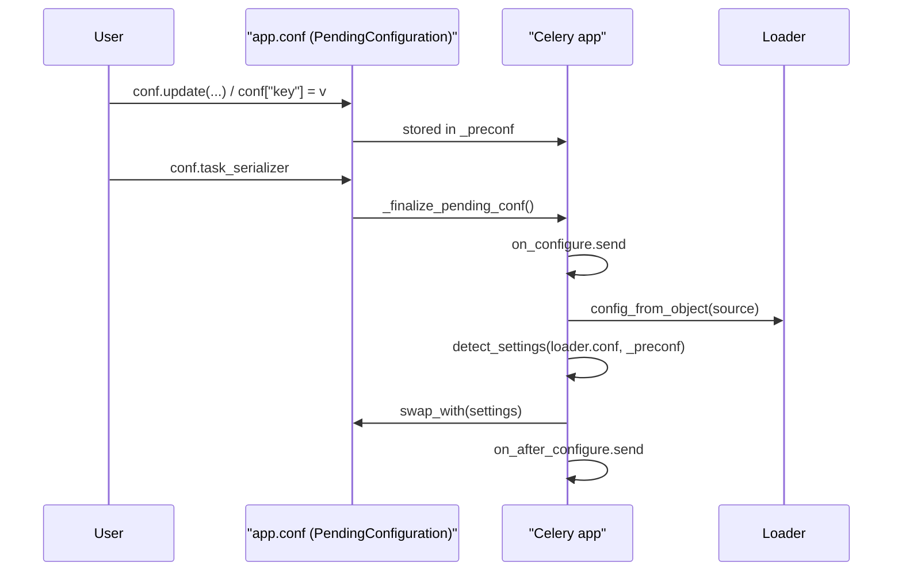

## Overview

An app's settings come from up to four places: keyword arguments to the constructor, values set directly on `app.conf`, a configuration object or module named with `config_from_object`, and the defaults declared in `celery/app/defaults.py`. Nothing is merged until a setting is first read. A loader decides how the configuration object is imported and which modules a worker imports at start; a fixup is a plug-in that adapts the app to a framework. This page follows a setting from where it is written to where `app.conf` returns it. The app object itself is described in [[The Celery Application]].

Sources: [celery/app/base.py:390-412](repo://celery/app/base.py#L390-L412), [celery/app/base.py:1247-1280](repo://celery/app/base.py#L1247-L1280), [celery/loaders/base.py:33-50](repo://celery/loaders/base.py#L33-L50)

## Setting sources

`config_from_object(obj)` only records `obj` as the configuration source (and an optional `namespace`) unless the app is already configured or `force=True`; in those cases it drops the current configuration and has the loader read the object now. `obj` can be a module, a module name, a `module:attribute` path or any object with attributes.

Sources: [celery/app/base.py:703-725](repo://celery/app/base.py#L703-L725)

`config_from_envvar(name)` reads a module name from the environment variable and passes it to `config_from_object`; an unset variable raises `ImproperlyConfigured` unless `silent=True`. `config_from_cmdline(argv)` parses `key=value` arguments with the loader and updates `app.conf`; `celery worker` and `celery beat` call it with the extra arguments after `--`, using the `worker` namespace for the worker.

Sources: [celery/app/base.py:727-748](repo://celery/app/base.py#L727-L748), [celery/bin/worker.py:325-332](repo://celery/bin/worker.py#L325-L332), [celery/bin/beat.py:50-56](repo://celery/bin/beat.py#L50-L56)

`add_defaults(d)` adds a dict, or a callable returning one, as an extra layer of defaults. Before the app is configured a callable is queued in `_pending_defaults` and evaluated during loading. Its docstring warns that defaults added this way are not sent to child processes, so they must be added again at import time.

Sources: [celery/app/base.py:679-701](repo://celery/app/base.py#L679-L701)

## Deferred loading

Until it is configured, `app.conf` is a `Settings` view over a `PendingConfiguration`. Writes (`__setitem__`, `update`, `setdefault`, `clear`) go straight into the app's `_preconf` dict, and `in` checks only that dict so `setdefault` stays lazy. Reading any other key accesses the `data` property, which calls `_finalize_pending_conf` and loads the real configuration.

Sources: [celery/app/base.py:208-249](repo://celery/app/base.py#L208-L249), [celery/app/base.py:1230-1245](repo://celery/app/base.py#L1230-L1245)

`_load_config` does the merge:

Sources: [celery/app/base.py:1247-1250](repo://celery/app/base.py#L1247-L1250)

1. Sends `on_configure`.
2. If a configuration source was recorded, asks the loader to read it with `config_from_object`.
3. Marks the app configured and calls `detect_settings` with the loader's configuration (passed through `prepare_config`, which warns about deprecated settings) and `_preconf`.
4. Swaps the new `Settings` into the existing `app.conf` object in place, because someone may already hold a reference to it.
5. Applies the pending `add_defaults` callables and the periodic tasks queued by `add_periodic_task` before configuration.
6. Sends `on_after_configure` with the settings as `source`.

Sources: [celery/app/base.py:1247-1280](repo://celery/app/base.py#L1247-L1280), [celery/app/base.py:1193-1195](repo://celery/app/base.py#L1193-L1195)

Sources: [celery/app/base.py:208-249](repo://celery/app/base.py#L208-L249), [celery/app/base.py:1230-1280](repo://celery/app/base.py#L1230-L1280)

## The Settings object

`Settings` extends `ConfigurationView`, a `ChainMap` whose first map holds the changes and whose later maps hold defaults. When a `prefix` is set (the app's `namespace`), every lookup tries the prefixed key first and then the bare key; the app also passes old-to-new and new-to-old key converters, so a key is found under either its current or its pre-4.0 name.

Sources: [celery/utils/collections.py:353-426](repo://celery/utils/collections.py#L353-L426), [celery/app/base.py:407-412](repo://celery/app/base.py#L407-L412)

Some settings are computed properties. `broker_url` returns `CELERY_BROKER_URL` from the environment before the configured value, and `broker_read_url` and `broker_write_url` check `CELERY_BROKER_READ_URL`/`CELERY_BROKER_WRITE_URL`, then their own setting, then `broker_url`. `result_backend` likewise prefers `CELERY_RESULT_BACKEND` from the environment. `task_default_exchange` and `task_default_routing_key` fall back to `task_default_queue`, and `timezone` falls back to Django's `TIME_ZONE`.

Sources: [celery/app/utils.py:70-131](repo://celery/app/utils.py#L70-L131)

`without_defaults()` drops the last map (the defaults) and `value_set_for(key)` checks whether the user set a key. `find_option`, `find_value_for_key` and `get_by_parts` look settings up by namespace and key. `table()` and `humanize()` produce the listing shown by `celery report`; they run values through `filter_hidden_settings`, which masks keys matching `API|TOKEN|KEY|SECRET|PASS|…|DATABASE|BEAT_DBURI` and strips passwords from broker and backend URLs.

Sources: [celery/app/utils.py:133-195](repo://celery/app/utils.py#L133-L195), [celery/app/utils.py:37-40](repo://celery/app/utils.py#L37-L40), [celery/app/utils.py:327-343](repo://celery/app/utils.py#L327-L343)

## Defaults and namespaces

`NAMESPACES` declares every setting as an `Option` with a default and a type (`string`, `int`, `float`, `bool`, `dict`, `tuple`, `list` or `any`), grouped by namespace. `flatten` walks the nested dicts and joins namespace and key with `_`, so `broker=Namespace(url=...)` becomes `broker_url`; `DEFAULTS` is that flat mapping and `SETTING_KEYS` its key set.

Sources: [celery/app/defaults.py:40-64](repo://celery/app/defaults.py#L40-L64), [celery/app/defaults.py:378-413](repo://celery/app/defaults.py#L378-L413)

| Namespace | Covers |
| --- | --- |
| top level | `accept_content` (default `('json',)`), `enable_utc`, `imports`, `include`, `timezone` |
| `beat_` | scheduler class, schedule file, `sync_every`, `max_loop_interval` |
| `broker_` | URLs, transport and options, connection retry, heartbeat, `pool_limit` (10), SSL |
| `cache_`, `cassandra_`, `s3_`, `azureblockblob_`, `gcs_`, `couchbase_`, `arangodb_`, `mongodb_`, `cosmosdbsql_`, `elasticsearch_`, `redis_`, `database_` | Options of the matching result backend |
| `control_` | Remote control queues and TTLs |
| `event_` | Event queue and serializer options |
| `result_` | Result backend, serializer, expiry, chord settings |
| `security_` | Message signing key, certificate, digest |
| `task_` | Defaults applied to every task and its messages |
| `worker_` | Concurrency, prefetch, pool, logging formats, shutdown behaviour |

Sources: [celery/app/defaults.py:66-108](repo://celery/app/defaults.py#L66-L108), [celery/app/defaults.py:109-204](repo://celery/app/defaults.py#L109-L204), [celery/app/defaults.py:205-264](repo://celery/app/defaults.py#L205-L264), [celery/app/defaults.py:265-376](repo://celery/app/defaults.py#L265-L376)

Each option also records its old upper-case names (`CELERY_*`, `CELERYD_*`, `CELERYBEAT_*` and per-namespace forms) through `Namespace(__old__=...)`. From these, `_TO_OLD_KEY` and `_TO_NEW_KEY` map between the two schemes, and `find(name, namespace)` looks a setting up in the preferred namespace, then any namespace, then the flat defaults.

Sources: [celery/app/defaults.py:23-38](repo://celery/app/defaults.py#L23-L38), [celery/app/defaults.py:382-389](repo://celery/app/defaults.py#L382-L389), [celery/app/defaults.py:403-447](repo://celery/app/defaults.py#L403-L447)

## Old and new setting names

`detect_settings` decides whether a configuration uses the new lower-case names or the old upper-case ones by counting how many keys of each it contains; the majority wins, and an app with a `namespace` always uses the new format. Keys from the losing scheme raise `ImproperlyConfigured` with a list of suggested renames, except keys the user also gave under the other name. The result is a `Settings` whose changes are the preconfiguration, whose maps are the loaded configuration and a copy of the matching defaults, and which records the old keys it saw so `maybe_warn_deprecated_settings` can warn that they go away in 6.0.

Sources: [celery/app/utils.py:232-286](repo://celery/app/utils.py#L232-L286), [celery/app/utils.py:197-209](repo://celery/app/utils.py#L197-L209)

## Loaders

### Choosing a loader

A loader is chosen by name through `LOADER_ALIASES`: `app` is `AppLoader`, the default for every app you create, and `default` is the loader of the fallback app that `celery._state` creates when no app exists. Any other `module:Class` path also works.

Sources: [celery/loaders/__init__.py:10-18](repo://celery/loaders/__init__.py#L10-L18), [celery/loaders/app.py:1-8](repo://celery/loaders/app.py#L1-L8), [celery/_state.py:91-99](repo://celery/_state.py#L91-L99)

`BaseLoader.config_from_object` imports a string with `_smart_import` (a `module:attr` path, a module name, or a module followed by an attribute), turns the object into a mapping, and reads `override_backends` from it so a configuration can register its own backend aliases. Without a source, `read_configuration` imports the module named by `CELERY_CONFIG_MODULE` if that is set. The default loader's `read_configuration` imports `celeryconfig` (or `CELERY_CONFIG_MODULE`), and with `C_WNOCONF` set warns when it is missing.

Sources: [celery/loaders/base.py:119-156](repo://celery/loaders/base.py#L119-L156), [celery/loaders/base.py:208-216](repo://celery/loaders/base.py#L208-L216), [celery/loaders/default.py:13-44](repo://celery/loaders/default.py#L13-L44)

### Worker hooks

The loader is also the worker's import hook. `init_worker` runs once: it calls `import_default_modules`, which sends the `import_modules` signal (where lazy `autodiscover_tasks` calls are connected) and re-raises any exception a receiver returned, then imports every module in `imports` and `include`. `on_task_init`, `on_process_cleanup`, `on_worker_init`, `on_worker_shutdown` and `on_worker_process_init` are empty hooks for subclasses.

Sources: [celery/loaders/base.py:59-117](repo://celery/loaders/base.py#L59-L117), [celery/loaders/base.py:224-237](repo://celery/loaders/base.py#L224-L237)

### Autodiscovery and command-line settings

`autodiscover_tasks` imports `<package>.<related_name>` for each package, guarded against re-entry by `_RACE_PROTECTION`. `find_related_module` returns `None` when only that submodule is missing but re-raises an import error raised inside it, so a broken tasks module is not silently skipped.

Sources: [celery/loaders/base.py:218-222](repo://celery/loaders/base.py#L218-L222), [celery/loaders/base.py:240-278](repo://celery/loaders/base.py#L240-L278)

`cmdline_config_parser` turns `ns.key=value` or `ns_key=value` into a setting. A key starting with `_` or `.` uses the default namespace, and a value prefixed with `(type)` is cast to that type (`tuple`, `list` and `dict` are parsed as JSON); otherwise the value is converted with the option's declared type.

Sources: [celery/loaders/base.py:161-206](repo://celery/loaders/base.py#L161-L206)

## Fixups

A fixup is a callable named in the app's `fixups` (by default `BUILTIN_FIXUPS`, which holds `celery.fixups.django:fixup`). The app calls each one with itself at construction time and keeps the returned objects in `_fixups`. The Django fixup returns `None` unless `DJANGO_SETTINGS_MODULE` is set, so it costs nothing outside Django; a fixup object that has `autodiscover_tasks` supplies the package list for `app.autodiscover_tasks()` with no arguments. Its behaviour is described in [[Django Integration]].

Sources: [celery/app/base.py:82-84](repo://celery/app/base.py#L82-L84), [celery/app/base.py:414-417](repo://celery/app/base.py#L414-L417), [celery/app/base.py:839-844](repo://celery/app/base.py#L839-L844), [celery/fixups/django.py:52-63](repo://celery/fixups/django.py#L52-L63)

## Finding the app from the command line

`find_app`, used by `-A`, resolves the name with `symbol_by_name`. When the result is a module and no `:` was given, it looks for an `app` attribute, then `celery`, then (for packages) a `<name>.celery` submodule, and finally any `Celery` instance among the module's attributes.

Sources: [celery/app/utils.py:378-415](repo://celery/app/utils.py#L378-L415)
