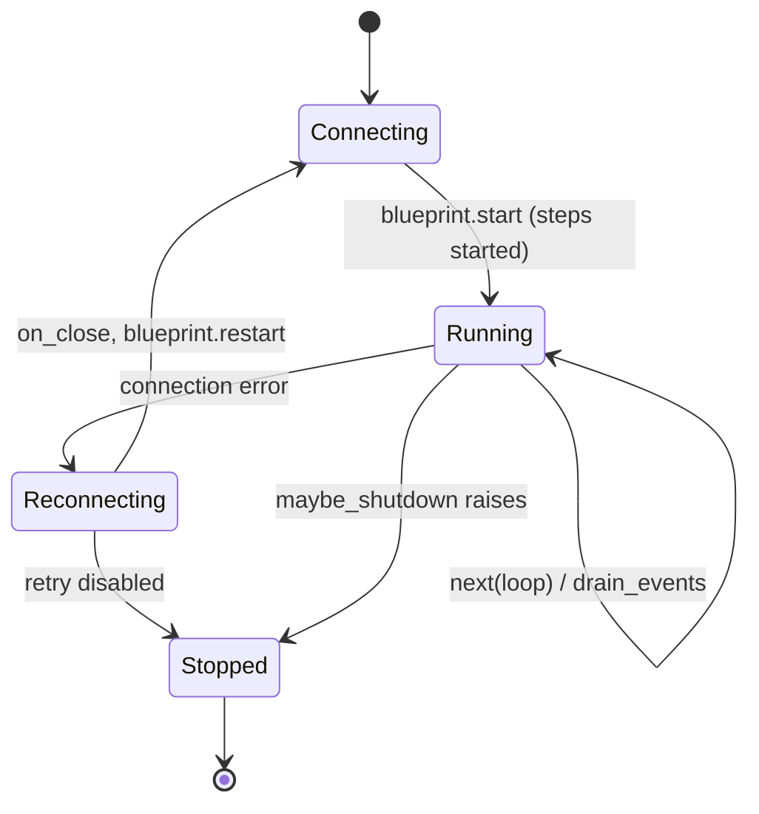

## Overview

The consumer is the part of the worker that talks to the broker. It is the last step of the worker blueprint ([[Worker Startup and Bootsteps]]) and has its own blueprint: one step opens the connection, others start the event dispatcher, synchronize with other workers, consume task messages, answer remote control commands and send heartbeats, and the last step runs the event loop that pulls messages off the connection until shutdown. It also owns the prefetch window (QoS), per-task rate-limit buckets and the reconnect logic. This page covers those parts; what happens to a single task message once received is in [[Task Execution Pipeline]].

Sources: [celery/worker/consumer/consumer.py:145-190](repo://celery/worker/consumer/consumer.py#L145-L190), [celery/worker/components.py:221-246](repo://celery/worker/components.py#L221-L246)

## The consumer blueprint

| Step | Requires | Does |
| --- | --- | --- |
| `Connection` | | Opens the broker connection for reading (`c.connection`) |
| `Events` | Connection | Creates the event dispatcher on a write connection |
| `Mingle` | Events | Asks other workers for their logical clock and revoked ids at start |
| `Gossip` | Mingle | Consumes other workers' events for clock sync and elections |
| `Heart` | Events | Sends `worker-heartbeat` events |
| `Tasks` | Mingle | Sets QoS and starts the task message consumer |
| `Control` | Tasks | Starts the pidbox for remote control commands |
| `DelayedDelivery` | Tasks | Binds queues for native delayed delivery (quorum queues only) |
| `Evloop` | (last) | Runs `asynloop` or `synloop` |
| `Agent` | Connection | Starts a `cell` actor agent when `worker_agent` is set |

Sources: [celery/worker/consumer/consumer.py:171-190](repo://celery/worker/consumer/consumer.py#L171-L190), [celery/worker/consumer/connection.py:13-22](repo://celery/worker/consumer/connection.py#L13-L22), [celery/worker/consumer/events.py:15-33](repo://celery/worker/consumer/events.py#L15-L33), [celery/worker/consumer/heart.py:10-26](repo://celery/worker/consumer/heart.py#L10-L26), [celery/worker/consumer/control.py:18-33](repo://celery/worker/consumer/control.py#L18-L33), [celery/worker/consumer/agent.py:9-21](repo://celery/worker/consumer/agent.py#L9-L21), [celery/worker/consumer/consumer.py:857-872](repo://celery/worker/consumer/consumer.py#L857-L872)

The `Consumer` constructor stores the task callback, pool, timer and hub, creates rate-limit buckets for every task, sets the AMQP heartbeat (only with the hub or a green pool), and chooses `loops.asynloop` when there is a hub and `loops.synloop` otherwise. Under gevent it clears `broker_connection_timeout`, citing a gevent bug where a timeout never resets. It then applies its blueprint with user steps from `app.steps['consumer']`.

Sources: [celery/worker/consumer/consumer.py:191-255](repo://celery/worker/consumer/consumer.py#L191-L255)

## Connecting and reconnecting

### The restart loop

`Consumer.start` loops while the blueprint is not closing. Each pass checks shutdown flags, rate-limits restarts (more than 5 within a second logs "Frequent restarts detected" and sleeps a second), and starts the blueprint. Connection errors, plus channel errors when `broker_channel_error_retry` is on, are caught as recoverable:

Sources: [celery/worker/consumer/consumer.py:366-407](repo://celery/worker/consumer/consumer.py#L366-L407)

1. If retrying is disabled (`broker_connection_retry_on_startup` for the first attempt when set, otherwise `broker_connection_retry`), the worker shuts down with `WorkerShutdown(1)`.
2. Running out of file descriptors (`EMFILE`) terminates the worker.
3. Otherwise it reports the error, calls `on_close` to drop buffered state, and restarts the blueprint, which reconnects.

Sources: [celery/worker/consumer/consumer.py:379-413](repo://celery/worker/consumer/consumer.py#L379-L413)

### Establishing the connection

`connect()` builds a read connection with the AMQP heartbeat and registers it with the hub. `ensure_connected` either connects once (retries disabled) or calls Kombu's `ensure_connection` with up to `broker_connection_max_retries`, logging each attempt (and failover to an alternate URL) and checking for shutdown between attempts. Leaving `broker_connection_retry_on_startup` unset while disabling `broker_connection_retry` raises a pending-deprecation warning, since only the former will govern startup in Celery 6.0.

Sources: [celery/worker/consumer/consumer.py:549-622](repo://celery/worker/consumer/consumer.py#L549-L622)

### After a connection loss

`on_connection_error_after_connected` collects the broken connection with a bounded socket timeout (the comment notes a blocking default could hang the worker) and closes it. With `worker_cancel_long_running_tasks_on_connection_loss`, it cancels running `acks_late` tasks that are not acknowledged, since their messages will be redelivered; otherwise it warns that this will become the default.

Sources: [celery/worker/consumer/consumer.py:419-450](repo://celery/worker/consumer/consumer.py#L419-L450)

With `worker_enable_prefetch_count_reduction`, the next connection starts with a reduced prefetch count (the maximum minus the tasks still running, at least one multiplier) to avoid fetching more than the worker can run, and each acknowledgement then raises it by one multiplier until the maximum is restored. With per-consumer QoS (quorum queues), where updates do not reach a running consumer, it skips the reduction entirely (Issue #9512).

Sources: [celery/worker/consumer/consumer.py:452-491](repo://celery/worker/consumer/consumer.py#L452-L491), [celery/worker/consumer/consumer.py:788-815](repo://celery/worker/consumer/consumer.py#L788-L815)

`on_close` runs before each restart: it clears the semaphore and rate-limit buckets, forgets reserved requests that are not running (their delivery tags belong to the dead channel), and flushes the pool.

Sources: [celery/worker/consumer/consumer.py:532-547](repo://celery/worker/consumer/consumer.py#L532-L547)

## Consuming tasks and QoS

### Prefetch window

The `Tasks` step builds a strategy for every registered task, then sets the channel's prefetch count with `basic_qos` and creates `app.amqp.TaskConsumer` over the queues selected for this worker. QoS is applied globally when the broker's QoS semantics differ from the AMQP spec (RabbitMQ 3.3+), except that detected quorum queues force per-consumer QoS, which makes the prefetch count static.

Sources: [celery/worker/consumer/tasks.py:17-50](repo://celery/worker/consumer/tasks.py#L17-L50), [celery/worker/consumer/tasks.py:94-115](repo://celery/worker/consumer/tasks.py#L94-L115)

`c.qos` is a Kombu `QoS` object capped by `worker_eta_task_limit`. Code that holds a message without running it, such as an ETA task waiting in the timer, calls `qos.increment_eventually()` so the worker can fetch more, and `decrement_eventually()` when it releases it; the event loop applies pending changes only between reads. Autoscaling changes it too, through `_update_prefetch_count`.

Sources: [celery/worker/consumer/tasks.py:44-50](repo://celery/worker/consumer/tasks.py#L44-L50), [celery/worker/consumer/consumer.py:305-327](repo://celery/worker/consumer/consumer.py#L305-L327), [celery/worker/consumer/consumer.py:659-663](repo://celery/worker/consumer/consumer.py#L659-L663)

With `worker_disable_prefetch` on a Redis broker, the step patches the channel's `can_consume` so the worker fetches no more messages than it has free slots (the autoscaler maximum or pool size); other brokers log a warning and ignore it.

Sources: [celery/worker/consumer/tasks.py:51-71](repo://celery/worker/consumer/tasks.py#L51-L71)

### Receiving a message

`create_task_handler` returns `on_task_received`, installed as the task consumer's `on_message`. It reads the task name from the `task` header (protocol v2) or decodes the body for protocol v1, finds that task's strategy and calls it with the message and ack/reject promises. An unknown name, an invalid message and a decode error are each handled separately: unknown tasks are rejected and marked failed with `NotRegistered`, invalid ones rejected, and undecodable ones logged and acknowledged so they do not loop.

Sources: [celery/worker/consumer/consumer.py:723-786](repo://celery/worker/consumer/consumer.py#L723-L786), [celery/worker/consumer/consumer.py:672-714](repo://celery/worker/consumer/consumer.py#L672-L714), [celery/worker/consumer/consumer.py:516-530](repo://celery/worker/consumer/consumer.py#L516-L530)

Acks and rejects go through `call_soon_ack`, which runs them on the hub or, without a hub, immediately. Its docstring explains why: in the green-pool loop, deferring them to the next iteration delayed every ack until another frame arrived, adding 50–400 ms between tasks with `acks_late` and a prefetch of one.

Sources: [celery/worker/consumer/consumer.py:257-294](repo://celery/worker/consumer/consumer.py#L257-L294)

### Rate limits

Each task with a `rate_limit` gets a `TokenBucket` of capacity 1. A request that cannot consume a token waits in its bucket and the timer retries after the bucket's expected wait, keeping order; `reset_rate_limits` rebuilds the buckets after a rate-limit change.

Sources: [celery/worker/consumer/consumer.py:296-364](repo://celery/worker/consumer/consumer.py#L296-L364)

### Adding and removing queues

`add_task_queue` selects an existing queue (or declares a new one) and starts consuming from it if needed; `cancel_task_queue` deselects it and cancels consumption. These back the `add_consumer` and `cancel_consumer` remote commands ([[Remote Control and Inspection]]).

Sources: [celery/worker/consumer/consumer.py:632-657](repo://celery/worker/consumer/consumer.py#L632-L657)

## The event loops

### asynloop

`asynloop` is used with the hub (non-green pools on asynchronous transports). It installs the task handler, starts AMQP heartbeat checks on the hub timer, registers the controller and consumer with the hub (pool file descriptors, timers), starts consuming and calls `on_ready`. On the first start it raises `WorkerLostError` if pool processes failed to start. Then it iterates the hub loop while the blueprint runs and the connection exists, checking shutdown flags and heartbeat errors on each turn and applying QoS changes only when there is nothing left to read, so remote control commands go before task messages.

Sources: [celery/worker/loops.py:45-89](repo://celery/worker/loops.py#L45-L89)

On an error, such as a lost connection, it resets the hub and clears its timer before re-raising, because stale timer entries from the old connection would otherwise fire during reconnect and crash it again. On a normal exit it leaves the hub alone so heartbeats keep running while the pool drains.

Sources: [celery/worker/loops.py:90-121](repo://celery/worker/loops.py#L90-L121)

### synloop

`synloop` is the blocking fallback for transports without asynchronous I/O and for green pools. Each cycle checks heartbeat errors, applies QoS changes, runs pending operations queued by `call_soon`, and calls `drain_events(timeout=2.0)`. On error it also resets the hub (Issue #9191).

Sources: [celery/worker/loops.py:124-170](repo://celery/worker/loops.py#L124-L170)

Both loops call `state.maybe_shutdown()`, which raises `WorkerTerminate` or `WorkerShutdown` when a signal handler has set `should_terminate` or `should_stop`.

Sources: [celery/worker/state.py:88-93](repo://celery/worker/state.py#L88-L93)

Sources: [celery/worker/consumer/consumer.py:366-407](repo://celery/worker/consumer/consumer.py#L366-L407), [celery/worker/loops.py:68-89](repo://celery/worker/loops.py#L68-L89)

## Cluster steps

### Mingle

On transports `amqp`, `redis` and `gcpubsub` (and unless `--without-mingle`), `Mingle` broadcasts a `hello` inspect command with this worker's revoked ids and a one-second timeout. For each other worker that replies it adjusts the logical clock and merges in their revoked task ids, so a restarted worker still honours revokes; with no replies it logs "mingle: all alone".

Sources: [celery/worker/consumer/mingle.py:12-76](repo://celery/worker/consumer/mingle.py#L12-L76)

### Gossip

On `amqp` and `redis` (and unless `--without-gossip`), `Gossip` consumes the event stream of other workers into a small `events.State`, firing `node_join`, `node_leave` and `node_lost` handlers and keeping the clock in step. It also implements `worker-elect` messages: a task signature sent with `Signature.election()` is run by only one worker, chosen from the lowest clock among the replies.

Sources: [celery/worker/consumer/gossip.py:23-110](repo://celery/worker/consumer/gossip.py#L23-L110), [celery/canvas.py:788-798](repo://celery/canvas.py#L788-L798)

### Events and Heart

`Events` is enabled when task events, gossip or heartbeats need it. On every (re)start it closes the old dispatcher, keeping the event groups that remote control may have changed, opens a new one, and re-sends events buffered while the connection was down. With the hub, task events are buffered and flushed by the loop. `Heart` sends `worker-online`, then `worker-heartbeat` every 2 seconds by default with the number of active and processed tasks and the load average, and `worker-offline` when stopped ([[Events and Monitoring]]).

Sources: [celery/worker/consumer/events.py:15-71](repo://celery/worker/consumer/events.py#L15-L71), [celery/worker/heartbeat.py:15-60](repo://celery/worker/heartbeat.py#L15-L60)

### Native delayed delivery

`DelayedDelivery` is included only when quorum queues are detected. On start it validates the configuration, then for each broker URL declares Kombu's native delayed delivery exchanges and queues (of type `broker_native_delayed_delivery_queue_type`, `quorum` by default) and binds every non-broadcast queue to them, retrying connection errors three times. Failures are logged; failing on every URL logs that native delayed delivery is unavailable. The publishing side is in [[Sending Tasks and Routing]].

Sources: [celery/worker/consumer/delayed_delivery.py:39-150](repo://celery/worker/consumer/delayed_delivery.py#L39-L150), [celery/app/defaults.py:97-97](repo://celery/app/defaults.py#L97-L97)

## Shutdown

`Consumer.shutdown` runs pending operations and sends `shutdown` to every step, which closes consumers, the dispatcher and finally the connection. `cancel_active_requests`, used by cold shutdown, cancels every running request except `acks_late` tasks that were already acknowledged or already succeeded; for `acks_late` tasks it does not emit a retry, since the broker will redeliver them.

Sources: [celery/worker/consumer/consumer.py:499-504](repo://celery/worker/consumer/consumer.py#L499-L504), [celery/worker/consumer/consumer.py:823-855](repo://celery/worker/consumer/consumer.py#L823-L855), [celery/worker/consumer/connection.py:24-38](repo://celery/worker/consumer/connection.py#L24-L38)
