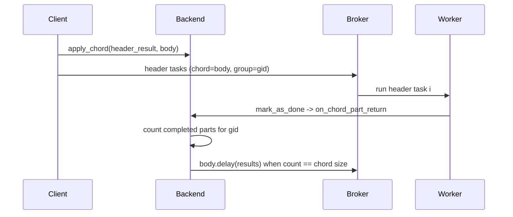

## Overview

A `group` sends several signatures at once so they run in parallel and returns a `GroupResult` that tracks them together. A `chord` is a group (the *header*) plus a signature (the *body*) that runs once every header task has finished, receiving the list of their results. Groups are handled entirely by the client; chords also need the result backend, because some process has to notice when the last header task completes. This page follows both, the backend counting that completes a chord, and the map and chunk helpers built on them. Signatures and chains are described in [[Signatures and Chains]]; `GroupResult` in [[Task Results and States]].

Sources: [celery/canvas.py:1492-1521](repo://celery/canvas.py#L1492-L1521), [celery/canvas.py:1971-1997](repo://celery/canvas.py#L1971-L1997)

## Groups

### Building a group

`group(*tasks, **options)` accepts signatures as arguments or a single iterable (including a generator, wrapped in a lazy `regen`), a single signature, or another group whose tasks it reuses. The tasks are stored in `kwargs['tasks']` of a `celery.group` signature. `group | task` builds a chord with the task as body; `group | empty group` returns the group unchanged.

Sources: [celery/canvas.py:1580-1607](repo://celery/canvas.py#L1580-L1607)

```pycon
>>> lazy_group = group([add.s(2, 2), add.s(4, 4)])
>>> promise = lazy_group()
>>> promise.get()
[4, 8]
```

Sources: [celery/canvas.py:1501-1506](repo://celery/canvas.py#L1501-L1506)

### Applying a group

`group.apply_async(args, kwargs, add_to_parent=True, producer=None, **options)` refuses `link` (the error says to use a chord) and `link_error` (to be set on individual tasks). Under `task_always_eager` it runs `apply`, and an empty group returns its frozen, empty `GroupResult`.

Sources: [celery/canvas.py:1616-1630](repo://celery/canvas.py#L1616-L1630)

For a real send, `_freeze_gid` takes the group's `task_id` option (or a new UUID) as the `group_id`, so the tasks do not all share one id. `_prepared` clones each task, recursively unrolls nested groups, prepends partial arguments to mutable tasks, and freezes each one with the `group_id`, `root_id` and its position as `group_index`. `_apply_tasks` then publishes every task with one producer and attaches each result to a `barrier` that becomes ready when all of them are.

Sources: [celery/canvas.py:1631-1650](repo://celery/canvas.py#L1631-L1650), [celery/canvas.py:1714-1761](repo://celery/canvas.py#L1714-L1761), [celery/canvas.py:1827-1837](repo://celery/canvas.py#L1827-L1837)

`_apply_tasks` iterates with one task of lookahead so it knows when it reaches the last one without exhausting a generator first (the comment cites #3021). Along the way it adds up the chord size of each task with `_chord._descend`; when the group is a chord header and the last task is reached, it records that size with `backend.set_chord_size(group_id, size)` before the last message is sent.

Sources: [celery/canvas.py:1763-1825](repo://celery/canvas.py#L1763-L1825)

The result is `app.GroupResult(group_id, results)`. A group holding a single chain that ends in a group returns that inner `GroupResult` instead, and when called inside a worker task the result is added to the task's trail.

Sources: [celery/canvas.py:1636-1650](repo://celery/canvas.py#L1636-L1650)

### Callbacks on a group

`group.link(sig)` links an immutable clone of the callback to the *first* task only; the comment warns this can fire before the other members finish or even if they fail, which is why a chord is the right tool. `link_error(sig)` adds a clone of the errback to every member, accepting that it may run more than once rather than not at all.

Sources: [celery/canvas.py:1691-1712](repo://celery/canvas.py#L1691-L1712)

## Chords

### Building a chord

`chord(header, body=None, **options)` stores the header (turned into a group) and the body in `kwargs['header']` and `kwargs['body']` of a `celery.chord` signature. Calling `chord(header)(body)` supplies the body late. `chord | task` and `chord | single-task group` pipe the new step into the body; anything else becomes a chain. A chain ending in a group followed by a task is also upgraded to a chord ([[Signatures and Chains]]).

Sources: [celery/canvas.py:2059-2092](repo://celery/canvas.py#L2059-L2092)

```pycon
>>> res = chord([add.s(2, 2), add.s(4, 4)])(sum_task.s())
>>> res.get()
12
```

Sources: [celery/canvas.py:1977-1990](repo://celery/canvas.py#L1977-L1990)

`link(callback)` links to the body only. `link_error(errback)` always links to the body and to nested chords in the header; it links to every header task only when `task_allow_error_cb_on_chord_header` is on, and otherwise emits a pending-deprecation warning saying the header behaviour will change.

Sources: [celery/canvas.py:2298-2341](repo://celery/canvas.py#L2298-L2341)

### Running a chord

`apply_async` merges partial arguments, clones the body with the call options and clones the header group. Under `task_always_eager`, `apply` runs the header eagerly and passes the list of its results to `body.apply`. Otherwise it calls `run`.

Sources: [celery/canvas.py:2153-2189](repo://celery/canvas.py#L2153-L2189)

`run(header, body, partial_args, ...)`:

Sources: [celery/canvas.py:2226-2286](repo://celery/canvas.py#L2226-L2286)

1. Takes the header's `task_id` (or a new one) as the `group_id` and freezes the body with its own id and that `group_id`.
2. Drops `chain`, `chord` and `task_id` from the options handed to the header: the comment cites #3771 for chains, and nested chords need the same.
3. Freezes the header tasks with `chord=body`, so every header message carries the body signature in its `chord` field.
4. With a non-empty header, calls `backend.apply_chord(header_result_args, body, ...)` and then sends the header with `group_id` as its id. With an empty header, which would never trigger the body, it sends `body.delay([])` directly.
5. Sets the body result's `parent` to the header's `GroupResult` and returns the body result.

Sources: [celery/canvas.py:2248-2286](repo://celery/canvas.py#L2248-L2286)



Sources: [celery/canvas.py:2248-2286](repo://celery/canvas.py#L2248-L2286), [celery/backends/base.py:180-186](repo://celery/backends/base.py#L180-L186), [celery/backends/base.py:1188-1256](repo://celery/backends/base.py#L1188-L1256)

### Chord size

`_descend` counts how many completions a header member contributes: each simple signature counts 1, a group counts the sum of its members, a chain counts its last non-empty step, and a nested chord counts its body. `len()`-style `__length_hint__` on a chord sums this over the header.

Sources: [celery/canvas.py:2191-2224](repo://celery/canvas.py#L2191-L2224)

`freeze` on a chord freezes the header with `chord=body`, takes the header's id as the chord's id, freezes the body, and walks the body's result parents to attach the header result at the first result without a parent, raising `RuntimeError` on a cycle.

Sources: [celery/canvas.py:2094-2125](repo://celery/canvas.py#L2094-L2125)

## How backends complete a chord

### Counting completions

Every task whose request has a `chord` field calls `backend.on_chord_part_return` from `mark_as_done` or `mark_as_failure`. What happens next depends on the backend.

Sources: [celery/backends/base.py:180-199](repo://celery/backends/base.py#L180-L199)

| Strategy | Backends | How the body is triggered |
| --- | --- | --- |
| Polling with `celery.chord_unlock` | Any backend without its own chord support (the default `Backend.apply_chord`) | A built-in task retries until the header is ready, then joins it and sends the body |
| Atomic counter | Key/value backends with `implements_incr = True` (cache, DynamoDB, GCS) | `incr` on a `chord-unlock-<gid>` key; the part that reaches the chord size joins the results and sends the body |
| Redis sorted set | Redis | Each part adds its encoded result to a `.j` key; the part that brings the count to the size stored in `.s` sends the body |
| Not allowed | `DisabledBackend` | `ensure_chords_allowed` raises `NotImplementedError` |

Sources: [celery/backends/base.py:838-866](repo://celery/backends/base.py#L838-L866), [celery/backends/base.py:964-978](repo://celery/backends/base.py#L964-L978), [celery/backends/cache.py:95-96](repo://celery/backends/cache.py#L95-L96), [celery/backends/dynamodb.py:66-66](repo://celery/backends/dynamodb.py#L66-L66), [celery/backends/gcs.py:167-168](repo://celery/backends/gcs.py#L167-L168), [celery/backends/redis.py:570-584](repo://celery/backends/redis.py#L570-L584), [celery/backends/base.py:1263-1272](repo://celery/backends/base.py#L1263-L1272)

### Polling with chord_unlock

`fallback_chord_unlock` sends `celery.chord_unlock` with the header result id, the body and the header results as tuples, routed to the body's queue (or its default route) with the body's priority. The task rebuilds the `GroupResult`, retries itself every `result_chord_retry_interval` while the header is not ready (it has `max_retries=None`), then joins with `result_chord_join_timeout` and sends `callback.delay(results)`.

Sources: [celery/backends/base.py:838-859](repo://celery/backends/base.py#L838-L859), [celery/app/builtins.py:36-97](repo://celery/app/builtins.py#L36-L97)

### Counter-based completion

For backends with `implements_incr`, `apply_chord` is replaced by `_apply_chord_incr`, which saves the header `GroupResult`. `on_chord_part_return` restores it, increments the chord key, and compares with the size from the request (`chord_size`) or the number of results. On the final part it joins the results, sends the body, and deletes the group and the counter; earlier parts only refresh the counter's expiry.

Sources: [celery/backends/base.py:1183-1256](repo://celery/backends/base.py#L1183-L1256)

The Redis backend keeps the results themselves: each part pipelines a `ZADD` of `[1, task_id, state, result]` scored by `group_index` (or an `RPUSH` when `result_chord_ordered` is off) and reads back the count and the size stored by `set_chord_size`. The last part reads all stored results in order and sends the body, then deletes the keys. Only when the header holds nested group results does `apply_chord` save the `GroupResult`, so it can be joined to keep their structure.

Sources: [celery/backends/redis.py:570-686](repo://celery/backends/redis.py#L570-L686)

## Chord errors

When a header task fails, joining raises; the backend finds the culprit with `_failed_join_report`, wraps the reason in a `ChordError` (keeping the original exception as its cause) and calls `chord_error_from_stack(body, exc)`. That calls the body's errbacks with a fake request built from the body signature and marks the body as failed, so `res.get()` on the chord raises. A body that cannot be sent is handled the same way with `Callback error: ...`.

Sources: [celery/backends/base.py:1225-1251](repo://celery/backends/base.py#L1225-L1251), [celery/backends/base.py:325-358](repo://celery/backends/base.py#L325-L358), [celery/backends/base.py:68-93](repo://celery/backends/base.py#L68-L93)

A header member can be a chain whose first task fails, in which case the chain's later steps never run. `mark_as_failure` therefore walks the failed task's remaining `chain`, stores the failure for each step that has an id, calls `on_chord_part_return` for steps that belong to a chord, and descends into a chained chord step's body, because the body is the result an outer chord waits on (Issue #9674). Without that descent the outer chord's body stayed `PENDING` and `chord_unlock` retried forever.

Sources: [celery/backends/base.py:200-247](repo://celery/backends/base.py#L200-L247)

## Adding to a running chord

`Task.add_to_chord(sig)` gives `sig` the current task's group, group index, chord and root id and calls `backend.add_to_chord`; the base backend raises `NotImplementedError`, and the task docstring states only Redis supports it. `Task.replace` with a group turns it into a chord with `celery.accumulate` as body so the replaced task can still pass on a result ([[Defining Tasks]]).

Sources: [celery/app/task.py:1097-1119](repo://celery/app/task.py#L1097-L1119), [celery/backends/base.py:829-830](repo://celery/backends/base.py#L829-L830), [celery/app/task.py:1048-1052](repo://celery/app/task.py#L1048-L1052)

## Map, starmap and chunks

`xmap(task, it)` and `xstarmap(task, it)` are immutable signatures for the built-in `celery.map` and `celery.starmap` tasks, which call the task body for each item (or each unpacked item) *sequentially in one worker*, not in parallel. They are routed by the inner task's name. `task.map(it)` and `task.starmap(it)` create them.

Sources: [celery/canvas.py:1385-1434](repo://celery/canvas.py#L1385-L1434), [celery/app/builtins.py:101-119](repo://celery/app/builtins.py#L101-L119)

`chunks(task, it, n)` splits the iterable into parts of `n` items and, when applied, sends a group of `xstarmap` signatures, one per part, so the parts run in parallel and the items inside a part run in sequence. `task.chunks(it, n)` creates it, and `chunks.group()` returns the group without sending it.

Sources: [celery/canvas.py:1436-1473](repo://celery/canvas.py#L1436-L1473), [celery/app/task.py:988-1001](repo://celery/app/task.py#L988-L1001)
